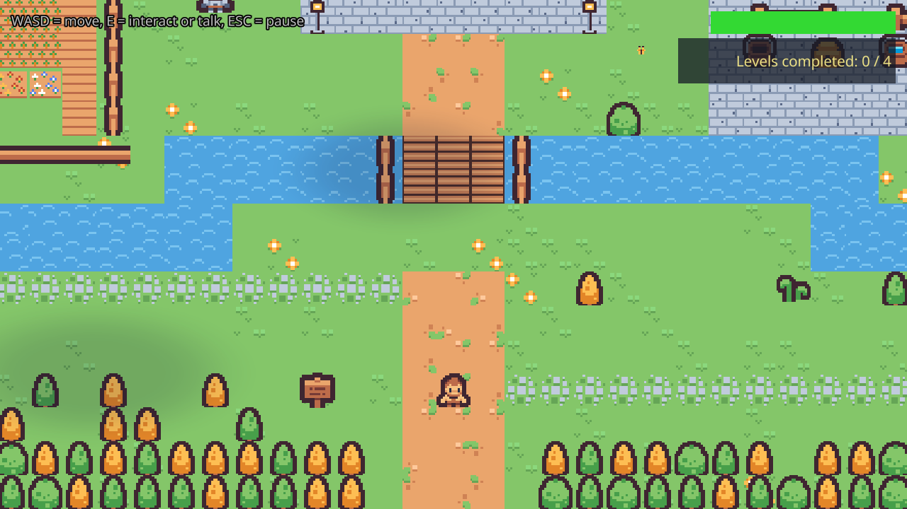
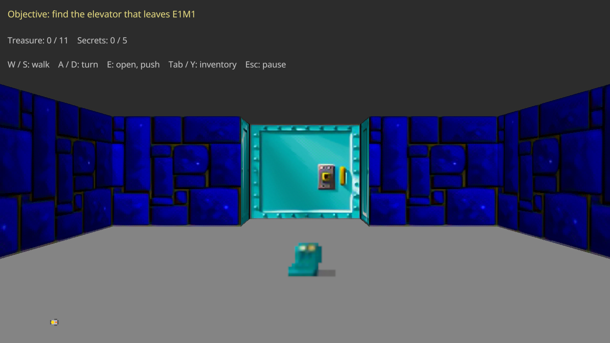
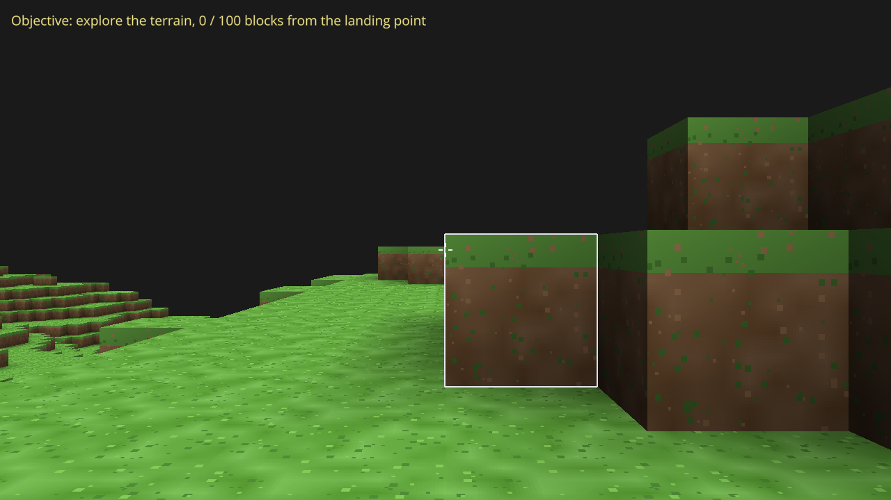
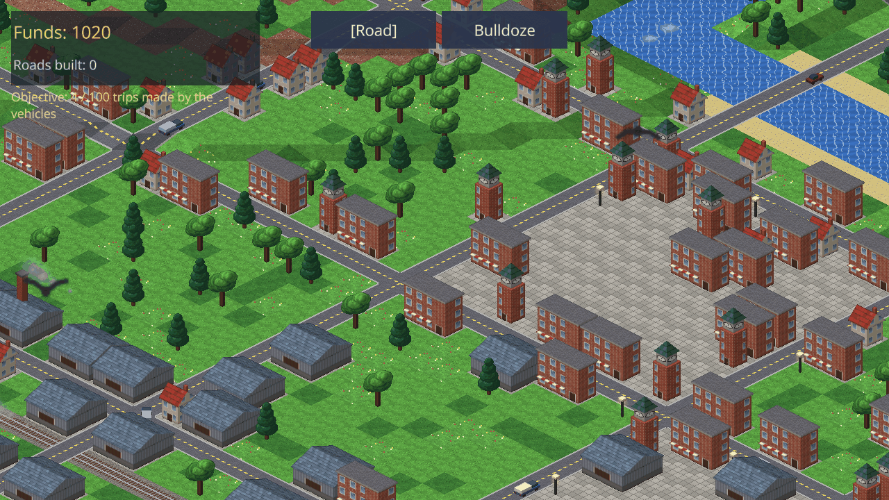
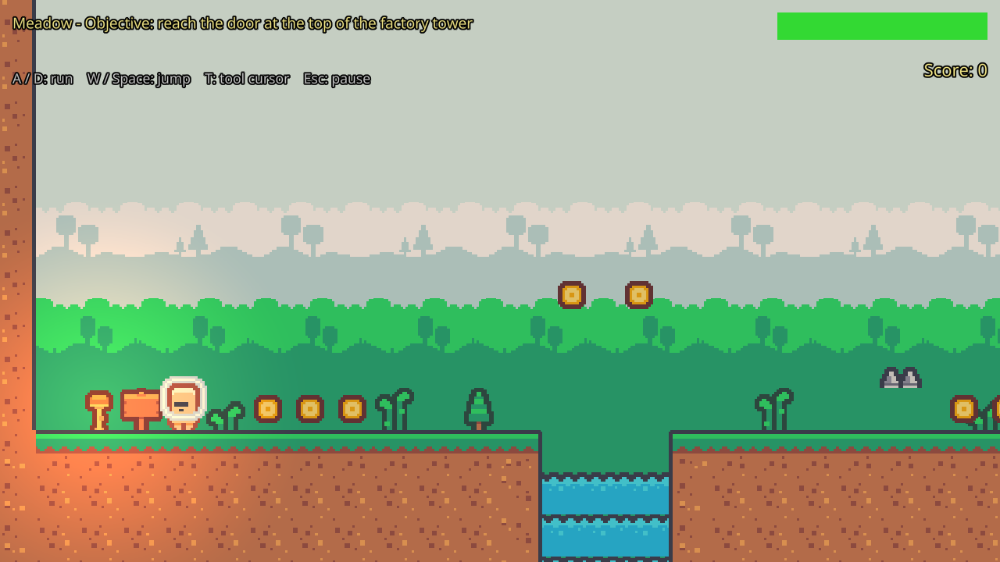
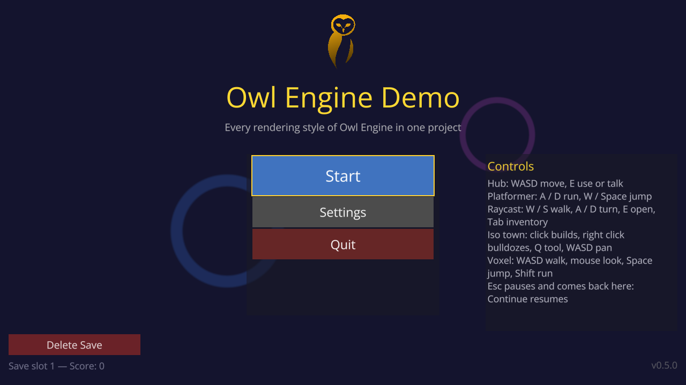

# Owl Engine


[](https://owl.argawaen.net)


**Owl Engine is the C++ engine that mixes rendering styles in one game: 2D, raycast, voxel, isometric and 3D,
stacked under one HUD, in the editor and in game.**

|             |      |
|-------------------------------------------------------|-------------------------------------------------------|
|        |    |
|   |        |

*Scenes of the Engine Demo (`engine_demo/`), rendered headless by the game runner on Vulkan.*

Documentation and downloads: [owl.argawaen.net](https://owl.argawaen.net). The name is a nod to the maintainer's
surname, Lachouette.

## Why Owl Engine

- **Render-style mixing**: 2D batches, tilemaps, a raycaster, voxel terrain, isometric maps and 3D meshes are
  renderer-stack layers that compose with each other and the HUD, in the editor viewport and in Play.
- **Owl Nest editor**: scenes, tilemaps, node graphs, animations, HUDs and prefabs with undo/redo and hot reload,
  plus an [MCP server](doc/pages/mcp.md) an AI agent can drive through the same editor commands as the user.
- **Engineering rigour**: unit and scenario tests, CI on Linux x64/arm64 and Windows, sanitizers, Vulkan validation
  clean and performance budgets checked against a baseline.

## How it is built

Owl Engine is developed by one maintainer with Claude Code as a development tool. Every change is reviewed and owned
by the maintainer, and goes through a strict CI: unit and scenario tests on Linux x64/arm64 and Windows, sanitizers,
clang-tidy, include checks and performance budgets.

## Engine Demo and samples

The **Engine Demo** (`engine_demo/`, see its `README.md`) is the all-in-one showcase: an RPG hub
leading to a platformer, a raycast level, an isometric town and a voxel terrain. Small real games live as sample
games (`samples/`, from v0.4.0).

## Features

-  
  **Rendering** with Slang shaders compiled to SPIR-V, precompiled at build time
-  **Entity-Component-System** with parent-child hierarchy,
  prefabs and Lua 5.5 scripting
-  2D physics,
   spatial sound
-  3D model loading, asset packs and a
  game runner

## Documentation

The full generated documentation is on [owl.argawaen.net](https://owl.argawaen.net); the pages also read on GitHub
([doc/pages](doc/pages)):

- [Getting Started](doc/pages/getting_started.md) -- First run of Owl Nest and where to go next
- [Architecture](doc/pages/architecture.md) -- Engine modules, backends, and shader pipeline
- [Editor](doc/pages/editor.md) -- Owl Nest editor: panels, prefabs, icons, undo/redo
- [MCP server](doc/pages/mcp.md) -- Drive Owl Nest from an AI agent
- [Scene System](doc/pages/scene.md) -- Hierarchy, components, serialization, triggers
- [Renderer](doc/pages/renderer.md) -- Renderer stack, shaders, textures, backgrounds
- [Physics](doc/pages/physics.md) -- Box2D integration, collisions, triggers
- [Sound System](doc/pages/sound.md) -- Components, spatial audio, and gameplay triggers
- [Events & Input](doc/pages/event_input.md) -- Event system, keyboard, mouse and gamepad
- [Lua Scripting](doc/pages/scripting.md) -- API, lifecycle, sandboxing
- [Lua API reference](doc/pages/lua-api.md) -- Every Lua binding, generated from the binding registry
- [Building](doc/pages/building.md) -- Prerequisites, presets, testing, and CMake options
- [Roadmap](doc/pages/roadmap.md) -- Planned and completed features by version (one-glance summary: `ROADMAP.md`)
- [Changelog](doc/pages/changelog.md) -- Detailed version history (one line per release: `CHANGELOG.md`)
- [Contributing](doc/pages/contributing.md) -- How to contribute (code style, checks, PRs, issues)
- [Sample games](samples/README.md) -- Small complete games made with Owl, beside the Engine Demo (Breakout)

## Supported Platforms


| OS      | Architecture | Compilers                      |
|---------|--------------|--------------------------------|
| Linux   | x64, arm64   | Clang 22+, GCC 14+             |
| Windows | x64          | MinGW Clang 22+, MinGW GCC 15+ |

## Backends


| Category | Backends                      |
|----------|-------------------------------|
| Graphics | OpenGL 4.5, Vulkan 1.4+, Null |
| Input    | GLFW, Null                    |
| Sound    | OpenAL, Null                  |

## Quick Start

Every command runs inside the build image through `./docker_run.sh` (drop the prefix to build with a local
toolchain, see [Building](doc/pages/building.md#prerequisites)). The first configure installs the Python tools and
builds the Conan dependencies; no server needs to be set up.

```bash
# Configure and build
./docker_run.sh cmake --preset linux-clang-release -S .
./docker_run.sh cmake --build output/build/linux-clang-release

# Run tests
./docker_run.sh ctest --test-dir output/build/linux-clang-release --output-on-failure

# Run the editor
./docker_run.sh --gui output/build/linux-clang-release/bin/OwlNest
```

See [Building](doc/pages/building.md) for the full build guide and all available presets.

## Dependencies

Dependencies come from [Conan 2](https://conan.io) and [ConanCenter](https://conan.io/center), declared in
[conanfile.py](conanfile.py) and pinned by `conan.lock`; the few recipes missing from ConanCenter live in
`conan/recipes/`. They are fetched (or built) during CMake configure, from public infrastructure only.
