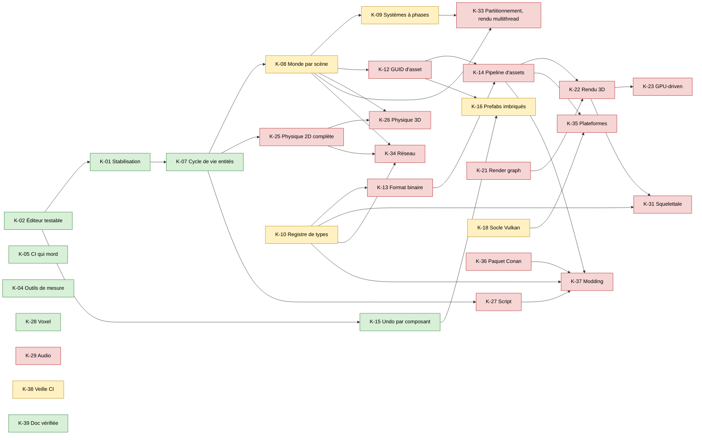

# Audit Owl — avenir du moteur (axe K)

> **Revu le 2026-10-20 sur `main` 4e1a6a10.** Livrable du §5 de [`00-cadrage.md`](00-cadrage.md). Aucun constat
> nouveau : assemblage des « Pistes pour l'avenir » des `10-constats-*.md`, du §7 de [`20-mesures.md`](20-mesures.md),
> des verdicts de [`30-etat-de-l-art.md`](30-etat-de-l-art.md) et des pistes du cadrage, avec renvoi aux constats
> vérifiés. Le plan de versions fait foi dans `doc/pages/roadmap.md` ; seuls les chantiers ouverts sont gardés.
>
> **Effort**, mainteneur seul : **S** quelques jours, **M** quelques semaines, **L** quelques mois, **XL** un trimestre
> ou plus. **[O]** : opinion de l'auditeur. Une fiche sans ligne « Effort » ou « Risques » reprend le tableau du §2
> (risques faibles ou nuls).

[TOC]

## 1. Lecture d'ensemble

Trois verrous conditionnent les grands chantiers restants :

1. **Les filets de sécurité sont à tenir** : tests d'image sur lavapipe / llvmpipe, `OwlNestCore`, frame bench et
   `test/bench/` protègent rendu et éditeur à condition d'être étendus avec chaque fonctionnalité.
2. **Le socle Vulkan est la référence** (`FrameRing`, 0 vidage de file par frame au frame bench) : rendu 3D, rendu
   piloté par GPU et nouvelle plateforme se bâtissent dessus.
3. **L'architecture héritée de Hazel pèse** : `Scene` porte du gameplay, physique et script sont liés à « la » scène
   active, le jeu de composants est fermé à la compilation. Réseau, modding, ECS parallèle et éditeur générique y butent.

Bonnes fondations : frontière publique/privée, pile de rendu pilotée par les données, Renderer2D instancié, contrat
du `Scheduler`, modèle de commandes de l'éditeur, choix tiers (EnTT, Box2D v3, Slang, Lua 5.5 : fiches 1, 3, 4 et 6
de `30-etat-de-l-art.md`).

## 2. Carte des chantiers

| ID   | Chantier                                                       | Effort | Horizon        | Prérequis                 | Constats principaux                |
|------|----------------------------------------------------------------|--------|----------------|---------------------------|------------------------------------|
| K-01 | Stabilisation : défauts de correction reproduits               | M      | court          | K-02 (en partie)          | E-12                               |
| K-02 | Éditeur testable (`OwlNestCore` + `owlnest_tests`)             | S      | court          | aucun                     | F-02                               |
| K-04 | Outillage de mesure : outils absents de l'image                | S      | court          | aucun                     | D-11, D-12                         |
| K-05 | CI qui mord et coûte moins                                     | S      | court          | aucun                     | F-04, H-05, H-06                   |
| K-07 | Cycle de vie des entités (hooks EnTT, création différée)      | M      | court-moyen    | K-01                      | C-09                               |
| K-08 | Contexte moteur et monde par scène                             | M-L    | moyen          | K-07                      | A-07, A-08, D-15                   |
| K-09 | `Scene` = données + systèmes à phases, gameplay hors moteur    | L      | moyen          | K-07, K-08                | A-02, C-14, A-15, A-16             |
| K-10 | Registre de types ouvert                                       | M-L    | moyen          | aucun                     | A-05                               |
| K-12 | GUID d'asset (les entités sont déjà référencées par UUID)      | M      | v0.6.0         | K-08                      | A-07                               |
| K-13 | Format binaire cuit                                            | M-L    | v0.6.0         | K-10                      | P-07                               |
| K-14 | Pipeline d'assets : cook, GUID, `readEntry` parallèle          | L      | v0.6.0         | K-12, K-13                | D-10                               |
| K-15 | Undo par composant, sélection multiple, opérations de groupe   | M      | court-moyen    | K-02                      | E-05, E-06, E-09                   |
| K-16 | Prefabs imbriqués et variants                                  | L      | moyen          | K-12, K-15                | C-11                               |
| K-18 | Socle Vulkan : reliquat après `FrameRing`                      | M      | moyen          | aucun                     | B-04                               |
| K-21 | Render graph                                                   | L      | v0.5.0         | aucun                     | B-22, A-15                         |
| K-22 | Rendu 3D moderne (static meshes, PBR, ombres, post-process)    | XL     | v0.5.0         | K-21, K-14                | B-07                               |
| K-23 | Rendu piloté par GPU (indirect, culling GPU, raycast GPU)      | L      | v0.5.0         | K-22                      | B-20, B-14                         |
| K-25 | Physique 2D complète (requêtes, joints, callbacks, capteurs)   | M      | v0.7.0         | K-07                      | D-14, D-07                         |
| K-26 | Physique 3D (Jolt)                                             | M      | v0.7.0         | K-08, K-25                | D-19, D-14                         |
| K-27 | Script : débogueur, visual scripting, option Luau              | M      | v0.6.0         | K-07                      | D-16, D-26, P-11, D-22             |
| K-28 | Voxel à l'échelle (raccourci chunk uniforme, mémoire, LOD)     | M      | court-moyen    | aucun                     | P-09, P-10, D-27                   |
| K-29 | Audio (mixer, effets, dialogue ; miniaudio en option)          | M      | v0.7.0         | aucun                     | D-13, D-07                         |
| K-31 | Animation squelettale                                          | L      | v0.6.0         | K-10, K-22                | aucun constat direct               |
| K-33 | Partitionnement spatial et préparation du rendu multithread    | XL     | v0.5.0         | K-08, K-09                | A-08, D-24, B-07                   |
| K-34 | Réseau et rollback                                             | XL     | v0.8.0         | K-08, K-10, K-25          | A-05                               |
| K-35 | Plateformes : export WebGPU (v0.8.0), Web 3e plateforme (v1.0.0) | XL   | v0.8.0-v1.0.0  | K-14, K-18                | B-16, B-01                         |
| K-36 | Paquet Conan `OwlEngine` consommable                           | M      | v1.0.0         | aucun                     | A-12                               |
| K-37 | Modding (mods, API Lua de mod, gestionnaire)                   | L      | v0.8.0         | K-10, K-14, K-27, K-36    | A-05                               |
| K-38 | Veille de dépendances et visibilité publique de la CI          | S-M    | moyen          | aucun                     | H-09                               |
| K-39 | Documentation vérifiée par la CI                               | S-M    | court          | aucun                     | I-01, I-02, I-06                   |

## 3. Fiches des chantiers

### Fondations et filets

#### K-01 — Stabilisation : défauts de correction reproduits

- **Intérêt** : tenir à zéro les comportements indéfinis et les pertes de données sur les chemins courants de
  l'éditeur et du Play ; les défauts de correction reproduits par l'audit sont traités et leurs sondes sont des tests
  de non-régression.
- **Difficulté** : faible.
- **Briques préalables** : la catégorie `owlnest_tests` (K-02).
- **Risques** : une restauration « en place » de `EntitySnapshot` change son contrat ; la faire sous tests.
- **Effort** : S au fil des PR.
- **Constats** : E-12.

#### K-02 — Éditeur testable

- **Intérêt** : rendre exécutable par la CI la pièce la plus délicate de l'éditeur (undo, fusion, dirty, snapshots).
- **Statut** : `OwlNestCore` existe ; il reste à étendre la couverture des commandes, de l'undo et des panneaux, au
  rythme de la règle « pas de nouvelle API publique sans test ».
- **Risques** : aucun ; au mieux, des tests révèlent d'autres défauts.
- **Constats** : F-02.

#### K-04 — Outillage de mesure : outils absents de l'image

- **Intérêt** : le profileur (Tracy en backend), le frame bench et le harnais `test/bench/` existent ; manquent à
  l'image `perf`, `heaptrack`, `renderdoccmd` et `hyperfine` (`00-cadrage.md` §11.3), donc aucun profil CPU ni mémoire
  ni capture GPU en ligne de commande.
- **Difficulté** : faible ; ajout à l'image de build.
- **Constats** : D-11, D-12.

#### K-05 — CI qui mord et coûte moins

- **Intérêt** : des gates qui échouent vraiment, moins de minutes perdues. aucun check n'est requis pour
  fusionner (H-06, plausible), LSan double ASan et arm64 émulé tourne sur chaque PR (H-05).
- **Difficulté** : faible.
- **Briques préalables** : aucune ; la durée des builds TeamCity n'est pas exportée (H-05) et devrait l'être pour
  élaguer sur chiffres.
- **Risques** : un gate durci révèle des défauts latents (c'est le but).
- **Constats** : F-04, F-07, F-12, H-04, H-05, H-06.

### Cœur du moteur

#### K-07 — Cycle de vie des entités

- **Intérêt** : la destruction différée existe (`Scene::destroyEntityDeferred`) et la physique branche des hooks EnTT
  `on_construct` / `on_destroy` (`PhysicCommand.cpp`) ; restent à généraliser la création différée et les hooks vers
  le son et Lua, et à préparer l'ECS parallèle.
- **Difficulté** : moyenne.
- **Briques préalables** : K-01.
- **Risques** : changement d'ordre observable par les scripts ; à documenter.
- **Constats** : C-09.

#### K-08 — Contexte moteur et monde par scène

- **Intérêt** : `app::EngineContext` existe, mais `Application::get()` reste utilisé largement dans les modules bas
  (A-07) et la physique, la VM et l'état UI restent liés à « la » scène active (D-15). Un monde par scène
  débloque plusieurs mondes simultanés (menu sur niveau, aperçu de prefab en Play), les tests parallèles, un
  serveur multi-instances et le rollback (cloner un monde).
- **Difficulté** : moyenne à élevée ; refactorisation transversale, sans changement de fonctionnalité.
- **Briques préalables** : K-07.
- **Risques** : régressions d'initialisation ; à couvrir par les tests d'image et `OwlNestCore`.
- **Constats** : A-07, A-08, D-15, C-13 (statiques de sauvegarde).

#### K-09 — `Scene` = données + systèmes à phases

- **Intérêt** : `SystemSchedule` et `scene/systems/` (`EngineSystems`, `EntityLinkSystem`, `RaycastWallSystem`,
  `VoxelPlayerSystem`) amorcent la liste de systèmes par phase ; `Scene.cpp` (2 339 lignes) reste le point de
  contention, et le gameplay (Victory/Death, portes raycast) n'est pas sorti du moteur.
- **Difficulté** : élevée.
- **Briques préalables** : K-07, K-08.
- **Risques** : régressions de comportement de la démo ; une batterie de tests de frame précède le découpage.
- **Constats** : A-02, C-14, A-15, A-16.

#### K-10 — Registre de types ouvert

- **Intérêt** : un registre runtime (EnTT `meta` ou maison) remplace les quatre listes de `components.h` et
  `IFactory` : composants de jeux tiers sérialisables, inspectables et liés à Lua, éditeur générique, sérialisation
  binaire, réplication réseau.
- **Difficulté** : moyenne à élevée ; 31 composants et l'inspecteur à migrer.
- **Briques préalables** : aucune. EnTT 4.0.0 est en place ; `meta` y est refondu (fiche 1).
- **Risques** : coût de compilation, perte de typage statique dans l'inspecteur.
- **Constats** : A-05.

#### K-12 — GUID d'asset

- **Intérêt** : les références d'entité passent par UUID ; les assets restent résolus par chemin et par nom, parfois
  via la bibliothèque de textures (A-07). Des GUID rendent possibles le renommage sans casse, le cook et le
  hot reload (v0.6.0).
- **Difficulté** : moyenne ; migration des scènes et projets existants.
- **Briques préalables** : K-08 (service d'assets hors `Application`).
- **Risques** : migration de `engine_demo/`, des samples et des projets utilisateurs.
- **Effort** : L.
- **Constats** : A-07, D-13 (scan disque répété pour un son absent).

### Données et éditeur

#### K-13 — Format binaire cuit

- **Intérêt** : formats versionnés et écriture atomique (`writeFileAtomic`) en place ; la lecture passe par rapidyaml
  (7,3 µs par entité, 20-mesures §9.7). Reste un format binaire cuit pour le runtime et le `.owlpack` (v0.6.0), qui
  gagnerait le parsing (~×4) au prix d'un second format à versionner.
- **Difficulté** : moyenne à élevée.
- **Briques préalables** : K-10 pour un format binaire générique.
- **Risques** : double maintenance texte et binaire.
- **Constats** : P-07.

#### K-14 — Pipeline d'assets

- **Intérêt** : les shaders du moteur sont précompilés au build (`OwlShaderBake`) ; restent le cook incrémental, les
  GUID, le format binaire, `PackReader::readEntry` parallèle (D-10) et l'atlas de police précalculé. Préalable du Web (K-35) et du modding (K-37).
- **Difficulté** : élevée ; touche tous les chargeurs.
- **Briques préalables** : K-12 (GUID), K-13 (format cuit).
- **Risques** : chantier long ; la validation de taille et de chemin du pack ne doit pas attendre.
- **Constats** : D-10, D-09.

#### K-15 — Undo par composant et opérations de groupe

- **Intérêt** : restaurer en place au lieu de détruire et recréer (E-05), snapshot du seul composant modifié,
  sélection multiple, copier-coller,
  commandes groupées (E-06). C'est aussi ce qu'exige la règle « Editor Coverage » du projet.
- **Difficulté** : moyenne ; le modèle de commandes est sain (E-09).
- **Briques préalables** : K-02.
- **Risques** : faibles sous tests.
- **Constats** : E-05, E-06, E-09, E-10.

#### K-16 — Prefabs imbriqués et variants

- **Intérêt** : `PrefabLink` et les surcharges existent ; ni l'imbrication ni les variants. Cible : surcharges par
  propriété détectées par le diff de l'inspecteur, document d'édition isolé.
- **Difficulté** : élevée.
- **Briques préalables** : K-12 (référence par GUID), K-15 (diff par composant).
- **Risques** : format de fichier à migrer.
- **Constats** : C-11.

### Rendu

#### K-18 — Socle Vulkan : reliquat

- **Intérêt** : `FrameRing` et les frames en vol sont en place (0 vidage par frame, 20-mesures §9.10). Reste à
  traiter B-04 (SSBO non versionné), qui touche plusieurs draws par frame.
- **Difficulté** : élevée.
- **Briques préalables** : tests d'image sur lavapipe / llvmpipe, validation layers sans message.
- **Risques** : régressions visuelles hors NVIDIA, dont les pilotes tolèrent les courses d'écriture.
- **Constats** : B-04, B-19, B-21, B-25.

#### K-21 — Render graph

- **Intérêt** (v0.5.0) : passes déclarant lectures et écritures, `loadOp`, barrières et ressources transitoires déduits ;
  base du post-process et des ombres. `RenderStack` (B-22) en est le bon front-end.
- **Difficulté** : élevée.
- **Briques préalables** : plusieurs formats de cible (une seule disposition d'attachements aujourd'hui).
- **Risques** : sur-ingénierie pour un moteur 2D [O] ; à lancer avec K-22 (même version).
- **Constats** : B-22, A-15.

#### K-22 — Rendu 3D moderne

- **Intérêt** : v0.5.0 : pipeline 3D, lumières, ombres, matériaux PBR, static mesh, post-process essentiel, édition 3D
  dans Owl Nest.
- **Difficulté** : très élevée.
- **Briques préalables** : matrice modèle par draw, mipmaps et samplers explicites, cibles HDR, profondeur
  échantillonnable, culling activé (B-07), render graph (K-21), pipeline d'assets pour les matériaux (K-14).
- **Risques** : le plus gros chantier de la roadmap ; un socle de rendu fragile se paie ici.
- **Constats** : B-07.

#### K-23 — Rendu piloté par GPU

- **Intérêt** (v0.5.0 : culling compute avec draws indirects, raycast GPU, adoption de `BitonicSortPass`) : voxel et
  scènes denses en quelques draws ; les briques existent mais sans appelant ni test (B-20).
- **Difficulté** : élevée.
- **Briques préalables** : tests d'image sur les passes concernées, bindless (`runtimeDescriptorArray`,
  `descriptorBindingPartiallyBound` non activés).
- **Risques** : code mort qui vieillit en attendant ; [O] le retirer si aucun test ne le couvre.
- **Constats** : B-20, B-14.

### Sous-systèmes

#### K-25 — Physique 2D complète

- **Intérêt** : le pas fixe, l'interpolation, `on_collision` et le solveur Box2D multi-thread (`SolverTaskPool`) sont en
  place. v0.7.0 : requêtes, joints, callbacks, capteurs à la place des AABB maison, chaînes pour les tilemaps,
  déterminisme.
- **Difficulté** : moyenne ; Box2D v3 fournit tout (D-14, D-19).
- **Briques préalables** : K-07 (hooks de création et destruction des corps).
- **Risques** : le déterminisme contraint le multi-thread.
- **Constats** : D-07, D-14, D-19.

#### K-26 — Physique 3D

- **Intérêt** : v0.7.0 (Jolt) ; remplacerait aussi la collision AABB maison de `VoxelPlayer` (D-14).
- **Difficulté** : moyenne (nouveau module, synchronisation des transforms).
- **Briques préalables** : K-08 (monde par scène, sinon un second singleton physique), K-25 (même patron
  d'intégration).
- **Risques** : [O] Box3D (0.1, 2026-06-30) est séduisant mais immature ; Jolt est le choix sûr (fiche 6).
- **Constats** : D-19, D-14, D-15.

#### K-27 — Script

- **Intérêt** : le hot reload des scripts, `on_collision` et un bac à sable durci (quotas, chien de garde) sont en
  place. Restent le débogueur et le visual scripting (v0.6.0), la sûreté des exceptions entre C++ et Lua compilé en C
  (D-16) et le nettoyage de l'état mort (D-26). Option : Luau si le modding devient un objectif (fiche 4).
- **Difficulté** : faible pour la sûreté, moyenne pour l'outillage.
- **Briques préalables** : K-07 (handles d'entité en userdata, destruction différée).
- **Risques** : le modèle « un `lua_State` par entité » coûte ~9 Ko et 30 µs par instance (P-11) ; une VM partagée
  avec `_ENV` par script change l'isolation (décision).
- **Constats** : D-16, D-22, D-26, P-11.

#### K-28 — Voxel à l'échelle

- **Intérêt** : le maillage tourne sur les workers avec un budget d'upload (20-mesures §3.10). Restent le raccourci
  pour les chunks uniformes (P-09), les sommets compactés, la palette et le LOD (P-10, D-27).
- **Difficulté** : moyenne ; les algorithmes sont bons (D-20), seul l'ordonnancement pesait.
- **Briques préalables** : mesures M5-M6 du coût GPU (20-mesures §7).
- **Effort** : M, puis L pour le LOD.
- **Constats** : D-20, D-27, P-09, P-10.

#### K-29 — Audio

- **Intérêt** (v0.7.0 : mixer, effets, dialogue) : bus par catégorie (les volumes `music` et `sfx` sont annoncés mais jamais appliqués : D-07),
  préchargement, pool de sources, streaming de la musique (D-13). miniaudio remplacerait OpenAL Soft (LGPL) et
  libsndfile (fiche 10).
- **Difficulté** : moyenne ; le backend est isolé et a un pendant Null.
- **Briques préalables** : aucune.
- **Risques** : spatialisation 3D à revalider.
- **Constats** : D-07, D-13.

#### K-31 — Animation squelettale

- **Intérêt** : v0.6.0 ; aucun constat ne la concerne directement.
- **Difficulté** : élevée (skinning, clips, blend, machine à états).
- **Briques préalables** : K-22 (pipeline 3D), K-10 (composants d'animation inspectables), K-14 (import et cook des
  clips). Prévue en v0.6.0.
- **Risques** : [O] chantier sans fondations à ce jour ; le placer après le rendu 3D.
- **Constats** : aucun constat direct.

### Long terme

#### K-33 — Partitionnement spatial et préparation du rendu multithread

- **Intérêt** (v0.5.0) : systèmes parallèles sur Taskflow, préparation du rendu sur les workers. Taskflow est réduit
  à une file FIFO de lambdas (D-24) ; seul le solveur Box2D utilise un pool dédié.
- **Difficulté** : très élevée.
- **Briques préalables** : K-08 (fin des singletons), K-09 (systèmes déclarés) ; command lists (aujourd'hui état
  `thread_local` des descripteurs, B-07).
- **Risques** : courses de données ; TSan existe en CI mais sans test de stress du `Scheduler`.
- **Constats** : A-08, D-24, D-21, B-07.

#### K-34 — Réseau et rollback

- **Intérêt** : v0.8.0 (transport, réplication, RPC, lobby).
- **Difficulté** : très élevée.
- **Briques préalables** : déterminisme (K-25), plusieurs mondes et clonage de monde (K-08),
  composants marqués répliqués (K-10, A-05), destruction différée (K-07). **Manquantes.**
- **Risques** : [O] chantier tributaire de K-08, K-10 et du déterminisme.
- **Constats** : A-05, D-15.

#### K-35 — Plateformes

- **Intérêt** : export WebGPU en v0.8.0, Web comme troisième plateforme en v1.0.0 ; macOS et Android restent
  « à évaluer » après la 1.0. GLFW est conservé (pas de SDL3).
- **Difficulté** : très élevée. Le Web n'offre ni GL 4.6 ni Vulkan ; les GPU à tuiles (Android, MoltenVK) sont plus stricts sur la synchronisation.
- **Briques préalables** : K-18, K-14 (assets cuits, lecture asynchrone), build wasm.
- **Risques** : [O] trois plateformes ensemble dépassent les moyens d'un mainteneur seul ; en choisir une.
- **Constats** : B-16, B-17, fiche 2.

#### K-36 — Paquet Conan `OwlEngine` consommable

- **Intérêt** : jalon de v1.0.0 (API figée, paquet consommable par un tiers). Le test de paquet existe
  (`test/package`, `test_package_folder`) ; la frontière ABI reste à tenir (A-12).
- **Difficulté** : moyenne pour la frontière ABI.
- **Briques préalables** : aucune.
- **Risques** : [O] un semver réel exige d'abord une API publique stable.
- **Constats** : A-12.

#### K-37 — Modding

- **Intérêt** : v0.8.0 (mods, API Lua de mod, gestionnaire en jeu).
- **Difficulté** : élevée.
- **Briques préalables** : pack sûr (chemins et tailles validés), sandbox Lua réel,
  composants enregistrables depuis Lua (K-10, A-05), ABI propre si mods natifs (K-36), pipeline d'assets (K-14).
- **Risques** : sécurité ; [O] Luau est conçu pour du code non fiable (fiche 4).
- **Constats** : D-10, A-05.

#### K-38 — Veille de dépendances et visibilité publique de la CI

- **Intérêt** : Conan 2 seul fournisseur, `conan.lock` en place, action `DependencyReport` (informative) ; reste un
  workflow GitHub Actions minimal pour la visibilité des contributeurs (fiche 9).
- **Difficulté** : faible.
- **Briques préalables** : aucune.
- **Constats** : H-09, fiche 9.

#### K-39 — Documentation vérifiée

- **Intérêt** : le sous-contrôle `doc-identifiers` de `CodeStyle` vérifie déjà les identifiants cités ; restent à
  générer la référence Lua depuis `LuaBindings.cpp` et le tableau des options CMake, et à alléger l'exigence Doxygen
  sur les membres triviaux (I-06).
- **Difficulté** : faible à moyenne.
- **Briques préalables** : aucune.
- **Constats** : I-01, I-02, I-06.

## 4. Graphe de dépendances

`A --> B` : A est un prérequis de B. Couleurs : court (sans décision d'architecture), moyen (refonte des
fondations), long (v0.6.0 à v1.0.0).

**K-08** (monde par scène) et **K-10** (registre de types) portent l'essentiel du graphe : réseau, modding,
multithreading et formats cuits en aval sont bloqués tant qu'ils ne sont pas faits.

## 5. Horizons et roadmap

Le séquencement détaillé est dans [`doc/pages/roadmap.md`](../pages/roadmap.md) (jalons jusqu'à v1.0.0), avec le résumé
racine `ROADMAP.md` et le [changelog](../pages/changelog.md) pour le livré. Les chantiers sans version (K-01, K-02,
K-04, K-05, K-07 à K-10, K-15, K-16, K-18, K-28, K-38, K-39) sont des fondations à glisser dans les versions en
cours. [O] Chaque chantier long (K-22, K-33, K-34, K-35, K-37) est un projet en soi pour un mainteneur seul : en
mener un à la fois, dans l'ordre de ses prérequis.

| Version | Date                | Thème                                                                                       | Chantiers                                           |
|---------|---------------------|---------------------------------------------------------------------------------------------|-----------------------------------------------------|
| v0.3.0  | 2026-10-11 (livrée) | Fondations : correctifs, filets de sécurité, Owl RHI, architecture ouverte                  |                                                     |
| v0.4.0  | 2026-10-20 (livrée) | Mondes isométriques : `RendererIsometric`, HUD, entrées par actions et manette, serveur MCP |                                                     |
| v0.5.0  | 2027-01-31          | Cœur 3D : pipeline 3D, lumières, PBR, static mesh, render graph, post-process essentiel     | K-21, K-22, K-23, K-33                              |
| v0.6.0  | 2027-04-15          | Contenu : cook, GUID, format binaire, squelette, particules, visual scripting               | K-12, K-13, K-14, K-27, K-31                        |
| v0.7.0  | 2027-06-30          | Gameplay : physique 2D complète, Jolt, audio, IA (NavMesh, arbres de comportement)          | K-25, K-26, K-29                                    |
| v0.8.0  | 2027-09-15          | Ouverture : réseau, mods, level streaming, export WebGPU, candidat à la 1.0                 | K-34, K-35 (export WebGPU), K-37                    |
| v1.0.0  | 2027-10-31          | API figée, paquet Conan `OwlEngine` consommable, Web, deux jeux vitrine                     | K-35 (Web, 3e plateforme), K-36                     |

macOS et Android restent « To evaluate » après la 1.0. GLFW est conservé (pas de SDL3).
`tools/doc/fix_md_links.py` corrige les liens Markdown pour Doxygen.
