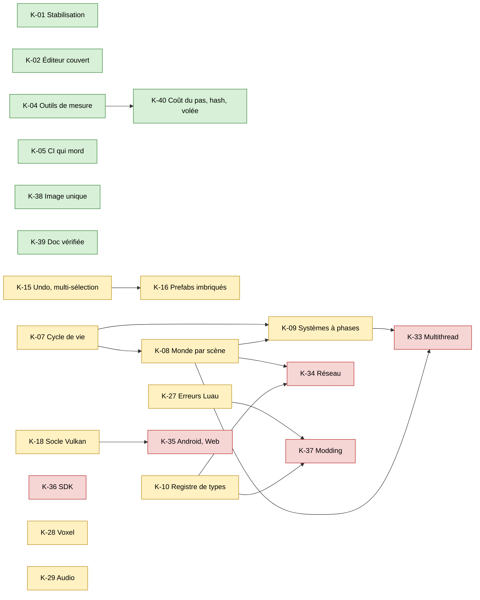

# Audit Owl — avenir du moteur (axe K)

> **Revu le 2026-11-12 sur `Feature/sample-games-new` b4281d72.** Livrable du §5 de [`00-cadrage.md`](00-cadrage.md).
> Aucun constat nouveau : assemblage des constats vérifiés des `10-constats-*.md`, de [`20-mesures.md`](20-mesures.md)
> et des verdicts de [`30-etat-de-l-art.md`](30-etat-de-l-art.md). Le plan de versions fait foi dans
> `doc/pages/roadmap.md` ; seuls les chantiers ouverts sont gardés (les livrés sont au changelog).
>
> **Effort**, mainteneur seul : **S** quelques jours, **M** quelques semaines, **L** quelques mois, **XL** un trimestre
> ou plus. **[O]** : opinion de l'auditeur.

[TOC]

## 1. Lecture d'ensemble

Les versions 0.5 à 0.7 ont livré le rendu 3D et son frame graph, le GPU-driven, les GUID et le cook, le squelette, le
visual scripting sur Luau, l'audio à bus, Jolt en 2D et en 3D, la simulation déterministe et le replay, l'IA. Restent
trois verrous :

1. **`Scene` absorbe tout** : 4 723 + 3 127 lignes, gameplay, ordonnancement et remplissage du frame graph (A-02, A-16,
   B-26) ; le jeu de composants est fermé à la compilation (A-05). Réseau (v0.9.0), modding (v0.8.0) et SDK y butent.
2. **Les filets ne couvrent pas tout** : l'éditeur est hors couverture (F-02), la nocturne est souvent rouge sans
   propriétaire (H-13).
3. **Deux coûts nouveaux, mesurés et acceptés** : un état Luau pèse 126 Kio par entité scriptée (P-11) et le pas
   physique 2D sur Jolt coûte 3 à 6 fois celui de Box2D (P-12) ; les deux choix sont gardés, le second est à régler.

Bonnes fondations : frontière publique/privée (A-06), frame graph et tests d'image sur lavapipe / llvmpipe (B-22,
B-28), `CommandRegistry` (E-13), simulation bit-exacte (D-30), choix tiers à jour (fiches 1, 3, 4, 6, 8).

## 2. Carte des chantiers

| ID   | Chantier                                                | Effort | Horizon      | Prérequis  | Constats principaux          |
|------|---------------------------------------------------------|--------|--------------|------------|------------------------------|
| K-01 | Stabilisation : défauts de correction reproduits        | S      | court        | aucun      | C-12, E-12                   |
| K-02 | Éditeur mesuré par la couverture                        | S      | court        | aucun      | F-02                         |
| K-04 | Outillage de mesure : outils absents de l'image         | S      | court        | aucun      | D-11, D-12                   |
| K-05 | CI qui mord et coûte moins                              | S-M    | court        | aucun      | H-05, H-06, H-13, F-04       |
| K-07 | Cycle de vie des entités                                | M      | court-moyen  | aucun      | C-09                         |
| K-08 | Contexte moteur et monde par scène                      | M-L    | avant v0.9.0 | K-07       | A-07, A-08, D-15, D-31       |
| K-09 | `Scene` = données + systèmes à phases                   | L      | avant v0.9.0 | K-07, K-08 | A-02, A-15, A-16, B-26, C-14 |
| K-10 | Registre de types ouvert                                | M-L    | avant v0.8.0 | aucun      | A-05                         |
| K-15 | Undo par composant, sélection multiple, écriture rapide | M      | court-moyen  | aucun      | E-05, E-06, E-14, P-07       |
| K-16 | Prefabs imbriqués et variants                           | L      | moyen        | K-15       | C-11                         |
| K-18 | Socle Vulkan : reliquat                                 | M      | avant v0.8.0 | aucun      | B-01, B-25                   |
| K-27 | Script : mémoire par état                               | M      | avant v0.8.0 | aucun      | P-11, D-22                   |
| K-28 | Voxel à l'échelle                                       | M      | moyen        | aucun      | P-09, P-10, D-27             |
| K-29 | Audio : pool de sources, streaming                      | M      | moyen        | aucun      | D-13                         |
| K-33 | Rendu et systèmes multithread                           | XL     | après 1.0    | K-08, K-09 | D-24, D-31, B-07             |
| K-34 | Réseau                                                  | XL     | v0.9.0       | K-08, K-10 | A-05, D-30                   |
| K-35 | Plateformes : Android et Web (WebGPU)                   | XL     | v0.8.0       | K-18       | B-16, B-17                   |
| K-36 | SDK : paquet Conan `OwlEngine` consommable              | M      | v0.9.0       | aucun      | A-12                         |
| K-37 | Modding                                                 | L      | v0.8.0       | K-10, K-27 | A-05, D-10                   |
| K-38 | Image de build unique et visibilité publique de la CI   | S      | court        | aucun      | H-09, fiche 9                |
| K-39 | Documentation vérifiée                                  | S-M    | court        | aucun      | I-01, I-06, I-11             |
| K-40 | Physique 2D, hash du monde et volée : coût              | S-M    | v0.8.0       | aucun      | P-12 à P-14, D-14            |

## 3. Fiches des chantiers

### Fondations et filets

#### K-01 — Stabilisation

- **Intérêt** : un lien d'entité perdu retombe sur un homonyme (C-12) ; le runner et l'éditeur chargent un niveau par
  deux chemins (E-12).
- **Effort** : S au fil des PR, chaque défaut avec son test.

#### K-02 — Éditeur mesuré par la couverture

- **Intérêt** : `owlnest_tests` existe (84 fichiers), mais `gcovr.cfg` ne retient que `source/owl/` : 58 600 lignes
  d'éditeur sans chiffre ni porte de baisse (F-02).
- **Risques** : le chiffre global baisse à l'ajout ; une référence séparée pour l'éditeur l'évite.

#### K-04 — Outillage de mesure

- **Intérêt** : `perf` est dans l'image ; manquent `heaptrack`, `renderdoccmd`, `hyperfine` (`00-cadrage.md` §11.3),
  donc ni profil mémoire (les 126 Kio d'un état Luau, P-11) ni capture GPU en ligne de commande.

#### K-05 — CI qui mord et coûte moins

- **Intérêt** : la nocturne est rouge 4 fois sur 6 sans bloquer personne (H-13) ; une MR prête coûte 84 à 88 min
  (H-05). Reste ASan, qui ne tourne que sur `main` (H-06).
- **Risques** : un gate durci révèle des défauts latents (c'est le but).

### Cœur du moteur

#### K-07 — Cycle de vie des entités

- **Intérêt** : la destruction différée et les hooks EnTT de la physique existent ; 46 fichiers du moteur et 21 de
  l'éditeur touchent le registre directement (C-09). Généraliser la création différée prépare l'ECS parallèle et la
  réplication.

#### K-08 — Contexte moteur et monde par scène

- **Intérêt** : physique et scripts sont portés par la scène ; restent `Application::get()` (104 appels moteur, 172
  éditeur, A-07), le rendu, le son, l'input et le log statiques (A-08), un exécuteur de solveur par scène à côté de
  celui du `Scheduler` (D-31). Condition d'un serveur multi-instances (K-34).
- **Risques** : régressions d'initialisation ; tests d'image et `owlnest_tests` en filet.

#### K-09 — `Scene` = données + systèmes à phases

- **Intérêt** : `scene/systems/` et `SystemSchedule` portent déjà l'IA, la navigation, l'origine flottante ; `Scene`
  garde Victory/Death et enregistre elle-même les passes 3D du frame graph (B-26). Déplacer le rendu vers les couches
  de la pile et le gameplay vers des systèmes réduit le point de contention (A-02, A-16).
- **Difficulté** : élevée ; les scénarios `.owltest` et les tests d'image précèdent le découpage.

#### K-10 — Registre de types ouvert

- **Intérêt** : 83 composants déclarés dans quatre listes à la main (A-05) ; un registre runtime ouvre les composants
  de mods (v0.8.0), la réplication (v0.9.0) et un inspecteur générique.
- **Risques** : coût de compilation, perte de typage statique dans l'inspecteur.

### Données et éditeur

#### K-15 — Undo par composant, sélection multiple, écriture rapide

- **Intérêt** : sélection d'entité unique, pas de copier/coller d'entités (E-06), snapshots d'entité entière (E-05),
  gestes hors `CommandRegistry` (E-14), écriture yaml-cpp à 20-24 µs par entité (P-07). C'est la règle *Editor
  Coverage* du dépôt.
- **Difficulté** : moyenne ; le modèle de commandes est sain (E-09, E-13).

#### K-16 — Prefabs imbriqués et variants

- **Intérêt** : `PrefabLink` et les surcharges existent, ni imbrication ni variants ; le champ `Version` d'un prefab
  ne versionne rien (C-11).

### Rendu

#### K-18 — Socle Vulkan : reliquat

- **Intérêt** : un command buffer par frame et des frames en vol ; restent les deux barrières globales autour de
  chaque transfert et des vidages synchrones hors frame (B-01), la swapchain recréée sans l'ancienne (B-25). Les GPU à
  tuiles d'Android (K-35) sont plus stricts.

### Sous-systèmes

#### K-27 — Script : mémoire par état

- **Intérêt** : le `lua_State` par entité est gardé (décision du 2026-11-12) ; reste à mesurer ce qui pèse dans ses
  126 Kio pour le réduire (P-11).

#### K-28 — Voxel à l'échelle

- **Intérêt** : raccourci pour les chunks uniformes (P-09), sommets compactés (P-10, 44 o), palette et LOD (D-27).

#### K-29 — Audio : pool de sources, streaming

- **Intérêt** : le mixeur à bus est en place ; restent un `alGenSources` par lecture, ni streaming de la musique ni
  reprise sur perte de périphérique (D-13). miniaudio reste l'option (fiche 10).

#### K-40 — Physique 2D sur Jolt, simulation et IA : coût

- **Intérêt** : 1 000 boîtes 2D coûtent 1,27 ms par pas sur un thread (cible tenue) ; 5 000 boîtes ne passent sous
  1,5 ms qu'à 4 workers avec un pas de collision, le fil multiple étant automatique dès 250 corps (P-12). Le hash du
  monde sérialise du YAML (28 µs par corps) et alourdit de 37 % une frame enregistrée (P-13) ; la volée de 1 000
  agents coûte 9,8 ms par frame pour 2 ms visées (P-14). Deux mécanismes de déclencheurs coexistent (D-14).
- **Briques préalables** : hash binaire des composants (change les hachages de référence) ; grille de voisinage tirée
  du rayon de voisinage et k plus proches sans tri complet.
- **Décision** (2026-11-12) : Jolt reste le moteur 2D ; une scène 2D dense règle `solverSubSteps` à 1.

### Long terme

#### K-33 — Rendu et systèmes multithread

- **Intérêt** : la file de tâches reste FIFO sans priorité ni annulation (D-24), deux exécuteurs se partagent les
  cœurs (D-31), l'état des descripteurs est `thread_local` (B-07). Hors roadmap jusqu'à la 1.0.

#### K-34 — Réseau

- **Intérêt** : v0.9.0 (transport, réplication, lockstep sur la simulation bit-exacte, RPC, lobby). Le déterminisme et
  le hash de monde sont en place (D-30).
- **Briques préalables** : composants marqués répliqués (K-10), monde par scène pour un serveur (K-08).

#### K-35 — Plateformes

- **Intérêt** : v0.8.0, Android (Vulkan) et Web (backend WebGPU de l'Owl RHI), chaque cible exportée de chaque hôte.
- **Difficulté** : très élevée ; le Web n'offre ni GL 4.6 ni Vulkan (B-16), les GPU à tuiles exigent une
  synchronisation stricte (K-18).

#### K-36 — SDK

- **Intérêt** : v0.9.0, paquet Conan `OwlEngine` consommable avec une ou deux dépendances publiques ; le test de
  paquet existe (`test/package`). Tout header paie ~80 k lignes préprocessées, `Scene.h` ~184 k (A-12).

#### K-37 — Modding

- **Intérêt** : v0.8.0 (`.owlmod`, API Lua de mod, gestionnaire en jeu).
- **Briques préalables** : composants enregistrables (K-10), erreurs Luau sûres (K-27), pack contrôlé par entrée
  (D-10 : XOR sans somme de contrôle).
- **Risques** : sécurité ; Luau est conçu pour du code non fiable (fiche 4), l'isolation par `lua_State` est gardée.

#### K-38 — Image de build unique et visibilité publique de la CI

- **Intérêt** : la CI et le poste local n'utilisent pas la même image, sans tag ni digest (H-09) ; les statuts GitLab
  ne sont pas visibles d'un contributeur GitHub (fiche 9).

#### K-39 — Documentation vérifiée

- **Intérêt** : identifiants cités et référence Lua vérifiés par la CI ; restent la prose (I-01), les `@brief` de
  remplissage (I-06, décision 7) et la référence générée qui décrit une `entity` comme un UUID (I-11).

## 4. Graphe de dépendances

`A --> B` : A est un prérequis de B. Couleurs : court (sans décision d'architecture), moyen (refonte des
fondations), long (versions v0.8.0 et v0.9.0, ou après 1.0).

**K-10** (registre de types) est le prérequis commun du modding (v0.8.0) et du réseau (v0.9.0) ; il n'est inscrit à
aucune version de la roadmap.

## 5. Horizons et roadmap

Le séquencement est dans [`doc/pages/roadmap.md`](../pages/roadmap.md), le livré dans le
[changelog](../pages/changelog.md). Les chantiers sans version (K-01, K-02, K-04, K-05, K-07 à K-10, K-15, K-16,
K-18, K-27, K-28, K-29, K-38, K-39) sont des fondations à glisser dans les versions en cours.

| Version | Date                | Thème                                                                           | Chantiers                                   |
|---------|---------------------|---------------------------------------------------------------------------------|---------------------------------------------|
| v0.6.0  | 2026-11-03 (livrée) | Contenu et script : cook, PCG, visual scripting, audio, dialogue, grands mondes |                                             |
| v0.7.0  | 2026-11-13 (livrée) | Physique, simulation et IA : Jolt 2D / 3D, déterminisme, replay, gravité, IA    |                                             |
| v0.8.0  | 2026-12-06          | Livrer partout : export de tout hôte, Android, Web, mods, rapport de crash      | K-35, K-37 ; avant : K-10, K-18, K-27, K-40 |
| v0.9.0  | 2026-12-15          | Candidat 1.0 : réseau, gel de l'API et des formats, SDK, durcissement           | K-34, K-36 ; avant : K-08                   |
| v1.0.0  | 2026-12-31          | Stable : une 0.9.x validée, API figée, quatre plateformes                       |                                             |

Le mainteneur garde ce calendrier, les versions étant pilotées par leurs fonctionnalités (décision du 2026-11-12). [O]
Les prérequis communs de K-34 et K-37 (K-08, K-10) restent à glisser dans v0.8.0 et v0.9.0 ; un gel de l'API avant
K-09 figerait `Scene` dans sa forme actuelle.
