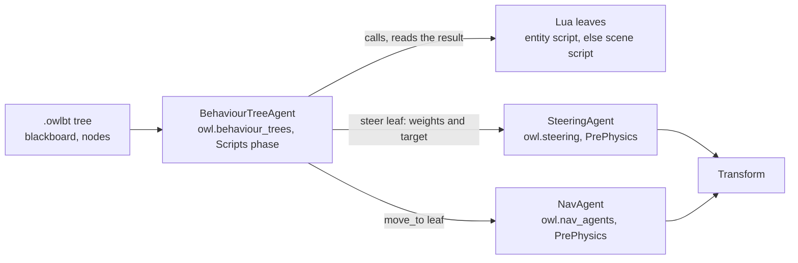
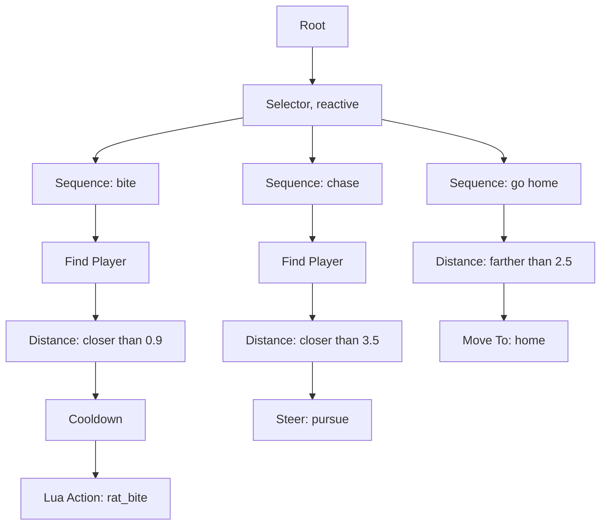

# AI: steering and behaviour trees {#page-ai}

[TOC]

**Level:** Confirmed. **Read first:** [Scene and Components](scene.md), [Pathfinding](pathfinding.md).

Two modules drive the enemies, guards and creatures of a game. Steering behaviours move a body: seek, flee, flock,
dodge, hold a formation. A behaviour tree decides what the body does: sniff around, chase, bite, go home. A tree sets
the steering behaviours, walks with the navigation mesh and calls Lua for what is specific to the game. The code is
`scene::ai` (`source/owl/public/scene/ai/`), the components are `SteeringAgent` and `BehaviourTreeAgent`.



Both systems run on the fixed tick only, agents in UUID order, so the same game replays the same way on every target.

## Steering behaviours {#ai-steering}

A `SteeringAgent` moves its entity by the sum of weighted behaviours. Each behaviour returns the velocity it wants minus
the current velocity; the `owl.steering` system (`PrePhysics`) adds them, multiplied by their weights.

### Planes {#ai-steering-planes}

| `plane`   | Moves in        | Front of the entity | Turns around |
|-----------|-----------------|---------------------|--------------|
| `Plane2D` | (x, y), z stays | +x                  | Z            |
| `Ground`  | (x, z), y stays | +z                  | Y            |
| `Space`   | the three axes  | +z                  | Y then X     |

`Ground` is the default (3D scenes, enemies on a floor), `Plane2D` is for 2D scenes, `Space` for a ship, a bird or a fish.
Every vector the agent sees (targets, neighbours, obstacles) is laid on its plane first. With `turn` on, the entity
turns the way it moves.

### Behaviours {#ai-steering-behaviours}

The target is the `target` entity, else the point `targetPoint`. Set a weight above 0 to switch a behaviour on.

| Weight       | Behaviour                                                                                            |
|--------------|------------------------------------------------------------------------------------------------------|
| `seek`       | Go straight to the target at full speed                                                              |
| `flee`       | Run straight away from the target while it is closer than `panicDistance` (0: always)                |
| `arrive`     | Go to the target and stop on it, slowing down inside `slowRadius`                                    |
| `pursue`     | Seek the point the target will reach: its velocity times the time to get there, at most `prediction` |
| `evade`      | Flee the point the target will reach                                                                 |
| `wander`     | Stroll: seek a point that jitters on a circle ahead of the agent (a sphere in `Space`)               |
| `separation` | Keep away from the flock members closer than `separationDistance`, harder the closer they are        |
| `alignment`  | Match the mean heading of the flock                                                                  |
| `cohesion`   | Seek the centre of the flock                                                                         |
| `avoidance`  | Steer around the moving volumes met within `lookAhead` seconds: other agents and `NavObstacle`s      |
| `formation`  | Hold the `slot` around the `leader`                                                                  |

`avoidance` is the only weight on by default (`1`). The velocity of a target is read from its `SteeringAgent`, else its
`NavAgent`, else from its moves between two ticks.

### Flocking {#ai-steering-flocking}

The flock of an agent is the agents of the same `flock` name closer than `neighbourRadius`. Set `separation`,
`alignment` and `cohesion` together, with `wander` or a target for the direction. An agent with an empty `flock` flocks
with the other agents of an empty name.

### Avoidance {#ai-steering-avoidance}

`avoidance` looks at every other agent (flock or not) and every `NavObstacle` in range. The volume met first, at the time
of the closest approach of the two spheres, pushes the agent sideways out of its way. Agents use `radius`, obstacles
their own radius. It works in the three planes, so two birds in `Space` avoid each other too.

### Formations {#ai-steering-formations}

An agent with a `leader` and a `formation` weight holds `slot`: a point in the frame of the leader (its front is +z,
+x in 2D), scale ignored. It reaches the slot with `arrive` and adds the velocity of the leader, so the formation turns
and moves with it. Lua `steer.set_leader` puts an agent in a formation while the game runs.

### How the system runs {#ai-steering-system}

- Agents are gathered in UUID order; disabled agents and those demoted by the simulation level of detail are skipped.
- A grid of cells (side: the longest reach of an agent) finds the neighbours in the 27 cells around an agent.
- Two passes: every new velocity is computed from the positions and velocities of the last tick, then every agent
  moves. The order of the agents never changes the result.
- The weighted sum is multiplied by a response rate of 4 (the agent makes the change in a quarter of a second), then
  kept under `maxAcceleration`; the velocity is kept under `maxSpeed`, and set to 0 under 0.05 units per second.
- `wander` draws from the scene random stream `owl.steering`.
- The behaviour functions only use `+ - * /` and `sqrt`: the same input gives the same bits on every target.

### Tuning {#ai-steering-tuning}

| Field                | Raise it to                                     | Lower it to                              |
|----------------------|-------------------------------------------------|------------------------------------------|
| `maxSpeed`           | Make the agent faster                           | Slow it down                             |
| `maxAcceleration`    | Turn and stop sharply                           | Make it glide, swing wide                |
| `radius`             | Keep more room between agents                   | Let them squeeze past                    |
| `slowRadius`         | Start braking earlier                           | Stop late, nearer to the target          |
| `panicDistance`      | Flee from farther                               | Flee only when the threat is close       |
| `prediction`         | Aim further ahead of a moving target            | Aim at the target as it is now           |
| `wanderSettings`     | Larger `radius`, longer `distance`: wider turns | More `jitter`: more nervous, less smooth |
| `neighbourRadius`    | See a larger flock                              | Flock with the closest only              |
| `separationDistance` | Keep the flock loose                            | Pack it                                  |
| `lookAhead`          | Dodge early, take a wide curve                  | Dodge late, close to the obstacle        |
| `weights`            | Dominate the other behaviours                   | Let the others win                       |

## Behaviour trees {#ai-trees}

A behaviour tree is an asset (`.owlbt`, YAML) of nodes linked from parents to children, plus the keys of a blackboard.
A `BehaviourTreeAgent` on an entity runs it: the `owl.behaviour_trees` system (`Scripts` phase, after `owl.scripts`)
ticks every enabled agent once per fixed tick, in UUID order.



### Run semantics {#ai-trees-run}

- A tick runs the tree from the root. Every node returns **Success**, **Failure** or **Running**.
- A node that returns Running resumes at the next tick: sequences and selectors remember the child they were at.
- The Root runs its child again each time it ends.
- A **reactive** Selector tries the children above the running one again at every tick: when one succeeds or runs, it
  stops the running child (an enemy that sees the player drops its patrol).
- Stopping a running node (a disabled agent, a hidden entity, `bt.restart`) halts it: a walk stops, the nodes go back to
  idle.
- Random draws (Random, Chance, the spread of Wait) come from the scene random stream `owl.behaviour_trees`.
- The children of a node run from top to bottom on the canvas, then from left to right.

### Blackboard {#ai-trees-blackboard}

The blackboard is the memory of an agent: named values, declared by the tree with the value they start at.

| Kind     | Holds                            |
|----------|----------------------------------|
| `Bool`   | A flag                           |
| `Number` | A number                         |
| `String` | A text                           |
| `Entity` | An entity by UUID (0: none)      |
| `Vector` | A point or a direction `x, y, z` |

Each agent has its own copy. The `overrides` of the component start a key at another value (a key the tree lacks or of
another kind is skipped), so one tree serves several creatures: the rats of the Engine Demo get their own `home`. Values
are written as text in the editor and in node parameters: `true`, `2.5`, a text, `x, y, z`.

### Node catalogue {#ai-trees-nodes}

Parameters with no default shown are empty. `key` is the name of a blackboard key.

| Id                    | Title         | Parameters                                                                    | What it does                                                                                                                    |
|-----------------------|---------------|-------------------------------------------------------------------------------|---------------------------------------------------------------------------------------------------------------------------------|
| `root`                | Root          |                                                                               | The entry: runs its child again each time it ends; one per tree                                                                 |
| `composite.sequence`  | Sequence      |                                                                               | Runs its children from top to bottom while they succeed; fails at the first that fails                                          |
| `composite.selector`  | Selector      | `reactive` (bool, `false`)                                                    | Runs its children until one succeeds; fails when all fail; reactive: tries the upper ones again                                 |
| `composite.parallel`  | Parallel      | `policy` (`all`, `one`)                                                       | Runs every child at each tick; `all`: succeeds when all did; `one`: succeeds at the first success                               |
| `composite.random`    | Random        |                                                                               | Runs its children in a random order until one succeeds, a new order each start                                                  |
| `decorator.inverter`  | Inverter      |                                                                               | Success becomes failure and failure success                                                                                     |
| `decorator.succeeder` | Succeeder     |                                                                               | Succeeds whatever its child returns                                                                                             |
| `decorator.repeat`    | Repeat        | `count` (int, `0`: forever)                                                   | Runs its child again each time it succeeds, one run per tick; fails when it fails                                               |
| `decorator.retry`     | Retry         | `count` (int, `3`; `0`: until it succeeds)                                    | Runs its child again each time it fails, one run per tick; succeeds when it succeeds                                            |
| `decorator.cooldown`  | Cooldown      | `seconds` (float, `2`)                                                        | Fails until the time has passed since its child last ended                                                                      |
| `decorator.timeout`   | Timeout       | `seconds` (float, `5`)                                                        | Stops its child and fails when it runs for too long                                                                             |
| `decorator.guard`     | Guard         | `key`, `op`, `value`                                                          | Runs its child while the comparison holds, checked at every tick; stops it and fails otherwise                                  |
| `condition.compare`   | Compare       | `key`, `op`, `value`                                                          | Succeeds when the comparison holds                                                                                              |
| `condition.distance`  | Distance      | `key`, `op` (`closer than`, `farther than`), `distance` (float, `5`), `space` | Succeeds when the entity or point of the key is closer or farther than a distance                                               |
| `condition.chance`    | Chance        | `probability` (float, `0.5`)                                                  | Succeeds at random                                                                                                              |
| `condition.lua`       | Lua Condition | `function` (text)                                                             | Calls a Lua function; succeeds when it returns a true value                                                                     |
| `action.wait`         | Wait          | `seconds` (float, `1`), `spread` (float, `0`)                                 | Runs for a time plus a random part up to `spread`, then succeeds                                                                |
| `action.set`          | Set Value     | `key`, `value`                                                                | Writes a value on the blackboard, then succeeds                                                                                 |
| `action.move_to`      | Move To       | `key`, `distance` (float, `0.5`)                                              | Walks to the entity or point of the key, with the `NavAgent` (else the `SteeringAgent`); runs until there, fails without a path |
| `action.steer`        | Steer         | `behaviour`, `key`, `weight` (float, `1`), `exclusive` (bool, `true`)         | Sets a behaviour of the `SteeringAgent` on the entity or point of the key, then succeeds                                        |
| `action.find_player`  | Find Player   | `key`                                                                         | Writes the player entity on the blackboard; fails when the scene has no player                                                  |
| `action.lua`          | Lua Action    | `function` (text)                                                             | Calls a Lua function at every tick: `true` or nothing succeeds, `false` fails, `"running"` runs on                              |
| `action.log`          | Log           | `message` (text)                                                              | Writes a message to the log, then succeeds                                                                                      |

Details of the shared parameters:

- `op` of Guard and Compare: `==`, `!=`, `<`, `<=`, `>`, `>=`, `is set`, `is not set`. `is set` means true, not 0, not
  empty, or an entity.
- `space` of Distance: `3D`, `ground` (x, z: the height of the player's eye does not count) or `plane` (x, y of a 2D scene).
- `behaviour` of Steer: `seek`, `flee`, `arrive`, `pursue`, `evade`, `wander`, `stop` (sets these six to 0). The `key`
  holds the target (empty keeps the current one); `exclusive` sets the five other target behaviours to 0.

### Lua leaves {#ai-trees-lua}

A Lua Action or Lua Condition names a function. The engine calls it with `(entity, dt)` in the script of the entity,
else in the scene script.

| Leaf      | Returns                                                                                           |
|-----------|---------------------------------------------------------------------------------------------------|
| Action    | `true` or nothing: success. `false`: failure. `"running"`: runs on, called again at the next tick |
| Condition | A true value: success; anything else: failure                                                     |

```lua
-- cellar_rat.lua: the Lua Action leaf `rat_bite` of the rat tree
function rat_bite(entity, dt)
	gamestate.set("cellar_bites", (gamestate.get("cellar_bites") or 0) + 1)
	return true
end

-- A Lua Condition leaf: only hurt creatures take this branch
function is_hurt(entity, dt)
	return (gamestate.get("hp") or 0) < 3
end
```

Lua also reads and drives the agents while the game runs ([Lua API: steering and behaviour trees](lua-api-ai.md)):

```lua
-- Alert a creature: it flees and the tree learns it
function alert(entity, dt)
	steer.set_weight(entity, "flee", 1)
	bt.set_value(entity, "alerted", true)
	return true
end
```

`entity.set_steering_enabled` and `entity.set_behaviour_tree_enabled` ([entities](lua-api-entities.md)) switch the
agents on and off.

## Editing in Owl Nest {#ai-editor}

**Content Browser > New Behaviour Tree** creates a `.owlbt` (a Root, a Selector and a Wait); it opens in
its own tab. The tab is the node graph canvas of the [Node Graph Framework](node_graph.md).

- **Canvas**: the nodes with their icon, title, a one-line summary of their parameters and their note. Drag to move,
  link a node to the pin of a parent. The children of a node run from top to bottom.
- **Palette**: the node types by kind (composites, decorators, conditions, actions). Right click on the
  canvas adds a node; right click on a node gives **Add Child**, **Duplicate** (Ctrl+D), **Unlink From Parent** and
  **Delete Node** (Del).
- **Blackboard panel** (left): add, rename, retype and delete keys, and set their start value and description. A new name
  is followed by the nodes that read the key.
- **Node panel** (right): the parameters of the selected node, a combo of the keys for a `key` parameter, a comment.
- **Problems badge**: the problems found by `BehaviourTree::validate()` (no root, a child too many, an unknown node or
  key); hover it to read them.
- **Live view**: while a scene plays, the status bar under each node shows idle, running, success or failure, the
  Blackboard panel shows the running values and the badge shows the tick count. The watched agent is the selected entity
  when it runs the tree, else the first agent running it.

The inspector of a `SteeringAgent` shows its fields in sections (target, behaviours with one weight each, wander); the one
of a `BehaviourTreeAgent` has the tree (drop a `.owlbt`, open it), a *Set* checkbox per key to override its start value,
and the running status and blackboard in Play. The navigation overlay (**Show > Navigation graph and routes**) draws every
steering agent: its radius, its velocity over one second and a line to its formation slot.

Every gesture of the tab is a command of the registry, so the console, the journal, macros and MCP see it:

| Command              | Does                                                           |
|----------------------|----------------------------------------------------------------|
| `bt.create`          | Create a `.owlbt` file                                         |
| `bt.add_node`        | Add a node, under a parent when given                          |
| `bt.remove_nodes`    | Remove nodes and their links                                   |
| `bt.duplicate_nodes` | Duplicate nodes with the links between them (not the Root)     |
| `bt.move_nodes`      | Move nodes on the canvas                                       |
| `bt.link`            | Make a node the child of another                               |
| `bt.unlink`          | Unlink a node from its parent                                  |
| `bt.set_value`       | Set a parameter of a node                                      |
| `bt.set_comment`     | Set the note of a node                                         |
| `bt.add_key`         | Declare a blackboard key                                       |
| `bt.set_key`         | Edit a blackboard key (rename, type, start value, description) |
| `bt.remove_key`      | Remove a blackboard key                                        |

## Example: the cellar creatures {#ai-demo}

The Engine Demo cellar (`engine_demo/scenes/tavern_cellar.owl`) runs both modules:

- **Three rats** carry a `SteeringAgent` on the ground (separation and avoidance) and a `BehaviourTreeAgent` running
  `scripts/tavern/cellar_rat.owlbt`. A reactive Selector tries, in order: bite when the player is within 0.9 m (Lua
  Action `rat_bite` of `cellar_rat.lua`, behind a Cooldown), chase with `pursue` when the player is within 3.5 m, go back
  to `home` when farther than 2.5 m from it, else `wander` and wait. Each rat overrides the key `home` with its nest.
- **Two ratlings** hold their formation slots behind the first rat (`leader`, `slot`, `formation` weight).
- **Six bats** flock under the ceiling in open 3D space (`flock: bats`, separation, alignment, cohesion, wander) and dodge
  the player and the barrels (`avoidance`).
- The `NavObstacle`s of the barrels, the chest and the log stack are avoided by every agent.

The scenario `test/unit/scenarios/cellar_creatures.owltest` checks that the bats stay under the ceiling, that the rats
and ratlings stay near their nest, and that the player standing by a nest gets bitten.
