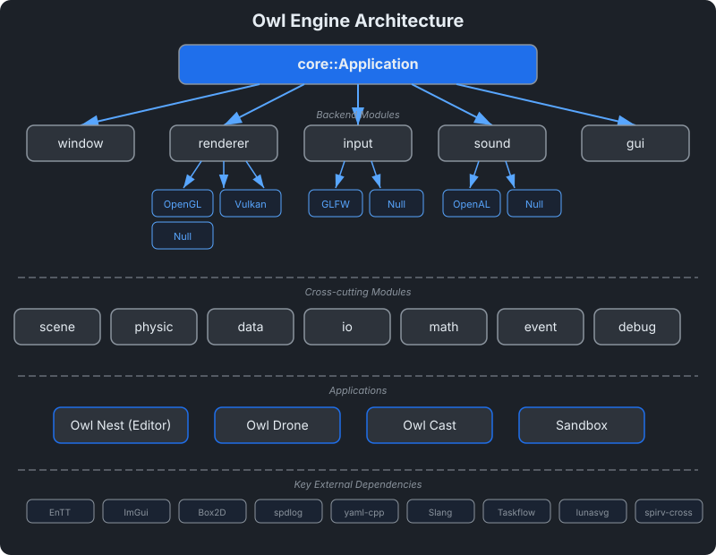
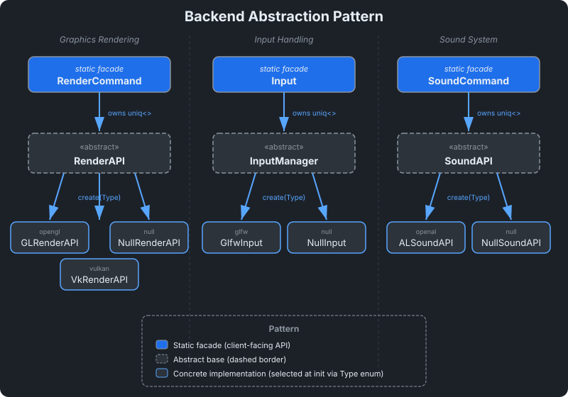
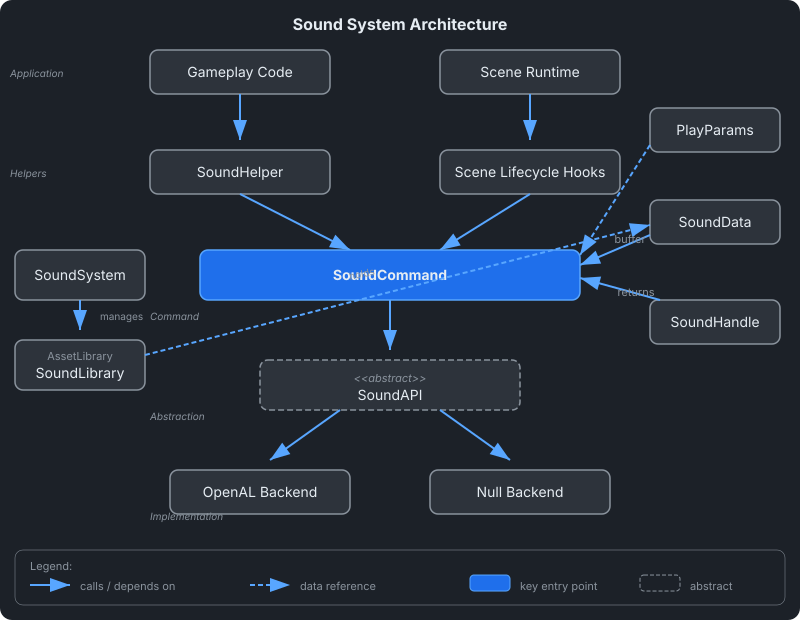
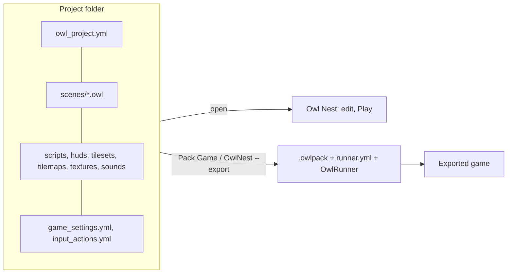
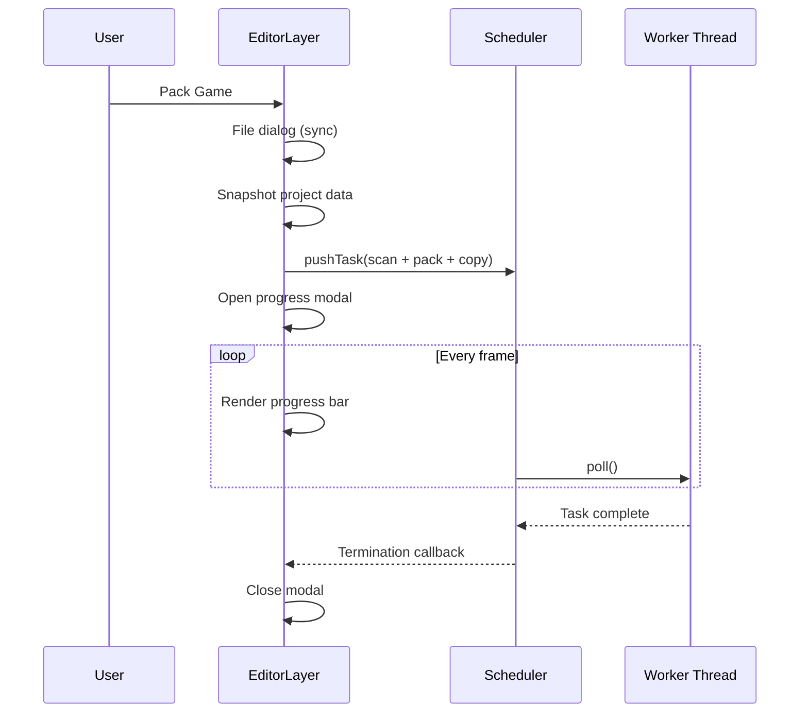
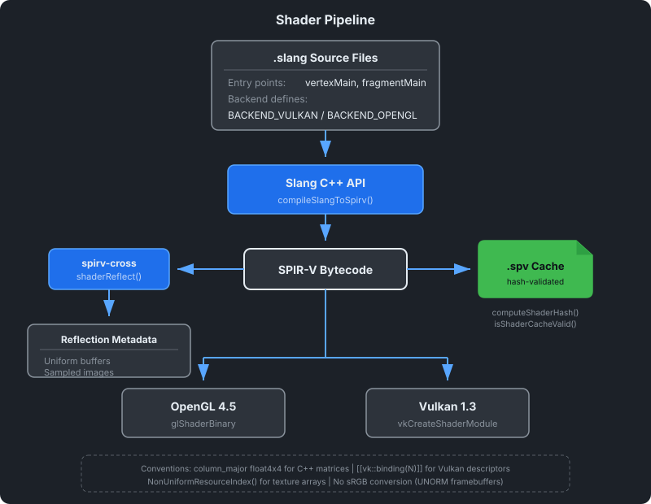
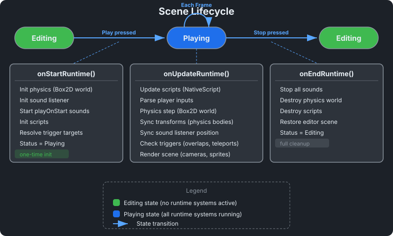
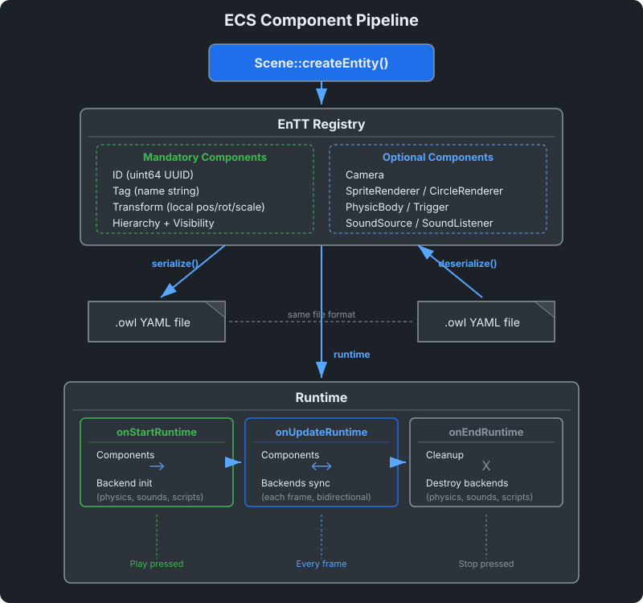
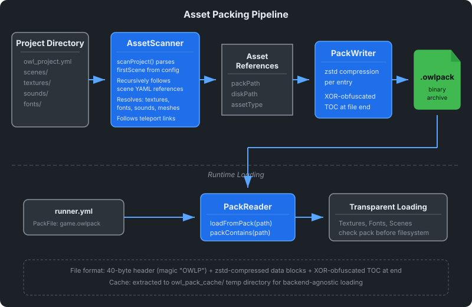

# Architecture Overview {#page-architecture}

[TOC]

This page describes the high-level architecture of the Owl Engine.

## Engine Modules



The engine library (`source/owl/`) is organized into the following modules:

| Module     | Description                                                                       |
|------------|-----------------------------------------------------------------------------------|
| `app`      | Application lifecycle: `Application`, `EntryPoint`, the layer stack               |
| `core`     | Foundation primitives: logging, assertions, smart pointers, `UUID`, tasks         |
| `platform` | OS / native-platform services: file dialogs, `fileToString`, open-URL             |
| `renderer` | Rendering abstraction, buffers, shaders, framebuffers, camera controllers         |
| `scene`    | Entity-Component-System (EnTT), scene graph, components, save/load                |
| `script`   | Lua 5.5 embedded scripting (sandboxed `LuaEngine` per entity)                     |
| `physics`  | 2D physics (Box2D integration)                                                    |
| `sound`    | Audio playback and device management                                              |
| `input`    | Keyboard, mouse, and gamepad input abstraction                                    |
| `window`   | Window creation and management                                                    |
| `gui`      | ImGui/ImGuizmo integration for editor UI                                          |
| `data`     | Data structures + their loaders: geometry/mesh, fonts, assets (+ `pack`), `voxel` |
| `math`     | Math utilities (vectors, matrices, quaternions, transforms)                       |
| `debug`    | Profiling, memory tracking, stack traces (cpptrace)                               |
| `event`    | Event system (application, input, window events)                                  |
| `io`       | External device / peripheral channels: serial, video                              |

Public headers live in `source/owl/public/` and implementation files in `source/owl/private/`, both mirroring the module
structure. **The folder path maps 1:1 to the namespace** (`data/geometry/` is `owl::data::geometry`). The rules for
*which* module a new file belongs to — and the key distinctions (a loader lives with its data type in `data`, not `io`;
camera controllers are `renderer`, not `input`; lifecycle is `app`, primitives are `core`) — are documented in
`.claude/rules/module-layout.md`.

Modules are layered: a public header includes only its own module and lower layers, so the public API has no
dependency cycle (checked by CodeStyle `module-deps`). A public header includes no third-party header but EnTT, and
imgui under `gui/` (CodeStyle `public-deps`): the other dependencies stay private to `libOwlEngine`.

| Layer | Modules                               |
|-------|---------------------------------------|
| 11    | `gui`                                 |
| 10    | `app`                                 |
| 9     | `physics`                             |
| 8     | `scene`                               |
| 7     | `sound`                               |
| 6     | `io`, `window`                        |
| 5     | `renderer`                            |
| 4     | `data`                                |
| 3     | `event`                               |
| 2     | `input`                               |
| 1     | `math`, `debug`, `platform`, `script` |
| 0     | `core`                                |

### Optional modules

A game specialises the engine at build time with five CMake options (`OWL_MODULE_*`, see
[Building](building.md#engine-modules)). They follow the layers above: an optional module only swaps the
implementation behind a public API of its layer, never removes a type a lower layer names, so no public header of the
core depends on whether it is built.

| CMake module | Engine modules it backs           | Implementation built in                                     | When off                            |
|--------------|-----------------------------------|-------------------------------------------------------------|-------------------------------------|
| core         | every module                      | ECS, scene, data, assets, renderer front end, Null backends | always built                        |
| render       | `renderer`, `window`, `input`     | `gpu/opengl`, `gpu/vulkan`, `window/glfw`, `input/glfw`     | Null backends: headless             |
| physics      | `physics`                         | `physics/PhysicCommand.cpp` (Box2D)                         | `physics/disabled/`: no-op          |
| audio        | `sound`                           | `sound/openal`                                              | Null sound backend                  |
| script       | `script`                          | `script/` (Lua)                                             | `script/disabled/`: scripts skipped |
| Gui          | `gui`, the ImGui overlay of `app` | `gui/`, `Owl::Gui`                                          | no `gui/` headers, no overlay       |

`OWL_WITH_<MODULE>` (`0` or `1`, a public definition of `Owl::OwlEngine`) guards the few call sites that reach a
backend: the backend factories, the ImGui overlay of `Application`, the ImGui init data of the Vulkan backend.

### Extension points

What a game plugs in without patching the engine:

| Extension point       | How                                                                                                                                                                                        |
|-----------------------|--------------------------------------------------------------------------------------------------------------------------------------------------------------------------------------------|
| Renderer-stack layers | `renderer::RenderLayerFactory::registerType()`: a layer type by name, created from the stack                                                                                               |
| Application layers    | `app::Application::pushLayer()` / `pushOverlay()`: per-frame update, events, ImGui render                                                                                                  |
| Extra data            | `data::extradata::ExtraDataRegistry`: typed extra data per mesh vertex, face or mesh                                                                                                       |
| Components            | `scene::ComponentRegistry::registerComponent<T>()`: saved, loaded, copied, added and inspected in the editor like an engine component (see [Game components](scene.md#component-registry)) |
| Systems               | `scene::SystemSchedule`: named systems in fixed phases, added, replaced or removed per game or per scene (see [Systems and phases](scene.md#systems))                                      |

**Dedicated guides:** [Renderer](renderer.md) · [Scene & Components](scene.md) ·
[Events & Input](event_input.md) · [Physics](physics.md) · [Sound](sound.md) ·
[Pathfinding](pathfinding.md) · [Lua Scripting](scripting.md) · [Lua API](lua-api.md) · [Editor (Owl Nest)](editor.md) ·
[Node Graph Framework](node_graph.md) · [MCP server](mcp.md)

## Backend System

Owl Engine uses a backend abstraction so that different platform APIs can be swapped at runtime.



### Graphics Backends

| Backend  | API         | Notes                                         |
|----------|-------------|-----------------------------------------------|
| `OpenGL` | OpenGL 4.5  | Widely supported on desktop; limited on ARM64 |
| `Vulkan` | Vulkan 1.3+ | Modern low-level API; full desktop support    |
| `Null`   | None        | Headless mode for servers or testing          |

Every renderer follows one **GPU-driven instanced pipeline**: a compute pre-pass writes an SSBO, the
graphics pass is instanced and indexes into the SSBO via the instance id, and
the CPU does zero per-vertex transform. `Renderer2D`, `RendererTilemap`, and
the raycaster wall stripes all share this shape; a new renderer
builds on it rather than reintroducing CPU-vertex batching.

See [Renderer](renderer.md) for the full rendering pipeline, batch system, and camera details.

### Input Backends

| Backend | Library | Notes                               |
|---------|---------|-------------------------------------|
| `GLFW`  | GLFW    | Windowing, keyboard, mouse, gamepad |
| `Null`  | None    | Headless mode                       |

### Sound Backends

| Backend  | Library | Notes                            |
|----------|---------|----------------------------------|
| `OpenAL` | OpenAL  | Audio playback and spatial sound |
| `Null`   | None    | Silent mode                      |

## Sound System

The sound module provides audio playback through a backend-agnostic API.



The system follows the same abstraction pattern as graphics and input:
`SoundCommand` delegates to a `SoundAPI` implementation (OpenAL or Null), selected at application startup.

At the scene level, **SoundSource** and **SoundListener** ECS components drive spatial audio during runtime. The OpenAL
backend uses the inverse-distance-clamped attenuation model for 3D positional sound.

See [Sound System](sound.md) for the full user guide covering components, spatial audio, and gameplay triggers.

## Applications

The project produces several executables built on top of the `OwlEngine` shared library:

| Application   | Directory                | Description                                                      |
|---------------|--------------------------|------------------------------------------------------------------|
| Owl Nest      | `source/owlnest/`        | Scene editor with project management (`OwlNest`)                 |
| OwlRunner     | `source/owlnest/runner/` | Game runner: plays an exported game, scenarios and frame benches |
| OwlShaderBake | `source/tools/`          | Build tool precompiling the engine shaders to SPIR-V             |

## Project System

A project is a directory holding an `owl_project.yml` (name, first scene, window, renderer stack, gamepad mappings)
beside its assets; opening it in Owl Nest adds the directory as a high-priority asset directory (content browser,
`nam:` lookups) and titles the window. **Scene > Document > Import** copies an external scene into it. The same
folder is what the export packs and the runner plays:



```yaml
OwlProject:
  name: "My Project"
  firstScene: "scenes/Example.owl"
```

### Async Packaging Flow

Long-running operations (game packaging, scene packing) are executed asynchronously via the engine's task scheduler,
with modal progress overlay in the editor:



## Shader Pipeline



Shaders are written in **Slang** (`.slang` files), a single-source shading language:

1. **Source**: `engine_assets/shaders/<renderer>/<name>.slang`
2. **Compilation**: `compileSlangToSpirv()` compiles Slang to SPIR-V at runtime using the Slang C++ API, with
   `BACKEND_VULKAN` or `BACKEND_OPENGL` preprocessor defines
3. **Reflection**: `shaderReflect()` uses spirv-cross to extract uniform buffers and sampled images from the SPIR-V
   bytecode
4. **Caching**: SPIR-V binaries are cached as `.spv` files with hash-based validation
5. **Precompiled**: the build runs the shader bake tool (`source/tools/shader_bake/main.cpp`), which writes the
   SPIR-V of every engine shader, for both APIs, to `bin/assets/shaders/<renderer>/spirv/<api>/`
   (`getPrecompiledShaderPath`); both CPack components install it and a game pack embeds it. `loadOrCompileSpirv` reads
   the cache, then this output, and compiles with Slang only when neither matches the cache key of the current source
   (an edited shader, a game shader, hot reload, another Slang version)
6. **Recovery**: stored SPIR-V is checked before a driver sees it (`checkSpirv`: header, instructions that fill the
   file, `OpFunctionEnd` last, an entry point of the expected stage); an absent, truncated, garbled or misplaced file,
   or one the driver still refuses (Vulkan module or pipeline creation, OpenGL compilation, spirv-cross translation of
   the GLSL fallback: `recompileSpirv`), is compiled again from the Slang source and the result goes to the cache,
   which is read first at the next start. The log names the file, the reason and the recompilation

See [Renderer > Shader System](renderer.md) for the shader class API.

Key conventions:

- Entry points: `[shader("vertex")] vertexMain` and `[shader("fragment")] fragmentMain`
- Matrices: `column_major float4x4` for C++ interop (Slang defaults to row-major)
- Vulkan bindings: `[[vk::binding(N)]]` for explicit descriptor bindings
- Backend branching: `#ifdef BACKEND_VULKAN` for texture binding differences

## Scene Hierarchy





Entities support parent-child relationships via the **Hierarchy** component (mandatory on every entity): `Transform`
is local, the world transform and the visibility are inherited from the parents, only `parentId` is saved. The
operations, the world-transform cache and serialization are in [Scene & Components](scene.md#transform-hierarchy), the
interaction with Box2D bodies in [Physics and Hierarchy](physics.md#hierarchy), the hierarchy panel in
[Editor](editor.md).

## Icon System

Editor icons are **SVG files loaded and rasterized at runtime** via
[lunasvg](https://github.com/nicbarker/lunasvg), with dynamic theme colour substitution.

### Directory Structure

SVG sources are organized by usage in `source/owlnest/assets_sources/icons/`:

| Directory     | Content                                                             |
|---------------|---------------------------------------------------------------------|
| `toolbar/`    | Playback buttons (play, pause, stop, step), gizmo controls (ctrl_*) |
| `browser/`    | Content browser file type icons (folder, glsl, png, ...)            |
| `visibility/` | Eye/camera visibility toggles                                       |
| `triggers/`   | Trigger type overlay icons (victory, death, ...)                    |
| `components/` | Component display icons (transform, camera, ...)                    |
| `panels/`     | Panel icons (scene_hierarchy, properties, ...)                      |
| `actions/`    | Menu/action icons (save, delete, duplicate, ...)                    |
| `templates/`  | SVG base templates (not rendered)                                   |

### Runtime Rendering and Theming

At startup, `IconBank::build()` loads SVG files via lunasvg, applies colour substitution in memory and rasterizes every
icon at several sizes: 16, 24 and 32 px times the monitor content scale, plus the 64 px cell (the only mipmapped atlas).
`IconBank::getIcon(name, size)` returns the smallest tier at least as large as the drawn size, so an icon is drawn at
its own resolution instead of a scaled-down bitmap; `getIcon(name)` returns the 64 px one.

Action glyphs come from the **Lucide** icon font (`engine_assets/fonts/`, ISC licence), merged into every UI
font: the constants of `gui/IconFont.h` (save, play, trash...) are UTF-8 strings used inside any label, at the size
and colour of the text around them. The text fonts exclude the private-use area so their own glyphs there never
shadow an icon.

**Colour convention** (SVG files are never modified on disk):

- White (`#ffffff` or the `white` keyword) → substituted with theme primary text colour
- Fuchsia (`#ff00ff`) → substituted with theme accent colour
- All other colours (R/G/B gizmo axes, etc.) → kept as-is

When the theme changes, `IconBank::rebuild()` re-rasterizes all SVGs with the new colours.

### Scene-Rendered Icons (Triggers)

Trigger overlay icons are also rendered in the viewport via `Renderer2D` and require PNG textures at 512x512. These are
pre-rasterized from the same SVG sources:

```bash
poetry run python tools/editor/generate_icons.py
```

This script only rasterizes the `triggers/` category using `cairosvg`.

## Task System

The engine includes a task scheduler backed by [Taskflow](https://github.com/taskflow/taskflow) 4.0:

- **Public API** (`core/task/`): `Task`, `Scheduler`, `Timer`
- **Private implementation**: `SchedulerImpl` owns a `tf::Executor` (thread pool sized to `hardware_concurrency`)
- Taskflow is a PRIVATE dependency — not exposed in public headers
- `Scheduler::parallelFor(count, minChunk, body)` splits `[0, count)` into contiguous chunks run by the calling thread
  and at most 7 workers (waking more costs more than it shares), and returns once every chunk is done

## Engine Context

`app::EngineContext` holds the engine state the scenes of one application share, rather than static state:
the screen transition (`scene::ScreenTransition`), the game settings (`scene::SettingsManager`) and the voxel mesh
cache (`renderer::VoxelMeshCache`). `Application` owns it (`getEngineContext()`) and releases it right after its
layers, before the renderer shuts down, since the voxel meshes are GPU buffers. Every scene created while an
application exists points at it (`Scene::getEngineContext()`), `Scene::copy()` keeps the pointer, and the Lua bindings
reach it through the scene of the script. A scene created without application has none: its runtime frame then skips
the transition overlay and the voxel meshes. A test creates its own context and gives it to its scenes
(`Scene::setEngineContext`), so no state leaks from one test to the next. It is a plain owner with typed accessors,
not a service locator; each scene keeps its own world (physics, script bindings, UI state).

## Game Settings

The `SettingsManager` (one per engine context, `EngineContext::getSettings()`) provides a persistent two-layer
key-value store for game configuration:

- **Game defaults** — loaded from `game_settings.yml` in the project assets (packed with the game)
- **User overrides** — loaded from `settings.yml` in the user directory (`~/.local/share/<game>/`
  on Linux, `%APPDATA%/<game>/` on Windows)

Built-in keys (`resolution_width`, `resolution_height`, `fullscreen`, `resizable`,
`volume_master`) are auto-applied to the Window and SoundCommand via `SettingsManager::applyBuiltins()`;
`volume_music` and `volume_sfx` are stored for scripts only (no per-category mixing yet). Custom keys (e.g., `player_speed`)
are stored and accessible from Lua but not automatically applied.

See [Lua Scripting > settings](scripting.md) for the Lua API.

## Asset Packing



Owl Nest can export a standalone game package via **Project > Pack Game**. The `AssetScanner`
recursively parses scene files starting from the project's first scene, discovers all referenced assets (textures,
fonts, sounds, scripts, meshes), follows teleport trigger links to other scenes, and follows the scene paths (`.owl`), sound files and serialized
textures (`nam:` / `pat:`) quoted in Lua scripts or given as string properties of a `LuaScript` (a `next_scene`
property), recursively.

Discovered assets are compressed with **zstd** and written to a `.owlpack` binary archive with an XOR-obfuscated table
of contents. At runtime, the game runner transparently loads assets from the pack file via `PackReader`.

A pack is treated as untrusted input: `PackReader::tryOpen` bounds every offset and size by the real file size and
by `g_maxTocSize` / `g_maxEntrySize` before allocating, rejects absolute or `..` entry paths, and returns a typed
`PackOpenError` instead of throwing. `extractPack` confines every entry to the destination directory (symbolic links
resolved) and reports failed writes as `PackExtractError`. The `OWL_FUZZING` option builds a libFuzzer target,
`owl_pack_reader_fuzzer`, over the reader.

## Dependency Management

Dependencies come from Conan 2, declared in `conanfile.py` at the project root and pinned by `conan.lock`. During
CMake configure, the `cmake/Conan.cmake` module runs `conan install` (ConanCenter, plus the local recipes of
`conan/recipes/`) and puts the generated package configurations on the CMake search path.

See [Building](building.md) for instructions on configuring and building with dependencies.

### Exported symbols

`libOwlEngine.so` exports only what `OWL_API` marks, as the Windows DLL does: the library is compiled with hidden
visibility and linked with `--exclude-libs,ALL`, so none of the statically linked dependencies (yaml-cpp, spdlog,
Lua, msdfgen, zstd...) leaks to a game that links its own copy. A class, a free function or an explicit template
instantiation used outside the engine (editor, tests, games) carries `OWL_API`, else the Linux link fails too. A
singleton of a private header lives out of line in its `.cpp`, or each binary would get its own copy.
