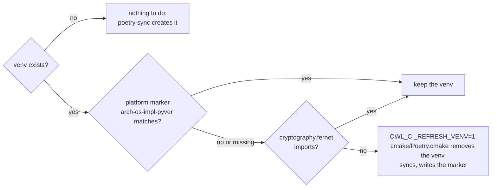

# Building from Source {#page-building}

[TOC]

**Level:** Confirmed.

This page explains how to configure, build, and test Owl Engine. To only run the editor, see
[Getting Started](getting_started.md).

## Prerequisites

### Supported platforms

| OS      | Architecture | Compilers                      |
|---------|--------------|--------------------------------|
| Linux   | x64, arm64   | Clang 22+, GCC 14+             |
| Windows | x64          | MinGW Clang 22+, MinGW GCC 15+ |

Owl Engine ships only what it tests: every platform listed has its machine in the CI, which builds it and runs the
unit and scenario tests on every change. A new platform comes with its test machine (the Web is on the
[roadmap](roadmap.md)). The backends of each platform are listed in [Architecture](architecture.md).

### Build image

The reference environment is the CI build image, driven by `./docker_run.sh`: it runs any command in the image with
your user, the repository mounted at its own path and a persistent home (Poetry venv, Conan cache, ccache) next to
the checkout. Every command of this page works prefixed with it, which is how the project is developed:

```bash
./docker_run.sh cmake --preset linux-clang-release -S .
./docker_run.sh cmake --build output/build/linux-clang-release
```

### Software

To build without the image, install:

| Tool    | Version | Notes                                                               |
|---------|---------|---------------------------------------------------------------------|
| CMake   | 4.4+    | Build system generator                                              |
| Ninja   |         | Recommended build backend                                           |
| Clang   | 22+     | Or GCC 14+ (tested versions; CMake warns below Clang 18 / GCC 13)   |
| Python  | 3.12+   | For CI tooling and Conan                                            |
| Poetry  |         | Python dependency manager                                           |
| Conan   | 2       | C++ dependency manager (installed via Poetry)                       |
| Doxygen | 1.9.1+  | Optional: API documentation (with Graphviz), `documentation` target |

Install Python dependencies:

```bash
poetry sync --no-root
```

### Third-party packages

Every dependency comes from [Conan 2](https://conan.io) and public infrastructure: ConanCenter, plus the few
recipes kept in `conan/recipes/` (served as the local `owl-local` remote). No server to set up:

```bash
poetry sync --no-root   # installs Conan 2 (dev group)
cmake --preset linux-clang-release
cmake --build output/build/linux-clang-release
```

The configure step runs `conan install` on `conanfile.py` with the profile of the compiler
(`conan/profiles/<os>-<compiler>`) and the versioned lockfile `conan.lock`, into `output/build/<preset>/conan/`. The
first run of each compiler builds the packages from source (ConanCenter has no binaries for these compilers); later
runs reuse the Conan cache. The shared libraries from the cache are copied next to the binaries.
`-DOWL_CONAN_HOME=<dir>` selects a dedicated cache, `-DOWL_CONAN_PROFILE` another profile, `-DOWL_CONAN_LOCKFILE=`
(empty) resolves without the lockfile, and `OWL_CONAN_CACHE_URL` adds a binary cache server (the CI uses one).

Once the Conan cache holds the packages, a configure needs neither the network nor Doxygen: `poetry sync` runs only
when the venv is missing or `poetry.lock` changed since the build tree last synced, and the `documentation` target
exists only when Doxygen is found (`-DOWL_ENABLE_DOCUMENTATION=ON` requires it). The `Doxyfile` is generated in the build tree.

The engine is also a Conan package, checked by `test/package/` (two programs built on `find_package(OwlEngine)`);
it is not published (see the [roadmap](roadmap.md)): other projects use the packaged `OwlEngine` archive (see
[Packaging](#packaging)). `Owl::OwlEngine` (`<owl.h>`) exposes EnTT as its only dependency; the headers that include
imgui (`<owlgui.h>`, `gui/utils.h`, `gui/widgets/AssetField.h`, `gui/widgets/CurveEditor.h`) come with the optional
`Owl::Gui` target:

```cmake
find_package(OwlEngine CONFIG REQUIRED COMPONENTS Gui)  # COMPONENTS Gui only for Owl::Gui (needs imgui)
target_link_libraries(my_game PRIVATE Owl::OwlEngine)
target_link_libraries(my_tools PRIVATE Owl::Gui)
```


```bash
poetry run conan create . --profile:all conan/profiles/linux-clang --lockfile conan.lock --lockfile-partial --build=missing
```

Preset status, lockfile update command and the local recipes: [Dependencies](design/dependencies.md).

### Troubleshooting a fresh checkout

If `cmake --preset …` fails in `conan install`, the output above the error names the package. A package
`not resolved` usually means `conan.lock` and `conanfile.py` disagree: regenerate the lockfile (design page). A
build failure of a third party on a new compiler is fixed in its profile or in a local recipe, never by vendoring.
`-DOWL_CONAN_HOME=<empty dir>` reproduces a fresh agent.

## Configure and Build

Owl Engine uses CMake presets. To configure and build:

```bash
cmake --preset <preset> -S .
cmake --build output/build/<preset>
```

A new source or header file needs no configure by hand: the source globs use `CONFIGURE_DEPENDS`, so the next build
notices it and configures again. The Clang presets link with lld (`CMAKE_LINKER_TYPE`). No C++ module is used, so
CMake does not scan the sources for imports (`CMAKE_CXX_SCAN_FOR_MODULES` off). A program is not linked again when only
a shared library it uses changed (`CMAKE_LINK_DEPENDS_NO_SHARED`): after an engine `.cpp` edit only `libOwlEngine.so`
is linked, and the engine shaders are baked again
(`OwlShaderBake <shaders> <assets> [--targets=vulkan,opengl,vulkan_android,webgpu]`, Vulkan and OpenGL by default).

### Available Presets

#### Standard Presets

| Preset                  | OS      | Compiler    | Config  |
|-------------------------|---------|-------------|---------|
| `linux-gcc-release`     | Linux   | GCC         | Release |
| `linux-gcc-debug`       | Linux   | GCC         | Debug   |
| `linux-clang-release`   | Linux   | Clang       | Release |
| `linux-clang-debug`     | Linux   | Clang       | Debug   |
| `windows-gcc-release`   | Windows | MinGW GCC   | Release |
| `windows-gcc-debug`     | Windows | MinGW GCC   | Debug   |
| `windows-clang-release` | Windows | MinGW Clang | Release |
| `windows-clang-debug`   | Windows | MinGW Clang | Debug   |

#### CI Presets

| Preset                               | Purpose                      |
|--------------------------------------|------------------------------|
| `linux-clang-tidy`                   | Static analysis (clang-tidy) |
| `windows-clang-tidy`                 | Static analysis (clang-tidy) |
| `linux-sanitizer-address`            | AddressSanitizer (+ LSan)    |
| `linux-sanitizer-thread`             | ThreadSanitizer              |
| `linux-sanitizer-undefined-behavior` | UndefinedBehaviorSanitizer   |
| `linux-include-check`                | Strict-libc++ include check  |
| `linux-clang-minimal`                | Every optional module off    |
| `linux-cross-arm64`                  | arm64 cross build (Release)  |
| `android-arm64`                      | Android game runner and APK  |
| `linux-bench`                        | `owl_bench` harness          |
| `linux-fuzz`                         | libFuzzer targets            |

#### Packaging

`cpack` works in any build tree and writes one archive per component: `OwlEngine-<version>-<hash>-<platform>` (the
SDK: `lib/`, `include/`, `assets/`, `lib/cmake/OwlEngine/`) and, when the editor is built, `OwlNest-…` (Owl Nest, the
runner, their shared libraries and assets in `bin/<platform>_<arch>/`, the editor SVG icons in
`bin/<platform>_<arch>/assets/icons/`, the Engine Demo in `engine_demo/` and the sample games in
`samples/`). The SDK ships the Release library only: build the engine in Debug from the sources for a Debug one. The CI packages the release tree it has just
tested (`linux-clang-release`, `windows-clang-release`, `linux-cross-arm64`: the presets with `package: true`), so the
archive holds the tested binaries.

```bash
./docker_run.sh cmake --build output/build/linux-clang-release
cd output/build/linux-clang-release && ../../../docker_run.sh cpack
```

On Linux the archives rely on the system's graphics, audio and windowing libraries, plus D-Bus (`libdbus-1-3`, any
desktop has it): the Owl Nest file dialogues go through `xdg-desktop-portal` (nativefiledialog-extended built with its
`portal` option, set in `conanfile.py`), so they need a running portal with a desktop backend (GNOME, KDE or GTK) and
no GTK in the process. Without a portal, opening a dialogue logs an error and returns no path.

On Windows `OwlNest.exe`, `OwlRunner.exe` and `OwlGameRunner.exe` carry the Owl icon and the version information of the project
(`owl_windows_application` in `cmake/OwlUtils.cmake`, resource script `source/owlnest/resources/OwlApp.rc.in`). The
icon `source/owlnest/resources/owl.ico` (16 to 256 px) is generated from `engine_assets/logo/logo_owl.png` by
`./docker_run.sh poetry run python tools/editor/generate_app_icon.py`. An exported game is a copy of `OwlGameRunner.exe`:
it shows the Owl icon in the Explorer, the project icon on its window and task bar button.

Both are GUI programs on Windows: no console window opens with them. Started from cmd or PowerShell they write their
output to that console (`platform::attachParentConsole`, called by the entry point), a redirected output (CTest, a pipe,
`> log.txt`) stays where it is. The shell does not wait for a GUI program: to get the exit code of a command-line run,
wait for it (`start /wait OwlRunner.exe --smoke-test` in cmd, `Start-Process -Wait` in PowerShell) or pipe its output
(`.\OwlRunner.exe --smoke-test | Out-Host`).

Windows has no RPATH: Conan's runtime deployer copies every DLL of the dependencies next to the binaries at configure
time, `source/shader_compiler/CMakeLists.txt` adds the Slang standard modules, and the package leaves out `slang-llvm.dll` (CPU targets,
never loaded by the engine).

A package holds `assets/` (fonts, shaders, project templates, logo, help and, for Owl Nest, the editor sounds, trigger
icons and SVG icons, rasterized at run time in the theme's colours), `engine_demo/` and `samples/`; generators and test
fixtures are not installed. Nor is anything the tested tree's runs wrote next to the binaries (logs, settings, ImGui
layouts, caches, recovery autosaves): `cmake/InstallRuntime.cmake` installs only the third-party shared libraries and
the Slang standard modules found in the build's `bin/`.

The binaries decide at run time where their assets are: `assets/` next to the working directory first, then, in a
development tree, `engine_assets/` and the application's assets found above it. No build switch tells a package from
a development build.

#### Code signing

Windows SmartScreen warns about a downloaded program that is not signed, or signed by a publisher it does not know
yet ("Windows protected your PC"). The `Package` action signs `OwlNest.exe`, `OwlRunner.exe`, `OwlGameRunner.exe` and
`OwlEngine.dll` in the build tree before `cpack` when a certificate is configured, through the agent's environment
(never the command line), and does nothing otherwise (`ci/utils/signing.py`):

| Variable                 | Meaning                                                                                |
|--------------------------|----------------------------------------------------------------------------------------|
| `OWL_SIGN_THUMBPRINT`    | SHA-1 thumbprint of a certificate in the agent's Windows store, signed with `signtool` |
| `OWL_SIGN_CERTIFICATE`   | Path to a PKCS#12 (`.pfx`) file, signed with `osslsigncode`                            |
| `OWL_SIGN_PASSWORD`      | Password of the `.pfx` (a secret, handed to `osslsigncode` in a private file)          |
| `OWL_SIGN_TIMESTAMP_URL` | RFC 3161 timestamp server, `http://timestamp.digicert.com` by default                  |

Ways to get a certificate:

- **OV code signing certificate** (a commercial certificate authority, about 200 to 400 € a year, the key on a
  hardware token or a cloud HSM since 2023): signed, but SmartScreen still warns until the publisher has built a
  reputation from downloads.
- **EV code signing certificate** (dearer, a company is required): the same, the reputation is not granted at
  once either.
- **Azure Trusted Signing** (Microsoft, about 10 $ a month, identity validation of an organisation or, in some
  countries, an individual): `signtool` with its dlib, no key to keep; reputation as for OV.
- **SignPath Foundation** (free for open-source projects that qualify): signs in their cloud from the CI artefact.
- **Certum open-source code signing** (an individual open-source developer, the key on a card or in Certum's
  cloud): the certificate Owl signs its own binaries with.

Until then a user starts the unsigned program through **More info** > **Run anyway** (see
[Getting Started](getting_started.md)).

### arm64 cross compilation

`linux-cross-arm64` (a Release tree inheriting `linux-clang-release`) builds for Linux arm64 on an x86_64 machine, with the toolchain
file `cmake/toolchains/linux-aarch64-clang.cmake`: Clang `--target=aarch64-linux-gnu`, lld and an arm64 sysroot.
Only the binaries the build runs (`OwlShaderBake`) and the tests go through `qemu-aarch64`, started by the kernel's
`binfmt_misc`.

- **Sysroot**: an arm64 root filesystem with the same `-dev` packages as the build image (libstdc++, Vulkan, GL, X11,
  Wayland, D-Bus, ALSA, PulseAudio), its absolute symlinks made relative. `OWL_SYSROOT` (cache or environment
  variable, default `/opt/sysroot/aarch64-linux-gnu`) points at it.
- **Emulation**: a `binfmt_misc` entry for aarch64 with the `F` flag (`/proc/sys/fs/binfmt_misc/qemu-aarch64`,
  package `qemu-user-binfmt`), so it works inside a container that has no QEMU. The tests run with
  `QEMU_LD_PREFIX=<sysroot>`, also for the `OwlRunner` they start.
- **Conan**: the host profile is `conan/profiles/linux-clang-armv8` (`arch=armv8`, target flags, system packages
  reported rather than checked against the image's dpkg), the build profile stays `linux-clang`; `cmake/Conan.cmake`
  adds the sysroot and its pkg-config paths. The binaries keep the package ids of a native arm64 build.
- **Package names**: `OWL_ARCH_STR` comes from `CMAKE_SYSTEM_PROCESSOR` and the glibc tag from the sysroot, so the
  archives are tagged `linux-glibc_<version>-arm64`.

A sysroot from the arm64 build image, then the cross build in the x64 one:

```bash
sysroot=$PWD/output/sysroot-arm64
mkdir -p "$sysroot"
container=$(docker create --platform linux/arm64 registry.argawaen.net/builder/builder-ubuntu2604:latest true)
docker export "$container" | tar -x -C "$sysroot" --anchored --exclude='dev/*' --exclude='proc/*' --exclude='sys/*'
docker rm "$container"
find "$sysroot" -type l -lname '/*' -exec sh -c \
    'ln -sfn "$(realpath -m --relative-to="$(dirname "$1")" "$2$(readlink "$1")")" "$1"' _ {} "$sysroot" \;
./docker_run.sh cmake --preset linux-cross-arm64 -DOWL_SYSROOT="$sysroot"
./docker_run.sh cmake --build output/build/linux-cross-arm64
./docker_run.sh ctest --test-dir output/build/linux-cross-arm64 --output-on-failure -j8
```

A sysroot outside the repository is mounted with `OWL_DOCKER_MOUNTS`.

### Android {#android-build}

`android-arm64` builds the game runner for Android arm64-v8a, API 33 (Android 13, the first level whose system loader
exports Vulkan 1.3), in the Android build image builder-android-ubuntu2604 of the CI registry (NDK, SDK platform and
build tools, JDK). Android is not yet a supported platform: it joins the table above with its test device in the CI.

- **Toolchain**: the NDK's `android.toolchain.cmake`, libc++ shared; the Conan host profile is
  `conan/profiles/android-clang-armv8`, the build profile `linux-clang`.
- **Backends**: Vulkan on the system loader, the native activity window and input
  (`source/owl/private/window/android/`, `source/owl/private/input/android/`: the first finger is the cursor and the
  left button), OpenAL Soft, logs in logcat under the tag `Owl`. No OpenGL, no GLFW, no file dialogue, no Slang: the
  host bakes the shaders (SPIR-V 1.3, target `VulkanAndroid`).
- **Output**: the `OwlGameRunner` shared library, loaded by `android.app.NativeActivity`; nothing else is built (no
  editor, no tests).
- **APK from Owl Nest**: `OwlNest --export <project> <dir> --target android` writes the folder of the game and its
  signed APK next to it, from the Android runner of the runner store (or `--runner <dir>` holding `lib/arm64-v8a/`),
  without the SDK; `OwlGameRunnerLibraries` writes those libraries in the android-runner folder of the build tree.
- **APK from the build tree**: `OwlGameRunnerApk` packs the runner, the shared libraries it needs (stripped) and a game exported for
  Android by a host Owl Nest into an APK next to the runner, signed with the debug key (`~/.android/debug.keystore`,
  created when missing). The game is extracted to the internal storage at its first launch.

```bash
./docker_run.sh output/build/linux-clang-release/bin/OwlNest --export samples/<game> output/android --target android
OWL_DOCKER_IMAGE=registry.argawaen.net/builder/builder-android-ubuntu2604 ./docker_run.sh bash -c \
    'cmake --preset android-arm64 -S . -DOWL_ANDROID_GAME_DIR=output/android/<Game> &&
     cmake --build output/build/android-arm64 --target OwlGameRunnerApk'
./docker_run.sh --adb adb install -r output/build/android-arm64/bin/OwlGameRunner.apk
```

`./docker_run.sh --adb[=host:port]` runs the Android image on the host network with `ADB_SERVER_SOCKET` set to the
adb server that owns the device (default `localhost:5037`, e.g. an SSH tunnel to the machine it is plugged in): the
container only runs the client, the server keeps the USB device and its authorization key. The nightly pipeline
builds the preset without testing it, no device reaching the CI yet.

### Web {#web-build}

`web-release` builds for the browser (WebAssembly) with the emsdk of the Web build image
(`registry.argawaen.net/builder/builder-web-ubuntu2604`), through `OWL_DOCKER_IMAGE`; `web-minimal` turns every
optional module off. The GUI module is off on the Web until its ImGui backend exists ([roadmap](roadmap.md)); the
network module plays over WebSocket ([Networking](networking.md#networking-transports)).

- **Toolchain**: `Emscripten.cmake` of `$EMSDK`; the platform is `OWL_PLATFORM_WEB`, the architecture `wasm32`.
- **Conan**: host profile `conan/profiles/emscripten-clang` (`os=Emscripten`, libc++, POSIX threads, native
  WebAssembly exceptions, every package static), build profile `linux-clang`; `cmake/Conan.cmake` sets
  `compiler.version` to the emsdk of the build. No native file dialogue, no stack trace (cpptrace), and the browser's
  OpenAL (WebAudio) with the headers of `openal-soft`.
- **Engine**: a static library that every program links whole (its types register from static initialisers). The
  browser owns the main loop: `main` hands `Application::runFrame` to `emscripten_set_main_loop`, the frame pacer does
  not sleep, and the threads come from Web Workers made when the page loads.
- **Render module**: the WebGPU backend of the Owl RHI (`RenderAPI::Type::WebGpu`, emdawnwebgpu) draws in the canvas
  of the page, and GLFW is the Emscripten port `contrib.glfw3` (canvas, keyboard, mouse, gamepads); a game asking for
  Vulkan or OpenGL gets WebGPU. The page makes the WebGPU device before `main` (`Module.preinitializedWebGPUDevice`),
  since a browser gives it asynchronously only. There is no Slang: the runner reads the WGSL baked on the desktop, and
  the tests that compile shaders are skipped (`OWL_REQUIRE_SHADER_COMPILER`). Each draw records and submits a render
  pass of its own, so it sees the buffer writes made before it. The buffers of a renderer block are bind group 0 at their
  binding numbers; its textures are bind group 1, the texture tables the shaders declare under `BACKEND_WEBGPU`
  (`common/webgpu_textures.slangh`: WebGPU has no array of textures, sixteen slots per stage). The backend reads the
  vertex input locations from the WGSL, which numbers them by semantics. A uniform or storage buffer belongs to the block
  of its renderer, as a Vulkan descriptor does. A framebuffer is a set of textures the draws go to while it is bound and
  that the passes after it sample; the swapchain one (`swapChainTarget`) is the canvas. Every depth attachment is
  `Depth32Float`. A page reads a texture back asynchronously only: `readPixel` gives -1. A compute shader reads its
  bindings from its WGSL and submits a pass per dispatch; `drawIndexedIndirectAt` draws the commands a culling pass
  wrote (WebGPU has no indirect count). A stage samples sixteen textures, the WebGPU limit every adapter has: the 3D renderer
  keeps a table of twelve (the environment levels as the mips of one texture) and reads the cascades, the spot and
  point shadows (six face layers each) and the probes from three texture arrays, each map in the corner of its layer
  (`source/owl/private/renderer/gpu/webgpu/PbrTextures.h`, copied once per frame); a lit isometric batch has five albedo slots and their companions
  instead of ten; a renderer of cubes alone gets the cube table (`OWL_WEBGPU_CUBE_TABLE`). Slang's WGSL keeps an
  `@interpolate` WGSL refuses on its internal structures: `OwlShaderCompiler` removes it, and a revision of that edit
  keys the WebGPU stages. The shaders keep their
  native code under `BACKEND_WEBGPU` branches where WGSL differs: `Atomic<uint>` for the culling counters, a texel load
  in `hiz_seed`. The page asks the adapter for its limits of textures, samplers, storage buffers and compute work
  groups and for `float32-filterable`: a 3D draw samples twenty-four textures, the bitonic sort runs 1024 invocations.
- **Page**: `?env=NAME=value` sets the environment of the program; `OWL_WEBGPU_CAPTURE=<frame>` reads that frame of
  the canvas back as a PNG, which `browser_run.py --shot <file>` writes; `--browser-log` prints the console of the
  browser. In the headless Chrome of the image, WebGPU runs on SwiftShader and the page is composited by ANGLE.
- **Tests**: `ctest` runs each test program under Node (Emscripten's emulator), on the real file system
  (`NODERAWFS`); `export_tests` stay on the desktop.
- **Runner**: `OwlGameRunner.html` with its `.js` and `.wasm`. Before `main`, behind a loading screen (files loaded, or why the game cannot start), the page fetches the files that
  `files.json` lists into its virtual file system; the query string is the command line (`?arg=--headless`). It needs a
  cross-origin isolated page (`Cross-Origin-Opener-Policy: same-origin`, `Cross-Origin-Embedder-Policy: require-corp`)
  for the threads. `tools/web/browser_run.py` serves a folder that way, opens the page in the headless Chrome of the
  image (`OWL_CHROME`) and returns its exit code.
- **Export**: `OwlNest --export <project> <dir> --target web` (`ExportTarget::Web`) bakes the shaders as WGSL into the
  pack, leaves the SPIR-V out, copies the page of the Web runner as `index.html` with its `.js` and `.wasm` (from
  `--runner <dir>`, else the `web/` folder next to Owl Nest) and lists the game files in `files.json`: the folder is
  served as it is.

```bash
./docker_run.sh output/build/linux-clang-release/bin/OwlNest --export samples/<game> output/web --target web \
    --runner output/build/web-release/bin
export OWL_DOCKER_IMAGE=registry.argawaen.net/builder/builder-web-ubuntu2604:latest
./docker_run.sh cmake --preset web-release -S .
./docker_run.sh cmake --build output/build/web-release
./docker_run.sh ctest --test-dir output/build/web-release --output-on-failure -j8
./docker_run.sh bash -c 'python=$(poetry env info -e); $python tools/web/browser_run.py output/web/<Game> \
    --page index.html -- --smoke-test'
```

## Running Tests

Tests use Google Test and are enabled by default (`OWL_TESTING=ON`):

```bash
ctest --test-dir output/build/<preset> --output-on-failure
```

Each of the 20 folders of `test/unit/` (`<category>_tests`: core, debug, event, export, font, gui, input, io, layer,
math, mesh, owlnest, physics, render, renderer, runner, scene, script, sound, voxel) builds one executable
`owl_<category>_tests_unit_test`; each `test/unit/scenarios/*.owltest` is one more CTest (label `scenario`) played by
`OwlRunner --scenario`; a scenario whose first line is `# slow` is labelled `slow` too (`ctest -LE slow` leaves those
out); each scenario has a user directory of its own but they share one cache directory (`OWL_CACHE_DIR`), so a font
atlas is generated once per run. The image tests are split into `OWL_RENDER_TEST_SHARDS` CTest entries (gtest shards,
one X server each) that run in parallel; `export_tests` has one CTest entry per shipped project
(`owl_export_tests_<project>`, the templates as `template_<name>`) and `owl_export_tests_UTests` for its other cases,
so CTest balances them over its jobs. `owlnest_tests` links the editor sources through the `OwlNestCore` static library and is skipped when
`OWL_BUILD_NEST` is off.

## Measuring frames on the GPU

`OwlRunner --frame-bench <scene.owl>` loads a scene, plays a warm-up then a fixed number of frames without vsync,
with a fixed time step and no user input, and reports the CPU time per phase and the GPU time from timestamp queries
(Vulkan and OpenGL), plus the queue drains per frame:

```bash
./docker_run.sh --gui output/build/linux-clang-release/bin/OwlRunner \
    --frame-bench engine_demo/scenes/platformer_house.owl --backend opengl --frames 1000 --out fb.json
```

Options, output format and device selection: `test/bench/README.md`. The measurement protocol of the audit lives in
`doc/audit/20-mesures.md`.

## CI System

The Python-based CI system wraps CMake operations. The same Python actions are invoked locally
and from the GitLab CI jobs — see [Continuous Integration](continuous_integration.md) for
the pipelines, the build matrix and the reports.

Always invoke through Poetry:

```bash
poetry run python ci_action.py Build <preset>
poetry run python ci_action.py Test <preset>
poetry run python ci_action.py Coverage <preset>
poetry run python ci_action.py Clean <preset>
poetry run python ci_action.py Documentation <preset>
poetry run python ci_action.py ClangTidy <preset>
```

`ClangTidy` needs the preset built first — it reads `compile_commands.json` and
ninja's dependency database. On a merge request it analyses only the translation
units the diff can affect (the touched `.cpp` files plus every `.cpp` that
includes a touched header); elsewhere, all of them. See
[Clang-tidy scoping](continuous_integration.md#clang-tidy-scoping).

### Multi-architecture CI (ARM64 + x86_64)

Agents of both architectures can share one `$HOME`, hence one Poetry venv path, and an arm64 run would then load
x86_64 wheels (`ImportError: cryptography/_rust.abi3.so`). `ci_action.py` checks on every call
(`ci.utils.venv.needs_refresh()`), cheapest first:



A rerun pays one file read, an architecture switch one venv rebuild (30 to 60 s). Prefix any `ci_action.py` or
`cmake --preset` call with `OWL_CI_REFRESH_VENV=1` to force a refresh (a corrupt wheel).

## Running under Wayland or X11

On Linux the editor and the runner use GLFW with both display backends. By default (`auto`) they use Wayland when
`WAYLAND_DISPLAY` is set and X11 otherwise; force one with the `OWL_WINDOW_PLATFORM` environment variable or the
`windowPlatform` key of the application's `config.yml` (the variable wins):

```bash
OWL_WINDOW_PLATFORM=wayland output/build/linux-clang-release/bin/OwlNest   # native Wayland
OWL_WINDOW_PLATFORM=x11 output/build/linux-clang-release/bin/OwlNest       # X11 / XWayland: detached editor windows
./docker_run.sh --platform=x11 --gpu=nvidia output/build/linux-clang-release/bin/OwlRunner
```

- `./docker_run.sh --gui` mounts the Wayland socket, the X11 socket and `/dev/dri`; `--gpu=intel|nvidia` pins Vulkan,
  EGL and GLX to one GPU of a hybrid laptop (`nvidia` turns PRIME render offload on), `--platform=` sets
  `OWL_WINDOW_PLATFORM`. It also lends the host cursor themes (read-only) with `XCURSOR_THEME` / `XCURSOR_SIZE`, so
  the window shows the desktop cursor.
- Under Wayland the editor keeps detached panels inside its main window (GLFW cannot position windows); use X11 for
  native detached windows.
- Under Wayland the icon comes from a hidden desktop entry written to `~/.local/share/applications/<app_id>.desktop`
  (`installDesktopEntry: false` in `config.yml` to opt out); `./docker_run.sh --gui` mounts the host
  `~/.local/share/applications` there, so the compositor finds it. A CLion Docker toolchain needs the same volume
  (`~/.local/share/applications` to `/fhome/.local/share/applications`).
- A locked or hidden session presents no frame: X11 windows that wait for presentation (vsync on, or any NVIDIA
  PRIME window) crawl at about one frame per second until shown again (`./docker_run.sh` warns when the session is
  locked).

See [Windowing and input](design/windowing-input.md) for the details and the GLFW limits.

## Frame pacing

With vertical sync on (the default) a frame waits for the display: Vulkan presents in FIFO mode, OpenGL swaps with
interval 1, and under Wayland both present without blocking and sleep to the refresh period (a hidden surface would
otherwise freeze the loop). The GPU therefore draws no frame the display does not show. Two `config.yml` keys change it:

- `lowLatencyPresent: true` (*Parameters > Backends > Low-Latency Present*): Vulkan MAILBOX, a lower input latency but
  no display pacing, the GPU draws as many frames as it can.
- `frameRateLimit: N`: at most N main-loop iterations per second (`Application::setFrameRateLimit`), 0 for none. Owl
  Nest drives it from its own settings.

The simulation runs at a fixed step whatever the frame rate (`scene::SimulationClock`), so capping the frames costs
it nothing.

## Build Output Locations

| Output    | Path                         |
|-----------|------------------------------|
| Binaries  | `output/build/<preset>/bin/` |
| Libraries | `output/build/<preset>/lib/` |
| Install   | `output/install/<preset>/`   |

## CMake Options

| Option                                     | Default | Description                                                                                         |
|--------------------------------------------|---------|-----------------------------------------------------------------------------------------------------|
| `OWL_BUILD_SHARED`                         | ON      | Build engine as shared library                                                                      |
| `OWL_BUILD_NEST`                           | ON      | Build Owl Nest editor                                                                               |
| `OWL_TESTING`                              | ON      | Enable unit tests                                                                                   |
| `OWL_ENABLE_COVERAGE`                      | OFF     | Code coverage (auto-enabled in debug presets)                                                       |
| `OWL_ENABLE_STACKTRACE`                    | OFF     | Memory tracker stacktrace (performance impact)                                                      |
| `OWL_ENABLE_PROFILING`                     | OFF     | Deprecated: same as `OWL_PROFILER=chrome`                                                           |
| `OWL_USE_RELEASE_THIRD_PARTY`              | ON      | Use release builds of third-party libraries                                                         |
| `OWL_ENABLE_VULKAN_LAYERS`                 | OFF     | Copy Vulkan layers to binary directory                                                              |
| `OWL_ENABLE_CLANG_TIDY`                    | OFF     | Enable clang-tidy static analysis                                                                   |
| `OWL_ENABLE_ADDRESS_SANITIZER`             | OFF     | AddressSanitizer                                                                                    |
| `OWL_ENABLE_THREAD_SANITIZER`              | OFF     | ThreadSanitizer                                                                                     |
| `OWL_ENABLE_UNDEFINED_BEHAVIOR_SANITIZER`  | OFF     | UndefinedBehaviorSanitizer                                                                          |
| `OWL_ENABLE_MEMORY_SANITIZER`              | OFF     | MemorySanitizer (Clang-only)                                                                        |
| `OWL_ENABLE_DOCUMENTATION`                 | OFF     | Require Doxygen (otherwise `documentation` exists only when Doxygen is found)                       |
| `OWL_ENABLE_RENDERER_VERBOSE_CAPABILITIES` | OFF     | Log every capability of the graphics device at start-up                                             |
| `OWL_ENABLE_SHADER_REFLECT_RESOURCES`      | OFF     | Log the resources reflected from every compiled shader                                              |
| `OWL_USE_CCACHE`                           | ON      | ccache (PCH sloppiness set) or sccache as launcher                                                  |
| `OWL_BENCHMARK`                            | OFF     | `owl_bench` harness (`test/bench/`), with the Owl Nest MCP libraries                                |
| `OWL_INCLUDE_CHECK`                        | OFF     | `owl_include_check`: every header and source compiled alone (Clang only)                            |
| `OWL_TEST_SHUFFLE`                         | OFF     | Run every test binary with `--gtest_shuffle`                                                        |
| `OWL_RENDER_TESTS`                         | ON      | Image tests (`test/unit/render_tests`, label `render`)                                              |
| `OWL_RENDER_TEST_SHARDS`                   | 6       | Parallel CTest entries the image tests are split into                                               |
| `OWL_TEST_TIMEOUT`                         | 600     | Per test binary CTest timeout, s (coverage 1200, sanitizers 1800, `export_tests` ≥ 1200, ×2 QEMU)   |
| `OWL_TEST_COOK_CACHE`                      | (auto)  | Cook cache of the end-to-end export tests, default `output/cook_cache` (kept by the CI jobs)        |
| `OWL_SCRIPT_TIME_SCALE`                    | 1       | Lua quota multiplier, scenario and export tests (8 arm64 on QEMU, 4 sanitizers and coverage builds) |
| `OWL_CONAN_PROFILE`                        | (auto)  | Conan host profile, default `conan/profiles/<os>-<compiler>[-<arch>]`                               |
| `OWL_CONAN_BUILD_PROFILE`                  | (auto)  | Conan build profile, default `conan/profiles/<os>-<compiler>`                                       |
| `OWL_SYSROOT`                              | (auto)  | arm64 sysroot of the cross toolchain, default `/opt/sysroot/aarch64-linux-gnu`                      |
| `OWL_CONAN_HOME`                           | (empty) | `CONAN_HOME` for the install (empty: Conan's default)                                               |
| `OWL_CONAN_BUILD`                          | missing | Value of `conan install --build`                                                                    |
| `OWL_FUZZING`                              | OFF     | libFuzzer targets in `test/fuzz/` (Clang-only)                                                      |
| `OWL_ENABLE_MEMORY_TRACKER`                | OFF     | Allocation tracker, opt-in in every build type (Debug included)                                     |
| `OWL_PROFILER`                             | none    | `OWL_PROFILE_*` backend: `none`, `tracy` or `chrome` ([Profiling](profiling.md))                    |
| `OWL_LOG_LEVEL`                            | trace   | Lowest log level compiled in (`trace` to `off`)                                                     |
| `OWL_MODULE_RENDER`                        | ON      | OpenGL / Vulkan backends, GLFW, Slang ([Engine modules](#engine-modules))                           |
| `OWL_MODULE_PHYSICS`                       | ON      | Jolt physics ([Engine modules](#engine-modules))                                                    |
| `OWL_MODULE_AUDIO`                         | ON      | OpenAL backend, libsndfile ([Engine modules](#engine-modules))                                      |
| `OWL_MODULE_NETWORK`                       | ON      | ENet UDP transport ([Engine modules](#engine-modules))                                              |
| `OWL_MODULE_SCRIPT`                        | ON      | Lua scripting ([Engine modules](#engine-modules))                                                   |
| `OWL_MODULE_GUI`                           | ON      | ImGui layer, widgets, `Owl::Gui` ([Engine modules](#engine-modules))                                |

## Engine modules

The core (ECS, scene, data, assets, renderer front end, Null backends) is always built. Each optional module is a
CMake option and a recipe option of the same name: turned off, it leaves out its sources and its third parties, and
its public API stays, backed by the Null backend or a no-op, so a game compiles against the same headers.

| Option               | Conan option | Third parties left out                          | Without it                                                |
|----------------------|--------------|-------------------------------------------------|-----------------------------------------------------------|
| `OWL_MODULE_RENDER`  | `render`     | glad, GLFW, lunasvg, Vulkan, SPIRV-Cross, Slang | Null window, input and graphics: the engine runs headless |
| `OWL_MODULE_PHYSICS` | `physics`    | Jolt                                            | `PhysicCommand` does nothing, bodies stay where they are  |
| `OWL_MODULE_AUDIO`   | `audio`      | OpenAL Soft, libsndfile                         | Null sound backend                                        |
| `OWL_MODULE_NETWORK` | `network`    | ENet                                            | Loopback transport only: no socket, in-process sessions   |
| `OWL_MODULE_SCRIPT`  | `script`     | Lua                                             | `ScriptInstance` never loads, scripts are skipped         |
| `OWL_MODULE_GUI`     | `gui`        | imgui, ImGuizmo                                 | No `UiLayer`, no `gui/` headers, no `Owl::Gui` target     |

- The code sees `OWL_WITH_<MODULE>` (`0` or `1`), a public definition of `Owl::OwlEngine`; a consumer checks a module
  with `find_package(OwlEngine COMPONENTS Physics)` (components `Render`, `Physics`, `Audio`, `Network`, `Script`, `Gui`).
- `OWL_MODULE_GUI` needs `OWL_MODULE_RENDER` (turned off otherwise). Owl Nest, both runners, the benchmarks and the
  fuzzers need every module: `OWL_BUILD_NEST`, `OWL_BENCHMARK` and `OWL_FUZZING` are turned off when one is missing.
- Tests: `physics_tests`, `script_tests` and `gui_tests` go with their module; a test elsewhere that needs a module
  starts with `OWL_REQUIRE_MODULE(PHYSICS)` (`testHelper.h`), which skips it.
- `linux-clang-minimal` turns every module off: 23 Conan packages instead of 47, `libOwlEngine.so` 9.3 MB instead
  of 13.7 MB (Release). Not built by the CI: build and test it locally after changing a module boundary or a
  disabled stub (`private/*/disabled/`).
- `conan create . -o "owlengine/*:physics=False"` packages a specialised engine; `test_package` checks `Owl::Gui`
  only when the package has the gui module.
