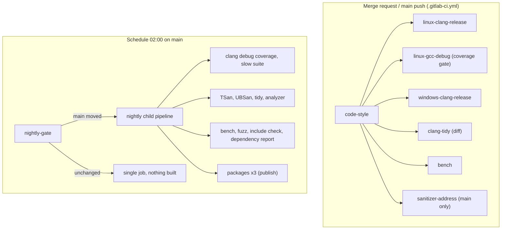
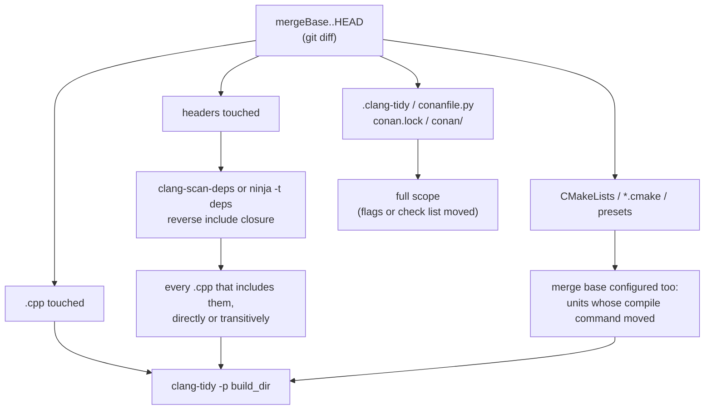

# Continuous Integration {#page-ci}

[TOC]

**Level:** Expert. **Read first:** [Contributing](contributing.md).

This page documents the Owl Engine Continuous Integration: what GitLab CI runs and when, where the configuration
lives, and the analyses it relies on. For local build instructions see [Building Owl Engine](building.md); for
contribution conventions see [Contributing](contributing.md).

## Overview

Owl Engine is built and tested by **GitLab CI** on [gitlab.argawaen.net](https://gitlab.argawaen.net) (project
argawaen/Owl). Every job is one `ci_action.py` call (`ci/actions/`); the YAML only says which preset runs where and
when:

| File                      | Content                                                                       |
|---------------------------|-------------------------------------------------------------------------------|
| `.gitlab-ci.yml`          | Merge request and `main` pipeline: rules, stages, the jobs.                   |
| `ci/gitlab/templates.yml` | Shared blocks (runners, artifacts, analysis, bench) and the secrets they use. |
| `ci/gitlab/nightly.yml`   | The nightly child pipeline.                                                   |
| `ci/gitlab/nightly-unchanged.yml` | The child pipeline written when `main` did not move.                  |

| Area         | Coverage                                                                                                          |
|--------------|-------------------------------------------------------------------------------------------------------------------|
| Build / Test | Linux x64 — Clang Release, GCC Debug, Clang Debug (nightly); Windows x64 — Clang Release; Linux ARM64 (cross compiled) |
| Quality      | Code Style, clang-tidy, static analyzer, 3 sanitizers (Address + Leak, Thread, UB), include check, fuzzing, bench |
| Packaging    | Engine + Owl Nest archives of the tested release tree, per platform, published by the nightly                     |
| Reporting    | Findings as Code Quality reports, tests as JUnit, line coverage as Cobertura, all on the merge request            |

## Pipelines



## What runs when

| Job                                         | Draft MR / `Experiment/*` | Ready MR | Doc-only ready MR | `main` push | Nightly |
|---------------------------------------------|---------------------------|----------|-------------------|-------------|---------|
| `code-style`                                | ✅                         | ✅        | ✅                 | ✅           | —       |
| `linux-clang-release` (Doxygen)             | ✅                         | ✅        | ✅                 | ✅           | —       |
| `linux-gcc-debug` (coverage gate)           | ❌                         | ✅        | ❌                 | ✅           | —       |
| `windows-clang-release`                     | ❌                         | ✅        | ❌                 | ✅           | —       |
| `clang-tidy` (diff scope)                   | ❌                         | ✅        | ❌                 | ❌           | full    |
| `bench` (runner tag `bench`)                | ❌                         | ✅        | ❌                 | ❌           | ✅       |
| `sanitizer-address`                         | ❌                         | ❌        | ❌                 | ✅           | —       |
| `linux-clang-debug` (Clang coverage)        | ❌                         | ❌        | ❌                 | ❌           | ✅       |
| `slow-suite` (Release, every test)          | ❌                         | ❌        | ❌                 | ❌           | ✅       |
| `sanitizer-thread`, `sanitizer-undefined-behavior` | ❌                  | ❌        | ❌                 | ❌           | ✅       |
| `static-analyzer`, `include-check`          | ❌                         | ❌        | ❌                 | ❌           | ✅       |
| `fuzz`, `dependency-report`                 | ❌                         | ❌        | ❌                 | ❌           | ✅       |
| `package-linux-x64`, `-linux-arm64`, `-windows-x64` | ❌                 | ❌        | ❌                 | ❌           | ✅       |

- **Draft merge requests** (title `Draft:`) and **`Experiment/*` branches** run Code Style and Linux Clang Release
  only: the fast verdict. An experiment is not meant to be merged as such; move the work to a `Feature/*` branch for
  the full one.
- **Ready merge requests** add the GCC Debug build (coverage gate), Windows Clang Release, clang-tidy and the
  benchmarks. Every job but Code Style and Linux Clang Release is skipped when only documentation moved (`rules:
  changes`: everything outside `doc/`, `.claude/`, the root Markdown files and `LICENSE`).
- Marking a draft ready **does not start a pipeline**: run one by hand from the merge request (*Run pipeline*). A
  pipeline run by hand always runs the ready set.
- **Merging** needs the last pipeline to succeed (*Settings > Merge requests > Pipelines must succeed*); this
  replaces any composite check.
- **`main` push**: Code Style, the three builds and the address sanitizer, on the merged result.
- **Nightly**: a pipeline schedule on `main` at 02:00 runs `nightly-gate` (`NightlyGate`), which writes the child
  pipeline only when `main` moved since the last successful scheduled pipeline, a single no-op job otherwise. The
  child pipeline builds nothing in the three package jobs beyond their own tree: each builds and tests its release
  tree, then publishes the archives to the site (Linux x64 also publishes the documentation).
- **Nightly by hand**: *Build > Pipelines > Run pipeline* on any branch with `NIGHTLY` = `true` runs the gate and the
  whole child pipeline on that branch, whether it moved or not, and none of the usual jobs; only `main` publishes.

Code Style and Linux Clang Release run on documentation-only merge requests because those paths are their input:

- **Code Style** — codespell and the markdown checks read `doc/` and the root markdown files; `doc-identifiers`
  checks that every symbol, file or `OWL_*` option cited between backticks in `doc/pages` exists in the repository
  (`ci/utils/doc_identifiers.py`: the changelog, the roadmap and the design pages are skipped, the short list of
  names living elsewhere is `EXCEPTIONS`, each with its reason).
- **Linux Clang Release** — the only job whose preset (`linux-clang-release`) sets `OWL_ENABLE_DOCUMENTATION=ON`;
  Doxygen documents it, with `WARN_AS_ERROR=YES` over `doc/`, `README.md`, `CHANGELOG.md`, `ROADMAP.md` and
  `CONTRIBUTING.md`.

## Reports

- **Findings** (Code Style, clang-tidy, static analyzer) are GitLab Code Quality reports
  (`ci/utils/code_quality.py`): the merge request shows the new ones on the diff.
- **Tests** are JUnit reports; a build job (`BuildAndTest`) reads from its preset what to build, test, cover,
  document and package.
- **Coverage** is a Cobertura report plus the `coverage:` regex of the job. The `Coverage` action fails the job when
  the line coverage of the engine (without backends, `gcovr.cfg`) is more than one point below the last successful
  job of the same name on `main`, read through the GitLab API (`OWL_GITLAB_API_TOKEN`).
- **Benchmarks** compare with `test/bench/baseline/<preset>.json`; only the runner tagged `bench` measures them. A
  pipeline run by hand with `BENCH_CALIBRATE=true` (and `BENCH_ROUNDS=<n>`) publishes a proposed baseline instead
  (see `test/bench/README.md`).

## Runners and secrets

Jobs take tagged runners: `linux` + `docker` + `amd64` (an arm64 runner never takes an x64 image), `windows`, and
`bench` (one machine, so timings stay comparable). The runner configuration provides `CONAN_HOME` and `CCACHE_DIR` on persistent volumes, `SYS_PTRACE` and
`seccomp=unconfined` for the sanitizers, and qemu-user (`binfmt_misc`) for the arm64 tests; the YAML sets none of them.
Conan's cache takes one writer at a time, so each concurrent slot of a runner uses its own `$CONAN_HOME/slot-<n>`.

The secrets are masked project CI/CD variables, never in the repository:

| Variable                                                      | Used for                                     |
|---------------------------------------------------------------|----------------------------------------------|
| `OWL_DEPLOY_URL`, `OWL_DEPLOY_LOGIN`, `OWL_DEPLOY_PASSWORD`   | Publishing packages and documentation        |
| `OWL_CONAN_CACHE_URL`, `CONAN_LOGIN_USERNAME_OWL_CACHE`, `CONAN_PASSWORD_OWL_CACHE` | The Conan binary cache |
| `OWL_GITLAB_API_TOKEN`                                        | Coverage reference and nightly gate (`read_api`) |

## Fuzzing

`linux-fuzz` builds every `test/fuzz/*_fuzzer.cpp` (libFuzzer, `OWL_FUZZING=ON`) with AddressSanitizer. The `Fuzz` action
runs each `owl_*_fuzzer` for five minutes (`-- --time=<seconds>`, `-- --fuzzer=<name>` for one) on
`output/fuzz/<fuzzer>/corpus`, seeded from `test/fuzz/corpus/<name>/` when that folder exists. A crash, a leak or a
timeout fails the job; its input lands in `output/fuzz/<fuzzer>/artifacts/`, kept as the job's artifacts, and
replays with `bin/<fuzzer> <input>`.

```bash
./docker_run.sh poetry run python ci_action.py Build linux-fuzz
./docker_run.sh poetry run python ci_action.py Fuzz linux-fuzz -- --time=60
```

## Dependency report

On `main`, Build Linux x64 / Clang ends with the `DependencyReport` action. It never fails the job.

- ConanCenter: `conan graph outdated` on `conanfile.py` (every option on) resolves the whole graph, transitive
  packages and build tools included, the local recipes through the `owl-local` remote (registered as
  `cmake/Conan.cmake` does, so the result does not depend on the cache); every version of each flagged package is
  then listed on ConanCenter, because Conan's own "latest" sorts `cci.<date>` snapshots above semantic versions and
  can hide a real update.
- Upstream: the tags of the GitHub or GitLab repository of each source of `conan/recipes/` (second sources
  included); sources pinned to a commit or hosted elsewhere are not checked.

An update counts within its scheme (semantic or date), with the same flavour (`-docking`), and as a pre-release only
after a pre-release; `KNOWN_FALSE_POSITIVES` keeps the few older versions that sort higher (ImGuizmo 1.83). Each update
is logged as a warning, the list written to `output/dependency_report.json` and its count logged (`-- --no-upstream` skips the tags).

```bash
./docker_run.sh poetry run python ci_action.py DependencyReport linux-clang-release
```

## Include check

A recent libstdc++ (MSYS2 MinGW) does not include `<cstdint>`, `<mutex>`, … transitively, so a file that
names `uint32_t` or `std::mutex` without including the header breaks the Windows build while every Linux
configuration stays green — the precompiled header `owlpch.h` hides the gap. Two complementary gates catch it
on Linux:

- **`std-includes` (Code Style)** — a lexical audit (`ci/utils/std_includes.py`): every file under `source/`,
  `test/unit/` and `test/bench/` must include the standard header of each `std::` symbol, `uint*_t` and `size_t` it names.
  A `.cpp` may rely on its own header and on `owlpch.h`. Fast, runs on every merge request, any platform.
- **Include Check (`linux-include-check`)** — `ci_action.py IncludeCheck` configures the preset (it sets
  `OWL_INCLUDE_CHECK=ON`) and builds `owl_include_check`, defined in `cmake/IncludeCheck.cmake`:
  - `owl_header_check` compiles every header of `source/owl/{public,private}`, `source/owlnest/{sources,runner}`,
    `test/unit/test_helper` and `test/bench/` alone in a generated translation unit;
  - `owl_source_check` compiles every `.cpp` of the engine, the editor, the runner, the tests and the bench again;
  - both with the flags of the real target, **without the PCH**, against libc++ with
    `_LIBCPP_REMOVE_TRANSITIVE_INCLUDES` (`-Wno-everything`: only the hard errors matter). Nothing is linked, so
    the libstdc++-built dependencies are no obstacle.

Run it locally (the build image ships libc++):

```bash
./docker_run.sh poetry run python ci_action.py IncludeCheck linux-include-check
./docker_run.sh cmake --build output/build/linux-include-check --target owl_header_check   # headers only
```

The compile check catches project headers that are not self-contained too (a missing `core/Macros.h`), which
the lexical audit cannot see; the lexical audit catches what libc++ happens to provide transitively.

## Clang-tidy scoping

`linux-clang-tidy` configures the tests too (`OWL_TESTING=ON`) but never runs them (`run_tests: false` in its
`vendor.silmaen` block, which wins over `OWL_TESTING`), so both analyses cover `test/` (about 510 translation
units): `test/unit/.clang-tidy` inherits the root configuration minus the checks whose pattern is the point of a test
(suspicious argument order, copies and moves under test, float loop counters, …), and the analyzer mode drops
`EnumCastOutOfRange` and `FloatLoopCounter` on test files (`TEST_ANALYZER_EXCLUSIONS`).

The `clang-tidy` job of a ready merge request is the one this concerns. It analyses only the translation units that
merge request can change the verdict of. The nightly `clang-tidy` and `static-analyzer` jobs, a pipeline run by hand
and every case where the narrowing cannot be trusted analyse all of them.

The analysis is **not** hooked into the compiler. `cmake/Sanitizers.cmake`
deliberately leaves `CMAKE_CXX_CLANG_TIDY` unset (for the two `*-clang-tidy`
presets, the only ones that set `OWL_ENABLE_CLANG_TIDY`) and only turns on
`CMAKE_EXPORT_COMPILE_COMMANDS`; the job's `ClangTidy` action then drives
clang-tidy from `compile_commands.json`. The compiler hook has no way to skip a
file, so selecting a subset is only possible from outside it.

The tree is **configured, not compiled** (`build_args` = `-- --configure_only`): clang-tidy needs the compilation
database and the headers, all of them in the sources or staged by the configure (imgui bindings), and the tidy
presets have no precompiled header nor C++ module scan whose build outputs a command would point at.

### How the subset is built



The header step is the one that matters: a `.cpp` outside the diff still gets
analysed when it includes a header the merge request touched. The closure is the
complete include list of every object file — so an indirect include, several
headers deep, is covered too. In a configured tree it comes from `clang-scan-deps`
over the compilation database (preprocessing only, about 5 s for the whole tree on
four cores); in a built tree, from ninja's own dependency database. In practice a change to a core header
(`math/matrices.h`) selects nearly every unit, and a change confined to an
editor panel selects a handful.

A CMake input (`CMakeLists.txt`, `*.cmake`, a preset file) does not widen to everything: the merge base is checked
out in a temporary worktree and configured with the same preset beside the build folder (about 15 s, its Conan
binaries are cached), and the units whose compile command differs between the two databases join the scope. A
change that moves no flag adds nothing; one that moves a global flag adds every unit.

### Diff base

The base is the merge request's **merge base**, `CI_MERGE_REQUEST_DIFF_BASE_SHA`, passed to the action as
`--merge_base`. Not the target branch's head: that head
also carries everything that landed on `main` since the branch started, so
diffing against it would report other contributors' findings on this pull
request. When it is empty the action derives the merge base locally from
`--target_branch` using git's three-dot form, which is the same comparison.

### Falling back to the full scope

Narrowing is an optimisation; missing a finding is not an acceptable failure
mode. Any of these analyses everything:

| Situation                                                                       | Why                                    |
|---------------------------------------------------------------------------------|----------------------------------------|
| not a merge request (nightly, `main`, manual run)                                         | nothing to narrow against              |
| no usable diff base                                                             | the range would be a guess             |
| the diff is empty against the base                                              | a real merge request changes something — bad base |
| `conanfile.py`, `conan.lock`, `conan/` (recipes, profiles)                      | dependencies moved                     |
| `.clang-tidy`                                                                   | the check list itself changed          |
| git, `clang-scan-deps` (or ninja) unavailable, or a scan error                  | the mapping cannot be built            |
| a CMake input changed and the merge base does not configure                     | the moved commands cannot be compared  |

Every fallback is logged with its reason, so a run that looks unexpectedly long
says why in the job log.

### Running it locally

```bash
poetry run python ci_action.py Build linux-clang-tidy -- --configure_only  # the compilation database
poetry run python ci_action.py ClangTidy linux-clang-tidy  # full scope

# What would a merge request against main analyse? (--dry_run stops before the analysis)
poetry run python ci_action.py ClangTidy linux-clang-tidy -- --diff_base=main --dry_run
```

`--full` forces the full scope, `--jobs=N` caps the parallel clang-tidy
processes (default: one per available core, from the scheduler affinity mask).

The findings are written as a GitLab Code Quality report (`output/code-quality/*.json`): the merge request lists the new ones, and a finding fails the job.


## Cross-references

- [Building Owl Engine](building.md) — local CMake invocations and CI action wrappers
- [Contributing](contributing.md) — coding conventions and merge request workflow
- [Roadmap](roadmap.md) — ongoing-quality priorities and per-release goals
