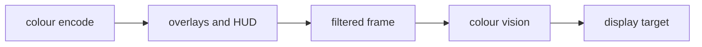

# Accessibility {#page-design-accessibility}

[TOC]

Every game made with Owl can be played by more people, with settings the player controls, summarised in the
[Roadmap](../roadmap.md). They are game settings (`SettingsManager`, `game_settings.yml` defaults, the player's
`settings.yml`), read by the engine every frame through `scene::Accessibility`: a menu changes them with `settings.set`
and the next frame shows the change.

## Settings

| Key                    | Type   | Default | Effect                                                                                    |
|------------------------|--------|---------|-------------------------------------------------------------------------------------------|
| `ui_scale`             | float  | 1       | Scales the HUD, the HUD markers and the subtitles on top of the canvas scale (0.5 to 3)   |
| `color_blind_mode`     | string | `none`  | `protanopia`, `deuteranopia` or `tritanopia`: the whole frame is corrected for it         |
| `color_blind_strength` | float  | 1       | Strength of the correction, 0 to 1                                                        |
| `reduced_motion`       | bool   | false   | No camera motion blur, a still film grain, wipes drawn as fades; scripts read it too      |
| `subtitles`            | bool   | true    | Draws the subtitles of the sounds and of `ui.show_subtitle`                               |
| `subtitle_scale`       | float  | 1       | Size of the subtitles, 0.5 to 3                                                           |
| `subtitle_background`  | float  | 0.6     | Opacity of the band behind the subtitles, 0 to 1                                          |

`Accessibility::setDefaults` registers every key (the runner and Owl Nest Play do it), so `settings.get` and
`settings.reset` know them; `reduced_motion` reaches the screen transitions through `settings.apply`.

## Colour vision {#accessibility-colour-vision}

- With a filter on, the encode, the outlines, the overlays and the HUD draw into a display target of the graph,
  then the `colour vision` pass (`renderer::ColorVision`, `color_encode/color_vision.slang`) draws it into the
  display target through one 3×3 matrix on linear RGB, and copies the entity ids and the depth: the HUD is corrected
  like the world, picking still works. Without a filter the graph is unchanged.
- `ColorVisionFilter::getMatrix`: the simulation is the dichromat matrix of Machado, Oliveira and Fernandes (2009) at
  full severity; the correction adds back the contrast the simulation loses, moved to the channels still seen (red
  to green and blue for protanopia and deuteranopia, blue to red and green for tritanopia). The strength blends either
  with the identity. Greys stay grey in every mode.
- The player setting corrects the frame of a game; Edit mode shows the scene as authored. Owl Nest previews a
  simulation in Edit and in Play (viewport **Show > Colour vision preview**), so the designer sees what a colour-blind
  player sees.

## Reduced motion

| What                    | With `reduced_motion`                                                           |
|-------------------------|---------------------------------------------------------------------------------|
| Camera motion blur      | Off                                                                             |
| Film grain              | One still pattern instead of a new one every frame                              |
| Screen transition wipes | Drawn as fades of the same coverage, on the same timeline                       |
| Camera shake of scripts | Each script reads `settings.get("reduced_motion")` (the platformer player does) |

## Subtitles {#accessibility-subtitles}

- `SceneSound::subtitle` (Sound Source inspector, **Subtitle**): a localisation key or the text itself. The
  `owl.subtitles` system renews the line, translated, every frame the sound plays within hearing of the primary
  listener (any sound that is not spatial, a spatial one nearer than its **Max Distance**; every sound without a
  listener), and the line stays `Subtitles::g_lingerSeconds` (1.5 s) after it stops or goes out of hearing.
- `ui.show_subtitle(text, seconds)` and `ui.clear_subtitles()` for dialogues, voices and scripted captions.
- `scene::Subtitles` keeps at most three lines, the same text renewed instead of repeated; `HudPass` draws them in
  Play, centred at the bottom of the screen over every canvas, the newest lowest, wrapped at 80 % of the width.

## Status

| Item               | Status                                                                          |
|--------------------|---------------------------------------------------------------------------------|
| UI scale           | Done (`ui_scale`)                                                               |
| Colour-blind modes | Done: correction for players, simulation preview in Owl Nest                    |
| Subtitles          | Done: sounds and Lua                                                            |
| Reduced motion     | Done: motion blur, film grain, wipes, scripts                                   |
| Input remapping    | Planned in the gamepad improvements ([Windowing and input](windowing-input.md)) |
| Readable fonts     | Legible fonts and sizes by default ([HUD system](hud-system.md))                |
