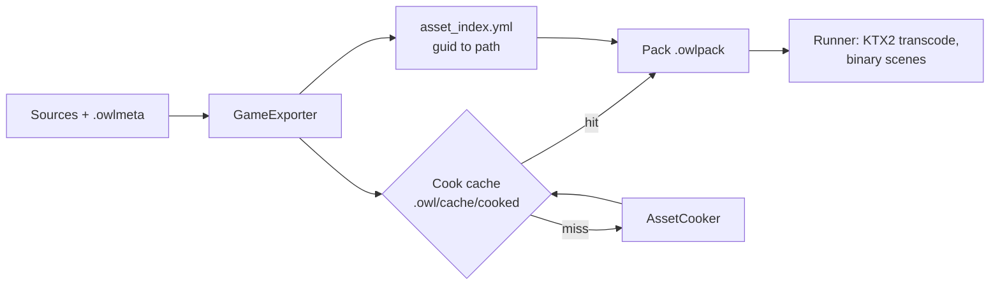

# Content pipeline {#page-design-content-pipeline}

[TOC]

Design of the asset pipeline: GUIDs, the cook and its cache, the binary scene format. Animation is in
[Skeletal animation](skeletal-animation.md), effects in [Effects](gpu-effects.md), the world-authoring bricks (double
positions, splines, data tables) in [Large worlds](large-worlds.md); visual scripting and procedural graphs have their
own pages: [Visual scripting](visual-scripting.md), [PCG graphs](pcg-graphs.md).

## Offline asset pipeline (cooking) {#content-pipeline-cook}

Every asset of a project has a **GUID** kept in a `<file>.owlmeta` sidecar; the export **cooks** each packed asset
through a content-addressed cache and the runner loads the cooked bytes.

### GUIDs and references

- A project opened in Owl Nest gets a sidecar per asset: `FormatVersion`, `Guid` (16 hex digits), `Importer` and, for
  a texture, `Settings` (`Nearest`, `Compression` `None`/`Uastc`/`Etc1s`, `Mips`).
- `AssetRegistry` (owned by the `Application`) maps GUID and path. A copy of a file with its sidecar gets a new GUID
  on the most recently written copy; an orphan sidecar is warned about; hidden folders (`.owl/`, `.git/`) are skipped.
  Read-only directories (runner, export, headless sessions) never write.
- A serialized reference is `gid:<16 hex>:<path hint>`: a known GUID resolves to the current path, an unknown one to
  the hint. Plain paths, `nam:` and `pat:` load too. Renaming or moving a file with the editor commands keeps every
  reference valid because the GUID follows the file.

### Cook and cache

- The cache entry `<project>/.owl/cache/cooked/<2 hex>/<key>.owlc` is keyed by the XXH3-128 of the source bytes, the
  importer, the cooker version and the settings; `manifest.yml` skips re-hashing unchanged files. An asset is cooked
  again only when one of them changes.
- Texture `Compression`: `None` keeps the source (an unreadable image only warns); `Uastc` and `Etc1s` write KTX2
  Basis Universal with a box-filtered mip chain (none for `Nearest`), UASTC supercompressed with zstd. Decoded to
  RGBA8, textures take several times their compressed size, which is why the cook compresses instead of storing pixels.
- At load the KTX2 is transcoded to BC7, else ASTC 4x4, else RGBA8, following `RenderAPI::supportsFormat`. glTF and
  OBJ images that are cooked keep their KTX2 bytes in `MeshImage::cooked`.
- Scenes, prefabs and HUDs are upgraded to the current `FormatVersion` and stored as a binary tree (next section).
- The cook builds the levels of detail of a mesh whose sidecar asks for some ([Skeletal animation](skeletal-animation.md)).
- The pack holds `asset_index.yml` (GUID to path, `Nearest`), read by the runner. `ExportSettings::cookCacheDirectory`
  (`--cook-cache`) moves the cache; the report counts `cookedAssets` and `cacheHits`; `ExportError::CookFailed`
  reports a failed cook.
- `PackReader::readEntry` is thread-safe: only the seek and read of the stored block are serialised, the zstd
  decoding of entries runs in parallel.
- The cook generates no atlas and does not optimise meshes.

## Binary scene format {#content-pipeline-binary}

`YamlDocument::toBinary` writes the node tree of a scene, prefab or HUD behind the `OWLB` magic; the loader rebuilds
the tree without parsing text and runs the same deserializers, about twice as fast as the YAML on large scenes, from a
smaller file. YAML stays the editor and source format; the cook converts it, after upgrading it to the current
`FormatVersion`.

## Hot reload {#hot-reload}

Assets, Slang shaders and Lua scripts hot reload in Owl Nest. Hot reload of a C++ game module is to be evaluated
after 1.0: game code built as a shared library, swapped while the editor runs, state kept through serialization.

## Environment

Weather and environment effects (rain, snow, fog) are built by a project on particles and post-processing, not an
engine system; the day-night cycle is an engine component ([3D core](3d-core.md#procedural-sky-and-day-night-cycle)).
