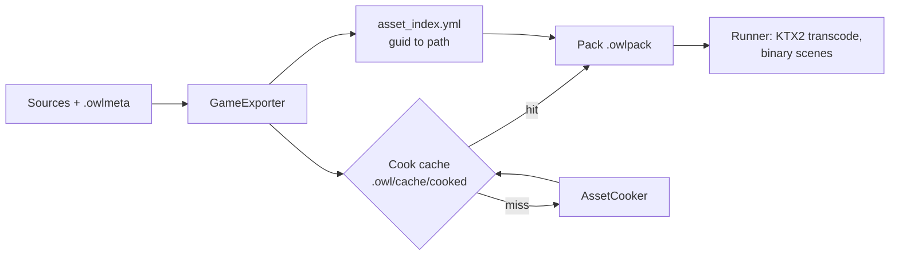

# Content pipeline {#page-design-content-pipeline}

[TOC]

Design page for the v0.6.0 content work (assets, animation, effects), summarised in the [Roadmap](../roadmap.md).
Visual scripting and procedural graphs have their own pages: [Visual scripting](visual-scripting.md),
[PCG graphs](pcg-graphs.md).

## Offline asset pipeline (cooking) {#content-pipeline-cook}

Every asset of a project has a **GUID** kept in a `<file>.owlmeta` sidecar; the export **cooks** each packed asset
through a content-addressed cache and the runner loads the cooked bytes.

### GUIDs and references

- A project opened in Owl Nest gets a sidecar per asset: `FormatVersion`, `Guid` (16 hex digits), `Importer` and, for
  a texture, `Settings` (`Nearest`, `Compression` `None`/`Uastc`/`Etc1s`, `Mips`).
- `AssetRegistry` (owned by the `Application`) maps GUID and path. A copy of a file with its sidecar gets a new GUID
  on the most recently written copy; an orphan sidecar is warned about; hidden folders (`.owl/`, `.git/`) are skipped.
  Read-only directories (runner, export, headless sessions) never write.
- A serialized reference is `gid:<16 hex>:<path hint>`: a known GUID resolves to the current path, an unknown one to
  the hint. Plain paths, `nam:` and `pat:` still load. Renaming or moving a file with the editor commands keeps every
  reference valid because the GUID follows the file.

### Cook and cache

- The cache entry `<project>/.owl/cache/cooked/<2 hex>/<key>.owlc` is keyed by the XXH3-128 of the source bytes, the
  importer, the cooker version and the settings; `manifest.yml` skips re-hashing unchanged files. An asset is cooked
  again only when one of them changes.
- Texture `Compression`: `None` keeps the source (an unreadable image only warns); `Uastc` and `Etc1s` write KTX2
  Basis Universal with a box-filtered mip chain (none for `Nearest`), UASTC supercompressed with zstd.
- At load the KTX2 is transcoded to BC7, else ASTC 4x4, else RGBA8, following `RenderAPI::supportsFormat`. glTF and
  OBJ images that are cooked keep their KTX2 bytes in `MeshImage::cooked`.
- Scenes, prefabs and HUDs are upgraded to the current `FormatVersion` and stored as a binary tree (next section).
- The pack holds `asset_index.yml` (GUID to path, `Nearest`), read by the runner. `ExportSettings::cookCacheDirectory`
  (`--cook-cache`) moves the cache; the report counts `cookedAssets` and `cacheHits`; `ExportError::CookFailed`
  reports a failed cook.

| Engine Demo export (73 PBR JPEGs)         | Pack size | Cook (cold / warm cache) |
|-------------------------------------------|-----------|--------------------------|
| Sources, `None`                           | 59.8 MiB  | none                     |
| All UASTC                                 | 94.1 MiB  | 43.7 s / 0.5 s           |
| All ETC1S                                 | 27.9 MiB  | 20 s                     |
| ETC1S colour and ARM, UASTC normal maps   | 49.0 MiB  | not measured             |

Decoded to RGBA8 the same textures take 314 MiB, which is why the cook compresses instead of storing pixels. The
cooked Engine Demo tavern runs on lavapipe Vulkan with validation on without a message.

Still open:

- Atlas generation
- Mesh optimisation

The cook builds the levels of detail of a mesh whose sidecar asks for some ([Skeletal animation](skeletal-animation.md)).

## Binary scene format {#content-pipeline-binary}

`YamlDocument::toBinary` writes the node tree of a scene, prefab or HUD behind the `OWLB` magic; the loader rebuilds
the tree without parsing text and runs the same deserializers. YAML stays the editor and source format; the cook
converts it, after upgrading it to the current `FormatVersion`.

| Scene load (owl_bench)  | YAML    | Binary  |
|-------------------------|---------|---------|
| 1000 entities           | 2.98 ms | 1.77 ms |
| 10000 entities          | 78.5 ms | 36.0 ms |

The binary form is 22% smaller than the YAML.

## Parallel pack `readEntry`

Wrap `PackReader::readEntry` so multiple entries can be zstd-decompressed concurrently (file seek serialized under a
mutex, decompression off-mutex). Useful for packed games loading dozens of textures in parallel at startup. Needs
PackReader thread-safety audit + a worker-friendly API.

## Hot reload

- Assets, Slang shaders and Lua scripts hot reload ship in v0.3.0 (see [Foundations](foundations.md))
- ![To evaluate][evaluate] Hot reload of a C++ game module, evaluated after 1.0 (game code built as a shared library, swapped while the
  editor runs, state kept through serialization)

## Animation

Detailed in [Skeletal animation](skeletal-animation.md).

- Skeletal animation
    - Bone hierarchy and skinning
    - Animation clips with blending and transitions
    - Animation state machine component
- Mesh LOD support (multiple detail levels per mesh, produced by the cook)

## Effects

- Particle system
    - GPU-accelerated particle emitters
    - Configurable: lifetime, velocity, colour over time, size, gravity
    - Emitter shapes: point, sphere, cone, box
    - Editor: visual particle preview and property curves
    - Trails and ribbons behind moving emitters
- Emissive materials (feeding the v0.5.0 bloom) and lens flares
- Advanced post-processing on the v0.5.0 stack: chromatic aberration, film grain, motion blur, depth of field

## World authoring

Detailed in [Large worlds](large-worlds.md):

- World positions in double with a floating origin
- Spline component and its editor (paths, lanes, rails)
- Data tables: typed records edited in a grid in Owl Nest, read from Lua
- Mesh sockets: named attachment points, entities assembled at runtime

## Environment

- Weather and environment effects (rain, snow, fog, day-night cycle) are a sample-project demo built on particles and
  post-processing, not an engine system

[evaluate]: https://img.shields.io/badge/-To_evaluate-8250df?style=flat-square
