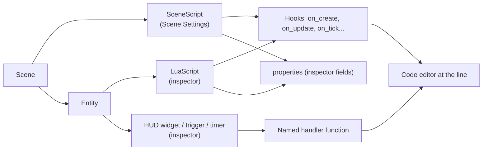

# Editor reach {#page-design-editor-reach}

[TOC]

Design page of the editor reach work of v0.5.0, summarised in the [Roadmap](../roadmap.md): everything a game of
the Engine Demo or of the [sample games](sample-games.md) uses can be found, read and tuned in Owl Nest, without
opening a Lua or YAML file to discover it. It extends the *Editor coverage* rule of
[Ongoing quality](ongoing-quality.md) from the authored objects to the scripts and the settings that drive them.

## Goal

- A designer opening a scene sees every script it runs, every Lua function the engine calls, and every value a
  script reads from the scene, each one clickable to its source
- Generic behaviours (a flickering light, a moving platform, a patrol) are engine components edited in the
  inspector, not code copied from one script to the next
- A value a designer tunes (a jump height, a spawn count, a colour) is a field of the inspector, undoable, saved in
  the scene, never a `local X = 7.5` at the top of a script
- A gap is caught by the CI, not by the maintainer playing a demo

## Rules

| Rule               | Choice                                                                                                                                                                     |
|--------------------|----------------------------------------------------------------------------------------------------------------------------------------------------------------------------|
| Scripts            | Every script a scene runs is listed: the scene script in Scene Settings, entity scripts on their entity, with an **Open** button                                           |
| Lua functions      | Every function the engine may call is shown where it is bound: lifecycle hooks on the script, HUD handlers on their widget, trigger and timer callbacks on their component |
| Hook state         | Each known hook of a script shows *defined* or *not defined*; a defined hook opens the code editor at the line of its `function`                                           |
| Scene script       | A scene owns one optional script of its own (`SceneScript`), with the hooks of an entity script but no entity; no more "global" script on the camera                       |
| Tuned values       | A value a designer changes is a script property (`properties = { ... }`) or a component field, drawn by the inspector, never a top-level local                             |
| Generic behaviours | A behaviour found in two scripts, or that any game would want, becomes an engine component with a system `owl.*`, its script removed                                       |
| Layer settings     | Every key a render-stack layer reads in `applyConfig` has a field in the layer overrides of Scene Settings                                                                 |
| Files              | Every file type the engine reads opens in Owl Nest: a document of its own, the code editor for text, the system viewer otherwise                                           |
| Check              | `EditorCoverage` (gui_tests) fails when a component field has no inspector widget or a layer key has no override field                                                      |

## Scripts in the editor

- **Hook list.** The inspector of a `LuaScript` (and the scene script section) lists the hooks the engine calls:
  `on_create`, `on_update`, `on_tick`, `on_destroy`, `on_collision`, `on_trigger_enter`, `on_trigger_exit`,
  `on_triggered`, `on_interact`, `on_timer`. A defined hook shows its line and an **Open** button; an undefined one is
  dimmed. The lines come from the loaded chunk (`debug.getinfo(fn, "S").linedefined`), refreshed with the file.
- **Bound handlers.** A component that names a Lua function (a HUD button, a trigger, a timer) shows the script that
  defines it, a warning when no script of the scene defines it, and the same **Open** button.
- **Scene script.** `SceneScript` is saved in the scene file (new format version, a migration step moving a script
  found on the primary camera when it only drives the scene) and edited in Scene Settings; it runs before the entity
  scripts in the `Scripts` phase. Lua: `scene.*` from it as from an entity script, `self` absent.
- **Properties.** The `properties` table of a script gains `color` (sRGB, a colour picker), `vec2` and `vec3`,
  optional `min`, `max` and `step`, an entity reference (UUID picker) and a list of numbers or strings; the inspector
  shows the default from the script and a reset button per field.

## Behaviour components

| Component      | Replaces                                                            | Fields                                                                                                       |
|----------------|---------------------------------------------------------------------|--------------------------------------------------------------------------------------------------------------|
| `LightFlicker` | `scripts/mesh/tavern.lua` (fire, candles), `platformer/flicker.lua` | Style (`Fire`, `Candle`, `Pulse`), amplitude, speed, seed, colour shift, position jitter, dips (rate, depth) |
| Flame follow   | The flame-card formulas of `tavern.lua`                             | A `LightFlicker` field on a sprite or mesh: scale and tint follow the flicker factor of a linked light       |
| `Oscillator`   | `platformer/moving_platform_h.lua`, `moving_platform_v.lua`         | Axis or offset, amplitude, period, phase, easing; kinematic bodies moved through physics                     |
| `Patrol`       | `hub/hub_villager.lua`, `hub/hub_wanderer.lua`                      | Waypoints (edited in the viewport), wait time, speed, loop or ping-pong, random wander radius                |
| `Drift`        | `iso/iso_cloud.lua`                                                 | Velocity, range, wrap, follow-camera factor                                                                  |

Each ships with inspector, viewport gizmos where it has a shape (patrol waypoints, oscillator range), undo
through the command registry, Lua accessors and YAML, as every authored object.

## Inventory

Measured on 2026-10-22 over `engine_demo/` and `samples/`; each row becomes a migration in the delivery plan.

| Where                                       | Not reachable in Owl Nest                                                                 | Fix                                      |
|---------------------------------------------|-------------------------------------------------------------------------------------------|------------------------------------------|
| Tavern (`scripts/mesh/tavern.lua`)          | Fire and candle flicker, flame scaling, candle lookup by name, exit transition            | `LightFlicker`, properties               |
| Platformer (`platformer/*.lua`)             | Jump, coyote time, buffers, camera lift; moving platforms; a second flicker               | Properties, `Oscillator`, `LightFlicker` |
| Hub (`hub/*.lua`)                           | Ambient smoke and bells, critter counts, villager patrols, water tile animation           | Properties, `Patrol`, animated tiles     |
| Raycast level (`raycast/raycast_level.lua`) | Secret and treasure lists and totals, hearing range                                       | Properties (tag counting)                |
| Iso town (`iso/*.lua`)                      | Build rules, trip goals, traffic fleet and economy, cloud drift                           | Properties (lists), `Drift`              |
| Breakout, Sokoban, Wolfenstein              | Ball, paddle, power-ups, timings, map size, minimap, door tags                            | Properties                               |
| Raycast layer                               | `FloorColor`, `CeilingColor`, fog colour and range                                        | Layer overrides                          |
| Isometric layer                             | `TileWidth`, `TileHeight`                                                                 | Layer overrides                          |
| Mesh and voxel layers                       | `SunDirection`, `SunIlluminance`, `Ambient`, `AmbientLuminance` (voxel: nothing editable) | Layer overrides                          |

## Editor fixes and gaps

| Item                | State                                                                                              |
|---------------------|----------------------------------------------------------------------------------------------------|
| Material document   | The **Open** buttons of the texture maps do nothing, while the Content Browser opens the same file |
| Text files          | A `.txt` file (`gamecontrollerdb.txt`) does not open: text files open in the code editor           |
| Material thumbnails | `.owlmat` files show a generic icon: a sphere rendered with the material, as the mesh thumbnails   |
| Prefabs             | A `.owlprefab` cannot be opened: a prefab document showing its entities, editable, saved back      |

## Delivery plan

One pull request per row, in this order.

| #   | Pull request                                                                                       |
|-----|----------------------------------------------------------------------------------------------------|
| 1   | Editor fixes: material texture **Open** buttons, text files in the code editor                     |
| 2   | Layer overrides for every key of the raycast, isometric, mesh and voxel layers                     |
| 3   | Hook list and bound handlers in the inspector, **Open** at the line of the function                |
| 4   | `SceneScript`: a script of the scene in Scene Settings, migration of the camera-held scene scripts |
| 5   | Script properties: colour, vectors, ranges, entity references, lists                               |
| 6   | `LightFlicker` and flame follow; the tavern and platformer flicker scripts removed                 |
| 7   | `Oscillator`, `Patrol`, `Drift`; the matching demo scripts removed                                 |
| 8   | Tuned constants of the Engine Demo and the sample games moved to properties                        |
| 9   | Material thumbnails and a prefab document                                                          |
| 10  | Coverage test: every component field and layer key has an editor widget                            |
