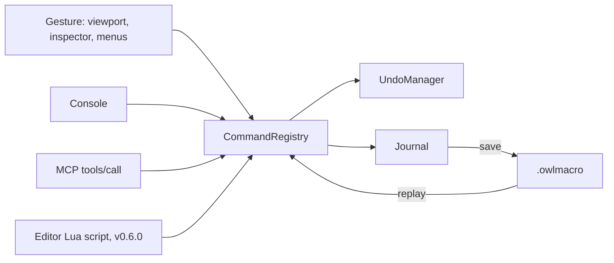

# Editor console and scripting (v0.4.0, v0.6.0) {#page-design-editor-scripting}

[TOC]

Design page for scripting Owl Nest itself, summarised in the [Roadmap](../roadmap.md). It builds on the editor command
API of the [MCP server](mcp-server.md) work: the console, the journal, the MCP tools and the editor scripts are four
clients of the same command registry.

## Goal

Everything done in the editor can be typed, recorded, replayed and scripted: a gesture produces a named command, the
command is written to a journal, the journal can be saved and replayed, and from v0.6.0 a Lua script can issue the same
commands with loops and conditions. Game scripts and editor scripts share one language, Lua, already embedded.

## Prerequisite: every edit gesture is a command

The journal only records what goes through `CommandRegistry`. At v0.4.0 kickoff the registry holds 13 commands while the
inspector, the viewport gizmo and several panels still push `UndoCommand`s directly. Every new edit gesture
is a registry command (ongoing rule, see [Ongoing quality](ongoing-quality.md)); existing gestures move over in the PRs
that touch them, the inspector field edit (`component.set`) and the gizmo transform first (done in NEST2).

## v0.4.0 — NEST2: console and journal

**Status: done.** Parser and printer in `commands/CommandLine.h`, journal in `commands/CommandJournal.h` (bound to the
registry, owned by the session), macros in `commands/Macro.h` (`macro.run`, undo groups of `UndoManager`), console
without UI in `session/Console.h` and its panel in `panel/ConsolePanel.h`; user documentation in
[Editor](../editor_console.md#editor-console). The inspector field edit (`component.set replace=true`), the gizmo drag
(`entity.set_transform`) and the inspector rename (`entity.rename`) are registry commands. Gestures still pushing an
undo command directly: the scene settings panel (physics, layers), "Revert to Prefab" and "Apply to Prefab", "Route to
layer" in the hierarchy, the voxel brush and tile painting, and the edits of the asset documents (tilemap, tileset,
font, node graph, Scene Flow), which have undo histories of their own.

- **Command line syntax**: `entity.create name="Tree" parent=$1`, one command per line; values in the argument types
  of the registry (text, number, bool, Vec2 / Vec4 as `(1, 2)`, colour as `#rrggbb`, enum by name, entity by UUID or
  `$n`).
- **Result references**: each result gets `$n` (`$1` is the first command of the session, `$_` the last one), so a
  recorded sequence can refer to the entities it created without hard-coded ids.
- **Console panel**: interactive input with history (↑ / ↓, kept across sessions), completion of command names,
  argument names and enum choices from the `ArgSpec`s, `help <command>`, results and errors printed below. Commands
  refused during Play are reported as such.
- **Journal**: every command executed in the session, whatever its source, appended as one line with its result;
  shown in the console, filterable by source (gesture, console, MCP, replay).
- **Macros**: save a selection of the journal as a `.owlmacro` asset (plain text, one command per line, `#` comments);
  replay from the Content Browser, the console (`macro.run path`) or MCP. A replay is one undo group: one Ctrl+Z
  cancels it. A failing line stops the replay and reports its line number.
- **Tests**: parser and printer round-trip for every argument type, `$n` resolution, a replay undone in one step,
  a scenario step `macro:`.

Depends on MCP1 (`EditorSession`): console, journal and replay are written against the session interface, so they work
in the headless session too.

## v0.6.0 — Lua editor scripts

- **Interactive Lua console**: the v0.4.0 console gains a Lua mode, a REPL like Python's — variables kept between
  lines, the value of an expression printed, multi-line input while a block is open, `help(editor.entity)`. Lines in
  command syntax are still accepted.
- **`editor` module** generated from the registry: `editor.entity.create{name = "Tree"}` returns the structured result;
  same names, arguments and refusals as the MCP tools.
- **Separate Lua state** from the game: editor scripts never run inside Play and cannot reach the game state directly.
  The game sandbox rules apply (no `io`, `os`, `debug`, `package`).
- **Editor scripts as assets** (`.lua` under `editor/` in the project): run from a menu, a shortcut or the console;
  a script may add a menu entry or a tool button.
- **Export a macro to Lua**: a `.owlmacro` converted into the equivalent script, the first step from recording to
  editing.
- A whole script is one undo group.

## Decisions

- **Lua, not Python**: Lua is already embedded (Conan `lua/5.5.0`), sandboxed, and is the language of game scripts:
  one language to learn. Embedding CPython means a runtime and standard library to package, MinGW builds on Windows and
  a second set of bindings. JavaScript is excluded.
- **No custom language**: the command syntax stays a flat list of commands; loops and conditions are Lua's job.
- **Journal records commands, not input events**: replays are independent of window size, camera and timing. Input
  replay for games is a separate v0.7.0 topic.

