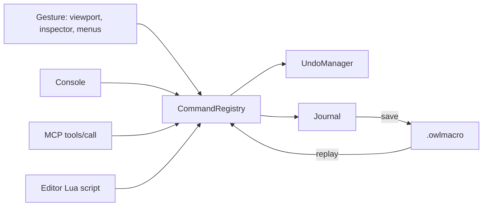

# Editor console and scripting {#page-design-editor-scripting}

[TOC]

Design of scripting Owl Nest itself. It builds on the editor command API of the [MCP server](mcp-server.md): the
console, the journal, the MCP tools and the editor scripts are four clients of the same command registry.

## Goal

Everything done in the editor can be typed, recorded, replayed and scripted: a gesture produces a named command, the
command is written to a journal, the journal can be saved and replayed, and a Lua script can issue the same commands
with loops and conditions. Game scripts and editor scripts share one language, Lua.

## Every edit gesture is a command

The journal only records what goes through `CommandRegistry`, so every edit gesture is a registry command (ongoing
rule, see [Ongoing quality](ongoing-quality.md)): the inspector field edit (`component.set replace=true`), the gizmo
drag (`entity.set_transform`), the rename (`entity.rename`) among them. Asset documents with an undo history of their
own run their named commands on it through `commands::DocumentHost` (the sound cue and localisation documents with
`sound.*` / `locale.*`, for instance).

## Console and journal

Parser and printer in `commands/CommandLine.h`, journal in `commands/CommandJournal.h` (bound to the registry, owned by
the session), macros in `commands/Macro.h` (`macro.run`, undo groups of `UndoManager`), console without UI in
`session/Console.h` and its panel in `panel/ConsolePanel.h`; user documentation in
[Editor](../editor_console.md#editor-console). They are written against the `EditorSession` interface, so they work
in the headless session too.

- **Command line syntax**: `entity.create name="Tree" parent=$1`, one command per line; values in the argument types
  of the registry (text, number, bool, Vec2 / Vec4 as `(1, 2)`, colour as `#rrggbb`, enum by name, entity by UUID or
  `$n`).
- **Result references**: each result gets `$n` (`$1` is the first command of the session, `$_` the last one), so a
  recorded sequence can refer to the entities it created without hard-coded ids.
- **Console panel**: interactive input with history (↑ / ↓, kept across sessions), completion of command names,
  argument names and enum choices from the `ArgSpec`s, `help <command>`, results and errors printed below. Commands
  refused during Play are reported as such.
- **Journal**: every command executed in the session, whatever its source, appended as one line with its result;
  shown in the console, filterable by source (gesture, console, MCP, replay).
- **Macros**: save a selection of the journal as a `.owlmacro` asset (plain text, one command per line, `#` comments);
  replay from the Content Browser, the console (`macro.run path`) or MCP. A replay is one undo group: one Ctrl+Z
  cancels it. A failing line stops the replay and reports its line number.
- **Tests**: parser and printer round-trip for every argument type, `$n` resolution, a replay undone in one step,
  a scenario step `macro:`.

## Lua editor scripts

Engine side `script::ScriptConsole` (`script/ScriptConsole.h`), editor side `session/LuaConsole.h` and the Console
panel; user documentation in [Editor](../editor_console.md#editor-lua).

- **Interactive Lua console**: a Lua mode of the console, a REPL like Python's — variables kept between lines, the
  value of an expression printed, multi-line input while a block is open, `help(editor.entity)`. Lines in command
  syntax are accepted too.
- **`editor` module** generated from the registry: `editor.entity.create{name = "Tree"}` returns the structured result;
  same names, arguments and refusals as the MCP tools.
- **Separate Lua state** from the game: editor scripts never run inside Play and cannot reach the game state directly.
  The game sandbox rules apply (no `io`, `os`, `debug`, `package`).
- **Editor scripts as assets** (`.lua` under `editor/` in the project): run from the Console menu **Editor Scripts** or
  the Content Browser (**Run as Editor Script**); a script cannot add a menu entry or a tool button. What stays in
  the editor (a command, a panel, an inspector drawer, a document type, an importer) is an
  [Owl Nest plugin](../mods.md#mods-nest-plugins): the same `editor` module (`session::EditorModule`) in a Lua state
  per plugin.
- **Reading the scene**: a plugin reads entities, their components and their fields with `nest.entities`,
  `nest.components`, `nest.fields` and `nest.field`, through the serialisation of the scene; there is no write path
  besides the `editor.*` commands.
- **Nested commands**: a command run by another command (a macro line, a plugin command step) is journaled as nested and
  left out of a macro built from the journal, which replays the parent once.
- **Entity ids** reach Lua as their decimal digits: a Lua number only holds 53 bits exactly.
- **Export a macro to Lua**: a `.owlmacro` converted into the equivalent script, the first step from recording to
  editing.
- A whole script is one undo group, and an error undoes it.

## Decisions

- **Lua, not Python**: Lua is already embedded (Luau), sandboxed, and is the language of game scripts: one language to
  learn, no second runtime to package nor second set of bindings.
- **No custom language**: the command syntax stays a flat list of commands; loops and conditions are Lua's job.
- **Journal records commands, not input events**: replays are independent of window size, camera and timing. Input
  replay for games is separate ([Simulation and networking](simulation-networking.md#simulation-replay)).
