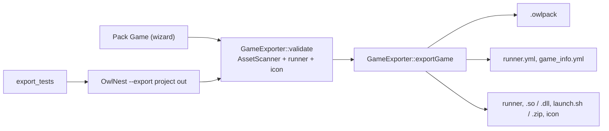

# Game export {#page-design-game-export}

[TOC]

How a game authored in Owl Nest is exported, and the design of the export to every target.

## One export path

`data::assets::pack::GameExporter` (engine) does the whole export; Owl Nest *Pack Game*, `OwlNest --export` and the
tests call it:

- `validate()` scans the project from its first scene (`AssetScanner::scanProject`) and lists missing references,
  a missing runner and a missing icon; the editor shows them before packing.
- `exportGame()` writes the pack, rewrites absolute `pat:` texture paths of scenes, tilesets, tilemaps and prefabs to
  the packed `nam:` entry, writes `runner.yml` / `game_info.yml` with a YAML emitter, copies the icon (searched in
  the project, then the asset directories), the runner and every shared library next to it (replacing older
  copies), then writes `launch.sh` (Linux) or the `.zip` (Windows). Failures return an `ExportError`.
- `OwlNest --export <project dir or owl_project.yml> <output dir>` runs it headless (Null backends) from the
  executable folder, so the engine assets are found whatever the current directory; exit code 0 on success.

## Headless runner

- `--headless` starts the runner on the Null window, renderer and sound backends.
- `--smoke-test [frames]` plays the first scene, then every other scene of the pack, `frames` frames each (60 by
  default); `scene.quit()` moves to the next scene. The runner exits with code 1 if any error was logged or a scene
  failed to load (`LogBuffer::getErrorCount`, `Application::setExitCode`).
- The runner also exits with code 1 when `runner.yml` or the first scene is missing.

## Automated test

`test/unit/export_tests` (CTest label `export`):

- unit tests of `GameExporter` on a synthetic project: file layout, `runner.yml` round trip with `:` in the name,
  `pat:` relocation, stale library replacement, every `ExportError`;
- end to end: `OwlNest --export engine_demo`, check that every scene, tileset, tilemap and script is in the
  pack without absolute path, move the game folder elsewhere, run `launch.sh --headless --smoke-test 60` from
  another directory, and fail on a non-zero exit code or any warning / error in `Owl.log`; the same run covers every
  sample game and project template (`GameExportEndToEnd.PlaysFromItsExportFolder`, one case per project, run in
  parallel shards by CTest).
- The exported binaries keep the build-tree RPATH after `$ORIGIN`; harmless, since `$ORIGIN` comes first.

## What the pack holds {#game-export-content}

A game packs only the engine files it uses: no engine font beyond the default, no viewport gizmo, no owl logo, no
shader of an unused renderer.

| Content       | Packed                                                                                              |
|---------------|-----------------------------------------------------------------------------------------------------|
| Shaders       | Folders of the `RendererSet` of the game (`RendererSet::getShaderFolders`), sources and SPIR-V      |
| Fonts         | Fonts referenced by the scenes and HUDs, the default font, the ImGui fonts when the project asks    |
| Engine images | None in the pack; the window icon is copied beside the game, the Owl logo when the project has none |
| Owl Nest      | Nothing: icons and logos are never collected                                                        |

| Decision           | Choice                                                                                                                    |
|--------------------|---------------------------------------------------------------------------------------------------------------------------|
| Renderer families  | `RendererSet`: 2D family always, raycast, isometric, `Renderer3D` (mesh and voxel layers)                                 |
| Families of a game | Layer types of its stack, plus `Renderer3D` when a scene holds an `Environment` (sky, lights)                             |
| Runtime            | `Renderers` in `runner.yml` → `AppParams::renderers` → `Renderer::initShaders` and layer factory                          |
| Shader sources     | Kept: the SPIR-V cache key hashes the source, and the runner recompiles a rejected binary                                 |
| ImGui              | Project setting `imGui` (off): `ImGui` in `runner.yml` → `AppParams::hasGui`, fonts `g_UiFontFiles`                       |
| Checks             | `RendererSet_test`, `ExportPacksOnlyTheEngineFilesOfTheGame`; every shipped project smoke-tested on lavapipe and llvmpipe |

## Reading in the pack {#game-export-in-memory}

The runner opens the pack and every loader reads its entries in memory; nothing is extracted, and
nothing is written next to the game (no `assets/`, no `cache/`).

| Item         | Choice                                                                                                    |
|--------------|-----------------------------------------------------------------------------------------------------------|
| Asset lookup | `readAssetBytes`: the open pack first, then the asset directories; `AssetLibrary::find` sees pack entries |
| Loaders      | Textures, sounds (libsndfile virtual I/O), fonts, ImGui fonts, shader sources and SPIR-V from bytes       |
| `readEntry`  | Thread-safe: the read of the stored block is serialised, deobfuscation and zstd run in parallel           |
| Font atlases | Baked at export into `cache/font/`; a game writes no atlas cache and warns when one is missing            |
| Extraction   | None at runtime; `extractPack` stays for the tools                                                        |
| Checks       | Every shipped project exported and played headless, then on lavapipe with OpenAL on its null device       |

The lavapipe run of `GameExportEndToEnd` fails on any warning, on any shader compiled at start and on any file
written next to the game.

## Project shaders {#game-export-project-shaders}

A project shader (`<project>/shaders/<renderer>/<name>.slang`, which replaces the engine shader of the
same name) is compiled by the export for Vulkan and OpenGL; the game compiles no shader at start.

| Item    | Choice                                                                                                    |
|---------|-----------------------------------------------------------------------------------------------------------|
| Trigger | A packed `.slang` whose stored SPIR-V is missing or does not match the cache key of its expanded source   |
| Source  | Expanded from its pack path, includes looked up as the game looks them up, so that the keys match         |
| Output  | `shaders/<renderer>/spirv/<api>/` with its `.hash`, kept in the cook cache: a second export compiles none |
| Failure | A shader that does not compile stops the export (`ExportError::CookFailed`)                               |
| Report  | `ExportReport::shadersBaked`                                                                              |

## Export to every target (planned)

Design of the export for the five targets; the platforms themselves are in
[Modding and platforms](modding-platforms.md).

| Item                   | Subject                                                | Anchor                    |
|------------------------|--------------------------------------------------------|---------------------------|
| Hosts and targets      | Any host exports any target                            | `game-export-targets`     |
| Runner templates       | Host and Web runners shipped, the others downloaded    | `game-export-templates`   |
| Shaders per target     | Baked at export by the host, none at runtime           | `game-export-shaders`     |
| Signing                | Owl never signs for the developer                      | `game-export-signing`     |
| Game code              | Lua and node graphs everywhere, C++ through the SDK    | `game-export-game-code`   |
| Export report          | Size, shaders, unused assets, warnings                 | `game-export-report`      |
| Smoke tests per target | Every target exported and played in CI                 | `game-export-smoke-tests` |

### Hosts and targets {#game-export-targets}

- Owl Nest ships on linux-x64, linux-arm64, windows-x64.
- Games target linux-x64, linux-arm64, windows-x64, android-arm64, web; the game developer chooses a set of targets
  per export.
- Every host exports every target.
- A Linux game is a portable tar.gz with its libraries bundled and found through `$ORIGIN`, built on the Ubuntu 26.04
  glibc (no older glibc); an AppImage and a Flatpak are exported next to it.
- Release runners only, no debug runner: diagnostics come from the `runner.yml` log level and console, the crash
  reporter ([Crash reporter](crash-reporter.md)) and Play in the Nest.
- A Windows game carries its project icon in its executable: the export rewrites the resources of the PE in C++ on
  any host (`data::assets::pack::setExecutableIcon`), the first icon group replaced by 16 to 256-pixel images of the
  project icon (bitmaps, PNG for 256), the version information and the manifest kept; a patch that fails leaves the
  Owl icon and a warning, not a failed export.
- An Android game is an APK the Nest assembles on any host, without the Android SDK nor a JDK on the workstation
  (`android::writeApk`): the stripped libraries of the Android runner, the binary `AndroidManifest.xml` the Nest writes
  (package name, label, version, a `NativeActivity` requiring Vulkan 1.3), a `resources.arsc` holding the project icon,
  the game's assets and `owl_assets.txt`; stored entries aligned on 4 bytes, signed with the schemes v2 and v3
  ([Signing](#game-export-signing)). Games are developed on the desktop, never on the device.

### Runner templates {#game-export-templates}

- Every Nest package ships the runner of its own host (it shares the Nest's libraries) and the Web runner (about
  5 MB compressed): a game exports and plays offline for these two targets.
- The other targets download their runner at their first export, from `https://owl.argawaen.net` by default; the
  runner server is an editor preference, any server answering the same API (below) replaces it.
- The Nest accepts only the runners of its own version: each Nest package carries `runners.json`, the name, size and
  SHA-256 of every runner archive of its release; a download or an import that does not match is refused. No signed
  manifest: the Nest package is the trust anchor.
- Runners are cached in the user data folder (`runners/<version>-<hash>/<target>/`), shared by every project; the Nest lists
  them with their size and removes the versions no Nest uses any more.
- Offline: the runner archives are published on their own next to the Nest packages; **Import runner…** takes a
  downloaded archive, checked against `runners.json` like a download. No "full" Nest package with every runner.
- Server API, plain HTTPS `GET` with the user agent `OwlNest/X.Y.Z`, a static file tree is enough:
  `<server>/runners/<version>/<hash>/OwlGameRunner-<version>-<hash>-<target>.tar.gz`, `<hash>` the commit of
  the Nest (a nightly and a release of one version differ).
- Size: about 10 MB compressed per runner once Slang leaves the runner (Slang is most of the runner's libraries).
- Release pipeline: each runner is built once, published as an archive per target and listed in the `runners.json` of
  each Nest package; the Android, Web and arm64 runners are built at night and at release, on a pull request only when
  its diff touches their backend.
- Build images (made by the maintainer): the Android NDK and emsdk with a headless browser each get their own image,
  like the arm64 cross image; `docker_run.sh` reaches them through `OWL_DOCKER_IMAGE`. Windows runners are built
  natively on the Windows agent.

### Shaders per target {#game-export-shaders}

The host (Slang lives in the Nest) bakes every shader of the pack, engine and project, for each chosen target:

| Target         | Shader format                                                                      |
|----------------|------------------------------------------------------------------------------------|
| Vulkan desktop | SPIR-V                                                                             |
| Vulkan Android | SPIR-V 1.3                                                                         |
| WebGPU         | WGSL                                                                               |
| OpenGL         | SPIR-V for GL 4.6 (`ARB_gl_spirv`): OpenGL is a desktop fallback on recent drivers |

Rules:

- No shader is generated at runtime in a shipped game; future material, particle and post graphs generate at cook
  time.
- Shader compilation lives in an editor-side library (`OwlShaderCompiler`) used by the Nest, `OwlRunner`,
  `OwlShaderBake`, the tests and the benchmarks, not in `libOwlEngine`.
- The game runner (`OwlGameRunner`) links no Slang and fails with a clear error on a missing shader.

`OwlShaderCompiler` (`source/shader_compiler/`) is the only library that links Slang; it installs itself into the
engine before `main` through `renderer::utils::setShaderCompiler`, and `renderer::utils::compileShader(source, module,
ShaderTarget)` produces the four formats: `Vulkan` (SPIR-V 1.6), `OpenGl` (SPIR-V, `glsl_450` profile),
`VulkanAndroid` (SPIR-V 1.3) and `WebGpu` (WGSL). `OwlShaderBake <shaders> <assets> [--targets=...]` bakes the engine
shaders (Vulkan and OpenGL by default), `GameExporter` the project shaders
([Project shaders](#game-export-project-shaders)) for the target of the export: SPIR-V for the desktop, SPIR-V 1.3
for Android, WGSL alone for the Web. The game runner `OwlGameRunner` links
neither the compiler nor Slang: it loads baked stages only and logs an error naming the shader when none matches. Of
the 35 engine shaders, all compile for `vulkan_android` and for WGSL, where the culling counters are `Atomic<uint>`
(under `BACKEND_WEBGPU`, the SPIR-V unchanged). The only macro is
`BACKEND_<api>`, so the variant set is finite.

### Signing {#game-export-signing}

Owl never signs a game for its developer.

| Target          | Signature                                                                                                                                                                              |
|-----------------|----------------------------------------------------------------------------------------------------------------------------------------------------------------------------------------|
| Windows         | The export signs the game executable from any host: Authenticode in C++ on OpenSSL with a `.pfx`, or a custom signing command (covers cloud services); last step, after the icon patch |
| Android debug   | APK signature schemes v2 and v3 in C++ (no JDK); the Nest generates a debug keystore on the first Android export, kept in the Nest settings, never in the project                      |
| Android release | Keystore provided by the developer, path in the Nest settings outside the project; password asked at export or kept in the OS keychain (libsecret, Windows Credential Manager)         |
| Google Play     | AAB, signed with the release keystore                                                                                                                                                  |

- Owl's own binaries (Nest, runners) are signed with a Certum open-source code-signing certificate; it blocks no
  code.

### Game code {#game-export-game-code}

- Lua and node graphs (compiled to Lua) export to every target from every host.
- A game with its own C++ goes through the SDK and its own CI.
- WASM modules: after 1.0, with mods.

### Export report {#game-export-report}

Every export returns an `ExportReport` (`data/assets/pack/ExportReport.h`) and writes it beside the game as
`export_report.yml`:

| Key            | Content                                                                                                     |
|----------------|-------------------------------------------------------------------------------------------------------------|
| `Sizes`        | Total size of the folder, then by category: pack (`.owlpack`, `.owlmod`), runner, libraries, other          |
| `Assets`       | Assets packed, cooked by this export, served by the cook cache                                              |
| `Renderers`    | The optional renderer families the game initialises                                                         |
| `Shaders`      | Project shaders baked, the shader targets of the platform, engine shader files left out                     |
| `Mods`         | The `.owlmod` files of the embedded extension packs                                                         |
| `UnusedAssets` | Project files with an importer the scan did not pack (hidden folders, output, icon, mod sources aside)      |
| `Warnings`     | The validation warnings and what the export could not do (icon, gamepad mappings, localisation, archive)    |

Owl Nest shows it in the **Export Report** window at the end of *Pack Game*; `OwlNest --export` prints its summary
(`ExportReport::getSummary`).

### Smoke tests per target {#game-export-smoke-tests}

Every target is exported and played in CI:

| Target  | Where                                                                                |
|---------|--------------------------------------------------------------------------------------|
| Linux   | Linux agents                                                                         |
| Windows | `hecate` agent                                                                       |
| Web     | Headless browser                                                                     |
| Android | A device on the adb server of `artemis`, nightly; until a device with Android 13 and Vulkan 1.3 is there, the nightly job only builds |
