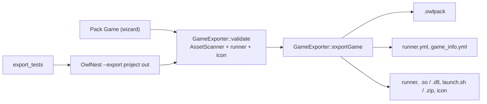

# Game export {#page-design-game-export}

[TOC]

Design page for exporting a game authored in Owl Nest, summarised in the [Roadmap](../roadmap.md).

## v0.3.0 — export that works end to end (correctness)

Phase A of [Foundations](foundations.md). **Done**: the export has one implementation, a command line, and a test
that plays the exported Engine Demo.

### One export path

`data::assets::pack::GameExporter` (engine) does the whole export; Owl Nest *Pack Game*, `OwlNest --export` and the
tests call it:

- `validate()` scans the project from its first scene (`AssetScanner::scanProject`) and lists missing references,
  a missing runner and a missing icon; the editor shows them before packing.
- `exportGame()` writes the pack, rewrites absolute `pat:` texture paths of scenes, tilesets, tilemaps and prefabs to
  the packed `nam:` entry, writes `runner.yml` / `game_info.yml` with a YAML emitter, copies the icon (searched in
  the project, then the asset directories), the runner and every shared library next to it (replacing older
  copies), then writes `launch.sh` (Linux) or the `.zip` (Windows). Failures return an `ExportError`.
- `OwlNest --export <project dir or owl_project.yml> <output dir>` runs it headless (Null backends) from the
  executable folder, so the engine assets are found whatever the current directory; exit code 0 on success.

### Headless runner

- `--headless` starts the runner on the Null window, renderer and sound backends.
- `--smoke-test [frames]` plays the first scene, then every other scene of the pack, `frames` frames each (60 by
  default); `scene.quit()` moves to the next scene. The runner exits with code 1 if any error was logged or a scene
  failed to load (`LogBuffer::getErrorCount`, `Application::setExitCode`).
- The runner also exits with code 1 when `runner.yml` or the first scene is missing.

### Automated test

`test/unit/export_tests` (CTest label `export`, about one second):

- unit tests of `GameExporter` on a synthetic project: file layout, `runner.yml` round trip with `:` in the name,
  `pat:` relocation, stale library replacement, every `ExportError`;
- end to end: `OwlNest --export engine_demo`, check that every scene, tileset, tilemap and script is in the
  pack without absolute path, move the game folder elsewhere, run `launch.sh --headless --smoke-test 60` from
  another directory, and fail on a non-zero exit code or any warning / error in `Owl.log`; since v0.4.0 the same
  run covers every `samples/*/owl_project.yml` (`GameExportEndToEnd.PlaysFromItsExportFolder`, one case per project, run in parallel).

### Defects found by the first real export

| Defect                                                                                          | Fix                                                       |
|-------------------------------------------------------------------------------------------------|-----------------------------------------------------------|
| 71 sprite textures of `raycast_demo.owl` saved as absolute `pat:` paths of a developer checkout | `Texture` saves files inside an asset directory as `nam:` |
| Same paths absent from the pack                                                                 | Export rewrites absolute `pat:` to the packed entry       |
| `VoxelWorld` tileset and its atlas not scanned: voxel scene untextured in the game              | `AssetScanner` follows `VoxelWorld.Tileset`               |
| Project icon only searched in the project folder (`logo/logo_owl.png` is an engine asset)       | Icon also searched in the asset directories               |
| `runner.yml` written by hand: a `:` or `#` in the game name corrupts it                         | YAML emitter                                              |
| Re-export kept the stale `.so` of the previous export                                           | Libraries always replaced                                 |
| `launch.sh` added the current directory to `LD_LIBRARY_PATH` when it was empty                  | Separator only when the variable is set                   |
| Runner returned 0 on a fatal error; missing tilemap / tileset silently ignored                  | Exit code 1, warning on missing tilemap / tileset         |

### Left after v0.3.0

- Rendering of the exported game: covered since Phase B by the image tests on lavapipe / llvmpipe.
- Shaders: precompiled at build time and embedded in the pack (v0.3.0), no Slang compile at first run.
- The exported binaries keep the build-tree RPATH after `$ORIGIN`; harmless (`$ORIGIN` comes first) but not clean.

## v0.6.0 — a game ships only its content

### What the pack holds {#game-export-content}

Status: done. On the shipped projects a pack is about 3.3 MiB smaller than one holding every engine file (Breakout
1.5 MiB against 4.8, Engine Demo 46 against 49): no engine font beyond the default, no viewport gizmo, no owl logo, no
shader of an unused renderer.

| Content       | Packed                                                                                              |
|---------------|-----------------------------------------------------------------------------------------------------|
| Shaders       | Folders of the `RendererSet` of the game (`RendererSet::getShaderFolders`), sources and SPIR-V      |
| Fonts         | Fonts referenced by the scenes and HUDs, the default font, the ImGui fonts when the project asks    |
| Engine images | None in the pack; the window icon is copied beside the game, the Owl logo when the project has none |
| Owl Nest      | Nothing: icons and logos are never collected                                                        |

| Decision           | Choice                                                                                                                           |
|--------------------|----------------------------------------------------------------------------------------------------------------------------------|
| Renderer families  | `RendererSet`: 2D family always, raycast, isometric, `Renderer3D` (mesh and voxel layers)                                        |
| Families of a game | Layer types of its stack, plus `Renderer3D` when a scene holds an `Environment` (sky, lights)                                    |
| Runtime            | `Renderers` in `runner.yml` → `AppParams::renderers` → `Renderer::initShaders` and layer factory                                 |
| Shader sources     | Kept: the SPIR-V cache key hashes the source, and the runner recompiles a rejected binary (v0.8.0 removes Slang from the runner) |
| ImGui              | Project setting `imGui` (off): `ImGui` in `runner.yml` → `AppParams::hasGui`, fonts `g_UiFontFiles`                              |
| Checks             | `RendererSet_test`, `ExportPacksOnlyTheEngineFilesOfTheGame`; every shipped project smoke-tested on lavapipe and llvmpipe        |

### Reading in the pack {#game-export-in-memory}

The runner opens the pack and extracts every entry into `<game>/assets/` before loading anything
(`Application::init`, `extractPack`): the compressed and obfuscated pack ends as readable files next to the game.

| Item            | Target                                                                             |
|-----------------|------------------------------------------------------------------------------------|
| Loaders         | Textures, meshes, sounds, fonts, Lua, documents and shaders load from bytes        |
| Asset lookup    | A pack-backed source in `AssetSearchPaths`, before the asset directories           |
| `readEntry`     | Thread-safe and parallel, for the async texture and mesh loads                     |
| Extraction      | None at runtime; `extractPack` stays for the tools                                 |
| Streamed sounds | Read from the pack through a libsndfile virtual I/O                                |

## v0.8.0 — export to every target

Plan of the export for the five targets, summarised in the [Roadmap](../roadmap.md); the platforms themselves are in
[Modding and platforms](modding-platforms.md).

| Item                   | Subject                                                | Anchor                    |
|------------------------|--------------------------------------------------------|---------------------------|
| Hosts and targets      | Any host exports any target                            | `game-export-targets`     |
| Runner templates       | The five release runners shipped in every Nest package | `game-export-templates`   |
| Shaders per target     | Baked at export by the host, none at runtime           | `game-export-shaders`     |
| Signing                | Owl never signs for the developer                      | `game-export-signing`     |
| Game code              | Lua and node graphs everywhere, C++ through the SDK    | `game-export-game-code`   |
| Export report          | Size, shaders, unused assets, warnings                 | `game-export-report`      |
| Smoke tests per target | Every target exported and played in CI                 | `game-export-smoke-tests` |

### Hosts and targets {#game-export-targets}

- Owl Nest ships on linux-x64, linux-arm64, windows-x64.
- Games target linux-x64, linux-arm64, windows-x64, android-arm64, web; the game developer chooses a set of targets
  per export.
- Every host exports every target.
- A Linux game is a portable tar.gz with its libraries bundled and found through `$ORIGIN`, built on the Ubuntu 26.04
  glibc (no older glibc).
- Release runners only, no debug runner: diagnostics come from the `runner.yml` log level and console, the crash
  reporter ([Crash reporter](crash-reporter.md)) and Play in the Nest.
- A Windows game carries its project icon in its executable (PE resource patch at export).

### Runner templates {#game-export-templates}

- Every Nest package bundles the five release runners: no download, no template manager, no signed manifest; the
  versions are coupled by construction.
- Size: about 10 MB compressed per runner once Slang is removed (measured: Linux runner and libraries 71 MB, of which
  Slang 43 MB).
- Release pipeline: each runner is built once, then each Nest package is assembled with all of them; the Android,
  Web and arm64 runners are built at night and at release, on a pull request only when its diff touches their backend.
- Build image: the Android NDK, emsdk, xwin with `clang-cl` and `lld-link`, and a headless browser join the build image
  (the maintainer extends the image).

### Shaders per target {#game-export-shaders}

The host (Slang lives in the Nest) bakes every shader of the pack, engine and project, for each chosen target:

| Target         | Shader format                                                                       |
|----------------|-------------------------------------------------------------------------------------|
| Vulkan desktop | SPIR-V                                                                              |
| Vulkan Android | SPIR-V 1.3                                                                          |
| WebGPU         | WGSL                                                                                |
| OpenGL         | SPIR-V for GL 4.6 (`ARB_gl_spirv`): OpenGL is a desktop fallback on recent drivers  |

Rules:

- No shader is generated at runtime in a shipped game; future material, particle and post graphs generate at cook
  time.
- Shader compilation leaves `libOwlEngine` for an editor-side library (`OwlShaderCompiler`) used by the Nest,
  `OwlShaderBake` and the tests.
- The runner links no Slang and fails with a clear error on a missing shader.

Current state:

- `OwlShaderBake` bakes the engine shaders only (SPIR-V for Vulkan and OpenGL).
- `GameExporter` does nothing with shaders.
- A project `.slang` is compiled at first run by `loadOrCompileSpirv` (`source/owl/private/renderer/utils/shaderFileUtils.cpp`).
- The only macro is `BACKEND_<api>`, so the variant set is finite.
- Baking project shaders at cook time comes in v0.6.0 with the cook ([Content pipeline](content-pipeline.md)).

### Signing {#game-export-signing}

Owl never signs a game for its developer.

| Target          | Signature                                                                                                                                                                              |
|-----------------|----------------------------------------------------------------------------------------------------------------------------------------------------------------------------------------|
| Windows         | The export signs the game executable from any host: Authenticode in C++ on OpenSSL with a `.pfx`, or a custom signing command (covers cloud services); last step, after the icon patch |
| Android debug   | APK signature schemes v2 and v3 in C++ (no JDK); the Nest generates a debug keystore on the first Android export, kept in the Nest settings, never in the project                      |
| Android release | Keystore provided by the developer, path in the Nest settings outside the project; password asked at export or kept in the OS keychain (libsecret, Windows Credential Manager)         |
| Google Play     | AAB: after 1.0                                                                                                                                                                         |

- Signing Owl's own binaries (Nest, runners): the provider is chosen separately (SignPath Foundation, OV certificate;
  Azure Artifact Signing excludes individuals outside the US and Canada); it blocks no code.

### Game code {#game-export-game-code}

- Lua and node graphs (compiled to Lua) export to every target from every host.
- A game with its own C++ goes through the SDK and its own CI.
- WASM modules: after 1.0, with mods.

### Export report {#game-export-report}

After each export: size per target, shaders baked, unused assets, warnings.

### Smoke tests per target {#game-export-smoke-tests}

Every target is exported and played in CI:

| Target  | Where                                                                                |
|---------|--------------------------------------------------------------------------------------|
| Linux   | Linux agents                                                                         |
| Windows | `hecate` agent                                                                       |
| Web     | Headless browser                                                                     |
| Android | The maintainer's tablet over adb, nightly; device setup decided when the port starts |
