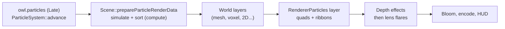

# GPU effects {#page-design-gpu-effects}

[TOC]

Design page for the GPU particle system, the ribbon trails, the emissive effects and the lens flares, summarised in the
[Roadmap](../roadmap.md). User documentation: [Particles and effects](../particles.md).

## Goal

- Fire, smoke, sparks, magic and weather in 2D and in 3D, thousands of particles per emitter for the cost of a few draws
- Trails behind particles (sparks, comets) and behind entities (a sword, a rocket), glowing through the bloom
- Lens flares of the sun and of the bright lights, hidden by what covers them
- Everything authored and previewed in Owl Nest, driven from Lua, and headless tests without a GPU

## Decisions

| Decision            | Choice                                                                                                                         |
|---------------------|--------------------------------------------------------------------------------------------------------------------------------|
| Simulation          | Compute shader `particles/particle_simulate`, one thread per slot; the particle state never leaves the GPU                     |
| CPU reference       | `renderer::simulateParticle`: the same arithmetic in C++, run on the Null backend and by the tests                             |
| Emission            | Counted on the CPU (rate, bursts, duration, loop): the GPU gets a slot range of a ring, no atomics, no free list                |
| Randomness          | PCG hash of the seed, the spawn serial and a channel, identical in C++ and Slang                                               |
| Capacity            | Up to 65536 particles per emitter; past it the oldest slot is replaced                                                         |
| Sorting             | Alpha-blended emitters sorted far to near on the GPU (`particle_sort_keys` then `bitonic_sort`), 1024 particles at most        |
| Additive blending   | `BlendMode::Additive` (`src * a + dst`, destination alpha kept) in the RHI, unsorted                                           |
| Curves              | Colour (gradient) and size (curve) over life baked into 16 samples per frame, read from the draw uniform block                 |
| Rendering           | One instanced draw of camera-facing quads per emitter, depth tested without depth write, in a `RendererParticles` layer        |
| Render-style mixing | The layer draws with the scene camera after the layers before it: over meshes, voxels, tilemaps or sprites, under the HUD      |
| Trails              | Particle trails: up to 16 points recorded by the simulation; entity trails: up to 128 points recorded on the CPU (`Trail`)     |
| Emissive            | Luminance in nits pre-exposed by `Renderer3D::getExposure`, added on linear targets only: the bloom makes it glow              |
| Lens flares         | Post-process after the depth effects: a copy of the colour plus additive glow, halo and ghosts per source                      |
| Flare occlusion     | 16 depth taps around the source in the vertex stage against the post depth of the meshes and voxels; no read-back              |
| Flare sources       | Lights with a `flare` strength, the brightest 8 by their pre-exposed illuminance at the camera (inverse square), the sun too   |
| Floating origin     | A shift is added to the next step: world-space particles and their trails move back by it, also while paused                   |
| Reuse               | Emitters are reused as prefabs and started from presets (`ParticlePreset`); no separate emitter asset                          |
| Editor preview      | Every emitter plays in Edit mode; pause, restart, stop and burst from the inspector or `particles.preview`, nothing saved      |

## Frame

The compute dispatches run before any pass of the frame graph, so they never split a render pass. On Vulkan the
particle and trail buffers are never written from the CPU: they stay persistent device buffers, while the step of the
frame goes through the streamed frame ring.

## Delivery

| Step                                                                                  | Status                  |
|---------------------------------------------------------------------------------------|-------------------------|
| `ParticleSystem`, CPU reference, presets, tests                                       | ![Done][done]           |
| Compute simulation, GPU sort, `RendererParticles` layer, additive blending            | ![Done][done]           |
| Particle trails and `Trail` component                                                 | ![Done][done]           |
| Emissive particles and trails feeding the bloom                                       | ![Done][done]           |
| Lens flares with GPU occlusion, `Light::flare`, camera settings                       | ![Done][done]           |
| Owl Nest: inspector, gradient and curve editors, viewport preview, commands           | ![Done][done]           |
| Lua (`entity.particles_*`, `entity.set_trail_enabled`)                                | ![Done][done]           |
| Image tests (lavapipe, llvmpipe), benchmark `particles/*`, Engine Demo tavern embers  | ![Done][done]           |
| Sorting across emitters, more than 1024 sorted particles (multi-pass sort)            | ![Planned][planned]     |
| Collisions with the depth buffer, vector fields, sub-emitters                         | ![To evaluate][evaluate] |

[done]: https://img.shields.io/badge/-Done-2ea043?style=flat-square
[planned]: https://img.shields.io/badge/-Planned-1f6feb?style=flat-square
[evaluate]: https://img.shields.io/badge/-To_evaluate-8250df?style=flat-square
