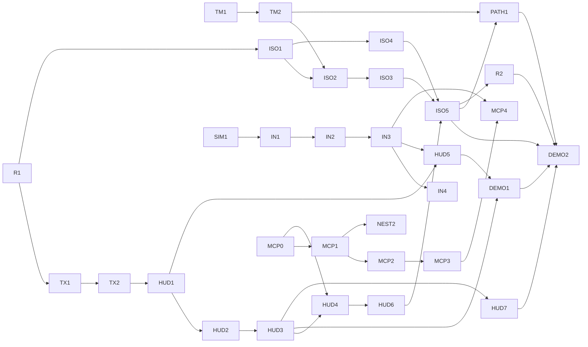

# Isometric worlds (v0.4.0) {#page-design-isometric-worlds}

[TOC]

Design page of the v0.4.0 release, summarised in the [Roadmap](../roadmap.md). It holds the plan: the tracks, the pull
requests in order, the decisions frozen at kickoff, the budgets and the exit criteria. The subsystem pages carry the
specification: [Isometric renderer](isometric.md), [HUD system](hud-system.md),
[Windowing and input](windowing-input.md), [MCP server](mcp-server.md). Audit references (`B-13`, `D-18`, …) point to
`doc/audit/`.

## Goal

Owl Engine must be able to carry a **Transport Tycoon-like game** — not a remake, an engine able to make one, modern
rendering included. v0.4.0 lays the ground for it: an isometric renderer sized for large tile maps, terrain with
slopes, thousands of moving sprites, a HUD able to hold a management game's windows and toolbars, input actions with
a gamepad, a fixed simulation tick, and a local MCP server so tools can drive Owl Nest. Game rules (economy, vehicles,
towns) stay in the projects (`engine_demo/`, `samples/`), never in the engine.

## State at kickoff

What the v0.4.0 investigation (2026-10-12) found on `main`, and that the plan below answers:

- Rendering still lives in `Scene::render`, which branches on layer type keys; every `RenderLayer::onRender` is empty.
  A-02 moved gameplay out of `Scene`, not rendering.
- Tilemaps are rebuilt cell by cell each frame, without culling, truncated past 16 384 cells, uploaded inside the
  render pass; rotation and scale of the entity are ignored, `TilemapLayer::parallax` is never rendered (B-13).
- `Renderer2D` caps transient matrices at 4 096 per batch, scans texture slots linearly, allocates in `drawRect` /
  `drawPolyLine` (B-09); text is converted to Latin-1 and glyphs are stretched to their rectangle (D-18).
- The HUD is a second `Renderer2D` layer in world space with hand-written `RendererTag: ui`; only direct children of a
  `Canvas` draw and react, there is no resolution scaling and no keyboard or gamepad focus.
- Input is polling only, without "just pressed" edges nor gamepad; injection works on the Null backend only; keys are
  hard-coded in engine systems and Lua reads raw key codes.
- The editor command API has 9 commands, no field edit, no structured result; no headless editor session exists.
- The `Feature/KickoffIsometricRenderer` branch (one commit, 107 behind) no longer fits: old `applyConfig`
  signature, no Vulkan Y flip, depth collapsed to 0, no camera. It is **rewritten**, not rebased: only the projection
  helpers and their tests are ported, then the branch is deleted.

## Decisions frozen at kickoff

The June 2026 isometric decisions (D1–D4) were re-checked against the v0.3.0 architecture and the Transport Tycoon
scale; two of them change.

- **D1** — The isometric camera is a real view (45° yaw, 30° pitch for the 2:1 ratio) times `CameraOrtho`: pan,
  power-of-two zoom, Vulkan flip and a usable depth come with it; the gizmo receives this view and projection. Replaces
  D1 "hand-built mat4".
- **D2** — **Depth test + alpha cutout**: each sprite writes its isometric depth; opaque and cut-out sprites draw
  unsorted, only translucent ones (smoke, glass) are CPU-sorted back to front. Replaces D2 "CPU painter sort of
  everything".
- **D3** — Procedural Python atlas generator under Poetry, output committed; it emits albedo plus optional normal and
  depth atlases on the same grid. Extends D3.
- **D4** — Heights belong to the **map**: a `(W+1)×(H+1)` corner-height grid on `TilemapAsset`, the 19 slopes (15 + 4
  steep) derived from it, terraforming possible; the tileset maps (terrain, slope) to a tile and holds foundation
  sprites; `Tileset::kind`. Replaces D4 "`SlopeType` and `cornerHeights` on `TileMeta`".
- **D5** — Pre-rendered sprites are billboards anchored at their world foot point, never projected a second time;
  objects wider than a tile are sliced per footprint tile, each slice with a 3D box.
- **D6** — Tilemaps: 32×32 chunks in persistent GPU buffers, generation counter per chunk, uploads in the prepare phase
  before any layer, chunk culling against the view; maps up to **1024²** stored as binary chunks in the file (format v2
  + migration); 4096² waits for the v0.6.0 content pipeline.
- **D7** — Every render layer draws from its own `onRender`; the isometric and tilemap layers are the first,
  `Scene::render` loses a type-key branch each time a layer moves.
- **D8** — The HUD is an `.owlhud` asset loaded into its own scene, cached per path, shared between scenes and kept
  across transitions; an implicit last pass in pixels; embedded canvases stay legal for menu scenes.
- **D9** — HUD layout: Y-down pixels with the origin at the top left, the most common UI convention (every `UiRect` is
  migrated), nested `UiRect`, min / max anchors besides the 9 presets, reference resolution 1280×720 with a scale
  mode.
- **D10** — Input sampled once per simulation tick into a plain-data `InputFrame`; actions (button, 1D axis, 2D axis)
  evaluated by a pure function into an `ActionFrame` that v0.7.0 can record; the map lives in a packed
  `input_actions.yml`.
- **D11** — MCP: `cpp-httplib` without TLS, `nlohmann_json` promoted to a direct dependency, protocol 2025-11-25 with a
  stateless core that also accepts 2026-07-28.
- **D12** — MCP security: `127.0.0.1` only, `Host` / `Origin` checked against loopback, `application/json` required, a
  256-bit bearer token per session in a `0600` file, 1 MiB body, bounded queue, paths kept inside the project, no Lua
  eval nor shell.

Pulled into v0.4.0 at kickoff (from the later releases of the roadmap of that time): aspect-correct text with
alignment and fit modes, management-game widgets (windows, layout, clipping, tooltips), the fixed simulation tick,
gamepad dead zones and response curves, file dialogues through the desktop portal, the inventory demo. The
2026-10-16 replan, which dropped the old v0.5.0 and merged the later releases into four, pulled three more items in:
tile-graph pathfinding, the draw-order sort key (B-10), and HUD scroll views and lists; node-based editing of other
assets went to the visual scripting of v0.6.0.

## Pull requests

One branch `Feature/*` per pull request. **R** rendering, **TM** tilemaps, **ISO** isometric, **TX** text, **HUD**,
**SIM** simulation tick, **IN** input, **MCP**, **NEST** editor, **PATH** pathfinding, **DEMO** Engine Demo. Sizes:
S < 1 day of review, M a few days, L a week.

### Rendering foundations

- ![Done][done] **R1 — Renderer2D transients (B-09), M.** Transients sized per frame like the instances
  (20 000), texture slot lookup by id, no temporary vectors, renderer id instead of a string in `ScopedActive`. Bench:
  transient path at 10 000 and 100 000 quads, zero allocation per frame in `renderer/`.
- ![Done][done] **R2 — Draw-order sort key (PR-30: B-10, from v0.5.0), M.** A sort key on every 2D
  primitive instead of the primitive type and the storage order, on the depth convention of D2, so 2D, isometric and
  HUD primitives order the same way; HUD windows no longer need one batch each. Changes a shipped render path: the
  image tests stay pixel-identical, the maintainer confirms before merge.
- ![Done][done] **TM1 — Persistent, chunked, culled tilemap (PR-31: B-13), L.** D6 and D7 for tilemaps:
  encapsulated cells with generation counters, chunk cache per asset, culling, full entity transform, no cap,
  `parallax` rendered. Changes a shipped render path: `tilemap.owl` image test stays pixel-identical, the
  maintainer confirms before merge. Bench `tilemap/{32,128,256,1024}` × {1, 4} layers and `edit_one_cell`.
- ![Done][done] **TM2 — Tilemap storage v2, M.** Structure of arrays per map (terrain id, overlay id, flags),
  binary chunks inside `.owltilemap`, `FormatVersion` 2 with the first migration of the chain, storage interface ready
  for 4096². `TilemapDocument` undo by changed chunks instead of whole-asset snapshots.

### Text

- ![Done][done] **TX1 — UTF-8 text (PR-30: D-18), M.** UTF-8 decoded to code points, `Font` API on `char32_t`,
  default charset Latin only (Latin-1 + Latin Extended-A + punctuation + €), extra ranges per font, atlas cached on
  disk, thread count from the task pool.
- ![Done][done] **TX2 — Text layout (from v0.5.0), M.** One uniform scale per em instead of per-axis stretch,
  horizontal and vertical alignment, word wrap, fit modes (clip, shrink, overflow), on `UiText` and
  `Renderer2D::drawString`; scene format migration.

### Isometric

- ![Done][done] **ISO1 — Isometric camera and layer, L.** D1, D2, D5, D7: `RendererIsometricLayer` drawing
  from `onRender`, depth-tested pipeline state with alpha cutout, billboards, translucent sort, projection helpers
  ported from the old branch, `Tileset::kind`. Editor: isometric viewport mode, gizmo fed with the layer's view and
  projection, world-axis cursor and tile highlight.
- ![Done][done] **ISO2 — Isometric terrain, L.** D4: corner heights, 19 slopes, (terrain, slope) table and
  foundations in the tileset, track and road overlay layers following the slope, slope-aware picking (CPU ray against
  the two triangles of each candidate cell). Editor: isometric preview in `TilemapDocument`, raise / lower / level
  tools, overlay brush, slope table in `TilesetDocument`, all undoable.
- ![Done][done] **ISO3 — Atlas generator, M.** D3: `tools/` generator (Pillow), seeded and deterministic,
  terrain × 19 slopes, foundations, overlays, a few sliced buildings, albedo + normal + depth, one set per zoom level
  or mips; pytest on a stable hash, ruff and mypy.
- ![Done][done] **ISO4 — Objects and vehicles, M.** D5 slices with 3D boxes, an anchor-plus-size billboard
  instance without a matrix for thousands of moving sprites, pixel snapping at integer zoom. Bench `iso/*` (budgets
  below).
- ![Done][done] **ISO5 — Demo and close-out, M.** `iso_town.owl`: a Transport Tycoon-style town on a sloped
  map, roads, a vehicle loop and a mouse "build road" tool in Lua, the shared HUD, plus a scene mixing isometric with
  another style; persistent isometric chunk buffers (cells are emitted per frame until then); image tests on
  lavapipe and llvmpipe; [Isometric](isometric.md) and help pages final.

### HUD

- ![Done][done] **HUD1 — HUD layer out of `Scene.cpp`, L.** D9: implicit last pass in pixels, nested layout
  computed once per frame and shared by drawing and hit-testing, anchors, reference resolution and scale modes, Y-down
  coordinates with a scene migration of every `UiRect`; the old `renderHud` (voxel crosshair) renamed
  `renderOverlays`. Image tests of the HUD over raycast and voxel at three resolutions; bench at 500 widgets.
- ![Done][done] **HUD2 — `.owlhud` asset, L.** D8: serializer with its own `DocumentFormat`, `HudLibrary` in
  `EngineContext`, scene key `Hud:` and project `DefaultHud`, Lua `ui.find` (HUD then scene), HUD state in saves,
  Content Browser kind and thumbnail.
- ![Done][done] **HUD3 — Management-game widgets, M/L.** `UiWindow` (title bar, drag, close, raise on click,
  clamped to the screen), `UiLayout` (row, column, grid), clipping by scissor, `UiTooltip`, tool cursor sprite; any
  window blocks world clicks under it. A window covers the ones under it through the R2 sort key.
- ![Done][done] **HUD4 — HUD editor document, L.** `HudDocument` on `.owlhud` and embedded canvases: pixel
  viewport with resolution presets and a colour or image backdrop, rect gizmo with anchor handles and snapping, widget
  palette and drag & drop, multi-select; every action a named command, hence undoable and reachable through MCP.
- ![Done][done] **HUD5 — Focus navigation, S/M.** Keyboard and gamepad focus driven by the `ui_*` actions: nearest
  widget in the direction pressed from the shared layout, `UiFocus` (focusable, initial, neighbours by UUID, focus
  callback, highlight), confirm and cancel, sliders adjusted with left / right, restricted to the top window, mouse
  hover moves the focus, Lua `ui.set_focus` / `ui.get_focus`; the sample menus play with a gamepad alone.
- ![Done][done] **HUD6 — Migration, M.** "Extract canvas to `.owlhud`" command; Engine Demo and project
  templates moved to a shared `huds/gameplay.owlhud`, no `RendererTag: ui` left; empty raycast hint fixed.
- ![Done][done] **HUD7 — Scroll views and lists (from v0.5.0), M.** `UiScrollView` (clip, wheel, draggable bars,
  `ui_scroll`, focus scrolled into view) and `UiList` (a model of any size, only the rows in view drawn and bound from
  Lua, selection by mouse and keys), Lua `ui.scroll_*` / `ui.list_*`, HUD editor palette and `hud.add_widget` kinds,
  bench with a 1000-row list.
- ![Done][done] **DEMO1 — Inventory demo (from v0.5.0), S/M.** Collectible objects, key-locked switches and an
  inventory window with slots in `engine_demo/`, in Lua only, navigable with the gamepad: the showcase of the HUD
  widgets, the shared HUD and focus navigation.
- ![Done][done] **DEMO2 — Engine Demo overhaul, M/L.** The isometric town in the demo's flow, the new HUD,
  text and input in every scene (voxel text no longer stretched), the hub map and the platformer redrawn with the
  Kenney CC0 packs and the isometric art from `tools/iso_atlas`; closes the release.

### Pathfinding

- ![Done][done] **PATH1 — Tile-graph pathfinding (from v0.5.0), M/L.** A* on a tile grid or on a graph built
  from tilemap overlays (roads, tracks), per-edge costs and one-way edges, hierarchical over the 32×32 chunks of TM2,
  incremental update when a tile changes, queries spread over ticks on the task system; Lua API, an editor overlay of
  the graph and a test path; the `iso_town` vehicles follow the roads with it. Spec in [2D complete](2d-complete.md).

### Simulation and input

- ![Done][done] **SIM1 — Fixed simulation tick, S/M.** Systems and Lua get an `on_tick` at a fixed step (project
  setting, 60 Hz by default), beside the variable `on_update`; physics always runs on this fixed clock. The first piece
  of the v0.7.0 determinism.
- ![Done][done] **IN1 — Input frames and edges, M.** D10: `InputFrame` per tick, `isKeyJustPressed` /
  `JustReleased`, injection moved out of the backends so it works on GLFW too; hand-written edge code removed.
- ![Done][done] **IN2 — Gamepad, M.** GLFW `glfwGetGamepadState`, connect / disconnect events, optional
  project mapping file, Null backend injection, per-binding radial dead zone and response curve.
- ![Done][done] **IN3 — Action map, M.** `input_actions.yml` packed with the game, Lua `input.is_action_*`,
  `get_action_value`, `get_action_vector`; scenarios gain an `actions:` step; engine systems and Engine Demo scripts move
  to actions (`is_key_pressed` kept, deprecated).
- ![Done][done] **IN4 — Action map editor, M.** Document with its own undo stack, "press a key" capture,
  default maps in the project templates, live action monitor in Play.

### MCP server

- ![Done][done] **MCP0 — Command API v2, M.** Arguments Vec2, Vec4 / colour and enum with defaults and
  choices, structured result data; `component.set`, `scene.save`, undo / redo commands; edits refused during Play.
- ![Done][done] **MCP1 — Editor session, M.** `EditorSession` interface (scene, undo, registry, play for N
  frames, capture, statistics) implemented by `EditorLayer` and by a headless session on the Null renderer.
- ![Done][done] **MCP2 — `OwlNestMcp` dispatcher, M.** Socket-free JSON-RPC: version negotiation, `tools/*`
  generated from the registry, `resources/*` (scene tree, components, assets, prefabs, documentation, statistics).
- ![Done][done] **MCP3 — HTTP transport, M.** D11, D12: queue drained by the main loop, setting off by
  default, port, token, status bar indicator; jobs wait while a gesture or a modal is in progress.
- ![Done][done] **MCP4 — Play and capture, M.** `play.run` (frames, step, held actions, capture as PNG plus
  phase timings); `doc/pages/mcp.md` with the client setup.

### Editor

- ![Done][done] **NEST1 — File dialogues through the desktop portal (from v0.5.0), S.** nativefiledialog-extended
  built with `portal=True`: `xdg-desktop-portal` over D-Bus instead of GTK, no UI freeze; D-Bus added to the Linux
  package dependencies (the build image already has `dbus-1` 1.16); checked on GNOME and KDE, Wayland and X11.
- ![Done][done] **NEST2 — Console and command journal, S/M.** Command-line syntax with `$n` result references,
  console panel with history and completion from the `ArgSpec`s, journal of every executed command whatever its
  source, `.owlmacro` macros replayed as one undo group; spec in [Editor scripting](editor-scripting.md).

### Order

Four tracks run in parallel; arrows are hard dependencies.

First wave: R1, TM1, SIM1, MCP0 (disjoint files); NEST1 fits in any wave. `Renderer2D.cpp` is touched by R1, TX1, TX2
and ISO1: they merge in that order. `Scene.cpp` is touched by TM1, ISO1 and HUD1: each one removes code from it.

## Performance budgets

New `test/bench/` cases, Null backend CPU unless stated; each one enters `test/bench/baseline/` with its PR.

| Case                                                     | Budget                      |
|----------------------------------------------------------|-----------------------------|
| Tilemap 256² × 4 layers, static camera                   | ≤ 0.1 ms, 0 byte uploaded   |
| Tilemap one-cell edit                                    | one chunk uploaded          |
| Build one 32² chunk                                      | < 0.2 ms                    |
| Isometric 512² map, 1080p, zoom 1, no vehicle            | < 1 ms frame CPU            |
| Isometric 512² map + 5 000 vehicles (cull, sort, emit)   | < 2 ms                      |
| Isometric 512² map zoomed out ×4 (~65 000 visible cells) | < 4 ms                      |
| 1024² map load                                           | < 1 s, ≤ 16 MB of tile data |
| Slope-aware tile picking                                 | < 20 µs                     |
| 10 000 glyphs                                            | one draw call               |
| HUD with 500 widgets (layout + draw)                     | < 0.5 ms, ≤ 2 draw calls    |
| MCP `tools/call` round trip                              | ≤ one frame + 5 ms (median) |

## Later releases prepared here

- v0.5.0: 2D lights use the normal and depth atlases of D3 and an ambient tint (day / night); 3D meshes draw under
  the D1 camera into the same depth buffer; a minimap on a render target builds on HUD3.
- v0.6.0: 4096² maps through the content pipeline, on the TM2 storage interface; procedural terrain heights.
- v0.7.0: replays record the D10 `ActionFrame` stream and drive `play.run`; SIM1 is the clock of the deterministic
  simulation.

## Exit criteria

The release ships when these hold, whatever the date:

- Tilemaps: no truncation (100 000+ visible cells), 0 byte uploaded for a static map, 1024² maps load
- `iso_town.owl` plays in editor and runner: sloped terrain, roads, moving vehicles, a construction tool, zero Vulkan
  validation message on lavapipe, image tests green on OpenGL and Vulkan
- Vehicles of `iso_town` find their way on the road graph; a 2D primitive draws in sort-key order whatever its
  type; a HUD list of 1 000 rows draws only its visible rows
- Tile picking correct on the 19 slopes; the gizmo follows the isometric axes
- One `.owlhud` draws the same over 2D, raycast, voxel and isometric scenes at three resolutions; no
  `RendererTag: ui` left in `engine_demo/`; windows drag, close and stack
- Text never stretched; text beyond U+00FF renders
- Menus and the sample games playable with a gamepad only; every action map edit undoable
- The inventory demo plays with a gamepad only; Owl Nest file dialogues go through the desktop portal, no GTK
- MCP: every registered command exposed as a tool; a create through HTTP then undone restores the scene; 401, 403
  and 413 cases tested; no socket open by default; end-to-end test clean under the thread sanitizer
- Every authored object of this release has full editor support; budgets above in `test/bench/baseline/`; coverage not
  lower than at v0.3.0

## Release status

Checked on 2026-10-18 against `main` at 41de054d (release, Vulkan on lavapipe, `linux-clang-debug`, `linux-include-check`).

| Exit criterion                                                                     | Status             | Evidence                                                                                                                                                                      |
|------------------------------------------------------------------------------------|--------------------|-------------------------------------------------------------------------------------------------------------------------------------------------------------------------------|
| Tilemaps without truncation, 0 byte uploaded when static, 1024² load               | Met                | `tilemap/static/*`, `tilemap/load/1024x1024` (11.8 ms) in the baseline                                                                                                        |
| `iso_town` in editor and runner, zero VUID on lavapipe, image tests green          | Met (runner)       | 0 VUID on the nine Engine Demo scenes (`--frame-bench --backend vulkan --validation`); `owl_render_tests_UTests` and `iso_town*` scenarios pass; editor play to check by hand |
| Vehicles on the road graph, sort-key order, 1 000-row list draws visible rows      | Met                | `iso_town_routes` scenario, `path/*` benches, `hud` bench with a 1000-row list                                                                                                |
| Picking on the 19 slopes, gizmo on the isometric axes                              | Not verified       | `iso/pick/256x256_hills` bench and unit tests exist; gizmo needs a manual look                                                                                                |
| One `.owlhud` over 2D, raycast, voxel, isometric at three resolutions              | Met                | no `RendererTag: ui` in `engine_demo/`, `DemoHudLayout_test`, HUD image tests; window drag, close and stack by hand                                                           |
| Text never stretched, text beyond U+00FF                                           | Met                | `FontUnicode_test`, `hud_text` render test                                                                                                                                    |
| Menus and games with a gamepad only, action map edits undoable                     | Met (manual)       | `main_menu_focus`, `platformer_gamepad` scenarios pass; real gamepad test is manual                                                                                           |
| Inventory demo with a gamepad, file dialogues through the portal                   | Met (manual)       | `portal = True` in `conanfile.py`; GNOME and KDE check is manual                                                                                                              |
| MCP: every command a tool, create then undo, 401 / 403 / 413, off by default, TSan | Met (TSan not run) | `McpHttp_test`, `McpDispatcher_test`; the thread sanitizer run belongs to CI                                                                                                  |
| Editor support for every authored object                                           | Met (manual)       | manual pre-merge check of `ongoing-quality.md`                                                                                                                                |
| Budgets in `test/bench/baseline/`                                                  | Partly met         | see below                                                                                                                                                                     |
| Coverage not lower than v0.3.0                                                     | Met                | 86.2 % lines here, 85.8 % on CI (TeamCity Linux Clang #435) against 83.98 % at the v0.3.0 release (#390)                                                                      |

Also green: every CTest of `linux-clang-debug`, `IncludeCheck linux-include-check`.

Budget rows without a baseline entry: `MCP tools/call round trip` (`mcp/tools_call/entity_rename`, 64 µs locally without
the frame wait, absent from the baseline), `hud/frame/1000_row_list` (documented in `test/bench/README.md`, absent from the
baseline), `path/*` (absent from the baseline). Every other row has a case and an entry, and the stored medians are inside
their budgets (zoom ×4 frame 3.3 ms for 4 ms).

Left to the maintainer:

- Manual tests left: picking on the slopes and the gizmo on the isometric axes (gamepad, file dialogues and editor
  support checked by the maintainer on 2026-10-18).
- Three sample games joined v0.4.0 after this check: Breakout, Sokoban and a Wolfenstein mini without combat
  ([Sample games](sample-games.md)), each checked with a gamepad.
- Refresh the bench baseline from five runs on hephaistos and add the missing entries (`mcp/*` included).
- Version, date and the changelog sections of the release.

[done]: https://img.shields.io/badge/-Done-2ea043?style=flat-square

[progress]: https://img.shields.io/badge/-In_Progress-d29922?style=flat-square

[planned]: https://img.shields.io/badge/-Planned-1f6feb?style=flat-square
