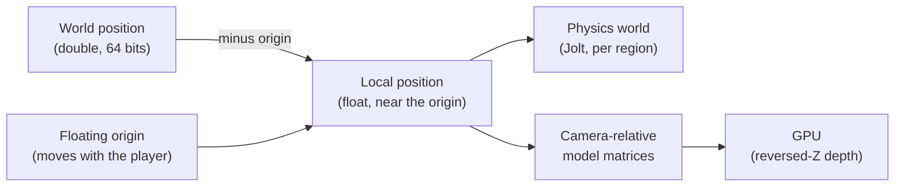

# Large worlds {#page-design-large-worlds}

[TOC]

Design page for the capabilities that let a game span any scale and any time span, from a room to a star system,
summarised in the [Roadmap](../roadmap.md). Each brick also serves smaller games: splines carry isometric roads, data
tables carry management games, the floating origin carries open worlds.

## Goal

- Positions precise to the millimetre anywhere in a world of several astronomical units
- Vehicles assembled from parts at runtime, simulated as articulated bodies that can break apart
- Bodies under gravity fields, their trajectories predicted, time sped up without losing them
- Thousands of entities alive off screen on a coarse model, back to full simulation when the player comes near
- Planets rendered from orbit to the ground in one continuous view, mixed with the other renderer-stack layers

## Precision

A 32-bit float keeps 24 bits of mantissa: its step is about 8 mm at 100 km and 1 m at 10 000 km. A 64-bit double
keeps a step of 0.1 mm at 1012 m. World positions are stored in doubles; everything the GPU and the
physics solver see is relative to a local origin, in floats.

| Decision          | Choice                                                                                                 |
|-------------------|--------------------------------------------------------------------------------------------------------|
| Rendering         | Model matrices built relative to the camera on the CPU, in double, then cast to float                  |
| Depth             | Reversed-Z with a floating-point depth buffer and an infinite far plane, on Vulkan and OpenGL          |
| World coordinates | `WorldPosition` in double beside the float `Transform`; scenes without it keep today's behaviour       |
| Floating origin   | Shifted when the focus leaves a radius; transforms, physics bodies, audio sources and particles follow |
| Owl Nest          | Gizmos, picking, snapping and the camera work in world coordinates; the inspector shows doubles        |
| Serialisation     | Scenes and saves store world positions in double                                                       |

### Lights at astronomical scale {#lights-at-astronomical-scale}

| Decision      | Choice                                                                                                    |
|---------------|-----------------------------------------------------------------------------------------------------------|
| Near a planet | The star is a directional light (angular radius from its size and distance), shadows from cascades        |
| In space      | The star is an emissive body carrying a point light without falloff, placed camera-relative like any body |
| Switching     | The same entity: its light is directional below a distance from the planet, a point light above it        |
| Depth         | Reversed-Z and the infinite far plane keep the star and the planet in one depth buffer                    |
| Shadows       | Planet-scale shadows (eclipses) are analytic (sphere against ray), not shadow maps                        |

## Assembly and articulated bodies

The sockets are detailed in [Skeletal animation](skeletal-animation.md); the physics items are v0.7.0.

- Mesh sockets: named attachment points on a mesh or a prefab, picked and moved in Owl Nest
- Entities snapped together at runtime on their sockets, the hierarchy rebuilt without reloading the scene
- Compound rigid bodies rebuilt when parts join or leave; mass, centre of mass and inertia recomputed
- Breakable joints with a force and a torque threshold, an event when they break
- Physics sub-stepping per scene, for long chains of joints
- Forces and torques applied at a point, from Lua and from systems (thrust, drag, lift computed by the game)

## Gravity and time

- Gravity fields: uniform, point and spherical sources, several summed, per-body opt-out
- Trajectory prediction: the future path of a body under the fields, drawn by a debug view and readable from Lua
- Time warp: the scene clock scaled; above a threshold, bodies leave the solver for analytic propagation
  (conic arcs around the dominant source) and come back when the warp drops
- Simulation level of detail: entities far from the focus follow a coarse model supplied by the game, on a slower
  tick; promotion and demotion are events, deterministic on the v0.7.0 simulation

## Planetary terrain

A renderer-stack layer, like the voxel and isometric ones, composing with the 3D layer and the HUD. User guide:
[Planets](../planets.md).

| Item                                                                                                    | Status  |
|---------------------------------------------------------------------------------------------------------|---------|
| `RendererPlanet` layer and `Planet` component: cube-sphere quadtree LOD, chunks built in the background | Done    |
| Horizon culling, skirts, ancestor chunks standing in while a chunk builds                               | Done    |
| Heights from a PCG graph (`output.height`) and a triplanar detail noise                                 | Done    |
| Atmospheric scattering (single scattering, Rayleigh and Mie), seen from the ground and from orbit       | Done    |
| Scaled space: far planets drawn shrunk toward the camera, level-0 chunks only                           | Done    |
| Owl Nest: inspector, creation, picking; Lua `scene.get_planet_altitude`                                 | Done    |
| Heights read from height map image files                                                                | Planned |
| Starfield and sky behind the planet                                                                     | Planned |
| Physics collision on the chunks near bodies only                                                        | v0.7.0  |

## Content and simulation at scale

- Spline component with its editor: control points, tangents, sampling by distance, paths, lanes and rails
  ([below](#large-worlds-splines))
- Data tables: typed records (columns, references between tables) edited in a grid in Owl Nest, read from Lua
  ([below](#large-worlds-data-tables))
- Emissive materials, lens flares and particle trails on the v0.6.0 effects ([Effects](gpu-effects.md))
- HUD markers anchored to world entities, with off-screen indicators ([HUD system](hud-system.md))
- 3D steering in open space: obstacle avoidance between moving volumes, formations
- Doppler effect and adaptive music driven by game states
- Interest management for replication: relevance areas and priorities, so a client receives only what is near it
- Camera tracks in the sequencer, for cutscenes

## World partition {#world-partition}

Streaming cells on world coordinates (double), additive scenes merged into the running one, loaded and unloaded around
the focus in the background through the task system, without a loading screen. User guide:
[World partition](../world_partition.md).

| Item                                                                                                 | Status  |
|------------------------------------------------------------------------------------------------------|---------|
| `WorldPartition:` scene settings: cubic cells, load and unload radii, one scene per cell             | Done    |
| `owl.world_streaming`: cells read and parsed on the task scheduler, merged two per frame             | Done    |
| `StreamingSource` component, the primary camera when a scene has none                                | Done    |
| Pack export follows the cell scenes and the planet graphs                                            | Done    |
| Owl Nest: cell table, drop to add, multi-select, move, viewport outlines; `scene.*_world_*` commands | Done    |
| Lua `scene.is_world_cell_loaded`, `get_loaded_world_cells`, `set_world_streaming`                    | Done    |
| Streaming in the editor viewport                                                                     | Planned |

## Splines {#large-worlds-splines}

User reference: [Spline](../scene.md#spline-component), [viewport](../editor_viewport.md#viewport-splines).

| Decision                                                                                                      | Why                                                                                   |
|---------------------------------------------------------------------------------------------------------------|---------------------------------------------------------------------------------------|
| The curve math is `math::SplineCurve`, the component `scene::component::Spline` holds one plus lanes and `up` | The math is reusable (camera tracks, roads of a tilemap) without the ECS              |
| Every interpolation is one cubic Bezier per segment (linear and Catmull-Rom converted to Bezier controls)     | One evaluator, one derivative, one exact split for every mode                         |
| Uniform Catmull-Rom, handles a sixth of the neighbour vector                                                  | Switching a curve to Bezier keeps its shape: the inspector copies those handles       |
| Arc-length table rebuilt by every setter, queries `const`                                                     | Sampling is a binary search, two systems may read one curve at once                   |
| Points in the space of the entity                                                                             | Moving, turning or scaling the entity moves the whole path; prefabs carry their paths |
| A lane is a name, a lateral offset and a height along `up`                                                    | Road lanes, rail tracks and formations without a second curve                         |
| `SplineFollower` (`owl.spline_followers`, `PrePhysics`) places the entity in world space, parent included     | Rails for cameras and carts; scripts drive speed, lane and distance                   |
| Orientation: -Z along the curve in 3D, +X on a 2D path (`up` along Z)                                         | A camera looks ahead; a 2D sprite faces its way                                       |
| Viewport gestures run `spline.*` commands, the inspector `component.set`                                      | Every edit is undoable and reachable from the console, macros and MCP                 |
| A point insert splits the Bezier exactly (De Casteljau)                                                       | Refining a path never moves it                                                        |

## Data tables {#large-worlds-data-tables}

User reference: [Data tables](../data_tables.md).

| Decision                                                                                                    | Why                                                                               |
|-------------------------------------------------------------------------------------------------------------|-----------------------------------------------------------------------------------|
| A `.owltable` YAML asset (format 1): columns, then one map per row keyed by column name                     | Diff-friendly, a reordered column does not move the values                        |
| Seven column types: Integer, Float, Bool, Text, Enum, Asset, Reference                                      | What the sample games need (prices, flags, choices, icons, links between tables)  |
| Rows have a unique `key`; a Reference cell holds the key of a row of another table (or its own)             | Keys survive reordering; scripts read rows by name                                |
| A row rename does not rewrite the referencing tables; the grid shows an unknown key in red                  | No hidden edit of other files; the broken link is visible                         |
| Asset cells and the table of a Reference column are stored by GUID                                          | Rename and move in the Content Browser keep them valid, like the other references |
| Cells always have the type of their column; a type change converts them                                     | Lua never meets a string where it expects a number                                |
| `DataTableLibrary` in `app::EngineContext` caches each table once, cleared when Owl Nest saves a table      | No static state; the game and the editor see the saved values                     |
| The export follows quoted `.owltable` paths in scripts, Reference tables and Asset cells                    | A table and what it names ship with the game                                      |
| The grid document runs `table.*` commands on its own undo history, typing previewed then committed on leave | Same pattern as the sound cue and localisation documents                          |
| Lua `datatable.*` (not `table`, the Lua library)                                                            | No clash with the standard `table` functions                                      |

## Delivery {#large-worlds-delivery}

| Release | Items                                                                                                 |
|---------|-------------------------------------------------------------------------------------------------------|
| v0.5.0  | Camera-relative rendering, reversed-Z depth                                                           |
| v0.6.0  | Double positions, splines, data tables, sockets, world partition, planets, camera tracks, HUD markers |
| v0.7.0  | Articulated bodies, gravity fields, time warp, simulation LOD, planetary terrain collision            |
| v0.8.0  | Joysticks and throttles with many axes                                                                |
| v0.9.0  | Interest management                                                                                   |

World positions in double ship in three steps:

| Step                                                                                  | Status |
|---------------------------------------------------------------------------------------|--------|
| `WorldPosition`, world origin and its shift, `FloatingOrigin:` scene settings, editor | Done   |
| Physics bodies, behaviours and sound follow a shift of the origin                     | Done   |
| Owl Nest gizmos, picking, snapping and camera in world coordinates                    | Done   |

World partition and planets ship in the same release:

| Step                                                                  | Status |
|-----------------------------------------------------------------------|--------|
| World partition, streaming sources, Owl Nest cell editing, Lua        | Done   |
| Planetary terrain layer, atmosphere, scaled space, Owl Nest, Lua      | Done   |
| `planet/*` and `world_streaming/*` benchmarks, `planet_*` image tests | Done   |
| Engine Demo far orbit: planet Cinder and streamed debris cells        | Done   |

Sample games that exercise these bricks are listed in [Sample games](sample-games.md).
