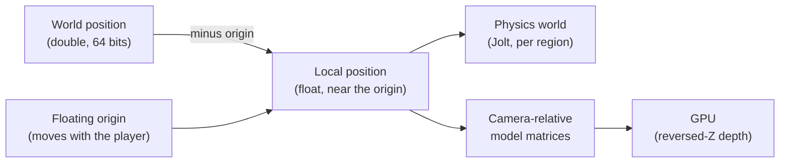

# Large worlds {#page-design-large-worlds}

[TOC]

Design of the capabilities that let a game span any scale and any time span, from a room to a star system. Each brick
also serves smaller games: splines carry isometric roads, data tables carry management games, the floating origin
carries open worlds. The articulated bodies are in [Physics API](physics-api.md), the sockets in
[Skeletal animation](skeletal-animation.md).

## Precision

A 32-bit float keeps 24 bits of mantissa: its step is about 8 mm at 100 km and 1 m at 10 000 km. A 64-bit double
keeps a step of 0.1 mm at 1012 m. World positions are stored in doubles; everything the GPU and the
physics solver see is relative to a local origin, in floats.

| Decision          | Choice                                                                                                 |
|-------------------|--------------------------------------------------------------------------------------------------------|
| Rendering         | Model matrices built relative to the camera on the CPU, in double, then cast to float                  |
| Depth             | Reversed-Z with a floating-point depth buffer and an infinite far plane, on Vulkan and OpenGL          |
| World coordinates | `WorldPosition` in double beside the float `Transform`; scenes without it use the float positions only |
| Floating origin   | Shifted when the focus leaves a radius; transforms, bodies, audio, particles and the AI points follow  |
| Owl Nest          | Gizmos, picking, snapping and the camera work in world coordinates; the inspector shows doubles        |
| Serialisation     | Scenes and saves store world positions in double                                                       |

## Gravity and time {#large-worlds-gravity}

User reference: [Gravity](../physics.md#gravity), [Time Warp](../physics.md#time-warp),
[Simulation Level of Detail](../physics.md#simulation-lod).

- Gravity fields: `GravitySource` (uniform, point and spherical), several summed with the world gravity, per-body scale
  and opt-out, on the 2D and the 3D physics
- Trajectory prediction: `PhysicCommand::predictTrajectory`, Lua `physics.predict_trajectory`, drawn in the viewport
- Time warp: the scene clock scaled up to 100000; above `railsTimeScale`, bodies leave the solver for analytic
  propagation (`math::propagateKepler`, conic arcs around the dominant source) and come back when the warp drops
- Simulation level of detail: `SimulationLod`, entities far from the focus follow a coarse model supplied by the game,
  on a slower tick; promotion and demotion are events, deterministic on the simulation

| Decision                                                                                                                                  | Why                                                                                         |
|-------------------------------------------------------------------------------------------------------------------------------------------|---------------------------------------------------------------------------------------------|
| World gravity is a scene setting; fields add to it, scaled by the body's `gravityScale`; `gravityFields` off keeps the world gravity only | One gravity for ordinary games, fields for the others, a per-body opt-out                   |
| Fields are applied as a force before each step, read from the world position of the source                                                | The solver integrates them like gravity: contacts, sleeping and snapshots need nothing else |
| Types: `Uniform` (zones), `Point` (inverse square), `Spherical` (a solid ball inside its `radius`)                                        | A planet surface and a black hole come from the same component; no singularity inside       |
| Trajectory prediction integrates as the solver does, collisions ignored, sources where they stand                                         | The drawn path matches what the solver does until the first contact                         |
| Rails are closed-form Kepler orbits in universal variables, in double, with the deterministic maths                                       | One evaluation for any warp duration; the same bits on every target                         |
| Patched conics: each body follows the strongest `Point` or `Spherical` source at its position; a uniform pull gives a parabola            | No n-body integration on rails; cheap and predictable                                       |
| The time warp caps the ticks at `railsTimeScale` and lengthens each one by `getRailsFactor()`                                             | The tick count per frame stays bounded at any scale                                         |
| On rails the solver stops: sleeping bodies stay, a body reaching a source's `radius` stops on it, moving sources carry their orbiters     | A conic means nothing under the surface, and the stopped solver cannot catch a landing      |
| A demoted body sleeps held by the solver (`setSimulated`) instead of being removed                                                        | Snapshots, joints and contacts stay consistent; promotion needs no rebuild                  |
| The focus is every enabled `StreamingSource`, else the primary camera; `hysteresis` separates demotion from promotion                     | Same focus as the world partition; no switching on the edge                                 |
| `owl.simulation_lod` runs on the tick in the `Scripts` phase before `owl.scripts`, in a fixed entity order                                | Promotions and demotions fall on the same ticks in a replay                                 |
| A demoted script gets `on_coarse_tick(dt)` instead of `on_update` and `on_tick`; the `Rails` model follows the arc, `Hold` stays          | The game supplies the coarse model; the engine only decides when it runs                    |

## Planetary terrain {#planetary-terrain}

A renderer-stack layer, like the voxel and isometric ones, composing with the 3D layer and the HUD. User guide:
[Planets](../planets.md).

- `RendererPlanet` layer and `Planet` component: cube-sphere quadtree LOD, chunks built in the background
- Horizon culling, skirts, ancestor chunks standing in while a chunk builds
- Heights from a PCG graph (`output.height`) and a triplanar detail noise
- Atmospheric scattering (single scattering, Rayleigh and Mie), seen from the ground and from orbit
- Scaled space: far planets drawn shrunk toward the camera, level-0 chunks only
- Owl Nest: inspector, creation, picking; Lua `scene.get_planet_altitude`
- No physics collision on the chunks, no height map read from an image file, no starfield behind the planet

## World partition {#world-partition}

Streaming cells on world coordinates (double), additive scenes merged into the running one, loaded and unloaded around
the focus in the background through the task system, without a loading screen. User guide:
[World partition](../world_partition.md).

- `WorldPartition:` scene settings: cubic cells, load and unload radii, one scene per cell
- `owl.world_streaming`: cells read and parsed on the task scheduler, merged two per frame
- `StreamingSource` component, the primary camera when a scene has none
- The pack export follows the cell scenes and the planet graphs
- Owl Nest: cell table, drop to add, multi-select, move, viewport outlines; `scene.*_world_*` commands; no streaming in
  the editor viewport
- Lua `scene.is_world_cell_loaded`, `get_loaded_world_cells`, `set_world_streaming`

## Splines {#large-worlds-splines}

User reference: [Spline](../scene.md#spline-component), [viewport](../editor_viewport.md#viewport-splines).

| Decision                                                                                                      | Why                                                                                   |
|---------------------------------------------------------------------------------------------------------------|---------------------------------------------------------------------------------------|
| The curve math is `math::SplineCurve`, the component `scene::component::Spline` holds one plus lanes and `up` | The math is reusable (camera tracks, roads of a tilemap) without the ECS              |
| Every interpolation is one cubic Bezier per segment (linear and Catmull-Rom converted to Bezier controls)     | One evaluator, one derivative, one exact split for every mode                         |
| Uniform Catmull-Rom, handles a sixth of the neighbour vector                                                  | Switching a curve to Bezier keeps its shape: the inspector copies those handles       |
| Arc-length table rebuilt by every setter, queries `const`                                                     | Sampling is a binary search, two systems may read one curve at once                   |
| Points in the space of the entity                                                                             | Moving, turning or scaling the entity moves the whole path; prefabs carry their paths |
| A lane is a name, a lateral offset and a height along `up`                                                    | Road lanes, rail tracks and formations without a second curve                         |
| `SplineFollower` (`owl.spline_followers`, `PrePhysics`) places the entity in world space, parent included     | Rails for cameras and carts; scripts drive speed, lane and distance                   |
| Orientation: -Z along the curve in 3D, +X on a 2D path (`up` along Z)                                         | A camera looks ahead; a 2D sprite faces its way                                       |
| Viewport gestures run `spline.*` commands, the inspector `component.set`                                      | Every edit is undoable and reachable from the console, macros and MCP                 |
| A point insert splits the Bezier exactly (De Casteljau)                                                       | Refining a path never moves it                                                        |

## Data tables {#large-worlds-data-tables}

User reference: [Data tables](../data_tables.md).

| Decision                                                                                                    | Why                                                                               |
|-------------------------------------------------------------------------------------------------------------|-----------------------------------------------------------------------------------|
| A `.owltable` YAML asset (format 1): columns, then one map per row keyed by column name                     | Diff-friendly, a reordered column does not move the values                        |
| Seven column types: Integer, Float, Bool, Text, Enum, Asset, Reference                                      | What the sample games need (prices, flags, choices, icons, links between tables)  |
| Rows have a unique `key`; a Reference cell holds the key of a row of another table (or its own)             | Keys survive reordering; scripts read rows by name                                |
| A row rename does not rewrite the referencing tables; the grid shows an unknown key in red                  | No hidden edit of other files; the broken link is visible                         |
| Asset cells and the table of a Reference column are stored by GUID                                          | Rename and move in the Content Browser keep them valid, like the other references |
| Cells always have the type of their column; a type change converts them                                     | Lua never meets a string where it expects a number                                |
| `DataTableLibrary` in `app::EngineContext` caches each table once, cleared when Owl Nest saves a table      | No static state; the game and the editor see the saved values                     |
| The export follows quoted `.owltable` paths in scripts, Reference tables and Asset cells                    | A table and what it names ship with the game                                      |
| The grid document runs `table.*` commands on its own undo history, typing previewed then committed on leave | Same pattern as the sound cue and localisation documents                          |
| Lua `datatable.*` (not `table`, the Lua library)                                                            | No clash with the standard `table` functions                                      |

## Sequences {#large-worlds-sequences}

User reference: [Cutscene sequences](../sequences.md), [SequencePlayer](../scene.md#sequence-player-component).

| Decision                                                                                                                      | Why                                                                   |
|-------------------------------------------------------------------------------------------------------------------------------|-----------------------------------------------------------------------|
| A `.owlseq` YAML asset (format 1): a duration, camera tracks and event tracks of keys sorted by time                          | Diff-friendly; one file per cutscene                                  |
| A camera track is a shot, live from its first to its last key; the last unmuted shot spanning a time drives the camera        | Cuts and overlaps without a separate edit list                        |
| In a gap the shot that ended last holds its last key; before any shot the earliest holds its first                            | The camera is never left without a pose                               |
| Easing per key: Smooth (Catmull-Rom through the neighbours, flat at the ends of a track), Linear, Step (cut)                  | Smooth moves and hard cuts in one track; rotations take the short way |
| Rotations and fields of view stored in radians, shown in degrees in Owl Nest                                                  | Same units as the transform components                                |
| Event keys call a Lua function by name in the script of the player entity, else the scene script; a seek calls none           | Cutscenes drive the story from scripts; scrubbing has no side effect  |
| `SequencePlayer` keys are in the space of the player entity (of its parent when it drives its own camera)                     | Moving the entity moves the cutscene; prefabs carry theirs            |
| The driven camera becomes primary while playing; the cameras it replaced are primary again at the end, then `onFinished` runs | The game camera comes back without script help                        |
| `owl.sequences` runs in `PostPhysics`, after `follow_target`                                                                  | The cutscene pose wins over the camera followers                      |
| `SequenceLibrary` in `app::EngineContext` caches each file, cleared when Owl Nest saves a sequence                            | No static state; the game and the editor see the saved keys           |
| The export packs the `.owlseq` of every `SequencePlayer`                                                                      | A cutscene ships with the game                                        |
| The Sequencer runs `sequence.*` commands on its own undo history; **Key from view** is a `sequence.set_key` or `add_key`      | Every edit is undoable and reachable from the console, macros and MCP |
| The Sequencer docks under the scene and previews on one of its `SequencePlayer`s; the scene keeps the viewport and Hierarchy  | Keys are placed in 3D, in the space they play in                      |

## Interest management

Planned: relevance areas and priorities for replication, so a client receives only what is near it
([Networking](simulation-networking.md)).
