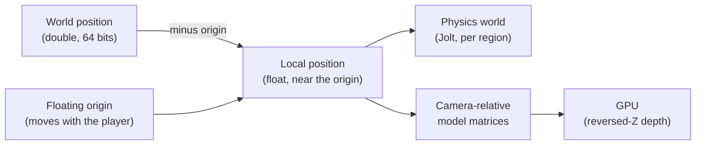

# Large worlds {#page-design-large-worlds}

[TOC]

Design page for the capabilities that let a game span any scale and any time span, from a room to a star system,
summarised in the [Roadmap](../roadmap.md). Each brick also serves smaller games: splines carry isometric roads, data
tables carry management games, the floating origin carries open worlds.

## Goal

- Positions precise to the millimetre anywhere in a world of several astronomical units
- Vehicles assembled from parts at runtime, simulated as articulated bodies that can break apart
- Bodies under gravity fields, their trajectories predicted, time sped up without losing them
- Thousands of entities alive off screen on a coarse model, back to full simulation when the player comes near
- Planets rendered from orbit to the ground in one continuous view, mixed with the other renderer-stack layers

## Precision

A 32-bit float keeps 24 bits of mantissa: its step is about 8 mm at 100 km and 1 m at 10 000 km. A 64-bit double
keeps a step of 0.1 mm at 1012 m. World positions are stored in doubles; everything the GPU and the
physics solver see is relative to a local origin, in floats.

| Decision          | Choice                                                                                                  |
|-------------------|---------------------------------------------------------------------------------------------------------|
| Rendering         | Model matrices built relative to the camera on the CPU, in double, then cast to float                   |
| Depth             | Reversed-Z with a floating-point depth buffer and an infinite far plane, on Vulkan and OpenGL           |
| World coordinates | `WorldPosition` in double beside the float `Transform`; scenes without it keep today's behaviour        |
| Floating origin   | Shifted when the focus leaves a radius; transforms, physics bodies, audio sources and particles follow  |
| Owl Nest          | Gizmos, picking, snapping and the camera work in world coordinates; the inspector shows doubles         |
| Serialisation     | Scenes and saves store world positions in double                                                        |

### Lights at astronomical scale {#lights-at-astronomical-scale}

| Decision      | Choice                                                                                                    |
|---------------|-----------------------------------------------------------------------------------------------------------|
| Near a planet | The star is a directional light (angular radius from its size and distance), shadows from cascades        |
| In space      | The star is an emissive body carrying a point light without falloff, placed camera-relative like any body |
| Switching     | The same entity: its light is directional below a distance from the planet, a point light above it        |
| Depth         | Reversed-Z and the infinite far plane keep the star and the planet in one depth buffer                    |
| Shadows       | Planet-scale shadows (eclipses) are analytic (sphere against ray), not shadow maps                        |

## Assembly and articulated bodies

- Mesh sockets: named attachment points on a mesh or a prefab, picked and moved in Owl Nest
- Entities snapped together at runtime on their sockets, the hierarchy rebuilt without reloading the scene
- Compound rigid bodies rebuilt when parts join or leave; mass, centre of mass and inertia recomputed
- Breakable joints with a force and a torque threshold, an event when they break
- Physics sub-stepping per scene, for long chains of joints
- Forces and torques applied at a point, from Lua and from systems (thrust, drag, lift computed by the game)

## Gravity and time

- Gravity fields: uniform, point and spherical sources, several summed, per-body opt-out
- Trajectory prediction: the future path of a body under the fields, drawn by a debug view and readable from Lua
- Time warp: the scene clock scaled; above a threshold, bodies leave the solver for analytic propagation
  (conic arcs around the dominant source) and come back when the warp drops
- Simulation level of detail: entities far from the focus follow a coarse model supplied by the game, on a slower
  tick; promotion and demotion are events, deterministic on the v0.7.0 simulation

## Planetary terrain

A renderer-stack layer, like the voxel and isometric ones, composing with the 3D layer and the HUD.

- Cube-sphere quadtree with seamless LOD, chunks streamed in the background
- Heights and materials produced by the [PCG graphs](pcg-graphs.md), or read from height maps
- Atmospheric scattering seen from the ground and from orbit, starfield and sky behind it
- Scaled space: far bodies drawn at reduced scale, then handed over to the full terrain on approach
- Physics collision on the chunks near bodies only

## Content and simulation at scale

- Spline component with its editor: control points, tangents, sampling by distance, paths, lanes and rails
- Data tables: typed records (columns, references between tables) edited in a grid in Owl Nest, read from Lua
- Emissive materials, lens flares and particle trails on the v0.6.0 effects
- HUD markers anchored to world entities, with off-screen indicators ([HUD system](hud-system.md))
- 3D steering in open space: obstacle avoidance between moving volumes, formations
- Doppler effect and adaptive music driven by game states
- Interest management for replication: relevance areas and priorities, so a client receives only what is near it
- World partition: streaming cells on world coordinates, additive scenes loaded and unloaded around the focus
- Camera tracks in the sequencer, for cutscenes

## Delivery {#large-worlds-delivery}

| Release | Items                                                                                                  |
|---------|--------------------------------------------------------------------------------------------------------|
| v0.5.0  | Camera-relative rendering, reversed-Z depth                                                            |
| v0.6.0  | World positions in double with a floating origin, splines, data tables, mesh sockets, emissive effects |
| v0.7.0  | Articulated bodies, gravity fields, time warp, simulation LOD, planetary terrain, HUD markers, audio   |
| v0.8.0  | World partition, camera tracks, joysticks and throttles with many axes                                 |
| v0.9.0  | Interest management                                                                                    |

World positions in double ship in three steps:

| Step                                                                                  | Status      |
|---------------------------------------------------------------------------------------|-------------|
| `WorldPosition`, world origin and its shift, `FloatingOrigin:` scene settings, editor | Done        |
| Physics bodies, sound sources and particles follow a shift of the origin              | Planned     |
| Owl Nest gizmos, picking, snapping and camera in world coordinates                    | Planned     |

Sample games that exercise these bricks are listed in [Sample games](sample-games.md).
