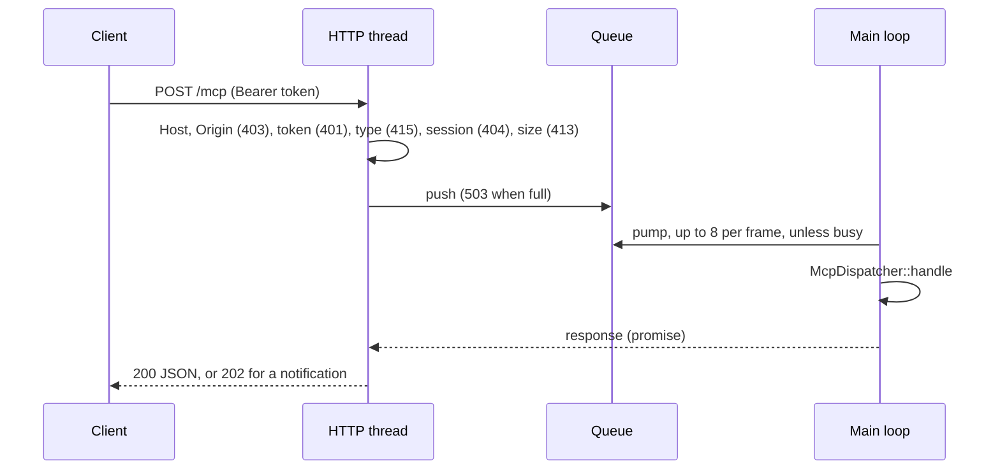

# Editor command API and MCP server {#page-design-mcp-server}

[TOC]

Design page for the editor automation work, summarised in the [Roadmap](../roadmap.md).

## v0.3.0 — editor command API

- Every editor mutation goes through a command executed by `UndoManager` (no direct scene writes from panels)
- Commands are addressable by name with typed arguments, so they can be issued by code, tests and tools
- The same API drives the headless runner and the `owlnest_tests` category
- Base of the MCP server below and of the v0.7.0 replay tooling
- Shipped as `commands::CommandRegistry` (library `OwlNestCommands`, see [Owl Nest internals](../editor_internals.md#commands-undo-and-journal)).
  Continuous edits previewed live (inspector fields, gizmo, brushes, node moves) stay recorded once the gesture
  ends; their named counterparts (`entity.set_transform`...) are what tools call

## v0.4.0 — MCP server in Owl Nest

Pull requests MCP0 to MCP4 of [Isometric worlds](isometric-worlds.md).

- Built directly into Owl Nest: same process, no separate bridge executable
- Enabled by an option in the editor settings, disabled by default; port and status shown in the status bar
- Listens over HTTP on `127.0.0.1` only (MCP "streamable HTTP" transport); it lives and dies with the editor
- Requests are queued and executed on the main thread during the frame; a job waits while an inspector or gizmo
  gesture or a modal is in progress; pending jobs fail cleanly when the server stops
- Read resources: scene tree, components (YAML), assets, prefabs, documentation pages, performance statistics
- Action tools routed through the command API, hence undoable: create / modify / delete entities, set a component,
  instantiate a prefab, save, undo / redo, run Play for N frames and return a capture plus measurements
- Tests drive the server end to end against a headless editor session

### Command API v2 (MCP0)

Done: the registry has 13 commands, with defaults, choices and structured results (see [Owl Nest internals](../editor_internals.md),
Editor commands).

- Argument types `Vec2`, `Vec4`, `Color` and `Enum`; `ArgSpec::defaultValue` (filled in before the command runs)
  and `ArgSpec::choices` (checked), so tool schemas are precise
- `CommandResult::data` carries structured fields (`entity`, `component`, `path`, `can_undo`...)
- New commands: `component.set` (merges a YAML / JSON fragment, recorded as a `ModifyEntityCommand`), `scene.save`,
  `edit.undo`, `edit.redo`; a `CommandSpec` holds either a factory (undo entry) or a runner (save, undo, redo)
- `CommandContext` (scene, undo history, play state, scene file, save callback) is what a command runs on;
  `EditorLayer::runCommand` builds it from the active document. While it plays, every command without
  `allowedInPlay` is refused with `RefusedDuringPlay`
- Every editor document adds its own named commands (the HUD editor first)

### Editor session (MCP1)

Done. `session::EditorSession` (`source/owlnest/sources/session/`, library `OwlNestCommands`, see [Owl Nest internals](../editor_internals.md),
Editor session) — scene and file, undo, registry and `execute` with the context the session builds, bounded play,
capture, statistics — implemented by `EditorLayer` (delegation to the active scene document) and by `HeadlessSession`
(no window, no ImGui) on the Null renderer for the tests.

- `PlayRequest`: `frames` and / or `ticks`, `timestepMs` (default one tick per frame), held `keys`, `stopAtEnd`,
  `capture`; a shared `PlayDriver` steps it one frame at a time (editor main loop) or in a loop (headless)
- `PlayReport`: frames, ticks, CPU time, draw calls, last phase timings, entity count, optional `FrameCapture`
  (`encodePng` through the engine's `encodeImagePng`); the Null renderer reads back a blank image of the right size
- Held keys, mouse buttons and a gamepad go through the input injection (any window type); input actions come with MCP4
- The editor runs commands through `EditorSession::execute`; the scenario runner keeps
  its own registry and undo history (it edits the playing scene on purpose) and shares `findProjectDirectory`

### Dispatcher (MCP2)

Done. `mcp::McpDispatcher` (`source/owlnest/sources/mcp/`, library `OwlNestMcp`, linked by `OwlNestCore`): one JSON-RPC
2.0 message in, its response out (`handle(text) -> optional<text>`, nothing for a notification), over an
`EditorSession`, on the thread that owns it. `nlohmann_json` is a direct dependency under the `nest` option (D11).

- `initialize` negotiates the revision: 2025-11-25 or 2026-07-28 is echoed, anything else gets 2025-11-25; capabilities
  `tools` and `resources` (no subscription, no list change); the core is stateless, so requests are served before the
  handshake too. `ping` answers `{}`; notifications (`notifications/initialized`, `notifications/cancelled`...) and
  responses sent by the client get no answer. No batch: 2025-11-25 removed JSON-RPC batching
- `tools/list`: one tool per registered command, in registration order (`entity.create`, `entity.delete`,
  `entity.duplicate`, `entity.reparent`, `entity.rename`, `entity.set_transform`, `component.add`, `component.remove`,
  `prefab.instantiate`, `component.set`, `scene.save`, `edit.undo`, `edit.redo`, plus what a document registers). The
  input schema is an object of the `ArgSpec`s, `additionalProperties: false`, `required`, `default` and `description`:

| `ArgType`                | JSON Schema                                                  |
|--------------------------|--------------------------------------------------------------|
| `Bool`                   | `boolean`                                                    |
| `Integer` / `Number`     | `integer` / `number`                                         |
| `Text`                   | `string`                                                     |
| `Entity`                 | `["integer", "string"]`: UUID or tag                         |
| `Vec2` / `Vec3` / `Vec4` | array of exactly 2 / 3 / 4 numbers                           |
| `Color`                  | `anyOf`: array of 3 or 4 numbers, or `#rrggbb` / `#rrggbbaa` |
| `Enum`                   | `string` with `enum` = the choices                           |

- `tools/call` runs the command through `EditorSession::execute` (hence undoable); `structuredContent` is
  `CommandResult::data` plus `description`, entity ids as the unsigned UUIDs of the scene files, also serialised as the
  text content
- `resources/list`, `resources/templates/list`, `resources/read` (`contents[0].text`):

| URI                       | Content                                                                         |
|---------------------------|---------------------------------------------------------------------------------|
| `owl://scene`             | JSON: open, path, playing, entity count, entity tree (`id`, `name`, `children`) |
| `owl://scene/entity/{id}` | YAML: the entity and its components, as in the scene file (template)            |
| `owl://assets`            | JSON: files of the asset directories (`path`, `directory`, `file`), 2000 max    |
| `owl://prefabs`           | JSON: the `.owlprefab` files of the asset directories                           |
| `owl://statistics`        | JSON: `SessionStatistics` and the last phase timings                            |
| `owl://help/{page}`       | Markdown: a page of the help bundle (`McpOptions::helpRoot`), case-insensitive  |

Error mapping:

| Case                                                                                                            | Answer                                                                                      |
|-----------------------------------------------------------------------------------------------------------------|---------------------------------------------------------------------------------------------|
| Not JSON                                                                                                        | `-32700` Parse error, `id: null`                                                            |
| Not a JSON-RPC 2.0 object (missing `jsonrpc`, bad `id` or `method`), batch                                      | `-32600` Invalid Request                                                                    |
| Unknown method                                                                                                  | `-32601` Method not found                                                                   |
| `params` not an object, missing `protocolVersion` / `name` / `uri`, unknown tool, `arguments` not an object     | `-32602` Invalid params                                                                     |
| Unknown resource                                                                                                | `-32002` Resource not found, `data.uri`                                                     |
| Exception inside a method                                                                                       | `-32603` Internal error                                                                     |
| Argument not declared, of the wrong type, missing; any `CommandError` (`UnknownEntity`, `RefusedDuringPlay`...) | tool result `isError: true`, `structuredContent.error` = the `CommandError` name, `message` |

### Transport (MCP3)

Done. Three classes of `OwlNestMcp` (see [Owl Nest internals](../editor_internals.md#editor-mcp-server)): `McpHttpServer` (the transport),
`McpServer` (dispatcher + transport + token file, what the editor and the tests hold) and the token helpers of
`McpToken.h`. `cpp-httplib` 0.59.0 (ConanCenter, header-only, built without TLS nor `getaddrinfo_a`, whose helper
threads crash ThreadSanitizer) is a dependency under the `nest` option.

- Streamable HTTP, JSON responses only: `POST /mcp` answers 200 with the JSON-RPC response, 202 for a notification
  or a client response; `GET` and `DELETE` answer 405 (no event stream, no session termination); every success
  carries `Mcp-Session-Id` (128 random bits, new at every start), a request naming another one gets 404, an
  unsupported `MCP-Protocol-Version` 400
- Threads: the httplib pool (up to 8 connections at once) only checks and queues; a message runs on the main thread
  (`McpServer::onUpdate`, from `EditorLayer::onUpdate`) or never. A message and its promise are claimed once, by
  the main loop (runs it) or by the server thread on timeout (30 s: JSON-RPC error `-32001`, nothing run); `stop`
  answers the queued messages with 503 before closing the socket, so no thread waits on the main loop it runs on
- Busy: ImGui item active, any popup or modal open, an inspector edit session open, the gizmo held
- Security (D12, every point tested in `McpHttp_test.cpp`): bound to `127.0.0.1` with `SO_REUSEADDR` instead of
  httplib's `SO_REUSEPORT` (`SO_EXCLUSIVEADDRUSE` on Windows), so no other process can listen on the same port;
  `Host` must be `127.0.0.1:port` or `localhost:port` and any `Origin` loopback (DNS rebinding); `Content-Type:
  application/json` required (no browser simple POST); a 256-bit bearer token from the system CSPRNG, kept for the
  editor run, compared in constant time, stored in a `0600` file of the user runtime directory (`0700` directory)
  that exists only while listening, never logged, regenerated from the settings; body limited to 1 MiB; a queue of
  4 messages (503 beyond) and 8 runs per frame; file arguments (`ArgSpec::projectPath`) canonicalised and kept
  inside the project (`confinePath`), refused without a project; no Lua eval nor shell tool; resources returned as
  plain data, never as instructions
- Editor: the **MCP Server** settings tab (enabled, off by default; port 47800; status, endpoint, token file;
  regenerate), persisted in `OwlNest_settings.yml` with a reset per row; a status bar indicator off / listening /
  client active whose tooltip gives the endpoint and the token file

### Play and capture (MCP4)

Done. `play.run` (`McpPlay.h`) is the one tool that is not a registry command; the user page is [MCP server](../mcp.md).

- Arguments `frames`, `ticks`, `timestep_ms`, `actions`, `keys`, `capture`, `stop_at_end`; `actions` are held through
  the first matching binding of each action of the engine action map (`session::resolveActionHolds`, moved out of the
  scenario runner, so a scenario `actions:` step and `play.run` hold the same inputs); `PlayRequest` gained
  `mouseButtons` and `gamepad`
- Result: structured content (frames, ticks, CPU times, draw calls, entity count, phase timings, capture size) also as
  text, then the capture as an `image` content (`image/png`, base64); a failure is an `isError` result (`PlayFailed`)
- The editor plays over several frames of its main loop, so the answer is deferred: `McpDispatcher::handleDeferrable`
  returns a poll (`DeferredPoll`), `McpHttpServer` keeps the job out of the queue and calls `pollDeferred` every frame,
  also while the editor is busy; the headless session plays synchronously and answers at once. One deferred play at a
  time. `stop()` and a play longer than `HttpOptions::deferredTimeout` (10 minutes) call the poll with `iCancel`: the
  play is stopped and answered as interrupted
- `stop_at_end` and the edited scene are those of `EditorSession::startPlay`; the capture is the viewport of the active
  document in the editor, the offscreen target in the headless session
- Tests: `McpPlay_test.cpp` (arguments, base64, held actions, deferral with a fake asynchronous session) and
  `McpHttp_test.cpp` (a whole session over HTTP: `tools/list`, create then undo restores the scene, `play.run`; the
  deferred answers), run under `linux-sanitizer-thread`
