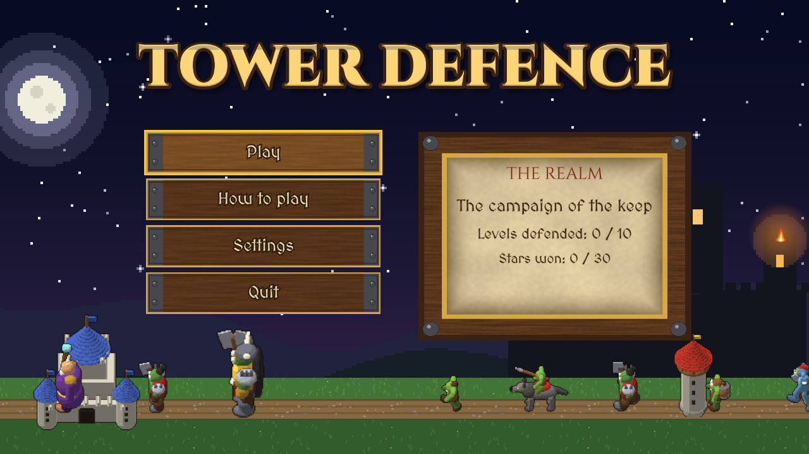
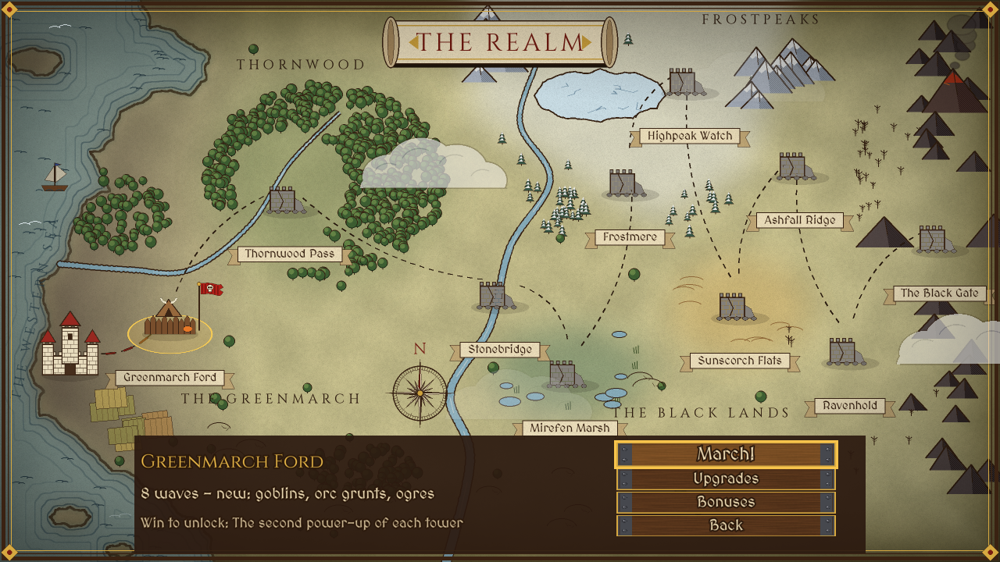
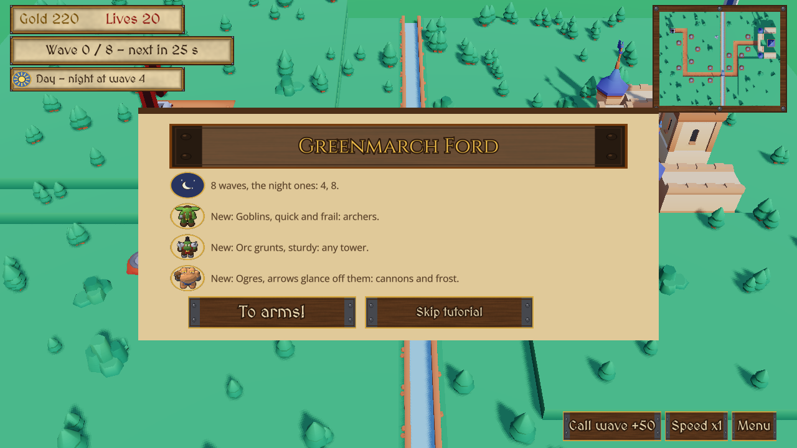
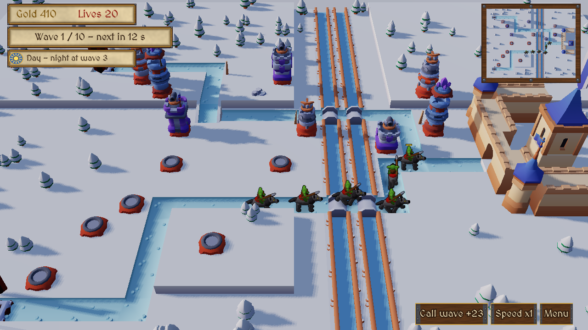
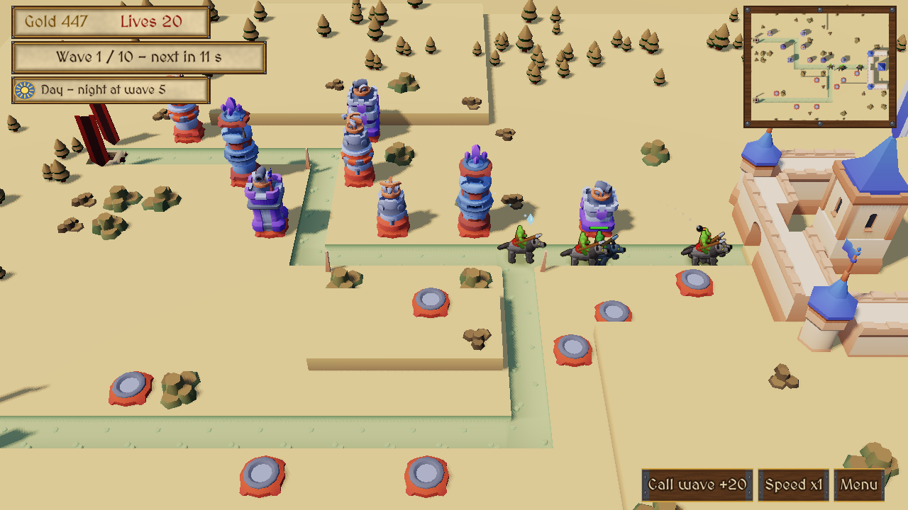

# Sample games {#page-design-sample-games}

[TOC]

Design page of the sample games, summarised in the [Roadmap](../roadmap.md).

## Goal

Owl Engine ships two kinds of example content:

- **Engine Demo** (today's `engine_demo/`): an all-in-one showcase of every engine feature, not a game in itself.
- **Sample games**: small but real games, each one built on only what it needs, most of them mini remakes of known
  games. They prove that Owl Engine makes games, give a newcomer a project of a readable size to start from, and feed
  the
  two showcase games of v1.0.

## Rules

- One project per game, beside the Engine Demo, authored in Owl Nest; game rules in Lua, never in the engine.
- Small: one screen or a handful of levels, finished (title, play, win / lose, settings), playable with keyboard,
  mouse and gamepad.
- CC0 or home-made art only (the reworked `textures/wolf3d/` of the Engine Demo included); a scenario test per game runs
  in CI, and the game packages with the runner.
- A sample game uses only what it needs: it is not a feature checklist, the Engine Demo is.

## Short list

| Game                | Inspired by           | Exercises                                       | Possible from | done in |
|---------------------|-----------------------|-------------------------------------------------|---------------|---------|
| Breakout            | Breakout / Arkanoid   | 2D, physics, HUD, sound, gamepad                | v0.4.0        | v0.4.0  |
| Sokoban             | Sokoban               | tilemap, undo, saves, level editing in Owl Nest | v0.4.0        | v0.4.0  |
| Wolfenstein mini    | Wolfenstein 3D        | raycast, doors, pick-ups, HUD                   | v0.4.0        | v0.4.0  |
| Tower defence       | Kingdom Rush          | 3D, billboards, waves, upgrades, world map      | v0.5.0        | v0.5.0  |
| Mini Minecraft      | Minecraft             | voxel, build and break, inventory               | v0.4.0        |         |
| One-room Zelda-like | The Legend of Zelda   | top-down, dialogue, enemy AI, 2D lights         | v0.7.0        |         |
| Marble or mini kart | Marble Madness / Kart | 3D, Jolt physics, shadows                       | v0.7.0        |         |
| Networked Bomberman | Bomberman             | tilemap, deterministic simulation, multiplayer  | v0.9.0        |         |
| Lunar lander        | Lunar Lander          | 3D, thrust and gravity, planetary terrain, legs | v0.7.0        |         |
| Asteroid field      | Star Fox / X-Wing     | 6DoF flight, 3D steering AI, trails, HUD marks  | v0.7.0        |         |

Breakout, Wolfenstein mini and Sokoban shipped in v0.4.0; the first map of a tower defence ships in v0.5.0, on the Lua
gaps closed for it and for Mini Transport Tycoon ([Order](#sample-games-order)), which waits in the
[Pool](#sample-games-pool). The two v1.0 showcase games (one 2D, one 3D) are picked from this
list, and so are the games of the [Pool](#sample-games-pool) once they enter it.

## Pool {#sample-games-pool}

Ideas without commitment: a game of the pool enters the short list when a release has room for it, or is dropped.

| Game                  | Inspired by                       | Exercises                                          | Possible from |
|-----------------------|-----------------------------------|----------------------------------------------------|---------------|
| Mini Transport Tycoon | Mini Motorways / TTD              | isometric, roads, pathfinding, management HUD      | v0.5.0        |
| Asteroids             | Asteroids                         | 2D inertia, screen wrap, particles                 | v0.4.0        |
| Station trader        | Taipan! / Elite                   | data tables, economy on the fixed tick, trade HUD  | v0.6.0        |
| Rail shooter          | Star Fox                          | splines, 3D, particles, HUD markers                | v0.7.0        |
| Orbital golf          | Angry Birds Space / Gravitee Wars | 2D gravity fields, trajectory preview              | v0.7.0        |
| Bridge builder        | Poly Bridge / Bad Piggies         | parts snapped on sockets, breakable joints, replay | v0.7.0        |

## v0.4.0 games

Feasibility checked against `main` on 2026-10-18 (Lua bindings, components, Engine Demo): all five games fit the
v0.4.0 engine. Breakout and Mini Transport Tycoon need no engine change, Sokoban one Lua binding (`isometric.get_size`,
added), Wolfenstein mini art, Mini Minecraft two small engine fixes ([Gaps](#sample-games-gaps)).
Breakout, Sokoban and a Wolfenstein mini without combat shipped with v0.4.0; the Lua gaps G1, G3, G7, G8 and G15 are
closed in v0.5.0, Mini Minecraft is planned in v0.6.0; Mini Transport Tycoon waits in the pool.

Common to every game:

- Title, settings, victory and game over scenes started from the Engine Demo (`scenes/main_menu.owl`,
  `scenes/settings_menu.owl`, `scenes/victory.owl`, `scenes/game_over.owl`, `scripts/ui/*.lua`): the menus already
  work with keyboard, mouse and gamepad (`UiFocus`, scenario `main_menu_focus.owltest`). Since the first playthrough,
  each game has menus of its own, written by `tools/samples/<game>/generate_menus.py`: its look, its title art, its
  buttons, its transitions (`scene.transition_to` in a colour) and an animated background; a How to play window on
  the title and the pause window are the only places that show the controls.
- `input_actions.yml` on the built-in actions (`move`, `look`, `jump`, `interact`, `primary`, `secondary`, `ui_*`)
  plus the game's own; `input/gamecontrollerdb.txt` copied.
- Sounds written by a generator in `tools/samples/<game>/`, like `tools/demo/generate_town_sounds.py` (the Kenney
  audio packs cannot be fetched from the build machine), a start jingle of its own per game;
  `sounds/ui/victory.wav` copied.
- The game state mirrored into `gamestate` keys (`<game>_score`, ...) for the scenarios.

### Breakout

Done in v0.4.0: `samples/breakout/` (how to play: its `README.md`).

| Item     | Made                                                                                                             |
|----------|------------------------------------------------------------------------------------------------------------------|
| Play     | One screen, 5 levels, 3 lives; bricks of 1 to 3 hits; 2 power-ups (wide paddle 15 s, slow ball 12 s)             |
| Win/lose | Every brick of the 5 levels / no life left; best score kept; the ball serves by itself after 5 s                 |
| Controls | `paddle` axis (A / D, arrows, left stick, D-pad) or the mouse; `serve` (Space, pad A, left click); `pause`       |
| Scenes   | `title`, `level_select`, `level_1` to `level_5` (one scene each), `settings`, `victory`, `game_over`             |
| Menus    | Arcade neon (`generate_menus.py`): a brick wall lit in a wave, an attract ball, neon buttons, magenta wipes      |
| Entities | `Paddle` and `PaddleWide` (Kinematic), `Ball` (Dynamic, restitution 1, friction 0), three `Wall` (Static)        |
| Bricks   | Instances of `prefabs/brick.owlprefab` (Static body, `SpriteRenderer`, `brick.lua` with its properties)          |
| Lua      | `game.lua` (rules, pools, pause), `paddle.lua`, `ball.lua` (speed kept with `physics.set_velocity`), `brick.lua` |
| HUD      | `huds/play.owlhud`: score, level, lives, a message line, the pause window (Resume, Restart, Quit, controls)      |
| Art      | Home-made bricks, paddle, ball, capsules, walls and backdrop, chip sounds and music (`tools/samples/breakout/`)  |
| Saves    | No slot; best score and levels cleared with their best through `settings.save` (`breakout_best`, `_done_N`)      |

- Reuse: the menus, built from the Engine Demo ones, have a
  look of their own. A broken brick is destroyed at once (a popping brick
  would keep its body), its burst shown from a pool instead of the pop of `coin.lua`.
- Gaps met: G5 (the paddle follows the mouse motion, `breakout_mouse_speed` setting), G1 (pools of hidden entities:
  power-ups, bursts, and a second paddle for the wide one, a body cannot be resized from Lua), G14 (one scene per
  level), G9 (master volume only), G8 (the pause stops the scene clock, `time.set_paused`). Each level names the next
  one in the `next_scene` property of its `Game` script (G16 fixed): a new level is a duplicated scene in Owl Nest.
- Scenarios: `breakout_serve` (serve, 300 frames, `breakout_bricks` below 40), `breakout_lose` (no input at all:
  the automatic serve, `breakout_lives` below 3), `breakout_gamepad` (dead zone, the stick moves the paddle, A serves),
  `breakout_level_select` (down selects level 2, accept starts a fresh run there), `breakout_how_to` (the How to play
  window opens and closes with the keyboard focus).
- The levels were first laid out by `tools/samples/breakout/generate_levels.py` (text grids) and are edited in Owl Nest
  from then on; `tools/tests/test_breakout_levels.py` checks the grids.

### Sokoban

| Item     | Done                                                                                                          |
|----------|---------------------------------------------------------------------------------------------------------------|
| Play     | 10 levels of 1 to 5 crates (2 to 38 pushes); push the crates onto the goals; undo, restart, moves and pushes  |
| Win/lose | Every crate on a goal; no lose; each level done and its fewest moves are kept                                 |
| Controls | `step_*` (WASD, arrows, D-pad) one cell per press, repeated when held; the left stick as four directions      |
|          | Z, U, Backspace or pad B undo; R or pad Y restart; Esc, P or Start pause; the mouse in menus and HUD buttons  |
| Scenes   | `title`, `level_select` (`UiList` with done marks), `level_01` to `level_10`, `settings`, `victory`           |
| Tilemap  | One `.owltilemap` per level: layer 0 floor and walls, 1 goals, 2 crates and the hero tile of the start        |
| Entities | `Level` (`Tilemap`), player (`AnimatedSpriteRenderer`, `isometric.set_sprite_frame`), `MovingBox`, music      |
| Lua      | `sokoban.lua` (rules on `isometric.get_cell`, undo stack in a Lua table, win), `level_select.lua`, menus      |
| HUD      | `huds/level.owlhud`: level, moves and pushes, best, Undo / Restart / Menu buttons, pause window with controls |
| Menus    | Wooden warehouse (`generate_menus.py`): crate letters, plank buttons, a progress log, an animated corridor    |
| Art      | `sokoban_tiles.png`: Tiny Dungeon floor, wall and hero (walk and push frames), home-made goal mark and crates |
| Saves    | No slot: `sokoban_done_NN` and `sokoban_best_NN` settings saved at once; Continue starts the first level left |

- Level editing in Owl Nest: paint the three layers in the tilemap editor (the hero tile of layer 2 places the player);
  for a new level, duplicate a level scene, point its `Level` at a new tilemap, set the `level`, `level_name` and
  `next_scene` properties of its `Game` script (and `next_scene` of the level before), then add the scene to
  `LEVEL_SCENES` of `title.lua` and `level_select.lua`, which list every level for the progress and the level select.
  `sokoban.lua` warns when crates and goals do not match.
- Generators in `tools/samples/sokoban/`: `generate_assets.py` (tile sheet, sounds), `generate_levels.py` (tileset,
  tilemaps, level scenes, HUD, from the texts of `levels.py`), `generate_menus.py`; `tools/tests/test_sokoban_levels.py`
  replays a stored solution of each level text.
- Reuse: the walk frames of `tools/demo/generate_kenney_atlases.py`, `scripts/hub/hub_water.lua` (`get_cell` /
  `set_cell` on a 2D tilemap), the journal list of `scripts/raycast/inventory.lua`; the menus, first copied from the
  Engine Demo, have a look of their own since the first playthrough.
- Gaps: G6 (tile bindings named `isometric`), G14 (one scene per level), G9 (master volume only). Lua had no way to
  read the size of a tilemap: `isometric.get_size` was added for it (width, height, cell size).
- Scenarios: `sokoban_push` (`sokoban_on_goal` grows), `sokoban_undo` (undo and restart put back crate and counters),
  `sokoban_wall` (no step into a wall nor a blocked crate), `sokoban_win` (level 1 solved, `sokoban_done_01` set, level
  2
  opens), `sokoban_gamepad` (D-pad, B, stick dead zone), `sokoban_level_select` (`ui_down`, `ui_accept`).
- Size: **S**, done.

### Tower defence {#sample-games-tower-defence}

Shipped in `samples/tower_defence/` (how to play: its `README.md`): a first map in flat isometric art validated the
gameplay. Plan of 2026-10-24: a small campaign in the spirit of Warcraft 1 and 2, the Horde (goblins, orcs, ogres)
against human towers and a human keep, in real 3D, mixing as many rendering styles as the engine has.

|  |          |
|--------------------------------------------------------------------------------------------------|----------------------------------------------------------------------------------------|
|                |  |
|  |                                                                                   |

| Item      | Plan                                                                                                                               |                                                                                         |
|-----------|------------------------------------------------------------------------------------------------------------------------------------|-----------------------------------------------------------------------------------------|
| Play      | 10 levels of 8 to 12 waves, on 3D terrain with relief, between visits to a world map and its upgrades screen                       |                                                                                         |
| Win/lose  | Every wave held with a life left / the 20 lives lost; 3, 2 or 1 stars for 18, 10 or fewer lives kept                               |                                                                                         |
| Waves     | Timed, called early for gold; the `night_waves` of a level are fought at night, dusk or dawn announced between two waves           |                                                                                         |
| Day/night | `time_effects` of `defence.lua`: a bonus or a malus by day and by night for every tower and enemy kind                             | Sun or moon on the HUD, legend in the pause window                                      |
| Modifiers | Per level (`modifiers`): fog, blizzard, blood moon, drought, gale, plunder, long night, effects of the same form                   | Briefing, world map panel, pause window                                                 |
| Briefing  | A modal window before the first wave: a line and an icon per night, modifier and new enemy (its portrait)                          | Time paused; Skip tutorial on level 1                                                   |
| Tutorial  | Level 1, skippable: build on a glowing pad, call a wave, raise, sell, read day and night; hints by the targets                     | `tower_tutorial` setting, Reset tutorial in Settings                                    |
| Towers    | Archer, cannon, frost on build pads; levels 1, 2, 3, then one power-up of two; sold for half of what was spent                     |                                                                                         |
| Enemies   | `Renderer2D` `sprites`: billboards, depth test                                                                                     | 8 directions x 9 frames (walk, attack, death), lit like the 3D scene; hit flash, sparks |
| Relief    | Plateaus, ramps, rivers and bridges; a pad on high ground gives its tower +15 % range per height step                              |                                                                                         |
| Controls  | As in the first map (mouse, keyboard cursor, gamepad), plus Z / C or pad LB, D-pad up / down turn the view by 45°, the wheel zooms |                                                                                         |
| Scenes    | `title`, `world_map`, `upgrades`, `level_01` to `level_10`, `settings`, `victory` (stats, stars credited, unlock), `game_over`     |                                                                                         |
| Saves     | No slot: `tower_done_NN`, `tower_stars_NN` (best), `tower_best_NN`, `tower_up_<family>` settings; unlocks follow from the wins     |                                                                                         |
| Scripts   | `defence.lua` holds the properties and the hooks; the rules are the modules of `scripts/game/td/` (`require`)                      |                                                                                         |

| #  | Level           | Terrain                                                    | Theme | Nights             | Modifiers           | New                    |
|----|-----------------|------------------------------------------------------------|-------|--------------------|---------------------|------------------------|
| 1  | Greenmarch Ford | One plateau, a ramp down, a river crossed by a bridge      | grass | 4, 8               |                     | Goblins, grunts, ogres |
| 2  | Thornwood Pass  | Two plateaus and a road winding between them through woods | grass | 3, 6, 9, 10        | fog                 | Wolf riders            |
| 3  | Stonebridge     | Two gates, two roads meeting before a long bridge          | grass | 3, 4, 7, 8, 10     |                     | Trolls                 |
| 4  | Mirefen Marsh   | Two rivers, two gates, four bridges                        | marsh | 3, 6, 9, 10        | fog                 | Goblin sappers         |
| 5  | Frostmere       | A plateau gate, a river crossed by two bridges             | snow  | 3, 6, 9, 10        | blizzard            | Ogre mages             |
| 6  | Highpeak Watch  | A high plateau, two ramps down                             | snow  | 3, 4, 7, 8, 11     | gale                | Orc berserkers         |
| 7  | Sunscorch Flats | Two gates on open sand                                     | dry   | 5, 10              | drought             |                        |
| 8  | Ashfall Ridge   | A road climbing a ridge and down again                     | ash   | 2, 4, 6, 8, 10, 11 | blood moon          |                        |
| 9  | Ravenhold       | Two long winding roads                                     | ash   | 3, 4, 7, 8, 11, 12 | plunder, long night |                        |
| 10 | The Black Gate  | Two winding roads to the fortress gate                     | ash   | 4, 8, 11, 12       | blood moon          | The orc chieftain      |

| Enemy         | Mechanic                                                               | Day / night                      | Counter                              |
|---------------|------------------------------------------------------------------------|----------------------------------|--------------------------------------|
| Wolf rider    | Speed 2.1                                                              | +15 % damage taken / +20 % speed | Frost                                |
| Troll         | Regenerates 7 hp/s, not while burning                                  | No healing / heals 50 % more     | Cannon bursts, fire shells           |
| Ogre mage     | Every 6 s a ward absorbing 45 damage on the Horde within 1.6           | Wards −20 % / +50 %              | Kill it first; burning ignores wards |
| Goblin sapper | Fast, 3 lives at the keep; killed, its keg hurts the Horde within 1.2  | −10 % / +20 % speed              | Archers' range, kill it in the crowd |
| Orc berserker | Up to 90 % faster as it loses its life                                 | +10 % damage taken / +15 % speed | Frost, then burst                    |
| Chieftain     | 2000 hp, arrows ×0.5, half slowed, never frozen, rallies (+25 % speed) | +10 % / −15 % damage taken       | Cannons, the vulnerability aura      |

| Star upgrades  | Tier 1 (1 star)    | Tier 2 (2 stars)       | Tier 3 (3 stars) | Tier 4 (4 stars)  |
|----------------|--------------------|------------------------|------------------|-------------------|
| Archers        | +15 % damage       | +12 % range            | 15 % faster      | +10 % range       |
| Cannons        | Cost −15 %         | Bursts +20 %           | +20 % damage     | 15 % faster       |
| Frost          | Chill +30 % longer | Slower chilled enemies | +12 % range      | +20 % damage      |
| Rain of arrows | Cooldown −20 %     | +30 % damage           | Radius +25 %     | +30 % damage      |
| Shield wall    | Cooldown −20 %     | +2 s                   | Radius +25 %     | Cooldown −20 %    |
| Treasury       | +40 starting gold  | +10 % gold per kill    | +2 lives         | +60 starting gold |

- Stars: the best of each level is kept, the upgrades screen spends their sum (30 at most for 60 of tiers): replaying
  a level for more stars credits the difference; Refund all is free.

| Level won         | Unlocks                                                                         |
|-------------------|---------------------------------------------------------------------------------|
| Greenmarch Ford   | The second power-up of each tower (double shot, shock wave, vulnerability aura) |
| Thornwood Pass    | Rain of arrows: a spell on a spot of the road, damage in an area, 45 s cooldown |
| Stonebridge       | Royal treasury: 60 more starting gold on every level                            |
| Mirefen Marsh     | Fletchers' guild: archers cost 10 % less (an effect `archer any cost 0.9`)      |
| Frostmere         | Shield wall: a spell stopping the enemies on a spot for 5 s, 60 s cooldown      |
| Highpeak Watch    | Watchtowers: every tower +5 % range                                             |
| Sunscorch Flats   | Harvest tithe: +10 % gold per kill                                              |
| Ashfall Ridge     | Night watch: towers +10 % range at night                                        |
| Ravenhold         | Royal guard: 3 more lives on every level                                        |
| 3 stars on all 10 | Keep walls: 5 more lives on every level                                         |

| Tower  | Level 2 | Level 3   | Power-up A (from the start)                        | Power-up B (Greenmarch Ford won)                |
|--------|---------|-----------|----------------------------------------------------|-------------------------------------------------|
| Archer | +range  | +rate     | Piercing arrows: each arrow hits up to 3 in a line | Double shot: two targets at each volley         |
| Cannon | +damage | +area     | Fire shells: the ground burns, damage over 3 s     | Shock wave: the enemies hit are thrown back     |
| Frost  | +slow   | +duration | Full freeze: a short stop every third hit          | Vulnerability aura: +25 % damage taken in range |

- Costs: level 2 at 80 % of the tower price, level 3 at 120 %, a power-up at 150 %; the ring of a tower shows the next
  step with its price, the two power-ups side by side at level 3 (a locked one says which level unlocks it), and Sell.
- Menus: the parade of the Horde, the keep, the archer tower and the road under them are pixel art rendered like the
  Horde (`scenery.py`, the models of `creatures.py`), under a starry night over the hills and the ramparts of the keep
  with flickering torches; the campaign board of the title is parchment framed in wood.
- World map (`world_map.owl`): a hand-inked map drawn by `world_map_art.py` at 80 pixels per unit (pixel for pixel on
  2560 x 1440, `MapRoot` scaled down to fit a narrower screen): inked coast with ripple lines and a ship, rivers
  between banks, a frozen lake, hatched mountains (snowy, black, a volcano), painted forests, fields, faint tracks,
  region and site names, a cartouche, a compass rose, paper grain and vignette, the marsh of Mirefen and the dunes
  of Sunscorch; waving banners, drifting clouds (thinning over the site names) and glints of the sea animated by
  `world_map.lua`. The road from the capital is shown up to the last site open and the
  next stretch is traced dash by dash after a win.
- Sites on the world map: locked (a grey ruin), open (a Horde camp under a red banner, bobbing), done (a human keep
  under a blue banner and its stars); a click, Q / E or the D-pad picks an open site, Enter, pad A or March! starts
  it; the panel names the level, its waves, the enemies it brings first and its unlock; Bonuses lists the unlocks,
  Upgrades opens the upgrades screen.
- Build wheel: the badges of the pad or the tower around it on the screen, their prices under them and a parchment
  scroll with the info, billboards of the `marks` layer kept inside the view and clear of the HUD.
- Look: parchment, dark wood, iron and gold (`medieval_ui.py`), titles in `Cinzel`, labels in `MedievalSharp` (OFL).

| Element                       | Rendered by                                    | How                                                                                                |
|-------------------------------|------------------------------------------------|----------------------------------------------------------------------------------------------------|
| Terrain, river, bridge, decor | `RendererMesh`                                 | Kenney Tower Defense Kit tiles, one entity per cell, raised and stacked for the plateaus           |
| Towers                        | `RendererMesh`                                 | Kit tower parts stacked by level (base, middle, top, weapon), power-ups by their tints and weapons |
| Keep, walls, gate, banners    | `RendererMesh`                                 | Kenney Castle Kit                                                                                  |
| Sky, sun, night               | `ProceduralSky`, `DayNightCycle`               | Sun with cascaded shadows; point `Light` torches on the keep and along the road at night           |
| Enemies                       | `Renderer2D` `sprites`: billboards, depth test | 8 directions x 9 frames (`creatures.py`), the frame picked from heading and view; the boss bigger   |
| Projectiles and effects       | `sprites`                                      | Arrows, shells, shards, bursts, fire; a `Light2D` on fire shells and torches                       |
| Build wheel, health bars      | `marks` over all; bars in `sprites`            | The wheel beside its pad on the screen, picked by tag                                              |
| Range ring, build cursor      | `Renderer2D` `ground`: flat, depth test        | Lies on the terrain, hidden by the towers in front                                                 |
| Minimap                       | `RenderTarget`                                 | Orthographic camera over the level into a `UiImage` of the HUD                                     |
| World map                     | `Renderer2D` `world`                           | The inked map, sites, banners, stars, road dashes, clouds, a 2D scene between the levels           |
| HUD and menus                 | `Canvas`                                       | Gold, lives, wave, minimap frame, spells, pause; parchment, wood and gold                          |

- Engine: `Renderer2D` layer keys `Billboard` (`None`, `Upright`, `Full`: the sprites turn to the camera, their 2D lights
  on the ground plane) and `DepthTest` (sprites tested against the 3D layers drawn before, sorted back to front), both
  following the light and exposure of the 3D scene; `scene.pick_entity` with a tag returns the tagged ancestor of the
  mesh hit and sees billboards as drawn; `ui.set_text` writes a world `TextRenderer`; shared materials instanced.
- Data-driven levels: `tools/samples/tower_defence/maps.py` holds per level a height grid, the road, the river, the
  pads, the decor, the waves and `night_from`; `generate_maps.py` writes one scene per level, editable in Owl Nest:
  terrain cells are mesh entities, the roads are the `Waypoint NN` and `Waypoint B NN` entities the enemies walk, pads
  are `Pad` entities.
- Scenarios: `tower_build` (mouse, wheel), `tower_upgrade` (archer to level 3, power-up), `tower_wave`,
  `tower_call_early`, `tower_defend` (gamepad), `tower_fast_forward`, `tower_rotate` (the enemy frames follow the view),
  `tower_build_only` (towers never raised lose level 1), `tower_win` (raised towers hold it, night, stars),
  `tower_title`, `tower_world_map`, `tower_map_first_level` (fresh save: the map fits, a click on level 1 marches,
  Quit to the map comes back), `tower_upgrades_screen` (a win credits stars, a tier bought then refunded),
  `tower_level_wolves` (level 2), `tower_level_roads` (level 3, both roads), `tower_level_frostmere` (sappers, a mage's
  wards), `tower_level_black_gate`, `tower_night_and_fog` (briefing shown and dismissed, the fog and the night effects
  on the range of an archer and the speed of a goblin), `tower_drought` (a cheaper cannon), `tower_tutorial` (each step
  of the tutorial in turn, then done), `tower_tutorial_skip` (skipped and remembered on a restart).
- Size: **M–L**.
- Done: the ten levels in 3D with relief (grass, marsh, snow, sand and ash themes), the Horde of nine kinds in 8
  directions with walk, attack and death frames introduced across the campaign with their counters, tower upgrades and
  power-ups, the build wheel, day and night alternating with their effects, the level modifiers and the briefing, the
  tutorial of the first level, the minimap, the inked world map, the unlocks, the star upgrades and the medieval look;
  the rules split into Lua modules.

### Mini Transport Tycoon

| Item     | Plan                                                                                                                                                                                            |
|----------|-------------------------------------------------------------------------------------------------------------------------------------------------------------------------------------------------|
| Play     | 64×64 map, two towns, four industries (farm, mine, factory, harbour); roads, stations, trucks with a route each                                                                                 |
| Win/lose | Company value at the target before year 5 / money below the loan limit for 3 months                                                                                                             |
| Controls | Mouse tools (left builds, right bulldozes), WASD or stick pans, keyboard cursor I J K L, pad RB switches tool                                                                                   |
| Scenes   | `title`, `play` (one generated map), `settings`, `victory`, `game_over`                                                                                                                         |
| Tilemap  | `Ground` (isometric, road overlays, `navigation` rules as in `iso_town.owl`); stations as overlay tiles                                                                                         |
| Entities | Towns and industries (`IsometricObject` slices), a pool of 24 hidden trucks (8 headings), trees, camera                                                                                         |
| Lua      | `build.lua` (roads, bulldozer, costs), `stations.lua`, `vehicles.lua` (`path.find`, `path.poll`, load, unload), `economy.lua` (production, pay by distance and days, running costs, loan, date) |
| HUD      | Toolbar, money and date, vehicle list (`UiList`), station and finance windows (`UiWindow`), tooltips                                                                                            |
| Art      | `tools/iso_atlas` (terrain, roads, buildings, vehicles); map from `city_map.py` with another seed and two towns                                                                                 |
| Saves    | Slots from the pause menu; the roads and stations laid in game are tilemap cells the save keeps (G3)                                                                                            |

- Reuse: `scripts/iso/iso_town.lua` (build tool, road shapes, funds), `scripts/iso/iso_town_traffic.lua` (route
  following, headings, waits), `scripts/iso/iso_camera.lua`, `scripts/iso/iso_town_life.lua`, `huds/iso_town.owlhud`,
  `tilesets/iso_ground.owltileset`, `textures/iso/`, `sounds/town/`, and the small map of the scenarios
  (`test/unit/test_helper/assets/scenarios/iso_town_small.owl`).
- Gaps, closed in v0.5.0: G1 (trucks spawned from a prefab), G3 (runtime roads kept by a save), G8 (pause, fast
  forward), G15 (click a vehicle, `scene.pick_entity`), G7.
- Scenarios: `tycoon_route` (the mouse lays a road from a farm to a factory, two stations, buys a truck;
  `tycoon_deliveries` above 0, money up), `tycoon_bankrupt` (no income, fast forward, game over),
  `tycoon_save` (save, bulldoze, load: the road is back).
- Size: **L**, about 3 weeks (the economy and its HUD are new, the rest comes from the demo).

### Wolfenstein mini

Shipped in `samples/wolfenstein/` (how to play: its `README.md`). An exploration game first: the guards, the weapons
and the combat come in a later release, once their art exists.

| Item     | As shipped                                                                                                                                                              |
|----------|-------------------------------------------------------------------------------------------------------------------------------------------------------------------------|
| Play     | 3 floors of 32×32 (cellars, prison, headquarters): treasure, food, gold and blue keys with their locked doors, 3 secret walls each, an exit elevator                    |
| Win      | The elevator of floor 3; after each floor a tally counted up line by line (skippable): items, secrets and map explored in %, 10 points per percent as a bonus           |
| Controls | `walk`, `turn`, `run`, `interact` (doors, secret walls, elevator), `map` (Tab, pad Y: large map); keyboard, mouse (right button turns, left opens) and gamepad          |
| Scenes   | `title`, `level_1` to `level_3` (`RendererRaycast` + a `Space: Screen` `Renderer2D` for the minimap), `tally`, `settings`, `victory`                                    |
| Entities | Player (`PhysicBody`, `Camera`), wall `Tilemap`, `RaycastDoor` (locked: empty `interactionAction`, `door.activate` with the key), `RaycastPushWall`, pick-ups, props    |
| Lua      | `player.lua`, `pickup.lua`, `locked_door.lua`, `secret.lua` (counts each wall once), `explore.lua` (fog, minimap, cells seen over floor cells), `level.lua`, `exit.lua` |
| HUD      | `huds/play.owlhud`: floor, score, keys, messages, a pause window with the controls (no ratio during play); the minimap is a tilemap of the overlay layer                |
| Menus    | Dark stone and steel (`generate_menus.py`): a raycast view turning behind the title, steel plate title and buttons, red fades                                           |
| Art      | The walls and props of `textures/wolf3d/`, reworked by the maintainer; the sounds of `sounds/raycast/` of the Engine Demo; guards and the weapon view later (G11)       |
| Saves    | Autosave in slot 1 at each floor start, F6 / F9 in slot 2, Continue loads the newer; best ratios per floor and best score in the settings                               |

- Floors carved by `tools/samples/wolfenstein/generate_levels.py`, which refuses a floor with a cell out of reach (so
  100 % is always possible; a slid secret wall counts as a wall where it stops, which cut off a room of floors 2 and
  3 until the first playthrough), then written as Owl Nest saves them: editable in Owl Nest, a pick-up counted by
  its tag.
- Map explored: the fog of `raycast_level.lua` on a 32×32 minimap, set up 8 rows per frame (a single `on_create` loop
  overruns the script time quota on emulated arm64), kept in the gamestate across saves. A slid secret wall shows,
  and stops the fog, in the cell where it stopped (it showed as floor there and the fog saw the room behind it).
- Reuse: `scripts/raycast/raycast_player.lua`, `scripts/raycast/raycast_level.lua`, `scripts/raycast/pickup.lua`,
  `scripts/raycast/raycast_exit.lua`, `tilesets/raycast_w3d_walls.owltileset`, `tilesets/minimap.owltileset`,
  `sounds/raycast/`; the menus, built from the Engine Demo ones, have a look of their own, and the ratios show
  on the tally, not on the play HUD.
- Gaps: G9, G17; G16 fixed (the `next_scene` property of `exit.lua` names the next floor). Later, with combat: G11
  (art), G10 (line of sight), G7 (weapon view frames), G1 (dropped ammo).
- Scenarios: `wolf_pickup` (walk onto a cross, `wolf_items` and `wolf_score` rise), `wolf_locked_door` (closed without
  the key, opens with it), `wolf_secret` (push a secret wall, `wolf_secrets` equals 1), `wolf_explore` (`wolf_seen`
  and `wolf_explored` rise while turning, Tab enlarges the map), `wolf_exit` (the tally scene opens, counts up,
  then floor 2), `wolf_tally` (accept during the count shows every line at once, the next accept leaves), `wolf_pause`
  (Escape opens the pause window, the player stands still, a door in reach stays closed, Resume closes it).

### Mini Minecraft

| Item     | Plan                                                                                                                                                              |
|----------|-------------------------------------------------------------------------------------------------------------------------------------------------------------------|
| Play     | A finite island (about 96×96×48) authored in Owl Nest; break blocks, collect them, build from a 9-slot hotbar                                                     |
| Win/lose | Place 3 diamonds on the altar / health 0 (falls, lava); no mobs                                                                                                   |
| Controls | Built-in `VoxelPlayer` (WASD or stick, mouse or right stick look, `jump`, `sprint`); `primary` breaks, `secondary` places; 1 to 9, wheel or bumpers pick the slot |
| Scenes   | `title`, `island` (`RendererVoxel`, `VoxelWorld` not procedural), `settings`, `victory`, `game_over`                                                              |
| Entities | `VoxelWorld` (`voxel_blocks.owltileset`), `VoxelPlayer` with its camera, altar trigger, ambience `SoundSource`                                                    |
| Lua      | `hotbar.lua` (selected block), `inventory.lua` (counts from breaks and places), `health.lua` (fall damage from the height lost), `goal.lua`                       |
| HUD      | Crosshair (built in), hotbar (9 `UiImage` slots and counts), inventory window (`UiList`), health bar                                                              |
| Art      | `textures/atlases/voxel_blocks.png` (home-made by `tools/demo/generate_atlases.py`) plus coal and diamond blocks, icons                                           |
| Saves    | Slots: a non-procedural world writes its chunks into the save, so the edits come back                                                                             |

- Reuse: `scenes/voxel_terrain.owl`, `huds/voxel.owlhud`, `scripts/voxel/voxel_explorer.lua`,
  `tilesets/voxel_blocks.owltileset`, the Voxel Palette and structures of Owl Nest for the island,
  `scripts/raycast/inventory.lua` (window pattern).
- Gaps: G2 (Lua voxel bindings, blocking), G13 (edits need a captured cursor, blocking), G4 (procedural edits not
  saved, avoided by a finite world), G7 (hotbar icons), G1.
- Scenarios: `minecraft_break` (aim down, `primary`, `minecraft_inv_dirt` equals 1), `minecraft_place`
  (`secondary`, back to 0), `minecraft_hotbar` (bumpers change `minecraft_slot`), `minecraft_win`.
- Size: **M**, about 1.5 weeks, after G2 and G13 (about 4 days of engine work).

### Order {#sample-games-order}

| Step | Game             | Release | Why                                                                                                |
|------|------------------|---------|----------------------------------------------------------------------------------------------------|
| 1    | Breakout         | v0.4.0  | Smallest, no blocking gap; sets up `samples/`, the scenarios and the export test for the others    |
| 2    | Wolfenstein mini | v0.4.0  | Exploration without combat (score, items, secrets, map explored); combat once its art exists (G11) |
| 3    | Sokoban          | v0.4.0  | No blocking gap; proves level editing in Owl Nest, undo and saves                                  |
| 4    | Tower defence    | v0.5.0  | Waves spawned from prefabs (G1), pause (G8), the tile graph of the iso town; the Lua gaps closed   |
| 5    | Mini Minecraft   | v0.6.0  | After a small engine PR for G2 and G13                                                             |

## v0.7.0 games

Planned, not yet checked against the engine: their plans are refined when v0.7.0 starts.

### Lunar lander

| Item     | Plan                                                                                                     |
|----------|----------------------------------------------------------------------------------------------------------|
| Play     | Land a small craft on marked pads of a moon, from orbit to touchdown, fuel limited                       |
| Win/lose | Every pad reached / a hard landing breaks the legs or the craft                                          |
| Engine   | Planetary terrain layer, gravity field, trajectory prediction, breakable joints, HUD markers on the pads |
| Size     | **M**, once the v0.7.0 physics and terrain are in                                                        |

### Asteroid field

| Item     | Plan                                                                                                    |
|----------|---------------------------------------------------------------------------------------------------------|
| Play     | Fly a fighter through an asteroid field, escort a convoy and fight waves of enemy fighters              |
| Win/lose | The convoy reaches the gate / the convoy or the player is destroyed                                     |
| Engine   | 6DoF flight on Jolt, 3D steering and formations, particle trails, emissive lights, HUD markers, Doppler |
| Size     | **M**, once the v0.7.0 AI and audio are in                                                              |

## Layout

```
samples/
  breakout/  sokoban/  wolfenstein/  tower_defence/   (tycoon/ and minecraft/ to come)
    owl_project.yml  game_settings.yml  input_actions.yml  input/gamecontrollerdb.txt
    scenes/  huds/  prefabs/  tilesets/  tilemaps/  scripts/  textures/  sounds/
tools/samples/<game>/                 art and sound generators (neither exported nor installed)
test/unit/scenarios/*.owltest         scenario tests
```

- One self-contained project per game beside `engine_demo/`: the export packs one project folder, so a sample copies
  what it reuses from the Engine Demo (the Kenney sheets weigh about 50 KB) rather than pointing at it. Each
  `owl_project.yml` has its own `name` (the save folder) and a title scene as `firstScene`.
- Scenarios stay in `test/unit/scenarios/`, already globbed by `test/unit/CMakeLists.txt` (one CTest each, label
  `scenario`), named `<game>_<behaviour>.owltest` (`breakout_serve`, `wolf_pickup`), with
  `scene: ../../../samples/<game>/scenes/<scene>.owl`; no test file is exported.
  `GameExportCoverage.EverySampleGameHasAScenario` fails for a sample whose scenes no scenario plays.
- Export: `GameExportEndToEnd.PlaysFromItsExportFolder` (one case per project)
  (`test/unit/export_tests/GameExport_test.cpp`)
  exports `engine_demo` and every `samples/*/owl_project.yml` (`OwlNest --export`, then
  `launch.sh --headless --smoke-test 60`): every scene and script is packed, and no warning is logged.
- Install: `source/owlnest/CMakeLists.txt` installs `engine_demo/` and `samples/` (component `Nest`) side by side.
- Owl Nest: the File screen lists the sample games under **Sample games** (`panel::findSampleGames`, the
  `samples/<game>/` folders beside the Engine Demo found by `findSampleProject`), one row each (G12).
- CI checks: `samples/` is in `_CODE_ROOTS` of `ci/utils/doc_identifiers.py`; `SampleHudLayout`
  (`DemoHudLayout_test.cpp`) applies the demo HUD rules to every `.owlhud` of `samples/` and to every sample scene
  holding a `Canvas` (its menus).

## Gaps {#sample-games-gaps}

| Id  | Gap                                                                                                                 | Size | Games                                    | Blocking?                                                   |
|-----|---------------------------------------------------------------------------------------------------------------------|------|------------------------------------------|-------------------------------------------------------------|
| G1  | No Lua call to spawn a prefab or add a component (fixed in v0.5.0: `scene.spawn_prefab`, `entity.add_component`)    | M    | Breakout, Tycoon, Wolfenstein, Minecraft | No: pools of authored entities hidden with `ui.set_visible` |
| G2  | No Lua `voxel` table: get and set a block, aimed block, `placeBlock`, break and place events                        | M    | Minecraft                                | **Yes**: no hotbar, no inventory                            |
| G3  | A save kept the `tilemapPath` of a tilemap, not its cells (fixed in v0.5.0: the changed cells are saved)            | M    | Tycoon                                   | No: replay the edits from a `gamestate` string              |
| G4  | A procedural `VoxelWorld` does not serialise its chunks: player edits are lost on save                              | M    | Minecraft                                | No: a finite, non-procedural world                          |
| G5  | No screen-to-world conversion in Lua for a 2D camera (viewport size and mouse added in v0.5.0)                      | S    | Breakout                                 | No: the paddle follows the mouse delta                      |
| G6  | Tile and sprite-frame bindings live in `isometric` although they work on any tilemap                                | S    | Sokoban, Wolfenstein                     | No: naming only (a `tilemap` alias)                         |
| G7  | No `ui.set_image` in Lua (fixed in v0.5.0: `ui.set_image`, `ui.set_image_frame` on a sprite sheet grid)             | S    | Wolfenstein, Minecraft, Tycoon           | No: several `UiImage` toggled visible                       |
| G8  | No pause nor time scale in Lua (fixed in v0.5.0: `time.set_paused`, `time.set_scale`, `ui.is_world_blocked`)        | S    | Tycoon, all (pause)                      | No: Lua scales its own delta, bodies stopped by hand        |
| G9  | No music and effects mixing: `SoundSource` loops ignore `volume_music` and have no Lua volume                       | S    | All                                      | No: master volume only                                      |
| G10 | No line-of-sight or ray query in Lua                                                                                | S    | Wolfenstein                              | No: grid DDA in Lua, as in `raycast_level.lua`              |
| G11 | No guard nor weapon-view sprites                                                                                    | M    | Wolfenstein                              | No: exploration first, combat later                         |
| G12 | Owl Nest finds `engine_demo` only, and only `engine_demo/` is installed (fixed in v0.4.0: `samples/`, File screen)  | S    | All                                      | No: File > Open project                                     |
| G13 | `VoxelPlayer` edits fire only with a captured cursor: a gamepad player and headless scenarios cannot break or place | S    | Minecraft                                | **Yes**: gamepad rule and CI scenario                       |
| G14 | Lua cannot switch the tilemap asset of an entity: one scene per level                                               | S    | Sokoban, Breakout                        | No: duplicate the level scene                               |
| G15 | No Lua pick of the entity under the mouse (fixed in v0.5.0: `scene.pick_entity`, 2D, isometric, 3D)                 | S    | Tycoon                                   | No: compare `isometric.pick_cell` with the vehicle cells    |
| G16 | The export follows scene paths quoted in scripts, not those in script properties (fixed in v0.4.0: both followed)   | S    | Breakout, Wolfenstein                    | No: list the scenes in the script                           |
| G17 | A save keeps neither a slid `RaycastPushWall` nor an open door: after a load they are back in place                 | S    | Wolfenstein                              | No: pushed again, a secret counts once                      |
| G18 | No Lua zoom of the isometric layer: its `Zoom` is a scene override only                                             | S    | Tower defence, Tycoon                    | No: the map fits the screen at zoom 0                       |
