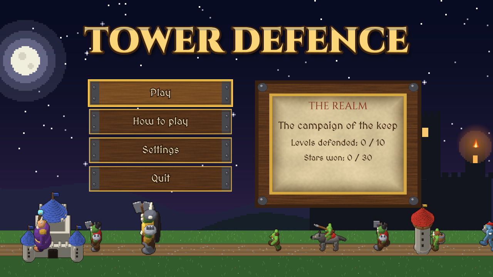
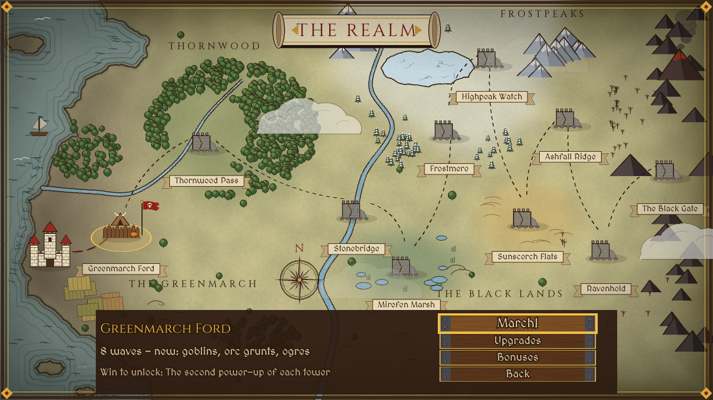
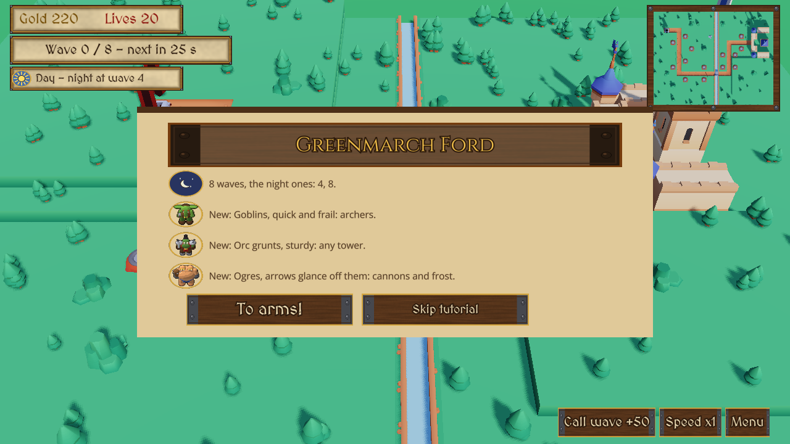
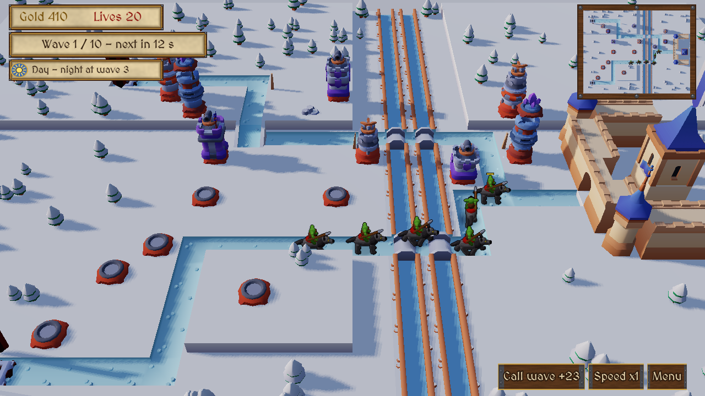
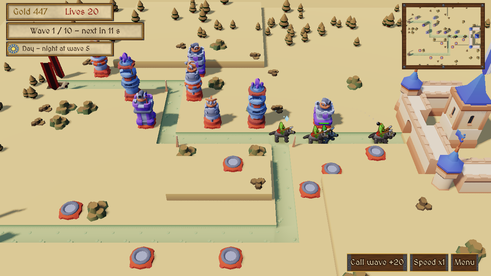

# Sample games {#page-design-sample-games}

[TOC]

Design page of the sample games, summarised in the [Roadmap](../roadmap.md).

## Goal

Owl Engine ships two kinds of example content:

- **Engine Demo** (today's `engine_demo/`): an all-in-one showcase of every engine feature, not a game in itself.
- **Sample games**: small but real games, each one built on only what it needs, most of them mini remakes of known
  games. They prove that Owl Engine makes games, give a newcomer a project of a readable size to start from, and feed
  the
  two showcase games of v1.0.

## Rules

- One project per game, beside the Engine Demo, authored in Owl Nest; game rules in scripts, never in the engine.
- Visual scripts first ([Visual scripts in every game](#sample-games-visual-scripts)): everything that reads as a
  graph is a `.owlvs`; Lua stays for what a graph would hide (an undo stack, a level generator, a long table of data),
  as a Custom Lua node or a module called from the graph.
- Small: one screen or a handful of levels, finished (title, play, win / lose, settings), playable with keyboard,
  mouse and gamepad.
- CC0 or home-made art only (the reworked `textures/wolf3d/` of the Engine Demo included); a scenario test per game runs
  in CI, and the game packages with the runner.
- A sample game uses only what it needs: it is not a feature checklist, the Engine Demo is.

## Short list

| Game                | Inspired by         | Exercises                                                  | Possible from | done in |
|---------------------|---------------------|------------------------------------------------------------|---------------|---------|
| Breakout            | Breakout / Arkanoid | 2D, physics, HUD, sound, gamepad                           | v0.4.0        | v0.4.0  |
| Sokoban             | Sokoban             | tilemap, undo, saves, level editing in Owl Nest            | v0.4.0        | v0.4.0  |
| Wolfenstein mini    | Wolfenstein 3D      | raycast, doors, pick-ups, HUD                              | v0.4.0        | v0.4.0  |
| Tower defence       | Kingdom Rush        | 3D, billboards, waves, upgrades, world map                 | v0.5.0        | v0.5.0  |
| Rail shooter        | Star Fox            | splines, 3D, planet, particles, HUD markers                | v0.6.0        | v0.6.0  |
| Point-and-click     | Legend of Kyrandia  | 2D backdrops, 3D actors, walkable areas, dialogue          | v0.6.0        | v0.6.0  |
| Wolfenstein combat  | Wolfenstein 3D      | guards on behaviour trees, weapons, line of sight          | v0.7.0        | v0.7.0  |
| Lunar lander        | Lunar Lander        | 3D, thrust and gravity, planetary terrain, breakable legs  | v0.7.0        | v0.7.0  |
| Asteroid field      | Star Fox / X-Wing   | 6DoF flight, 3D steering and formations, trails, HUD marks | v0.7.0        | v0.7.0  |
| Bridge builder      | Poly Bridge         | parts on sockets, breakable joints, assemblies, replay     | v0.7.0        | v0.7.0  |
| One-room Zelda-like | The Legend of Zelda | top-down, NavMesh, behaviour trees, 2D lights, dialogue    | v0.7.0        | v0.7.0  |

The two v1.0 showcase games (one 2D, one 3D) are picked from this list and from the
[Pool](#sample-games-pool). The Lua gaps closed for the tower defence also serve Mini Transport Tycoon
([Order](#sample-games-order)).

## Pool {#sample-games-pool}

Ideas without commitment, planned in no release. A release picks its sample games from the pool once its features are
done; a game it builds moves to the short list, the others stay in the pool or are dropped. "Possible from" is the
first release whose engine features the game needs. Every game of the pool is possible with 1.0, built or not.

| Game                  | Inspired by                       | Exercises                                                                          | Possible from |
|-----------------------|-----------------------------------|------------------------------------------------------------------------------------|---------------|
| Mini Transport Tycoon | Mini Motorways / TTD              | isometric, roads, pathfinding, management HUD                                      | v0.5.0        |
| Mini Minecraft        | Minecraft                         | voxel, build and break, inventory                                                  | v0.4.0        |
| Marble or mini kart   | Marble Madness / Kart             | 3D, Jolt physics, shadows                                                          | v0.7.0        |
| Networked Bomberman   | Bomberman                         | tilemap, deterministic simulation, multiplayer                                     | v0.9.0        |
| Asteroids             | Asteroids                         | 2D inertia, screen wrap, particles                                                 | v0.4.0        |
| Station trader        | Taipan! / Elite                   | data tables, economy on the fixed tick, trade HUD                                  | v0.6.0        |
| Orbital golf          | Angry Birds Space / Gravitee Wars | 2D gravity fields, trajectory preview                                              | v0.7.0        |
| Visual-script puzzle  | Lemmings / pipe puzzles           | rules written only in visual scripts, tilemap, HUD                                 | v0.6.0        |
| Mini roguelike        | Rogue / Spelunky                  | levels from PCG graphs, tilemap, saves                                             | v0.6.0        |
| Mini launcher         | Model rocketry                    | parts on sockets, articulated bodies, gravity, orbit prediction, time warp, planet | v0.7.0        |

## v0.4.0 games

Feasibility checked against `main` on 2026-10-18 (Lua bindings, components, Engine Demo): all five games fit the
v0.4.0 engine. Breakout and Mini Transport Tycoon need no engine change, Sokoban one Lua binding (`isometric.get_size`,
added), Wolfenstein mini art, Mini Minecraft two small engine fixes ([Gaps](#sample-games-gaps)).
Breakout, Sokoban and a Wolfenstein mini without combat shipped with v0.4.0; the Lua gaps G1, G3, G7, G8 and G15 are
closed in v0.5.0; Mini Minecraft and Mini Transport Tycoon wait in the pool.

Common to every game:

- Title, settings, victory and game over scenes started from the Engine Demo (`scenes/main_menu.owl`,
  `scenes/settings_menu.owl`, `scenes/victory.owl`, `scenes/game_over.owl`, `scripts/ui/*.lua`): the menus already
  work with keyboard, mouse and gamepad (`UiFocus`, scenario `main_menu_focus.owltest`). Since the first playthrough,
  each game has menus of its own, written by `tools/samples/<game>/generate_menus.py`: its look, its title art, its
  buttons, its transitions (`scene.transition_to` in a colour) and an animated background; a How to play window on
  the title and the pause window are the only places that show the controls.
- `input_actions.yml` on the built-in actions (`move`, `look`, `jump`, `interact`, `primary`, `secondary`, `ui_*`)
  plus the game's own; `input/gamecontrollerdb.txt` copied.
- Sounds written by a generator in `tools/samples/<game>/`, like `tools/demo/generate_town_sounds.py` (the Kenney
  audio packs cannot be fetched from the build machine), a start jingle of its own per game;
  `sounds/ui/victory.wav` copied.
- The game state mirrored into `gamestate` keys (`<game>_score`, ...) for the scenarios.

### Breakout

Done in v0.4.0: `samples/breakout/` (how to play: its `README.md`).

| Item     | Made                                                                                                                                                                                                                                                            |
|----------|-----------------------------------------------------------------------------------------------------------------------------------------------------------------------------------------------------------------------------------------------------------------|
| Play     | One screen, 5 levels, 3 lives; bricks of 1 to 3 hits; 2 power-ups (wide paddle 15 s, slow ball 12 s)                                                                                                                                                            |
| Win/lose | Every brick of the 5 levels / no life left; best score kept; the ball serves by itself after 5 s                                                                                                                                                                |
| Controls | `paddle` axis (A / D, arrows, left stick, D-pad) or the mouse; `serve` (Space, pad A, left click); `pause`                                                                                                                                                      |
| Scenes   | `title`, `level_select`, `level_1` to `level_5` (one scene each), `settings`, `victory`, `game_over`                                                                                                                                                            |
| Menus    | Arcade cabinet (`generate_menus.py`): a lit marquee with the title and the high score, the brick wall lit in a wave, an attract ball; hollow neon tube buttons filling with magenta, pixel labels (`PressStart2P`), neon headings (`Monoton`), magenta wipes up |
| Entities | `Paddle` and `PaddleWide` (Kinematic), `Ball` (Dynamic, restitution 1, friction 0), three `Wall` (Static)                                                                                                                                                       |
| Bricks   | Instances of `prefabs/brick.owlprefab` (Static body, `SpriteRenderer`, `brick.owlvs` with its properties)                                                                                                                                                       |
| Scripts  | `game.owlvs` (rules, spawns, pause), `paddle.owlvs`, `ball.owlvs` (speed set with `physics.set_velocity`), `brick.owlvs`                                                                                                                                        |
| HUD      | `huds/play.owlhud`: score, level, lives, a message line, the pause window (Resume, Restart, Quit, controls)                                                                                                                                                     |
| Art      | Home-made bricks, paddle, ball, capsules, walls and backdrop, chip sounds and music (`tools/samples/breakout/`)                                                                                                                                                 |
| Effects  | Sparks and a flash of light per broken brick (prefab), a neon trail and a 2D light on the ball, bloom                                                                                                                                                           |
| Saves    | No slot; best score and levels cleared with their best through `settings.save` (`breakout_best`, `_done_N`)                                                                                                                                                     |

- Reuse: the menus, built from the Engine Demo ones, have a
  look of their own. A broken brick is destroyed at once (a popping brick
  would keep its body); its burst (`prefabs/brick_burst.owlprefab`, tinted with `entity.set_tint`) and the power-up
  capsules are prefabs spawned with `scene.spawn_prefab` and destroyed when done.
- Gaps met: G5 (the paddle follows the mouse motion, `breakout_mouse_speed` setting), a second paddle for the wide one
  (a body cannot be resized from Lua), G14 (one scene per level). The music and the effects have their volumes on the
  mixer buses (G9 closed), the pause stops the scene clock (`time.set_paused`). Each level names the next
  one in the `next_scene` property of its `Game` script (G16 fixed): a new level is a duplicated scene in Owl Nest.
- Scenarios: `breakout_serve` (serve, 300 frames, `breakout_bricks` below 40), `breakout_lose` (no input at all:
  the automatic serve, `breakout_lives` below 3), `breakout_gamepad` (dead zone, the stick moves the paddle, A serves),
  `breakout_level_select` (down selects level 2, accept starts a fresh run there), `breakout_how_to` (the How to play
  window opens and closes with the keyboard focus), `breakout_pause` (no serve while paused), `breakout_settings`
  (music and effects sliders with the D-pad); `breakout_serve` also counts the bursts.
- The levels were first laid out by `tools/samples/breakout/generate_levels.py` (text grids) and are edited in Owl Nest
  from then on; `tools/tests/test_breakout_levels.py` checks the grids.

### Sokoban

| Item     | Done                                                                                                                                                                                                                                          |
|----------|-----------------------------------------------------------------------------------------------------------------------------------------------------------------------------------------------------------------------------------------------|
| Play     | 10 levels of 1 to 5 crates (2 to 38 pushes); push the crates onto the goals; undo, restart, moves and pushes                                                                                                                                  |
| Win/lose | Every crate on a goal; no lose; each level done and its fewest moves are kept                                                                                                                                                                 |
| Controls | `step_*` (WASD, arrows, D-pad) one cell per press, repeated when held; the left stick as four directions                                                                                                                                      |
|          | Z, U, Backspace or pad B undo; R or pad Y restart; Esc, P or Start pause; the mouse in menus and HUD buttons                                                                                                                                  |
| Scenes   | `title`, `level_select` (`UiList` with done marks), `level_01` to `level_10`, `settings`, `victory`                                                                                                                                           |
| Tilemap  | One `.owltilemap` per level: layer 0 floor and walls, 1 goals, 2 crates and the hero tile of the start                                                                                                                                        |
| Entities | `Level` (`Tilemap`), player (`AnimatedSpriteRenderer`, `isometric.set_sprite_frame`), `MovingBox`, music                                                                                                                                      |
| Scripts  | `sokoban.owlvs` (rules on `isometric.get_cell`, undo stack in a Lua table, win), `levels.lua`, menus                                                                                                                                          |
| Levels   | `tables/levels.owltable`: the scene and the name of each level, in play order                                                                                                                                                                 |
| Effects  | Dust behind a pushed crate (`PushDust`), a sparkle on a crate set on a goal (`GoalSparkle`)                                                                                                                                                   |
| HUD      | `huds/level.owlhud`: level, moves and pushes, best, Undo / Restart / Menu buttons, pause window with controls                                                                                                                                 |
| Menus    | Warehouse (`generate_menus.py`): stencilled crate letters, a row of crate buttons lighting up under the cursor, a clipboard in typewriter ink for the log, the settings, the levels and the victory, stencil font (`BlackOpsOne`), wipes left |
| Art      | `sokoban_tiles.png`: Tiny Dungeon floor, wall and hero (walk and push frames), home-made goal mark and crates                                                                                                                                 |
| Saves    | No slot: `sokoban_done_NN` and `sokoban_best_NN` settings saved at once; Continue starts the first level left                                                                                                                                 |

- Level editing in Owl Nest: paint the three layers in the tilemap editor (the hero tile of layer 2 places the player);
  for a new level, duplicate a level scene, point its `Level` at a new tilemap, set the `level` property of its `Game`
  script, then add its row (scene, name) to `tables/levels.owltable` in the data table editor: the title, the level
  select, the victory screen and the level before it follow the table. `sokoban.owlvs` warns when crates and goals do not
  match.
- Generators in `tools/samples/sokoban/`: `generate_assets.py` (tile sheet, sounds), `generate_levels.py` (tileset,
  tilemaps, level scenes, HUD, from the texts of `levels.py`), `generate_menus.py`; `tools/tests/test_sokoban_levels.py`
  replays a stored solution of each level text.
- Reuse: the walk frames of `tools/demo/generate_kenney_atlases.py`, `scripts/hub/hub_water.owlvs` (`get_cell` /
  `set_cell` on a 2D tilemap), the journal list of `scripts/raycast/inventory.lua`; the menus, first copied from the
  Engine Demo, have a look of their own since the first playthrough.
- Gaps: G6 (tile bindings named `isometric`), G14 (one scene per level); the music and the effects have their volumes
  on the mixer buses (G9 closed), the pause stops the scene clock (`time.set_paused`). Lua had no way to
  read the size of a tilemap: `isometric.get_size` was added for it (width, height, cell size).
- Scenarios: `sokoban_push` (`sokoban_on_goal` grows), `sokoban_undo` (undo and restart put back crate and counters),
  `sokoban_wall` (no step into a wall nor a blocked crate), `sokoban_win` (level 1 solved, `sokoban_done_01` set, level
  2
  opens), `sokoban_gamepad` (D-pad, B, stick dead zone), `sokoban_level_select` (`ui_down`, `ui_accept`),
  `sokoban_pause` (no step while paused), `sokoban_settings` (music and effects sliders); `sokoban_push` also counts
  the sparkles.
- Size: **S**, done.

### Tower defence {#sample-games-tower-defence}

Shipped in `samples/tower_defence/` (how to play: its `README.md`): a first map in flat isometric art validated the
gameplay. Plan of 2026-10-24: a small campaign in the spirit of Warcraft 1 and 2, the Horde (goblins, orcs, ogres)
against human towers and a human keep, in real 3D, mixing as many rendering styles as the engine has.

|                        |               |
|------------------------------------------------------------------------------------------------------------------------|---------------------------------------------------------------------------------------------|
|                                       |  |
|  |                                                                                             |

| Item      | Plan                                                                                                                                       |                                                                                            |
|-----------|--------------------------------------------------------------------------------------------------------------------------------------------|--------------------------------------------------------------------------------------------|
| Play      | 10 levels of 8 to 12 waves, on 3D terrain with relief, between visits to a world map and its upgrades screen                               |                                                                                            |
| Win/lose  | Every wave held with a life left / the 20 lives lost; 3, 2 or 1 stars for 18, 10 or fewer lives kept                                       |                                                                                            |
| Waves     | Timed, called early for gold; a data table per level (`waves_NN.owltable`), its night waves fought at night                                | Dusk or dawn announced between two waves                                                   |
| Day/night | `time_effects` of `defence.owlvs`: a bonus or a malus by day and by night for every tower and enemy kind                                   | Sun or moon on the HUD, legend in the pause window                                         |
| Modifiers | Per level (`modifiers`): fog, blizzard, blood moon, drought, gale, plunder, long night, effects of the same form                           | Briefing, world map panel, pause window                                                    |
| Briefing  | A modal window before the first wave: the captain speaks (a `.owldlg` dialogue), then a line and an icon per night, modifier and new enemy | Time paused; its answers are the buttons, Skip tutorial on level 1                         |
| Tutorial  | Level 1, skippable: build on a glowing pad, call a wave, raise, sell, read day and night; hints by the targets                             | `tower_tutorial` setting, Reset tutorial in Settings                                       |
| Towers    | Archer, cannon, frost on build pads; levels 1, 2, 3, then one power-up of two; sold for half of what was spent                             |                                                                                            |
| Enemies   | `Renderer2D` `sprites`: billboards, depth test, walking the lanes of the road splines                                                      | 8 directions x 9 frames (walk, attack, death), lit like the 3D scene; hit flash, particles |
| Relief    | Plateaus, ramps, rivers and bridges; a pad on high ground gives its tower +15 % range per height step                                      |                                                                                            |
| Controls  | As in the first map (mouse, keyboard cursor, gamepad), plus Z / C or pad LB, D-pad up / down turn the view by 45°, the wheel zooms         |                                                                                            |
| Scenes    | `title`, `world_map`, `upgrades`, `level_01` to `level_10`, `settings`, `victory` (stats, stars credited, unlock), `game_over`             |                                                                                            |
| Saves     | No slot: `tower_done_NN`, `tower_stars_NN` (best), `tower_best_NN`, `tower_up_<family>` settings; unlocks follow from the wins             |                                                                                            |
| Scripts   | `defence.owlvs` holds the properties and the hooks; the rules are the modules of `scripts/game/td/` (`require`)                            | Towers and enemies in data tables                                                          |
| Sound     | Music and effects on their mixer buses, their volumes in Settings, subtitles of the sounds that tell something                             | Accessibility: colour vision, reduced motion, subtitles                                    |

| #   | Level           | Terrain                                                    | Theme | Nights             | Modifiers           | New                    |
|-----|-----------------|------------------------------------------------------------|-------|--------------------|---------------------|------------------------|
| 1   | Greenmarch Ford | One plateau, a ramp down, a river crossed by a bridge      | grass | 4, 8               |                     | Goblins, grunts, ogres |
| 2   | Thornwood Pass  | Two plateaus and a road winding between them through woods | grass | 3, 6, 9, 10        | fog                 | Wolf riders            |
| 3   | Stonebridge     | Two gates, two roads meeting before a long bridge          | grass | 3, 4, 7, 8, 10     |                     | Trolls                 |
| 4   | Mirefen Marsh   | Two rivers, two gates, four bridges                        | marsh | 3, 6, 9, 10        | fog                 | Goblin sappers         |
| 5   | Frostmere       | A plateau gate, a river crossed by two bridges             | snow  | 3, 6, 9, 10        | blizzard            | Ogre mages             |
| 6   | Highpeak Watch  | A high plateau, two ramps down                             | snow  | 3, 4, 7, 8, 11     | gale                | Orc berserkers         |
| 7   | Sunscorch Flats | Two gates on open sand                                     | dry   | 5, 10              | drought             |                        |
| 8   | Ashfall Ridge   | A road climbing a ridge and down again                     | ash   | 2, 4, 6, 8, 10, 11 | blood moon          |                        |
| 9   | Ravenhold       | Two long winding roads                                     | ash   | 3, 4, 7, 8, 11, 12 | plunder, long night |                        |
| 10  | The Black Gate  | Two winding roads to the fortress gate                     | ash   | 4, 8, 11, 12       | blood moon          | The orc chieftain      |

| Enemy         | Mechanic                                                               | Day / night                      | Counter                              |
|---------------|------------------------------------------------------------------------|----------------------------------|--------------------------------------|
| Wolf rider    | Speed 2.1                                                              | +15 % damage taken / +20 % speed | Frost                                |
| Troll         | Regenerates 7 hp/s, not while burning                                  | No healing / heals 50 % more     | Cannon bursts, fire shells           |
| Ogre mage     | Every 6 s a ward absorbing 45 damage on the Horde within 1.6           | Wards −20 % / +50 %              | Kill it first; burning ignores wards |
| Goblin sapper | Fast, 3 lives at the keep; killed, its keg hurts the Horde within 1.2  | −10 % / +20 % speed              | Archers' range, kill it in the crowd |
| Orc berserker | Up to 90 % faster as it loses its life                                 | +10 % damage taken / +15 % speed | Frost, then burst                    |
| Chieftain     | 2000 hp, arrows ×0.5, half slowed, never frozen, rallies (+25 % speed) | +10 % / −15 % damage taken       | Cannons, the vulnerability aura      |

| Star upgrades  | Tier 1 (1 star)    | Tier 2 (2 stars)       | Tier 3 (3 stars) | Tier 4 (4 stars)  |
|----------------|--------------------|------------------------|------------------|-------------------|
| Archers        | +15 % damage       | +12 % range            | 15 % faster      | +10 % range       |
| Cannons        | Cost −15 %         | Bursts +20 %           | +20 % damage     | 15 % faster       |
| Frost          | Chill +30 % longer | Slower chilled enemies | +12 % range      | +20 % damage      |
| Rain of arrows | Cooldown −20 %     | +30 % damage           | Radius +25 %     | +30 % damage      |
| Shield wall    | Cooldown −20 %     | +2 s                   | Radius +25 %     | Cooldown −20 %    |
| Treasury       | +40 starting gold  | +10 % gold per kill    | +2 lives         | +60 starting gold |

- Stars: the best of each level is kept, the upgrades screen spends their sum (30 at most for 60 of tiers): replaying
  a level for more stars credits the difference; Refund all is free.

| Level won         | Unlocks                                                                         |
|-------------------|---------------------------------------------------------------------------------|
| Greenmarch Ford   | The second power-up of each tower (double shot, shock wave, vulnerability aura) |
| Thornwood Pass    | Rain of arrows: a spell on a spot of the road, damage in an area, 45 s cooldown |
| Stonebridge       | Royal treasury: 60 more starting gold on every level                            |
| Mirefen Marsh     | Fletchers' guild: archers cost 10 % less (an effect `archer any cost 0.9`)      |
| Frostmere         | Shield wall: a spell stopping the enemies on a spot for 5 s, 60 s cooldown      |
| Highpeak Watch    | Watchtowers: every tower +5 % range                                             |
| Sunscorch Flats   | Harvest tithe: +10 % gold per kill                                              |
| Ashfall Ridge     | Night watch: towers +10 % range at night                                        |
| Ravenhold         | Royal guard: 3 more lives on every level                                        |
| 3 stars on all 10 | Keep walls: 5 more lives on every level                                         |

| Tower  | Level 2 | Level 3   | Power-up A (from the start)                        | Power-up B (Greenmarch Ford won)                |
|--------|---------|-----------|----------------------------------------------------|-------------------------------------------------|
| Archer | +range  | +rate     | Piercing arrows: each arrow hits up to 3 in a line | Double shot: two targets at each volley         |
| Cannon | +damage | +area     | Fire shells: the ground burns, damage over 3 s     | Shock wave: the enemies hit are thrown back     |
| Frost  | +slow   | +duration | Full freeze: a short stop every third hit          | Vulnerability aura: +25 % damage taken in range |

- Costs: level 2 at 80 % of the tower price, level 3 at 120 %, a power-up at 150 %; the ring of a tower shows the next
  step with its price, the two power-ups side by side at level 3 (a locked one says which level unlocks it), and Sell.
- Menus: the parade of the Horde, the keep, the archer tower and the road under them are pixel art rendered like the
  Horde (`scenery.py`, the models of `creatures.py`), under a starry night over the hills and the ramparts of the keep
  with flickering torches; the campaign board of the title is parchment framed in wood, the plank buttons of the
  menus raised over their boards by a soft shadow.
- World map (`world_map.owl`): a hand-inked map drawn by `world_map_art.py` at 80 pixels per unit (pixel for pixel on
  2560 x 1440, `MapRoot` scaled down to fit a narrower screen): inked coast with ripple lines and a ship, rivers
  between banks, a frozen lake, hatched mountains (snowy, black, a volcano), painted forests, fields, faint tracks,
  region and site names, a cartouche, a compass rose, paper grain and vignette, the marsh of Mirefen and the dunes
  of Sunscorch; waving banners, drifting clouds (thinning over the site names) and glints of the sea animated by
  `world_map.owlvs`. The road from the capital is shown up to the last site open and the
  next stretch is traced dash by dash after a win.
- Sites on the world map: locked (a grey ruin), open (a Horde camp under a red banner, bobbing), done (a human keep
  under a blue banner and its stars); a click, Q / E or the D-pad picks an open site, Enter, pad A or March! starts
  it; the panel names the level, its waves, the enemies it brings first and its unlock; Bonuses lists the unlocks,
  Upgrades opens the upgrades screen.
- Build wheel: the badges of the pad or the tower around it on the screen, their prices under them and a parchment
  scroll with the info, billboards of the `marks` layer kept inside the view and clear of the HUD.
- Look: parchment, dark wood, iron and gold (`medieval_ui.py`), titles in `Cinzel`, labels in `MedievalSharp` (OFL).

| Element                       | Rendered by                                    | How                                                                                                |
|-------------------------------|------------------------------------------------|----------------------------------------------------------------------------------------------------|
| Terrain, river, bridge, decor | `RendererMesh`                                 | Kenney Tower Defense Kit tiles, one entity per cell, raised and stacked for the plateaus           |
| Towers                        | `RendererMesh`                                 | Kit tower parts stacked by level (base, middle, top, weapon), power-ups by their tints and weapons |
| Keep, walls, gate, banners    | `RendererMesh`                                 | Kenney Castle Kit                                                                                  |
| Sky, sun, night               | `ProceduralSky`, `DayNightCycle`               | Sun with cascaded shadows; point `Light` torches on the keep and along the road at night           |
| Enemies                       | `Renderer2D` `sprites`: billboards, depth test | 8 directions x 9 frames (`creatures.py`), the frame picked from heading and view; the boss bigger  |
| Projectiles and effects       | `sprites`                                      | Arrows, shells, shards, bursts, fire; a `Light2D` on fire shells and torches                       |
| Build wheel, health bars      | `marks` over all; bars in `sprites`            | The wheel beside its pad on the screen, picked by tag                                              |
| Range ring, build cursor      | `Renderer2D` `ground`: flat, depth test        | Lies on the terrain, hidden by the towers in front                                                 |
| Minimap                       | `RenderTarget`                                 | Orthographic camera over the level into a `UiImage` of the HUD                                     |
| World map                     | `Renderer2D` `world`                           | The inked map, sites, banners, stars, road dashes, clouds, a 2D scene between the levels           |
| HUD and menus                 | `Canvas`                                       | Gold, lives, wave, minimap frame, spells, pause; parchment, wood and gold                          |

- Engine: `Renderer2D` layer keys `Billboard` (`None`, `Upright`, `Full`: the sprites turn to the camera, their 2D lights
  on the ground plane) and `DepthTest` (sprites tested against the 3D layers drawn before, sorted back to front), both
  following the light and exposure of the 3D scene; `scene.pick_entity` with a tag returns the tagged ancestor of the
  mesh hit and sees billboards as drawn; `ui.set_text` writes a world `TextRenderer`; shared materials instanced.
- Data-driven levels: `tools/samples/tower_defence/maps.py` holds per level a height grid, the road, the river, the
  pads, the decor, the waves, the nights and the briefing; `generate_maps.py` writes one scene per level, its waves
  table and its briefing dialogue, editable in Owl Nest: terrain cells are mesh entities, the roads are the `Linear`
  splines of the `Road` and `Road B` entities the enemies walk in seven lanes, pads are `Pad` entities; the towers and
  the enemies are the rows of `tables/towers.owltable` and `tables/enemies.owltable`.
- Scenarios: `tower_build` (mouse, wheel), `tower_upgrade` (archer to level 3, power-up), `tower_wave`,
  `tower_call_early`, `tower_defend` (gamepad), `tower_fast_forward`, `tower_rotate` (the enemy frames follow the view),
  `tower_build_only` (towers never raised lose level 1), `tower_win` (raised towers hold it, night, stars),
  `tower_title`, `tower_world_map`, `tower_map_first_level` (fresh save: the map fits, a click on level 1 marches,
  Quit to the map comes back), `tower_upgrades_screen` (a win credits stars, a tier bought then refunded),
  `tower_level_wolves` (level 2), `tower_level_roads` (level 3, both roads), `tower_level_frostmere` (sappers, a mage's
  wards), `tower_level_black_gate`, `tower_night_and_fog` (briefing shown and dismissed, the fog and the night effects
  on the range of an archer and the speed of a goblin), `tower_drought` (a cheaper cannon), `tower_tutorial` (each step
  of the tutorial in turn, then done), `tower_tutorial_skip` (the answers of the briefing dialogue, skipped and
  remembered on a restart), `tower_settings` (the music volume and the accessibility settings, reset).
- Size: **M–L**.
- Done: the ten levels in 3D with relief (grass, marsh, snow, sand and ash themes), the Horde of nine kinds in 8
  directions with walk, attack and death frames introduced across the campaign with their counters, tower upgrades and
  power-ups, the build wheel, day and night alternating with their effects, the level modifiers and the briefing, the
  tutorial of the first level, the minimap, the inked world map, the unlocks, the star upgrades and the medieval look;
  the rules split into Lua modules.

### Mini Transport Tycoon

| Item     | Plan                                                                                                                                                                                            |
|----------|-------------------------------------------------------------------------------------------------------------------------------------------------------------------------------------------------|
| Play     | 64×64 map, two towns, four industries (farm, mine, factory, harbour); roads, stations, trucks with a route each                                                                                 |
| Win/lose | Company value at the target before year 5 / money below the loan limit for 3 months                                                                                                             |
| Controls | Mouse tools (left builds, right bulldozes), WASD or stick pans, keyboard cursor I J K L, pad RB switches tool                                                                                   |
| Scenes   | `title`, `play` (one generated map), `settings`, `victory`, `game_over`                                                                                                                         |
| Tilemap  | `Ground` (isometric, road overlays, `navigation` rules as in `iso_town.owl`); stations as overlay tiles                                                                                         |
| Entities | Towns and industries (`IsometricObject` slices), a pool of 24 hidden trucks (8 headings), trees, camera                                                                                         |
| Lua      | `build.lua` (roads, bulldozer, costs), `stations.lua`, `vehicles.lua` (`path.find`, `path.poll`, load, unload), `economy.lua` (production, pay by distance and days, running costs, loan, date) |
| HUD      | Toolbar, money and date, vehicle list (`UiList`), station and finance windows (`UiWindow`), tooltips                                                                                            |
| Art      | `tools/iso_atlas` (terrain, roads, buildings, vehicles); map from `city_map.py` with another seed and two towns                                                                                 |
| Saves    | Slots from the pause menu; the roads and stations laid in game are tilemap cells the save keeps (G3)                                                                                            |

- Reuse: `scripts/iso/iso_town.lua` (build tool, road shapes, funds), `scripts/iso/iso_town_traffic.lua` (route
  following, headings, waits), `scripts/iso/iso_camera.owlvs`, `scripts/iso/iso_town_life.lua`, `huds/iso_town.owlhud`,
  `tilesets/iso_ground.owltileset`, `textures/iso/`, `sounds/town/`, and the small map of the scenarios
  (`test/unit/test_helper/assets/scenarios/iso_town_small.owl`).
- Gaps, closed in v0.5.0: G1 (trucks spawned from a prefab), G3 (runtime roads kept by a save), G8 (pause, fast
  forward), G15 (click a vehicle, `scene.pick_entity`), G7.
- Scenarios: `tycoon_route` (the mouse lays a road from a farm to a factory, two stations, buys a truck;
  `tycoon_deliveries` above 0, money up), `tycoon_bankrupt` (no income, fast forward, game over),
  `tycoon_save` (save, bulldoze, load: the road is back).
- Size: **L**, about 3 weeks (the economy and its HUD are new, the rest comes from the demo).

### Wolfenstein mini

Shipped in `samples/wolfenstein/` (how to play: its `README.md`). An exploration game, guarded since v0.7.0
([Wolfenstein combat](#sample-games-wolfenstein-combat)).

| Item     | As shipped                                                                                                                                                                                                                                                                                                                                                          |
|----------|---------------------------------------------------------------------------------------------------------------------------------------------------------------------------------------------------------------------------------------------------------------------------------------------------------------------------------------------------------------------|
| Play     | 3 floors of 32×32 (cellars, prison, headquarters): treasure, food, gold and blue keys with their locked doors, 3 secret walls each, an exit elevator                                                                                                                                                                                                                |
| Win      | The elevator of floor 3; after each floor a tally counted up line by line (skippable): items, secrets and map explored in %, 10 points per percent as a bonus                                                                                                                                                                                                       |
| Controls | `walk`, `turn`, `run`, `interact` (doors, secret walls, elevator), `map` (Tab, pad Y: large map); keyboard, mouse (right button turns, left opens) and gamepad                                                                                                                                                                                                      |
| Scenes   | `title`, `level_1` to `level_3` (`RendererRaycast` + a `Space: Screen` `Renderer2D` for the minimap), `tally`, `settings`, `victory`                                                                                                                                                                                                                                |
| Entities | Player (`PhysicBody`, `Camera`), wall `Tilemap`, `RaycastDoor` (locked: empty `interactionAction`, `door.activate` with the key), `RaycastPushWall`, pick-ups, props                                                                                                                                                                                                |
| Scripts  | `player.owlvs`, `pickup.owlvs` (sparks), `locked_door.owlvs`, `secret.owlvs` (counts each wall once), `explore.owlvs` (fog, minimap, markers, cells seen over floor cells), `level.owlvs` (pause through `time.set_paused`), `exit.owlvs`, `elevator.owlvs` (the ride, `sequences/elevator.owlseq`, skippable)                                                      |
| HUD      | `huds/play.owlhud`: the status bar of Wolfenstein 3D along the bottom (floor, score, face, health, ammo, keys, weapon), messages, a pause window with the controls (no ratio during play); the minimap is a tilemap of the overlay layer above the bar; markers on the keys and the switch once seen                                                                |
| Menus    | DOS menus of 1992 (`generate_menus.py`): a raycast view turning behind the steel title, blood red windows with a hard shadow, grey pixel entries (`Jersey10`), a red bar with a skull cursor under the selected one, red fades; settings with master, music and effects volumes (mixer buses), mouse turn, interface size, colour vision, reduced motion, subtitles |
| Art      | The walls and props of `textures/wolf3d/`, reworked by the maintainer; the sounds of `sounds/raycast/` of the Engine Demo, home-made music; the guard and the weapons of the combat (CC0)                                                                                                                                                                           |
| Saves    | Autosave in slot 1 at each floor start, F6 / F9 in slot 2, Continue loads the newer; best ratios per floor and best score in the settings                                                                                                                                                                                                                           |

- Floors carved by `tools/samples/wolfenstein/generate_levels.py`, which refuses a floor with a cell out of reach (so
  100 % is always possible; a slid secret wall counts as a wall where it stops, which cut off a room of floors 2 and
  3 until the first playthrough), then written as Owl Nest saves them: editable in Owl Nest, a pick-up counted by
  its tag.
- Map explored: the fog of `raycast_level.lua` on a 32×32 minimap, set up 8 rows per frame (a single `on_create` loop
  overruns the script time quota on emulated arm64), kept in the gamestate across saves. A slid secret wall shows,
  and stops the fog, in the cell where it stopped (it showed as floor there and the fog saw the room behind it).
- Reuse: `scripts/raycast/raycast_player.owlvs`, `scripts/raycast/raycast_level.lua`, `scripts/raycast/pickup.owlvs`,
  `scripts/raycast/raycast_exit.owlvs`, `tilesets/raycast_w3d_walls.owltileset`, `tilesets/minimap.owltileset`,
  `sounds/raycast/`; the menus, built from the Engine Demo ones, have a look of their own, and the ratios show
  on the tally, not on the play HUD.
- Pick-up sparks: a `RendererParticles` layer with `Projection: Raycast` (`raycast_fx`) draws them in the first-person
  view, the raycast sprites' convention (world Z above the eye).
- Gaps: G17; G9 and G16 fixed (the music and effects sliders; the `next_scene` property of `exit.owlvs` names the
  next floor); G1, G7, G10 and G11 closed by the combat.
- Scenarios: `wolf_pickup` (walk onto a cross, `wolf_items` and `wolf_score` rise), `wolf_locked_door` (closed without
  the key, opens with it), `wolf_secret` (push a secret wall, `wolf_secrets` equals 1), `wolf_explore` (`wolf_seen`
  and `wolf_explored` rise while turning, Tab enlarges the map), `wolf_exit` (the tally scene opens, counts up,
  then floor 2, after the elevator ride), `wolf_tally` (a second E skips the ride, accept during the count shows every
  line at once, the next accept leaves), `wolf_pause` (Escape opens the pause window, the player stands still, a door
  in reach stays closed, Resume closes it), `wolf_markers` (the key's marker once seen, the sparks of its pick-up),
  `wolf_settings` (music and effects sliders, reduced motion and colour vision with the gamepad).

### Mini Minecraft

| Item     | Plan                                                                                                                                                              |
|----------|-------------------------------------------------------------------------------------------------------------------------------------------------------------------|
| Play     | A finite island (about 96×96×48) authored in Owl Nest; break blocks, collect them, build from a 9-slot hotbar                                                     |
| Win/lose | Place 3 diamonds on the altar / health 0 (falls, lava); no mobs                                                                                                   |
| Controls | Built-in `VoxelPlayer` (WASD or stick, mouse or right stick look, `jump`, `sprint`); `primary` breaks, `secondary` places; 1 to 9, wheel or bumpers pick the slot |
| Scenes   | `title`, `island` (`RendererVoxel`, `VoxelWorld` not procedural), `settings`, `victory`, `game_over`                                                              |
| Entities | `VoxelWorld` (`voxel_blocks.owltileset`), `VoxelPlayer` with its camera, altar trigger, ambience `SoundSource`                                                    |
| Lua      | `hotbar.lua` (selected block), `inventory.lua` (counts from breaks and places), `health.lua` (fall damage from the height lost), `goal.lua`                       |
| HUD      | Crosshair (built in), hotbar (9 `UiImage` slots and counts), inventory window (`UiList`), health bar                                                              |
| Art      | `textures/atlases/voxel_blocks.png` (home-made by `tools/demo/generate_atlases.py`) plus coal and diamond blocks, icons                                           |
| Saves    | Slots: a non-procedural world writes its chunks into the save, so the edits come back                                                                             |

- Reuse: `scenes/voxel_terrain.owl`, `huds/voxel.owlhud`, `scripts/voxel/voxel_explorer.owlvs`,
  `tilesets/voxel_blocks.owltileset`, the Voxel Palette and structures of Owl Nest for the island,
  `scripts/raycast/inventory.lua` (window pattern).
- Gaps: G2 (Lua voxel bindings, blocking), G13 (edits need a captured cursor, blocking), G4 (procedural edits not
  saved, avoided by a finite world), G7 (hotbar icons), G1.
- Scenarios: `minecraft_break` (aim down, `primary`, `minecraft_inv_dirt` equals 1), `minecraft_place`
  (`secondary`, back to 0), `minecraft_hotbar` (bumpers change `minecraft_slot`), `minecraft_win`.
- Size: **M**, about 1.5 weeks, after G2 and G13 (about 4 days of engine work).

### Order {#sample-games-order}

| Step | Game               | Release | Why                                                                                                |
|------|--------------------|---------|----------------------------------------------------------------------------------------------------|
| 1    | Breakout           | v0.4.0  | Smallest, no blocking gap; sets up `samples/`, the scenarios and the export test for the others    |
| 2    | Wolfenstein mini   | v0.4.0  | Exploration without combat (score, items, secrets, map explored); combat once its art exists (G11) |
| 3    | Sokoban            | v0.4.0  | No blocking gap; proves level editing in Owl Nest, undo and saves                                  |
| 4    | Tower defence      | v0.5.0  | Waves spawned from prefabs (G1), pause (G8), the tile graph of the iso town; the Lua gaps closed   |
| 5    | Rail shooter       | v0.6.0  | First game on the v0.6.0 content: splines, sequences, HUD markers, the planet layer                |
| 6    | Point-and-click    | v0.6.0  | Dialogue, inventory, localisation and subtitles; 3D actors on 2D backdrops on 2D walkable areas    |
| 7    | Visual scripts     | v0.7.0  | The earlier games moved to `.owlvs` first, so the missing nodes are found before the new games     |
| 8    | Wolfenstein combat | v0.7.0  | Its art found (CC0); behaviour trees and line of sight on an existing game                         |
| 9    | Lunar lander       | v0.7.0  | Gravity, trajectory prediction and breakable joints in their smallest game                         |
| 10   | Bridge builder     | v0.7.0  | Sockets, assemblies and joint stress; the replay and the rewind as a gameplay tool                 |
| 11   | Asteroid field     | v0.7.0  | 6DoF flight, 3D steering and formations; shares its art with the rail shooter                      |
| 12   | Zelda-like         | v0.7.0  | NavMesh and behaviour trees in 2D, with the 2D lights and a dialogue                               |
| 13   | Updates            | v0.7.0  | Tower defence, rail shooter and point-and-click on steering and NavMesh, beside the new games      |

## v0.6.0 games

### Rail shooter {#sample-games-rail-shooter}

Done in v0.6.0: Ring Runner, `samples/rail_shooter/` (how to play: its `README.md`).

| Item     | Done                                                                                                                                                                                                                                                          |
|----------|---------------------------------------------------------------------------------------------------------------------------------------------------------------------------------------------------------------------------------------------------------------|
| Play     | One lane of about 3 minutes on a rail through the asteroid ring of a planet: 195 rocks in reach, 22 waves of scouts, fighters, raiders and interceptors, the Warden                                                                                           |
| Win/lose | The Warden destroyed / the hull at zero; score, hit ratio and a bronze, silver or gold medal, the best kept; the hull recharges when nothing hits it                                                                                                          |
| Controls | Steer inside the frame (WASD, left stick), aim (mouse, arrows, right stick), fire (Space, left click, RT), barrel roll (Q / E, LB / RB), pause                                                                                                                |
| Scenes   | `title`, `level`, `settings`, `victory` (stats counted up line by line, the medal growing into place), `game_over`; live 3D backdrops in the menus                                                                                                            |
| Menus    | Cockpit displays (`generate_menus.py`): title and panels on the left, the telemetry on the right, dark glass with corner brackets and scanlines, cut-corner buttons turning amber, monospace readouts (`ShareTechMono`), headings in `Audiowide`, wipes right |
| Engine   | `Spline`, `SplineFollower`, mesh, planet and particle layers, floating origin, trails, bloom, HUD markers, sequences, mixer buses, data tables                                                                                                                |
| Art      | Kenney Space Kit ships and rocks (CC0, converted to GLB), a home-made starfield, HUD art, title, sounds, music and jingle                                                                                                                                     |
| Saves    | No slot: `rail_best`, `rail_best_medal`, `rail_invert_y` through `settings.save`                                                                                                                                                                              |

- Rail coordinates: every rule works in (distance along the rail, across, up), placed through `spline.sample` and
  `spline.get_tangent` each frame, so a shift of the floating origin changes nothing; enemies fly in the frame of the
  carrier (ahead of it, across, up) and keep pace with the ship.
- Aim assist: a shot close to the line of the reticles goes straight at the nearest target; enemy shots go wide in
  a fixed pattern, so a run plays the same each time and a weaving ship dodges them.
- Tempers: each row of the `enemies` table has an `accuracy` (the wide offset taken off, the shot led on the ship's
  motion) and a `pursuit` (the pattern drawn towards the ship until it closes in) beside its rate of fire; the scouts
  are timid and green, the raiders reckless and red, each kind its tint, engine flames and HUD marker in its prefab.
- The wingmen fire green bolts (`wing_bolt`) in turn at the nearest enemy ahead, and trail their engines like the
  ship; every enemy burns a local `ParticleEmitter` flame at its engines, seen from the front where a trail hides.
- Scenarios: `rail_title` (How to play, Launch), `rail_fly` (the frame edges, rolls, pause), `rail_shoot` (mouse
  and gamepad fire, rocks and fighters down), `rail_settings` (music volume, inverted steering, with the gamepad),
  `rail_game_over` (an idle ship loses, Retry), `rail_win` (the whole lane, the Warden, the victory tally),
  `rail_wingmen` (the wingmen's bolts hit), `rail_temper` (scouts and raiders come, the raiders lead their shots).
- Engine fix found on the way: the HUD markers were mirrored across the middle of the screen on Vulkan
  (`renderer::projectToViewport` now follows the clip space of the backend).
- Size: **M**.

### Point-and-click {#sample-games-point-and-click}

The Moon Lantern, `samples/point_and_click/` (how to play: its `README.md`):

| Item     | What exists                                                                                                                                                                                                                                                               |
|----------|---------------------------------------------------------------------------------------------------------------------------------------------------------------------------------------------------------------------------------------------------------------------------|
| Play     | A fairy tale with a light humour: three rooms (cottage, glade, troll bridge), one chain of puzzles, six objects picked, combined (berries and crust make a pie) and used                                                                                                  |
| Win/lose | The Moon Lantern lit (moonstone and fireflies), an ending sequence; no death, no dead end: nothing is used up before its puzzle                                                                                                                                           |
| Controls | Mouse: the cursor shows its action (walk, look, pick, use, talk, go), the right button looks; arrows and left stick move it, Tab / Q and RB / LB jump between hotspots; I, pad Y: the bag                                                                                 |
| Scenes   | `title`, `cottage`, `glade`, `bridge`, `settings`, `ending`                                                                                                                                                                                                               |
| Menus    | Storybook (`generate_menus.py`): a pixel-art book open over the glade, the name of the tale on the left page, the entries on the right one in the ink of an old print (`IMFellEnglish`), a sepia wash and a red line under the selected entry; the settings on both pages |
| Look     | 320 x 180 pixel-art backdrops, 3D skinned actors (idle, walk, reach out, wave) scaled by depth, walk-behind masks (table, oak, parapet)                                                                                                                                   |
| Engine   | Walkable areas, dialogues with choices and conditions, a sequence for the ending, the bag in the HUD, English and French string tables, subtitles of the one-shot sounds                                                                                                  |
| Art      | Generated backdrops, props, icons and sounds (`tools/samples/point_and_click/`), Quaternius CC0 characters (adventurer, wizard, goblin)                                                                                                                                   |
| Saves    | One slot through `save.*`: saved on entering a room and from the pause window, the room, the bag and the puzzles in `gamestate`                                                                                                                                           |
| Size     | **M**                                                                                                                                                                                                                                                                     |

### Improvements of the earlier games {#sample-games-improvements}

Each change serves its game, not a feature list:

- Every game: mixer buses for music and effects with their sliders in the settings (G9), `time.set_paused` for the
  pause
- Breakout: particles on the broken bricks and a trail on the ball in place of the pools of hidden entities, bloom and
  2D lights for the neon
- Sokoban: the level list in a data table, dust on a push and a sparkle on a crate set on a goal
- Wolfenstein mini: HUD markers on the keys and the exit, an elevator cutscene at the end of a floor, particles on the
  pick-ups, the accessibility settings
- Tower defence: waves, towers and enemies in data tables, particles (arrows, fire, rain), the briefings as dialogues,
  the enemy lanes on splines, mesh levels of detail, the accessibility settings; the enemies stay billboard sprites in
  the 3D world

## Engine Demo revamp (v0.6.0) {#sample-games-demo-revamp}

The Engine Demo stays as small as possible and as complete as possible: every scene opens from the world map and
returns to it, none is reached any other way.

| Item        | What exists                                                                                                                                           |
|-------------|-------------------------------------------------------------------------------------------------------------------------------------------------------|
| World map   | The only way in: the main menu starts the hub, no shortcut key leads to a scene                                                                       |
| Doors       | One script, `scripts/hub/place_door.owlvs`, with properties (target scene, transition, completion key, entry values) for every place                  |
| Progress    | Six places: platformer, raycast, iso town, voxel, tavern (cellar included), observatory; the portal wakes at six of six                               |
| Hub         | A `HudMarker` on each place left, a minimap, day and night with 2D lights, a reverb cave with adaptive music, Kenney Tiny Farm and Tiny Dungeon tiles |
| Tavern      | Kenney Mini Characters: a barkeeper with a tankard on a socket, a server walking a spline, two seated patrons, a dialogue each                        |
| Observatory | Its telescope opens `far_orbit`, flown from a cockpit HUD with a `ShipController`; the objective is to dock with the debris, then back to the hub     |
| Main menu   | A live diorama mixing styles: the 2D village in front, the 3D tavern behind, day and night; Start is the only way in                                  |
| Scenarios   | Every scene is played by a scenario, checked by `GameExportCoverage.EveryDemoSceneHasAScenario`                                                       |
| Rule        | Each release puts its features in the existing places instead of adding isolated scenes                                                               |

## v0.7.0 games {#sample-games-v070}

Picked once the v0.7.0 features were done: four new games and the Wolfenstein combat, each on the physics, the
simulation or the AI of the release; the earlier games take what serves them, and every game moves its rules to
visual scripts. The plans below are a first proposal: the gameplay is settled with the maintainer at the first
playthrough of each game, like the tower defence.

### Wolfenstein combat {#sample-games-wolfenstein-combat}

Done in `samples/wolfenstein/`.

| Item     | What exists                                                                                                                                                       |
|----------|-------------------------------------------------------------------------------------------------------------------------------------------------------------------|
| Play     | The 3 floors guarded by 7, 8 and 9 guards, standing or on patrol, alerted by a shot in earshot or by sight, who chase over the floor and fire                     |
| Win/lose | The elevator of floor 3 / health at zero: the floor restarts from its autosave with full health, the pistol and 8 rounds; the tally gives the kills in %          |
| Guards   | `guard.owlbt` (flinch, fire, chase when alerted, patrol), its leaves exported functions of `guard.owlvs`; line of sight by `physics.raycast`, chase over the grid |
| Weapons  | Knife, pistol, machine gun, chain gun; ammo boxes, first aid kits and the two guns on the floors, a clip dropped by each guard; the weapon in hand on the HUD     |
| Rules    | `arsenal.owlvs` (weapons, health, death), `guard.owlvs`, `pickup.owlvs`, `status.owlvs`; `tactics.lua` keeps the algorithms (ray, grid walk, sheet column)        |
| Feedback | A hit flashes the view, lights the edge of its side and shakes the view; the face of the status bar winces, bleeds as the health drops, grins at a new gun        |
| Low      | Below 25 % health the edges of the view turn red and pulse (steady with reduced motion, which also stops the shake)                                               |
| Art      | CC0 from OpenGameArt: *The Guard* (8 directions: walk, fire, pain, death), *FPS weapons overlay*; generated sounds (`generate_combat.py`)                         |
| Size     | **M**                                                                                                                                                             |

- Art sources (CC0): `https://opengameart.org/content/the-guard`, `https://opengameart.org/content/fps-weapons-overlay`,
  sliced by `tools/samples/wolfenstein/generate_combat.py` (the downloaded sheets given on its command line); one kind
  of guard.
- Placement: `tools/samples/wolfenstein/place_combat.py` writes the guards, the gear, the `Arsenal` and `Status`
  entities into the floor scenes, replacing only those entities; the guards stand on floor cells, a patrol along a
  straight row or column.
- Rules chosen for the first playthrough: guards of 50 health (two pistol shots), 0.5 to 1 second of surprise once
  alerted, hits likelier the closer the player, damage 5 to 13; shots heard within 10 cells through the walls; the
  kills shown on the score line of the tally (its four counted lines unchanged), a percent of them worth 10 points.
- Scenarios: `wolf_guard` (a shot alerts the guard of the start room, a second kills it, its clip picked up),
  `wolf_hurt` (the alerted guard fires back, the health drops), `wolf_weapons` (the machine gun picked up, automatic
  fire, weapons switched, the face grins), `wolf_game_over` (killed, the floor starts again from its autosave),
  `wolf_hit_feedback` and `wolf_debug_hit` (a hit from the right flashes and glows on the right, then the guard comes
  round in front), `wolf_low_health` (the red of low health, the bloodiest face, both cleared by the restart).
- Feedback: the status bar of Wolfenstein 3D with a home-drawn face, its art and `status.owlvs` written by
  `tools/samples/wolfenstein/generate_status.py`; the red overlays are frames of sprite sheets (`ui.set_image_frame`),
  the side of a hit the guard position `guard.owlvs` records (`wolf_hit_x`, `wolf_hit_y`), the shake a small yaw
  wobble `player.owlvs` adds from the `wolf_shake_yaw` game-state key.

### Lunar lander {#sample-games-lunar-lander}

In `samples/lunar_lander/` (how to play: its `README.md`, page [Lunar Lander](../sample_lunar_lander.md)).

| Item     | Made                                                                                                                     |
|----------|--------------------------------------------------------------------------------------------------------------------------|
| Play     | 5 landings on a moon of 160 m: a hover above the pad, two glides from high up, two descents from a circular orbit        |
| Win/lose | Every pad reached / a leg broken (touchdown over about 2 m/s), the hull on the ground, off the pad, dry in the air       |
| Score    | 1000 a landing, 10 per unit of fuel left, up to 500 for precision and 400 for softness; the best total kept              |
| Controls | `thrust` (Space, left click, RT or A), `attitude` (W A S D, left stick), `rcs` side jets (arrows, right stick)           |
| Scenes   | `title`, `landing_1` to `landing_5` (one scene each, properties on the scene script), `settings`, `victory`, `game_over` |
| Physics  | A static `Mesh` moon with a spherical `GravitySource`; the hull and four legs on breakable fixed joints                  |
| Flight   | Thrust by `physics.add_force` in `on_tick`, the stick as a turn rate (`physics.set_angular_velocity`)                    |
| Camera   | A chase view carried over the moon, turned (Q / E, R / F, right drag, right stick) and zoomed (Z / X, wheel, LB / RB)    |
| HUD      | Landing, pad, score, fuel, altitude, vertical and horizontal speeds; markers on the pad and the predicted impact         |
| Scripts  | `landing.owlvs`, `hull.owlvs` and the menus are graphs; the vector maths is `lander.lua`, an annotated module            |
| Art      | Home-made moon, pads, lander, plume, beads (`tools/samples/lunar_lander/`), the starfield of the rail shooter            |
| Saves    | No slot: `lander_best` and the settings through `settings.save`                                                          |

- The predicted path is `physics.predict_trajectory` drawn as beads, cut by a ray cast where it meets the ground;
  the Earth hangs in the sky through the planet layer.
- Engine gaps closed on the way: `physics.get_angular_velocity` / `set_angular_velocity` (the stick sets the turn
  rate) and a test compiling every graph of the samples with the Lua modules of its project.
- Not used: the rewind of [Simulation and networking](simulation-networking.md#simulation-rewind), which has no Lua
  call; a failed landing starts again from its scene.
- Scenarios: `lander_title`, `lander_land` (a powered descent pulsed to touch down below 2 m/s, the next landing starts,
  the touchdown on a foot pad), `lander_view` (the camera turned and zoomed), `lander_crash` (a free fall breaks a leg,
  game over, Retry), `lander_pause`, `lander_gamepad`, `lander_settings` (music, predicted path, reduced motion, colour
  vision), `lander_glide`, `lander_approach`, `lander_orbit` (the orbit holds), `lander_far_side` (a retrograde burn
  brings the impact point down), `lander_pads` (every pad rests on the ground), `lander_victory`.
- Size: **M**, done.

### Asteroid field {#sample-games-asteroid-field}

In `samples/asteroid_field/` (how to play: its `README.md`, page [Asteroid Field](../sample_asteroid_field.md)).

| Item     | Made                                                                                                                        |
|----------|-----------------------------------------------------------------------------------------------------------------------------|
| Play     | One mission of about two and a half minutes: three freighters ride a spline through the field to a jump gate                |
| Win/lose | The convoy jumps / every freighter or the player's fighter destroyed; kills, freighters saved and hull make the score       |
| Waves    | Seven rows of `tables/waves.owltable`, by the distance of the convoy: fighters and interceptors, for it or the player       |
| Controls | 6DoF `ShipController` (keys, sticks or right button turn it, persistent throttle), mouse aim, fire, lock, wings orders      |
| Aim      | The mouse moves an aim circle, gimballed guns fire along its ray; a lock shows the X of the intercept of the lasers         |
| Wingmen  | Two `SteeringAgent`s in formation on the player, `wingman.owlbt` switching to pursuit and fire by the order                 |
| Enemies  | Prefabs with a `SteeringAgent` in open space and `enemy.owlbt`: break off when hurt or too close, chase and fire, chase     |
| Fight    | Lasers ray-cast against the rocks (static spheres) and tested against the ships; rams by sphere overlaps                    |
| Scripts  | `mission.owlvs` (its exported functions are the leaves of the trees) and the menus; the lists of the fight are `combat.lua` |
| Art      | Kenney Space Kit ships and rocks and the starfield copied from the rail shooter; home-made freighter and gate               |
| Saves    | No slot: `field_best` and the settings through `settings.save`                                                              |

- Engine gaps closed on the way: `ShipController::invertPitch` (the *invert pitch* setting) and the `playOnStart`
  sounds of a prefab spawned in Play. A tree starts at the tick after its spawn, so `combat.lua` writes the target of
  a new enemy once `bt.set_value` takes it.
- The enemy engines and the lasers carry looping spatial sounds with Doppler, heard from the player's camera.
- Aim: the heading cross stays at the centre, the mouse moves the aim circle (a cursor of `combat.lua` kept in the
  view, so it works with the cursor captured; the `ShipController` has *Mouse Steer* off), and the lasers leave the
  fighter toward the point of the circle's ray (`scene.get_view_ray`) at the range of the lead, within 34° of the
  nose. The player's lasers carry the fighter's velocity, so the X solves the intercept in the fighter's frame:
  (w.w - s²) t² + 2 (r.w) t + r.r = 0 with r the target offset, w its velocity minus the fighter's, s the laser speed;
  hidden without a positive root or behind the camera. The middle button locks the enemy nearest the circle (none
  near: unlock), the wheel, T / G and the d-pad move the lock along the enemies. The right button held turns the
  fighter toward the circle through `entity.set_ship_turn`: the offset from the cross, in screen heights, past a dead
  zone of 0.01 and up to full rate at 0.25.
- Throttle: the `ShipController` has a *Throttle Rate* of 0.6 per second and a *Min Throttle* of -0.4: W / S (the
  triggers) move a throttle the fighter keeps, the controller holding its speed at the throttle times the top speed;
  Backspace (left stick click) cuts it with `entity.set_ship_throttle`; the HUD shows it under the hull.
- Freighters: they are `NavObstacle`s the enemies steer around; `combat.lua` pushes an enemy back out of a hull it
  enters, sets the `hurt` key of its tree (the break-off branch) when it comes within 12 m of the hull of the freighter
  it attacks, and an enemy holds its fire within 4 m of its target's hull, so the damage of a freighter comes from shots
  crossing the gap.
- Scenarios: `field_title`, `field_fly` (throttle, lasers, the convoy on its way, the first wave), `field_lost` (a
  passive fighter is shot down, game over, Retry), `field_wings` (the wings shoot the first waves down),
  `field_lock` (F locks at the centre, the middle button on an empty corner unlocks), `field_aim` (the mouse moves
  the circle within the view without turning the fighter, the lasers leave toward it), `field_turn` (no rotational
  inertia), `field_lead` (debug scripts: the X of a lock, the lock cycled by T and the d-pad), `field_pause`, `field_gamepad`, `field_settings` (with the inverted pitch), `field_stable` (ten
  seconds hands off with drifting sticks, the wings levelled, the briefing), `field_damping` (the reverse speed and a
  stop within a second or so), `field_throttle` (the throttle kept after W, cut, reversed), `field_steer` (the right
  button turns toward the circle), `field_convoy_clear` (no enemy hugs a freighter for long), `field_bounce` (thrown at a rock, the fighter rebounds and loses hull), `field_victory`.
- Rebounds and hit feedback: `combat.lua` pushes the fighter out of a rock or a ship along the contact normal and
  reflects its velocity (restitution 0.7, at least 9 m/s outward) through `entity.set_ship_velocity`; a hit flashes
  the model's tint, throws sparks from the `Spark` emitters and a glow from the `Glow` ones; a kill fires a fireball,
  a `Flash` (one particle growing to a shockwave) and `Debris`; `PlayerSmoke` and the `Freighter<n>Smoke` emitters
  start under 35 and 60 hull; on the player the `Hit*` panels at the screen edges show for 0.18 s and the camera
  shakes (`reduced_motion` off). The cursor is hidden in flight and shown, with the fighter's controller off, in the pause window.
- Size: **M**, done.

### Bridge builder {#sample-games-bridge-builder}

In `samples/bridge_builder/` (how to play: its `README.md`, page [Bridge Builder](../sample_bridge_builder.md)).

| Item     | Made                                                                                                                 |
|----------|----------------------------------------------------------------------------------------------------------------------|
| Play     | 6 gaps of 8 to 20 m, one scene each, opened one after the other from a level select; a budget and a star budget each |
| Build    | Road (deck), wood and steel parts from node to node on a 1 m grid (shown on demand), up to 3, 4 and 5 m; undo, erase |
| Run      | The parts become 2D bodies hinged at their nodes (`physics.add_joint`), the vehicles drive across on a bounded force |
| Win/lose | Every vehicle across / one fallen in the river or late after 30 s; a snapped joint only weakens the bridge           |
| Score    | 1 to 3 stars by cost; per gap the best stars, cost and score; the victory tally sums the six                         |
| View     | 3D side camera, a false 2D: bodies locked to the plane z = 0; zoom and pan a little, the view follows the cursor     |
| Loads    | `physics.get_joint_load` against the break force of each kind, drawn as a colour on the part and a load bar          |
| Controls | Mouse on the grid, or a cursor on the arrows, W A S D, D-pad, left stick; Space / A lay, R / Y test; icons on tools  |
| Scripts  | `level.owlvs`, `vehicle.owlvs`, `part.owlvs` and the menus are graphs; the lists of the build are `bridge.lua`       |
| Art      | Home-made parts, bolts, car, van, truck, cliffs, mountains, fir trees and river (`tools/samples/bridge_builder/`)    |
| Saves    | No slot: the design of each gap and its best results through `settings.save`                                         |

- Engine gaps closed on the way: `physics.add_joint` (a joint made in Play, built at the next step),
  `physics.get_joint_load` (the load the break thresholds are compared with) and the export of the prefabs a script
  spawns, which it did not pack.
- A part body is a prefab with a `Tail` part holding the joint of its far end, one joint per entity; at a node the
  parts hinge to the anchor, or to the first part of the node.
- **Replay the run** on the result plays the test run again: the run is driven by the design alone, so the design
  rebuilt runs the same way; the replay files of [Simulation and networking](simulation-networking.md) have no Lua
  call. The vehicles are home-made: the Kenney Car Kit could not be downloaded (the site refuses the request).
- Scenarios: `bridge_title`, `bridge_select`, `bridge_build` (a truss on the first gap, the car across, stars and
  saves), `bridge_collapse` (a deck alone snaps, the car falls), `bridge_edit` (undo, too long, erase, cost),
  `bridge_joints` (the bolts go with their parts), `bridge_orient` (a bridge drawn from the arrival side, its roads
  face up), `bridge_view` (zoom, pan, the view following the cursor, the grid),
  `bridge_replay` (the run replayed from the result), `bridge_pause`, `bridge_gamepad`, `bridge_settings`,
  `bridge_victory`, one per level (`bridge_mill_creek`,
  `bridge_long_reach`, `bridge_deep_gorge`, `bridge_step`) and `bridge_great_river` (two trucks and a van across 20 m).
- Size: **M**, done.

### One-room Zelda-like {#sample-games-zelda-like}

In `samples/sunken_shrine/`, The Sunken Shrine (how to play: its `README.md`, page
[The Sunken Shrine](../sample_sunken_shrine.md)).

| Item     | Made                                                                                                                     |
|----------|--------------------------------------------------------------------------------------------------------------------------|
| Play     | 6 rooms of 15 x 9 cells, one scene each: the hall and its old man, the key, the sword, a dark crypt, a block, a boss     |
| Doors    | A rule per room in its scene script: `key` (used at the door), `braziers` (all four lit), `block` (on its plate), `boss` |
| Win/lose | The heart taken from the guardian / hearts at zero: game over, Retry at the door of the room with the hearts full        |
| Enemies  | Slimes, bats, spiders, rats on behaviour trees (back off when hit, chase when close, wander); a guardian in 3 phases     |
| Moving   | `SteeringAgent`s in the plane on kinematic bodies that carry the steering velocity, kept inside the room walls           |
| Hero     | A 2D body walked by `move`, a picture per facing; the sword strikes in front; hit, it is pushed, shaken and blinks       |
| Engine   | Tilemap with wall colliders, 2D lights (torches, braziers, a dark room), a `.owldlg` dialogue, the game state            |
| Scripts  | `room`, `player`, `creature`, `guardian`, `exit`, `heart` and the menus are graphs; `shrine.lua` for the block           |
| Art      | Kenney Tiny Dungeon sheet; home-made hero back and sides, hearts, key, stroke, plate, title; chiptune sounds and music   |
| Saves    | Slot 1 by `save.save_game` at each room and find (items, doors, guardian), Continue on the title; `shrine_best` kept     |

- No engine change. The creatures steer in the plane and stay inside the walls of their room, without a NavMesh.
- An exit only leads on when the hero walks into it after a moment in the room: a creature pushing the hero does not
  send it out.
- Scenarios: `shrine_title`, `shrine_talk` (the old man's lines), `shrine_exit` (hall to armoury), `shrine_key`,
  `shrine_sword`, `shrine_strike` (a bat struck down), `shrine_swing` (a stroke on entering a room), `shrine_facing`
  (the picture of each facing), `shrine_hurt` (a hit pushes and shakes, in a debug Play build), `shrine_crypt` (a
  brazier lit), `shrine_block` (the block pushed), `shrine_fall` (the guardian, game over, Retry at the door),
  `shrine_continue` (the key saved, Continue), `shrine_pause`, `shrine_gamepad`, `shrine_settings`, `shrine_victory`.
- Size: **M**, done.

### Updates of the earlier games (v0.7.0) {#sample-games-updates-v070}

Each change serves its game, not a feature list:

| Game            | Update                                                                                                                                                                                                                             | Status  |
|-----------------|------------------------------------------------------------------------------------------------------------------------------------------------------------------------------------------------------------------------------------|---------|
| Tower defence   | Enemies on steering: a `SteeringAgent` per enemy prefab arrives at its lane point, keeps apart (separation, alignment, flock `horde`) and steps around the others (avoidance); scenario `tower_horde_steering`                     | Done    |
| Tower defence   | Water, ground and snow in material graphs (`td_water`, `td_ground`, `td_snow`), given to the tiles by `generate_materials.py`                                                                                                      | Done    |
| Rail shooter    | Two wingmen in formation on the ship (`wingman.owlvs` faces them the way of the carrier); `line` and `vee` squadrons in the formation of their middle fighter, scattering when it is shot (`foes.lua`); scenario `rail_formations` | Done    |
| Point-and-click | The hero paths on `RoomNav`, a `NavMeshVolume` baked from the walk area of the room (`WalkAreas` sources); scenario `pnc_navmesh`                                                                                                  | Done    |
| Every game      | Its scenarios checked by a recorded replay where a replay says more than a script of inputs                                                                                                                                        | Planned |

- The steering of the tower defence moves only where an enemy stands: its progress, the leaks and the towers' aim
  read the distance walked along the road, so the waves keep their timing.
- The point-and-click actors keep their walk agents (scale by depth, walk-behind masks): the mesh gives the corners
  of the path, the agent walks from one to the next.

### Menus of their own {#sample-games-menus}

The menus of the four games of v0.7.0 come from `tools/samples/menu_kit.py`, each with its `Layout`: Lunar Lander a
flight console on the left in a monospaced font, Asteroid Field a cockpit column on the right with notched frames,
The Sunken Shrine a storybook box at the foot of the hall in MedievalSharp, Bridge Builder the centred column.

### Visual scripts in every game {#sample-games-visual-scripts}

Every entity, scene and menu script of the six earlier games is a graph (`.owlvs`): the rules of the level, the
player, the pick-ups, the menus and their transitions, the HUD handlers. The Lua left is the code a graph would hide:
a function holding a closure, a `pairs` walk over text patterns or a long computation stays a Custom Lua node of its
graph, and the shared rule modules stay `.lua` modules whose functions the graphs call as Lua Function nodes
(`---@param` annotations). The new games are written in visual scripts from the start.

| Game            | Graphs | Lua left, and why                                                                                                                                                             |
|-----------------|--------|-------------------------------------------------------------------------------------------------------------------------------------------------------------------------------|
| Breakout        | 10     | Custom node `read_events` of `game.owlvs`: it reads the queue of brick events with `string.gmatch`                                                                            |
| Sokoban         | 6      | The undo stack (`take_back`, `undo`, `restart` custom nodes of `sokoban.owlvs`); `levels.lua`, the level table and the progress keys, a module                                |
| Wolfenstein     | 14     | The fog of war of `explore.owlvs` (`update_fog`, `restore_seen`, `add_blocker`, the marker and minimap follow-up): ray walks over the 32×32 grid, rows spread over the frames |
| Tower defence   | 8      | The modules of `scripts/game/td/` (towers, enemies, waves, effects, camera, wheel, input, tutorial), called from `defence.owlvs`; the reveal animation of the world map       |
| Rail shooter    | 6      | The modules of `scripts/game/rs/` (field, foes, guns, effects), called from `rail.owlvs`; the `on_create` and `on_update` of `rail.owlvs`, which pass functions as callbacks  |
| Point-and-click | 6      | `adventure.lua`, the cursor, verbs, bag and dialogues, a module the room graphs call; the `act` handlers of the rooms, which hand closures to the act animation               |

The level generators are Python tools (`tools/samples/<game>/`), the long data are data tables. The graphs were
converted from the Lua by a script, laid out one row per event or function: the big ones (`sokoban.owlvs`,
`defence.owlvs`, `rail.owlvs`, about a thousand nodes each) still need a layout pass in Owl Nest. The nodes the
move needed are engine nodes: `While Loop`, `For Each Pair`, `Break`, `Continue`, the `Step` of `For Loop` and
`Widget Values` (the slider value, list rows and button of a widget handler).

## Plans of pool games

Not yet checked against the engine: a plan is refined when its game is picked by a release.

### Mini launcher

| Item     | Plan                                                                                                        |
|----------|-------------------------------------------------------------------------------------------------------------|
| Play     | Assemble a rocket from parts snapped on sockets, launch it and reach a target orbit, then a moon            |
| Win/lose | The target orbit reached / the rocket breaks apart or runs out of fuel                                      |
| Engine   | Sockets, articulated bodies and breakable joints, gravity fields, orbit prediction, time warp, planet layer |
| Size     | **L**, once the v0.7.0 physics and gravity are in                                                           |

## Layout

```
samples/
  breakout/  sokoban/  wolfenstein/  tower_defence/  rail_shooter/  point_and_click/
    owl_project.yml  game_settings.yml  input_actions.yml  input/gamecontrollerdb.txt
    scenes/  huds/  prefabs/  tilesets/  tilemaps/  scripts/  textures/  sounds/
tools/samples/<game>/                 art and sound generators (neither exported nor installed)
test/unit/scenarios/*.owltest         scenario tests
```

- One self-contained project per game beside `engine_demo/`: the export packs one project folder, so a sample copies
  what it reuses from the Engine Demo (the Kenney sheets weigh about 50 KB) rather than pointing at it. Each
  `owl_project.yml` has its own `name` (the save folder) and a title scene as `firstScene`.
- Scenarios stay in `test/unit/scenarios/`, already globbed by `test/unit/CMakeLists.txt` (one CTest each, label
  `scenario`), named `<game>_<behaviour>.owltest` (`breakout_serve`, `wolf_pickup`), with
  `scene: ../../../samples/<game>/scenes/<scene>.owl`; no test file is exported.
  `GameExportCoverage.EverySampleGameHasAScenario` fails for a sample whose scenes no scenario plays.
- Export: `GameExportEndToEnd.PlaysFromItsExportFolder` (one case per project)
  (`test/unit/export_tests/GameExport_test.cpp`)
  exports `engine_demo` and every `samples/*/owl_project.yml` (`OwlNest --export`, then
  `launch.sh --headless --smoke-test 60`): every scene and script is packed, and no warning is logged.
- Install: `source/owlnest/CMakeLists.txt` installs `engine_demo/` and `samples/` (component `Nest`) side by side.
- Owl Nest: the File screen lists the sample games under **Sample games** (`panel::findSampleGames`, the
  `samples/<game>/` folders beside the Engine Demo found by `findSampleProject`), one row each (G12).
- CI checks: `samples/` is in `_CODE_ROOTS` of `ci/utils/doc_identifiers.py`; `SampleHudLayout`
  (`DemoHudLayout_test.cpp`) applies the demo HUD rules to every `.owlhud` of `samples/` and to every sample scene
  holding a `Canvas` (its menus).

## Gaps {#sample-games-gaps}

| Id  | Gap                                                                                                                 | Size | Games                                    | Blocking?                                                |
|-----|---------------------------------------------------------------------------------------------------------------------|------|------------------------------------------|----------------------------------------------------------|
| G1  | No Lua call to spawn a prefab or add a component (fixed in v0.5.0: `scene.spawn_prefab`, `entity.add_component`)    | M    | Breakout, Tycoon, Wolfenstein, Minecraft | No: closed, the dropped clips and corpses are prefabs    |
| G2  | No Lua `voxel` table: get and set a block, aimed block, `placeBlock`, break and place events                        | M    | Minecraft                                | **Yes**: no hotbar, no inventory                         |
| G3  | A save kept the `tilemapPath` of a tilemap, not its cells (fixed in v0.5.0: the changed cells are saved)            | M    | Tycoon                                   | No: replay the edits from a `gamestate` string           |
| G4  | A procedural `VoxelWorld` does not serialise its chunks: player edits are lost on save                              | M    | Minecraft                                | No: a finite, non-procedural world                       |
| G5  | No screen-to-world conversion in Lua for a 2D camera (viewport size and mouse added in v0.5.0)                      | S    | Breakout                                 | No: the paddle follows the mouse delta                   |
| G6  | Tile and sprite-frame bindings live in `isometric` although they work on any tilemap                                | S    | Sokoban, Wolfenstein                     | No: naming only (a `tilemap` alias)                      |
| G7  | No `ui.set_image` in Lua (fixed in v0.5.0: `ui.set_image`, `ui.set_image_frame` on a sprite sheet grid)             | S    | Wolfenstein, Minecraft, Tycoon           | No: closed, the weapon in hand is a frame of its sheet   |
| G8  | No pause nor time scale in Lua (fixed in v0.5.0: `time.set_paused`, `time.set_scale`, `ui.is_world_blocked`)        | S    | Tycoon, all (pause)                      | No: Lua scales its own delta, bodies stopped by hand     |
| G9  | No music and effects mixing: `SoundSource` loops ignore `volume_music` and have no Lua volume                       | S    | All                                      | No: master volume only                                   |
| G10 | No line-of-sight or ray query in Lua (closed: `physics.raycast`, the guards' line of sight and the shots)           | S    | Wolfenstein                              | No: closed                                               |
| G11 | No guard nor weapon-view sprites (closed: *The Guard* and *FPS weapons overlay*, CC0)                               | M    | Wolfenstein                              | No: closed                                               |
| G12 | Owl Nest finds `engine_demo` only, and only `engine_demo/` is installed (fixed in v0.4.0: `samples/`, File screen)  | S    | All                                      | No: File > Open project                                  |
| G13 | `VoxelPlayer` edits fire only with a captured cursor: a gamepad player and headless scenarios cannot break or place | S    | Minecraft                                | **Yes**: gamepad rule and CI scenario                    |
| G14 | Lua cannot switch the tilemap asset of an entity: one scene per level                                               | S    | Sokoban, Breakout                        | No: duplicate the level scene                            |
| G15 | No Lua pick of the entity under the mouse (fixed in v0.5.0: `scene.pick_entity`, 2D, isometric, 3D)                 | S    | Tycoon                                   | No: compare `isometric.pick_cell` with the vehicle cells |
| G16 | The export follows scene paths quoted in scripts, not those in script properties (fixed in v0.4.0: both followed)   | S    | Breakout, Wolfenstein                    | No: list the scenes in the script                        |
| G17 | A save keeps neither a slid `RaycastPushWall` nor an open door: after a load they are back in place                 | S    | Wolfenstein                              | No: pushed again, a secret counts once                   |
| G18 | No Lua zoom of the isometric layer: its `Zoom` is a scene override only                                             | S    | Tower defence, Tycoon                    | No: the map fits the screen at zoom 0                    |
