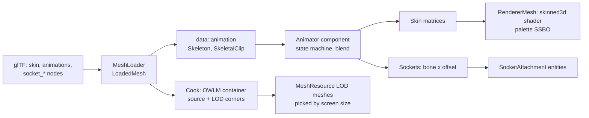

# Skeletal animation, mesh LODs and sockets {#page-design-skeletal-animation}

[TOC]

Design page of three v0.6.0 items of the [Roadmap](../roadmap.md): skeletal animation (skinning, blending, a state
machine), mesh levels of detail produced by the cook, and mesh sockets. It details the *Animation* section of the
[Content pipeline](content-pipeline.md) and the sockets of [Large worlds](large-worlds.md#assembly-and-articulated-bodies)
(compound bodies, joints and the other physics parts of that section are v0.7.0). User guide:
[Skinned meshes](../skinned_meshes.md).

## Delivery

| Step              | Content                                                                                           | Status |
|-------------------|---------------------------------------------------------------------------------------------------|--------|
| 1. Animation data | `data::animation`: `Skeleton`, `Pose`, `SkeletalClip` sampling, pose blending, skin matrices      | Done   |
| 2. Import         | `MeshLoader` reads the first glTF skin, its animations and the `socket_*` nodes into `LoadedMesh` | Done   |
| 3. GPU skinning   | `skinned3d.slang`, `Renderer3D::createSkinnedMesh` / `drawSkinnedMesh`, palette at binding 5      | Done   |
| 4. State machine  | `data::animation::StateMachine` and its player: states, parameters, conditions, cross-fades       | Done   |
| 5. Animator       | `Animator` component and the `owl.animation` system, skinned draws of `MeshRenderer`              | Done   |
| 6. Mesh LODs      | `data::geometry::buildMeshLods`, the mesh cook (`OWLM`), `MeshResource` LOD meshes, screen size   | Done   |
| 7. Sockets        | `MeshSockets`, `SocketAttachment`, `Scene::attachToSocket`, the `owl.sockets` system              | Done   |
| 8. Lua            | `animator.*` and `socket.*` tables                                                                | Done   |
| 9. Owl Nest       | Skeleton view, clip timeline, LOD preview, Animator and socket inspectors, commands               | Done   |
| 10. Engine Demo   | `character_yard` scene: a walking mannequin holding a lantern on its hand socket                  | Done   |

## Decisions

| Decision                                         | Reason                                                                                             |
|--------------------------------------------------|----------------------------------------------------------------------------------------------------|
| Skinning in the vertex shader                    | One palette upload per frame; no compute pass closing the render pass, no skinned vertex buffer    |
| A shader of its own, `skinned3d`                 | `mesh3d` keeps its vertex input and instancing; both include the same fragment (`mesh_surface`)    |
| Palette in the storage buffer of binding 5       | The instance binding is free in a single draw: no new binding in the Renderer3D descriptor block   |
| One palette buffer per pass, one offset per draw | The palettes of a pass are uploaded once (`SceneUbo.ids.w` = first matrix), like the instance list |
| Skinned draws are not instanced                  | Each character has its own pose; they keep the frustum culling of the mesh index                   |
| At most four joints per vertex                   | glTF `JOINTS_0` / `WEIGHTS_0`; `JOINTS_1` is ignored with a warning                                |
| Skinned vertices are not baked by the node chain | glTF ignores the transform of a skinned mesh node; the joints carry the placement                  |
| First skin of a file only                        | One skeleton per mesh resource; a second skin is reported and drawn by the first                   |
| Cubic-spline keys read as linear                 | The middle value of each key triplet; tangents dropped (rare in exported characters)               |
| State machine inside the `Animator` component    | Edited by the inspector, so every edit is a `component.set` command; prefabs share it              |
| Cross-fade by pose blending                      | Linear translation and scale, normalized-lerp of rotations (shortest arc), weight by duration      |
| Transitions: conditions and exit time            | Float compare, bool, trigger (consumed on fire); `*` as source for "any state"                     |
| LODs by vertex clustering                        | Deterministic, O(n), keeps real corners (UV, normal, skin of a kept vertex); no new dependency     |
| LOD corners reference the source triangles       | Data-layer form, independent of the renderer's vertex welding; skinned LODs keep their skin data   |
| Cooked mesh = `OWLM` container                   | The source bytes and the LOD block in one pack entry under the same path, loaded transparently     |
| LODs off by default (`.owlmeta` `Lods: 0`)       | Existing scenes draw the same; a project turns them on per mesh                                    |
| Uncooked meshes build their LODs at load         | Owl Nest previews what the game will draw, from the same settings                                  |
| LOD picked from the main camera                  | Screen height fraction of the bounding sphere; shadow passes reuse the pick of the camera          |
| Sockets: mesh `socket_*` nodes + component list  | Artists place them in the DCC tool; designers add or move them in Owl Nest                         |
| Attachment = parent + local transform            | The hierarchy is the one of the scene: picking, visibility and saves work unchanged                |
| Sockets follow bones in `PostPhysics`            | After the animation and before the triggers, the last phase allowed to move entities               |

## Formats

- `.owlmeta` of a mesh: `Lods` (extra levels, 0 to 4), `LodReduction` (triangle ratio from one level to the next,
  0.05 to 0.95) and `LodScreenSize` (screen height fraction under which level 1 is drawn, halved for each next level).
- Cooked mesh: `OWLM` magic, version, the size and bytes of the source, then per level its screen size and, per
  submesh, the corner references (`triangle * 3 + corner` of the source mesh).
- `Animator`, `MeshSockets` and `SocketAttachment` are scene components (see [Scene](../scene.md)).

## Out of scope

- Morph targets, inverse kinematics, root motion and additive layers: after the v0.6.0 items
- Compound rigid bodies and joints between assembled parts: v0.7.0, [Large worlds](large-worlds.md)
