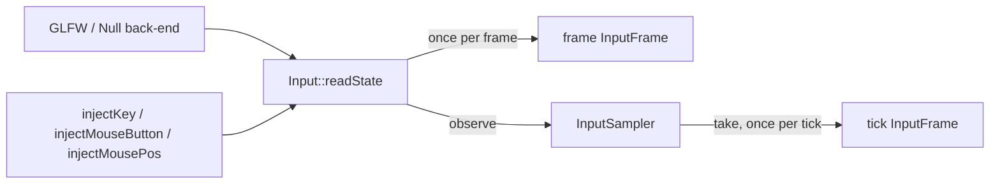
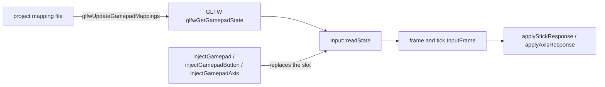
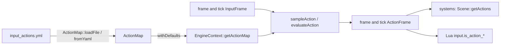

# Windowing and input {#page-design-windowing-input}

[TOC]

Platform windowing (Wayland and X11), the choice of GLFW, and input frames, gamepads and actions.

## Wayland and X11

Editor and runner run on Wayland and X11 alike, tested on GNOME and KDE.

### Platform selection

GLFW 3.5.1 is built with both the Wayland and the X11 backends (local Conan recipe `conan/recipes/glfw`, against the
system Wayland: a libwayland shipped next to the binaries would hide the system one from the GPU drivers). The engine
picks one explicitly at `glfwInit`:

| Source                                 | Values                       | Priority |
|----------------------------------------|------------------------------|----------|
| `OWL_WINDOW_PLATFORM` environment var. | `auto`, `wayland`, `x11`     | Highest  |
| `windowPlatform` key in `config.yml`   | same (`AppParams`)           | Default  |
| `OWL_FORCE_X11=1` (deprecated)         | forces `x11`, logs a warning | Legacy   |

`auto` lets GLFW choose: Wayland when `WAYLAND_DISPLAY` is set, X11 otherwise. A platform that fails to initialise
falls back to `auto` with a warning instead of aborting. The platform in use is logged
(`GLFW: Using the wayland platform (requested auto).`) and exposed by `Window::getPlatform()`. The parsing helpers
(`window::parsePlatform`, `resolvePlatform`, `makeAppId`) are pure functions covered by `input_tests`.

### What the engine does per platform

| Concern                | Wayland                                                                    | X11 (native or XWayland)          |
|------------------------|----------------------------------------------------------------------------|-----------------------------------|
| Application identifier | `app_id` = `AppParams::appId`, or the application name made id-safe        | `WM_CLASS` set to the same id     |
| Icon                   | Hidden user desktop entry `<app_id>.desktop` whose `Icon=` is the icon (1) | `glfwSetWindowIcon`               |
| Vertical sync (OpenGL) | Swap interval 0 + frame pacer at the monitor refresh rate (2)              | Swap interval 1                   |
| Vertical sync (Vulkan) | Mailbox when offered, FIFO otherwise                                       | Same                              |
| HiDPI / scale          | `GLFW_SCALE_FRAMEBUFFER` off: framebuffer = window size, compositor scales | Pixels, no scaling                |
| Editor multi-viewports | Disabled (detached panels float inside the main window)                    | Enabled (native detached windows) |
| Cursor capture         | Pointer constraints + relative pointer (GLFW)                              | Grab + raw motion                 |
| Fullscreen             | `xdg_toplevel.set_fullscreen` on the primary monitor; position ignored     | Video mode switch                 |
| Title, resize          | Supported                                                                  | Supported                         |
| Decorations            | Server-side when offered (libdecor then skipped), else libdecor            | Window manager                    |

1. `platform::installDesktopEntry` writes `$XDG_DATA_HOME/applications/<app_id>.desktop` (`NoDisplay=true`, so no
   menu entry) and only rewrites it when its content changes; opt out with `installDesktopEntry: false` in
   `config.yml`. The compositor reads the host's data directories: inside `./docker_run.sh` the entry lands in the
   container's `$HOME` and the icon stays generic. KDE may need a second launch (or `kbuildsycoca6`) to notice a new
   entry.
2. `eglSwapInterval(1)` waits for the compositor frame callback, which never comes while the surface is not shown
   (minimised, another workspace, locked session), so the main loop would stop, close request included. The compositor never tears, so interval 0 plus a sleep to the refresh period keeps vsync's
   pacing without blocking.

### Present modes

| Request               | Vulkan                                    | OpenGL                  |
|-----------------------|-------------------------------------------|-------------------------|
| vsync on              | FIFO                                      | swap interval 1         |
| vsync on, Wayland     | MAILBOX + sleep to the refresh period     | interval 0 + same sleep |
| vsync on, low latency | MAILBOX (FIFO when not offered), no sleep | as vsync on             |
| vsync off             | IMMEDIATE, else MAILBOX, else FIFO        | swap interval 0         |

The sleep is a `core::FramePacer` in the GLFW window; `Application` keeps a second one for `frameRateLimit`. MAILBOX
never blocks: without a pacer the GPU renders frames the display drops (90 % GPU load on an idle editor).

### Hidden windows and shutdown

The compositor does not present hidden surfaces (minimised, another workspace, locked session): native Wayland stops
frame callbacks, XWayland completes presents at about 1 Hz, so any vsync'ed swap blocks. OpenGL under Wayland
therefore paces itself (note 2 above); X11 with vsync still crawls while hidden, the X server's throttling.
`SIGINT` / `SIGTERM` request a clean shutdown (a second signal kills), so a throttled loop still exits; the window logs
`GLFW: Window closed after N presented frames.` and `Window::getPresentedFrames()` exposes the count.
`./docker_run.sh --gui` takes `--gpu=intel|nvidia` (Vulkan ICD, EGL and GLX vendor, PRIME offload) and
`--platform=wayland|x11`, and warns when the desktop session is locked. On KDE the icon and application id show from
the second launch: the desktop entry is written during the first one.

### CI smoke test

`test/unit/wayland_smoke.sh` (CTest `owl_wayland_smoke`, labels `render` and `wayland`) starts a headless weston (pixman
renderer, private `XDG_RUNTIME_DIR`), then plays 30 frames of `test/unit/test_helper/assets/render_tests/scenes/sprites.owl` with
`OwlRunner --frame-bench` on the Wayland platform, Vulkan on lavapipe then OpenGL on llvmpipe; it fails when the
runner crashes, logs an error or did not pick Wayland. Without `weston` it reports *Skipped*.

### GLFW limits under Wayland

- **No window icon.** `glfwSetWindowIcon` is still unavailable under Wayland in 3.5.1: GLFW does not implement
  `xdg-toplevel-icon-v1` (KWin 6 supports it, `wayland-protocols` 1.45 in the image ships it) and does not expose its
  `xdg_toplevel`, so the engine cannot add it either. The desktop entry is the only route, and it requires writing
  into the user's data directory.
- **No global window positions.** `glfwSetWindowPos` / `glfwGetWindowPos` are unavailable, so ImGui cannot place
  detached viewports (the ImGui GLFW backend itself refuses viewports under Wayland). Detached panels stay inside the
  main window; X11 (`OWL_WINDOW_PLATFORM=x11`, XWayland) keeps native detached windows. This is a protocol limit, not
  a GLFW one: SDL3 has the same.
- **Fractional scaling is there, Owl Engine does not use it yet.** Since 3.4 GLFW implements `wp_fractional_scale_v1` with
  `wp_viewporter` when `GLFW_SCALE_FRAMEBUFFER` is on (its default). Owl Engine turns that hint off because the swapchain,
  the viewports and ImGui are sized from the window size: the buffer stays at 1× and the compositor upscales it
  (correct size, slightly soft at 125 % or 150 %). Turning it on needs framebuffer-size resize events, ImGui's
  `DisplayFramebufferScale` and picking in framebuffer pixels: engine work, not a GLFW gap.
- **Vsync on hidden surfaces.** GLFW 3.5.1 does not block: under Wayland it drives the swap interval itself, waiting
  for the frame callback with a 20 ms timeout. Owl Engine still paces OpenGL itself: with interval 1 the timeout gives
  irregular frames where the pacer holds the refresh period.
- **libdecor loads GTK.** With libdecor, `glfwInit` loads its GTK plugin (GTK, Pango, the glycin image loader and its
  threads) even when the compositor draws the decorations itself. The engine asks the compositor first
  (`zxdg_decoration_manager_v1`, KWin, wlroots, COSMIC) and tells GLFW to skip libdecor then, which shortens start-up.
  GNOME and weston have no server-side decorations and keep libdecor.

## GLFW, not SDL3

Owl Engine stays on GLFW for the window, the input, the gamepads and (with NFD) the dialogues; OpenAL Soft stays the
audio backend; SDL GPU is not an RHI backend.

- The Wayland gaps left (window icon, global positions) are protocol limits SDL3 shares or depends on the compositor
  for; fractional scaling and non-blocking vsync exist in GLFW 3.5.1.
- The native modal file dialogues of NFD (portal, GTK, Win32) fit the editor's Open / Save As flow better than SDL's
  asynchronous `SDL_Show*Dialog`.
- Gamepads use `glfwGetGamepadState` with the SDL-compatible mapping database (`glfwUpdateGamepadMappings`).
- SDL audio has no 3D positioning, EFX or HRTF; SDL GPU has no OpenGL backend and its own shader model, a third RHI
  path for no missing feature.

## Input actions and gamepad

- **Fixed simulation tick**: systems and Lua get an `on_tick` at a fixed step set in the project (60 Hz by default),
  beside the variable `on_update`; physics always runs on this fixed clock. Input is sampled per tick, so edges are
  not lost when the frame rate and the tick differ.
- **Input frames**: a plain-data `InputFrame` (previous and current `InputState`: keys, mouse buttons, cursor, wheel,
  gamepads) per tick and per frame, `isKeyJustPressed` / `isKeyJustReleased` and the mouse equivalents; injection
  lives in the input layer, so scenarios, editor Play and the MCP server inject on GLFW too.
- **Gamepad**: GLFW `glfwGetGamepadState` for pads 0–15, connect / disconnect events, an optional project mapping file
  passed to `glfwUpdateGamepadMappings`, Null backend injection for tests, Lua `input.is_gamepad_connected` /
  `get_gamepad_name`; radial dead zone per binding (0.15 by default) and a response-curve exponent.
- **Action map**: actions are buttons, 1D axes or 2D axes; a binding is a device (key, mouse button, gamepad button,
  gamepad axis), a code and a scale, 2D actions also take key composites; `evaluate(map, previous, current)` is a pure
  function producing an `ActionFrame`, the stream replays can record.
- The map lives in `input_actions.yml` with its `DocumentFormat`, packed with the game like `game_settings.yml`; Lua
  `input.is_action_pressed`, `is_action_just_pressed`, `is_action_just_released`, `get_action_value`,
  `get_action_vector`; `input.is_key_pressed` is kept and deprecated; scenarios have an `actions:` step; engine
  systems and the Engine Demo scripts read actions.
- **Editor**: an action map document with its own undo stack, opened from the Content Browser, the ribbon or Project
  Settings; "press a key" capture; the built-in map in every project template; a live action monitor
  ([Action map editor](../editor_documents.md#editor-action-map)).

### Input frames {#input-frames-in1}

`input::Input::readState()` merges the device back-end (GLFW, or Null without device) with the injected input; the
wheel comes from the `MouseScrolledEvent`s the application adds between two `Input::beginFrame()` calls. Each running
scene samples it once per frame (`Scene::onUpdateRuntime`) and builds one state per simulation tick through an
`input::InputSampler`:

- `Scene::getInputFrame()` returns the tick frame inside the ticks (`tick` functions, `on_tick`) and the frame one
  elsewhere (`update` functions, `on_update`): an edge is seen once at each rate.
- Several ticks in one frame: the first one gets the edges and the wheel, the others repeat the held state.
- Frames without a tick: a key held in any of them counts as held at the next tick, so a press shorter than a tick
  gives a press edge then a release edge at the next tick. A key released and pressed again between two ticks reads
  as held throughout.
- `onStartRuntime()` starts both frames from the held state: a key held when the scene starts gives no edge.
- `input.is_key_pressed` and `Input::isKeyPressed` stay live polls (device or injection).

### Gamepads {#gamepads-in2}

- `InputState` carries 16 `GamepadState` (connected, 15 buttons, 6 axes): plain data, about 0.5 KiB per state.
  Triggers are rescaled from GLFW's [-1, 1] to [0, 1]; sticks keep GLFW's y down.
- A slot is a gamepad when GLFW has a mapping for its joystick; a joystick without one is not connected as a pad.
  Connect and disconnect come from `glfwSetJoystickCallback` as `GamepadConnectedEvent` / `GamepadDisconnectedEvent`
  sent to the first open window.
- The sampler ORs pad buttons over the frames of a tick like keys (a short press keeps both edges); axes and the
  connection take the last frame.
- Injection replaces a whole slot rather than merging with the device: a scenario pad is deterministic even with a
  real pad plugged in, and an injected disconnected state can hide one.
- Mapping file: `gamepadMappings` in `owl_project.yml`, `GamepadMappings` in `runner.yml`, packed under its relative
  path. Lines are checked first (`countGamepadMappings`: 32-digit GUID, name, mappings); GLFW cannot remove a mapping,
  so a changed file adds to the previous one until restart.
- `AxisResponse` (dead zone, curve, custom exponent clamped to [0.1, 10]) shapes the length past the dead zone,
  rescaled to [0, 1]: continuous at the edge, 1 at full deflection. Lua `get_gamepad_stick` uses it with a linear
  curve and an optional dead zone; action bindings carry their own.

### Action map {#action-map-in3}

- **Pure data.** `input::ActionMap` (actions in file order) holds `ActionDefinition`s (name, `Button` / `Axis` /
  `Vector`, bindings); an `ActionBinding` is a source (key, mouse button, gamepad button, axis or stick), a code, a pad
  slot (any when negative), a vector component, a scale and an `AxisResponse`. The map loads from and saves to YAML
  with a `FormatVersion` (`ActionMap::format()`); the in-memory form is what the editor document
  edits (`setAction`, `removeAction`, `==` for the dirty state), and the key names are shared through
  `input/InputNames.h`.
- **Pure evaluation.** `sampleAction(action, InputState)` reads one sample, `evaluateAction(action, InputFrame)` adds
  the edges between the two samples; `ActionFrame` holds one `ActionState` per action, ready to be recorded by
  replays. It allocates nothing after the first frame.
- **Combination.** The bindings of an action add up, then the result is clamped to [-1, 1], or to the unit disc for a
  vector (a diagonal is not faster). A button is held when a binding reads past half; an axis or a vector is held
  past half deflection, so `ui_*`-style tests work on them.
- **Y down.** Vectors keep the gamepad convention (y down): a key bound to `W` feeds `y` with `scale: -1`.
- **Where the map lives.** `app::EngineContext` owns it (state shared by the scenes, never a static); Owl Nest loads it
  when it opens a project, the runner from an asset folder, the source project of a scenario or the pack, and an
  unreadable file is logged and replaced by the built-in actions. A project map is completed with the built-in
  actions (`withDefaults`): engine systems never miss `move`, `jump` or `interact`, and a project may override them.
- **Scenarios.** An `actions:` step is resolved when the scenario is read: each held action picks the first binding
  that can produce the value (right sign, right component) and injects it through the same path as an `input` step,
  with the inverse of the dead zone and curve for an analog binding.
- **Doors and pushwalls** carry `interactionAction` (a button action name, empty to disable) instead of a key code;
  an `interactionKey: 0` read from a file disables the built-in path.

## Gamepad improvements (planned)

- Controller remapping UI, on the HUD widgets and the action map
- Haptic feedback / vibration API (GLFW has none: to study)
- Joysticks and throttles: raw GLFW joystick axes and buttons (`glfwGetJoystickAxes`) bound in the action map, beyond
  the six axes of a gamepad

## Touch screen input (planned)

Needed by the Web target and by touch screens (Raspberry Pi), where only keyboard and mouse work today.

- Touch points as pointer events: a tap clicks, a drag moves, under GLFW (which reports touch as an emulated mouse at
  best: to study, else a native path per platform)
- Gestures: pinch to zoom and two-finger pan for the cameras (isometric, 2D, editor viewport)
- HUD: buttons, sliders, lists and windows usable by touch (larger hit areas, no hover-only state)
- Owl Nest usable on a touch screen for the common gestures (select, move, pan, zoom)
- Scenario support: injected touch points in `.owltest` files, a scenario per gesture
