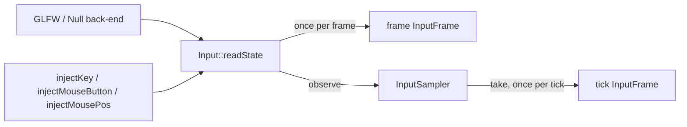
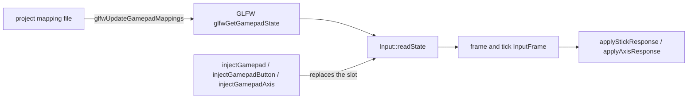
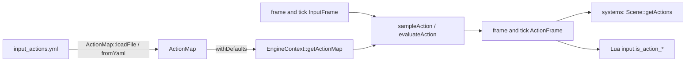

# Windowing and input {#page-design-windowing-input}

[TOC]

Design page for platform windowing (Wayland), the SDL3 evaluation and input actions, summarised in the
[Roadmap](../roadmap.md).

## Wayland (v0.3.0, platform correctness) — Done

Goal: full Wayland support for the editor and the runner, X11 kept as an option; the Owl icon on Wayland; editor
multi-window behaving on both; tested on GNOME and KDE, with a CI smoke test under a headless compositor if feasible.

### Platform selection

GLFW 3.5.1 is built with both the Wayland and the X11 backends (local Conan recipe `conan/recipes/glfw`, against the
system Wayland: a libwayland shipped next to the binaries would hide the system one from the GPU drivers). The engine
picks one explicitly at `glfwInit`:

| Source                                 | Values                       | Priority |
|----------------------------------------|------------------------------|----------|
| `OWL_WINDOW_PLATFORM` environment var. | `auto`, `wayland`, `x11`     | Highest  |
| `windowPlatform` key in `config.yml`   | same (`AppParams`)           | Default  |
| `OWL_FORCE_X11=1` (deprecated)         | forces `x11`, logs a warning | Legacy   |

`auto` lets GLFW choose: Wayland when `WAYLAND_DISPLAY` is set, X11 otherwise. A platform that fails to initialise
falls back to `auto` with a warning instead of aborting. The platform in use is logged
(`GLFW: Using the wayland platform (requested auto).`) and exposed by `Window::getPlatform()`. The parsing helpers
(`window::parsePlatform`, `resolvePlatform`, `makeAppId`) are pure functions covered by `input_tests`.

### What the engine does per platform

| Concern                | Wayland                                                                    | X11 (native or XWayland)          |
|------------------------|----------------------------------------------------------------------------|-----------------------------------|
| Application identifier | `app_id` = `AppParams::appId`, or the application name made id-safe        | `WM_CLASS` set to the same id     |
| Icon                   | Hidden user desktop entry `<app_id>.desktop` whose `Icon=` is the icon (1) | `glfwSetWindowIcon`               |
| Vertical sync (OpenGL) | Swap interval 0 + frame pacer at the monitor refresh rate (2)              | Swap interval 1                   |
| Vertical sync (Vulkan) | Mailbox when offered, FIFO otherwise                                       | Same                              |
| HiDPI / scale          | `GLFW_SCALE_FRAMEBUFFER` off: framebuffer = window size, compositor scales | Pixels, no scaling                |
| Editor multi-viewports | Disabled (detached panels float inside the main window)                    | Enabled (native detached windows) |
| Cursor capture         | Pointer constraints + relative pointer (GLFW)                              | Grab + raw motion                 |
| Fullscreen             | `xdg_toplevel.set_fullscreen` on the primary monitor; position ignored     | Video mode switch                 |
| Title, resize          | Supported                                                                  | Supported                         |
| Decorations            | Server-side when offered (libdecor then skipped), else libdecor            | Window manager                    |

1. `platform::installDesktopEntry` writes `$XDG_DATA_HOME/applications/<app_id>.desktop` (`NoDisplay=true`, so no
   menu entry) and only rewrites it when its content changes; opt out with `installDesktopEntry: false` in
   `config.yml`. The compositor reads the host's data directories: inside `./docker_run.sh` the entry lands in the
   container's `$HOME` and the icon stays generic. KDE may need a second launch (or `kbuildsycoca6`) to notice a new
   entry.
2. `eglSwapInterval(1)` waits for the compositor frame callback, which never comes while the surface is not shown
   (minimised, another workspace, locked session): the main loop froze after one frame and could not even process
   the close request. The compositor never tears, so interval 0 plus a sleep to the refresh period keeps vsync's
   pacing without the hang.

### Diagnosis of the "frozen first frame" (October 2026)

Reported as `OwlRunner` freezing at the first frame in `./docker_run.sh --gui`. Measured on a KDE Plasma 6.6 session
(Intel RPL-S + NVIDIA RTX 5000 Ada, PRIME offload), **with the session locked**, frames presented in 15 s:

| Run (OwlRunner, vsync on)            | Before the fix                     | After the fix       |
|--------------------------------------|------------------------------------|---------------------|
| Wayland, OpenGL, Intel or NVIDIA     | 1 frame, then blocked, kill needed | ~850-970 (60 Hz)    |
| Wayland, Vulkan, Intel or NVIDIA     | runs (mailbox)                     | 6400-6800           |
| X11 (XWayland), OpenGL, both GPUs    | ~20 (XWayland throttles to ~1 Hz)  | same, exits on TERM |
| X11 (XWayland), Vulkan, NVIDIA       | ~20                                | same                |
| X11 (XWayland), Vulkan, Intel        | runs (mailbox)                     | 5500                |
| X11 on a private Xvfb, Vulkan NVIDIA | —                                  | ~60 fps, scene OK   |

Owl Nest opens, runs and closes cleanly on `SIGTERM` in the same eight combinations (Wayland / X11 × Vulkan /
OpenGL × Intel / NVIDIA). Hidden on XWayland it runs unthrottled on Intel (~130 fps) but stays at ~1 Hz on NVIDIA,
whose PRIME presents wait for the X server whatever the swap interval.

- **Cause: presentation, not Docker.** The compositor does not present hidden surfaces: native Wayland stops frame
  callbacks altogether, XWayland completes presents at about 1 Hz. Any vsync'ed swap then blocks; `vkcube` shows the
  same throttling on XWayland. Without vsync nothing blocks, which matches the frame-bench observations.
- **Engine part (fixed):** OpenGL under Wayland now paces itself instead of blocking in `eglSwapBuffers`;
  `SIGINT` / `SIGTERM` request a clean shutdown (a second signal kills), so a throttled loop still exits; the window
  logs `GLFW: Window closed after N presented frames.` and `Window::getPresentedFrames()` exposes the count.
- **Docker part:** the socket, `WAYLAND_DISPLAY`, `XAUTHORITY` and `/dev/dri` were already right. `./docker_run.sh`
  gained `--gpu=intel|nvidia` (Vulkan ICD, EGL and GLX vendor, PRIME offload), `--platform=wayland|x11`, and warns
  when the desktop session is locked.
- **Not fixed:** X11 + vsync still crawls at ~1 Hz while the window is hidden — that is the X server's throttling.
  OpenGL on llvmpipe (Xvfb without a GPU) crashes on the missing `glSpecializeShader` (no `GL_ARB_gl_spirv`), and
  Mesa's Intel Vulkan driver crashes on Xvfb; neither is a supported target.

### Manual check on a visible desktop (October 2026)

Owl Nest on KDE Plasma 6.6 (Wayland session, Intel + NVIDIA), native and in `./docker_run.sh`, in five combinations:
Wayland / X11 (XWayland) × Vulkan / OpenGL × Intel / NVIDIA. Platform selection, fractional scales (125 %, 150 %, text
blurry as expected until the DPI work), fullscreen, cursor capture, hidden / locked window, clean close (button,
Alt+F4, `SIGTERM`), detached panels (inside the window on Wayland, native windows on X11), keyboard (AZERTY, accents,
shortcuts), clipboard, file drag and drop and the file dialog all pass.

| Combination                     | Frames per second (vsync on) |
|---------------------------------|------------------------------|
| Native, Wayland, Vulkan         | ~100 (mailbox)               |
| Native, Wayland, OpenGL         | 60 (monitor rate)            |
| Native, X11 (XWayland), Vulkan  | ~30                          |
| Docker, Wayland, Vulkan, Intel  | ~250 (mailbox)               |
| Docker, Wayland, OpenGL, Intel  | 60                           |
| Docker, Wayland, Vulkan, NVIDIA | ~350 (mailbox)               |
| Docker, X11, Vulkan, NVIDIA     | 60                           |

- On the **first** launch KDE shows the window under the launching application (the IDE) and the generic icon, in
  the task bar only: the desktop entry is written during that launch and KWin reads it from the next one. From the
  second launch the icon, the Alt+Tab entry and the application id are right.
- Inside Docker, OpenAL Soft logs `Failed to create PipeWire event context` and falls back to PulseAudio (sound works):
  the build image lacks PipeWire's client configuration (`libpipewire-0.3-common`).

GNOME (Mutter) passes the same checks.

### CI smoke test

`test/unit/wayland_smoke.sh` (CTest `owl_wayland_smoke`, labels `render` and `wayland`) starts a headless weston (pixman
renderer, private `XDG_RUNTIME_DIR`), then plays 30 frames of `test/unit/test_helper/assets/render_tests/scenes/sprites.owl` with
`OwlRunner --frame-bench` on the Wayland platform, Vulkan on lavapipe then OpenGL on llvmpipe; it fails when the
runner crashes, logs an error or did not pick Wayland. Without `weston` it reports *Skipped*. It found that GLFW 3.4
dereferenced a missing `wl_seat` (a compositor without input devices): the local recipe patched it until GLFW 3.5.1
fixed it upstream.

### Known GLFW 3.5.1 limits under Wayland

- **No window icon.** `glfwSetWindowIcon` is still unavailable under Wayland in 3.5.1: GLFW does not implement
  `xdg-toplevel-icon-v1` (KWin 6 supports it, `wayland-protocols` 1.45 in the image ships it) and does not expose its
  `xdg_toplevel`, so the engine cannot add it either. The desktop entry is the only route, and it requires writing
  into the user's data directory.
- **No global window positions.** `glfwSetWindowPos` / `glfwGetWindowPos` are unavailable, so ImGui cannot place
  detached viewports (the ImGui GLFW backend itself refuses viewports under Wayland). Detached panels stay inside the
  main window; X11 (`OWL_WINDOW_PLATFORM=x11`, XWayland) keeps native detached windows. This is a protocol limit, not
  a GLFW one: SDL3 has the same.
- **Fractional scaling is there, Owl Engine does not use it yet.** Since 3.4 GLFW implements `wp_fractional_scale_v1` with
  `wp_viewporter` when `GLFW_SCALE_FRAMEBUFFER` is on (its default). Owl Engine turns that hint off because the swapchain,
  the viewports and ImGui are sized from the window size: the buffer stays at 1× and the compositor upscales it
  (correct size, slightly soft at 125 % or 150 %). Turning it on needs framebuffer-size resize events, ImGui's
  `DisplayFramebufferScale` and picking in framebuffer pixels: engine work, not a GLFW gap, done with the Phase E
  text scale / DPI item.
- **Vsync on hidden surfaces.** GLFW 3.5.1 no longer blocks: under Wayland it drives the swap interval itself, waiting
  for the frame callback with a 20 ms timeout. Owl Engine still paces OpenGL itself: on the headless weston of the smoke
  test, interval 1 gives irregular frames (median 13.3 ms, p95 20.8 ms, the timeout firing every other frame) where
  the pacer holds 16.67 ms ± 0.1 ms. To be measured again on a visible desktop before switching.
- **libdecor loads GTK.** With libdecor, `glfwInit` loads its GTK plugin (GTK, Pango, the glycin image loader and its
  threads) even when the compositor draws the decorations itself. The engine asks the compositor first
  (`zxdg_decoration_manager_v1`, KWin, wlroots, COSMIC) and tells GLFW to skip libdecor then: start-up drops from
  309 ms to 279 ms on KDE Plasma 6 (Vulkan, warm, median of 3). GNOME and weston have no server-side decorations
  and keep libdecor.

## SDL3 evaluation (v0.3.0, Done): rejected

- ![Done][done] Evaluation of SDL3 for windowing, input, dialogues and audio, possibly SDL GPU as an Owl RHI backend
- **Decision (October 2026): Owl Engine stays on GLFW. SDL3 is rejected for the window, the input, the dialogues and the
  gamepads alike; OpenAL Soft is kept; SDL GPU is rejected.** Another alternative may be looked at later, not SDL3.

Why:

- GLFW 3.5.1 closes most of the Wayland gaps the evaluation started from: fractional scaling exists (Owl Engine's choice to
  turn it off, see above), vsync no longer hangs on hidden surfaces. The remaining ones (window icon, global
  positions) are protocol limits SDL3 shares or depends on the compositor for.
- The native modal file dialogues of NFD (portal, GTK, Win32) are preferred over SDL's asynchronous
  `SDL_Show*Dialog`, which would change the editor's Open / Save As flow.
- Gamepads stay on GLFW too (`glfwGetGamepadState`, SDL-compatible mapping database through
  `glfwUpdateGamepadMappings`); rumble and hot-plug details are not worth a second windowing library.
- A backend swap of about 12 files plus a release with two backends to test, for no feature Owl Engine lacks.

### What SDL3 would have brought

| Owl pain (GLFW)                 | SDL 3.4                                                                                        | GLFW 3.5.1                                   |
|---------------------------------|------------------------------------------------------------------------------------------------|----------------------------------------------|
| No Wayland window icon          | `SDL_SetWindowIcon` uses `xdg-toplevel-icon-v1` (needs a compositor that has it: KWin, Mutter) | Not supported: desktop entry                 |
| Fractional scaling              | `wp_fractional_scale_v1` + `wp_viewporter`; `SDL_GetWindowPixelDensity` / `DisplayScale`       | Same protocols with `GLFW_SCALE_FRAMEBUFFER` |
| Blocking vsync on hidden window | frame-callback swap with a timeout                                                             | Same since 3.5.1 (20 ms timeout)             |
| Window placement                | Same protocol limit: no global position under Wayland (`SDL_GetWindowPosition` is relative)    | Same limit                                   |
| Gamepad (I-03, D-25)            | Joystick / gamepad API, mapping database, rumble and hot-plug built in                         | Gamepad API and mapping database, no rumble  |
| File dialogs                    | `SDL_ShowOpenFileDialog` / `SaveFileDialog` / `OpenFolderDialog`, asynchronous                 | None: NFD, modal (kept)                      |
| Text input, IME, clipboard      | Built in (IME and composition are better than GLFW)                                            | Char callback and clipboard                  |

SDL audio is a stream API without 3D positioning, EFX or HRTF: it never was a replacement for OpenAL Soft.

### Prototype (scratchpad, throwaway)

SDL 3.4.16 compiled through Conan in the build image (profile `linux-clang`, Release, shared). With the Wayland
driver forced under headless weston 14: window created with `SDL_WINDOW_VULKAN | HIGH_PIXEL_DENSITY`, driver
`wayland`, pixel density 1.0, events pumped, clean quit. `SDL_SetWindowIcon` failed with *required
xdg_toplevel_icon_v1 protocol not supported*: weston 14 lacks the protocol.

### Cost that was weighed

- `libSDL3.so` is 3.8 MB in Release with Wayland, X11, OpenGL, Vulkan and dbus (GLFW is well under 1 MB, NFD small).
- Recipe options to tune (`pulseaudio`, `alsa`, `sndio`, `libusb` off), `libudev-dev` in the build image for
  joystick hot-plug.
- About 12 files behind the `window`, `input` and `GraphContext` seams, the ImGui backend, the key-code translation,
  and a release with both backends.

### SDL GPU: rejected

SDL GPU has no OpenGL backend and its own shader and resource model: it would be a third RHI path next to the
existing OpenGL and Vulkan ones, for no feature Owl Engine lacks. The Owl RHI work (Phase C) stays on Vulkan and OpenGL.

## Input actions and basic gamepad (v0.4.0) — Done

Pull requests SIM1 and IN1 to IN4 of [Isometric worlds](isometric-worlds.md). Before them input was polling only,
without "just pressed" edges nor gamepad, and injection worked on the Null backend only (both fixed by IN1); keys were
hard-coded in engine systems (`ScenePlayer`, `VoxelPlayerSystem`, doors and push-walls) and Lua read raw key
codes until IN3.

- **Fixed simulation tick** (SIM1, Done): systems and Lua get an `on_tick` at a fixed step set in the project (60 Hz by
  default), beside the variable `on_update`; physics always runs on this fixed clock. Input is sampled per tick, so
  edges are not lost when the frame rate and the tick differ
- **Input frames** (IN1, Done): a plain-data `InputFrame` (previous and current `InputState`: keys, mouse buttons,
  cursor, wheel) per tick and per frame, `isKeyJustPressed` / `isKeyJustReleased` and the mouse equivalents;
  injection lives in the input layer, so scenarios, editor Play and the MCP server inject on GLFW too; gamepad states
  join the frame with IN2. Details below
- **Gamepad** (IN2, Done): GLFW `glfwGetGamepadState` for pads 0–15, connect / disconnect events, an optional
  project mapping file passed to `glfwUpdateGamepadMappings`, Null backend injection for tests, Lua
  `input.is_gamepad_connected` / `get_gamepad_name`; the gamepad of the README becomes true (I-03, D-25). Details
  below
- **Dead zone and curve** (IN2, Done): radial dead zone per binding (0.15 by default) and a
  response-curve exponent
- **Action map** (IN3, Done, details below): actions are buttons, 1D axes or 2D axes; a binding is a device (key, mouse button, gamepad
  button, gamepad axis), a code and a scale, 2D actions also take key composites; `evaluate(map, previous, current)`
  is a pure function producing an `ActionFrame`, the stream v0.7.0 records for replays (K-30)
- The map lives in `input_actions.yml` with its `DocumentFormat`, packed with the game like `game_settings.yml`, with
  room for a user override layer; Lua `input.is_action_pressed`, `is_action_just_pressed`, `is_action_just_released`,
  `get_action_value`, `get_action_vector`; `input.is_key_pressed` kept and deprecated; scenarios gain an `actions:`
  step; engine systems and the Engine Demo scripts move to actions
- **Editor** (IN4, Done): an action map document with its own undo stack, opened from the Content Browser, the ribbon
  or Project Settings; "press a key" capture; the built-in map in every project template; a live action monitor
  ([Action map editor](../editor.md#editor-action-map))

### Input frames (IN1) {#input-frames-in1}

`input::Input::readState()` merges the device back-end (GLFW, or Null without device) with the injected input; the
wheel comes from the `MouseScrolledEvent`s the application adds between two `Input::beginFrame()` calls. Each running
scene samples it once per frame (`Scene::onUpdateRuntime`) and builds one state per simulation tick through an
`input::InputSampler`:

- `Scene::getInputFrame()` returns the tick frame inside the ticks (`tick` functions, `on_tick`) and the frame one
  elsewhere (`update` functions, `on_update`): an edge is seen once at each rate.
- Several ticks in one frame: the first one gets the edges and the wheel, the others repeat the held state.
- Frames without a tick: a key held in any of them counts as held at the next tick, so a press shorter than a tick
  gives a press edge then a release edge at the next tick. A key released and pressed again between two ticks reads
  as held throughout.
- `onStartRuntime()` starts both frames from the held state: a key held when the scene starts gives no edge.
- `input.is_key_pressed` and `Input::isKeyPressed` stay live polls (device or injection).

### Gamepads (IN2) {#gamepads-in2}

- `InputState` carries 16 `GamepadState` (connected, 15 buttons, 6 axes): plain data, about 0.5 KiB per state.
  Triggers are rescaled from GLFW's [-1, 1] to [0, 1]; sticks keep GLFW's y down.
- A slot is a gamepad when GLFW has a mapping for its joystick; a joystick without one is not connected as a pad.
  Connect and disconnect come from `glfwSetJoystickCallback` as `GamepadConnectedEvent` / `GamepadDisconnectedEvent`
  sent to the first open window.
- The sampler ORs pad buttons over the frames of a tick like keys (a short press keeps both edges); axes and the
  connection take the last frame.
- Injection replaces a whole slot rather than merging with the device: a scenario pad is deterministic even with a
  real pad plugged in, and an injected disconnected state can hide one.
- Mapping file: `gamepadMappings` in `owl_project.yml`, `GamepadMappings` in `runner.yml`, packed under its relative
  path. Lines are checked first (`countGamepadMappings`: 32-digit GUID, name, mappings); GLFW cannot remove a mapping,
  so a changed file adds to the previous one until restart.
- `AxisResponse` (dead zone, curve, custom exponent clamped to [0.1, 10]) shapes the length past the dead zone,
  rescaled to [0, 1]: continuous at the edge, 1 at full deflection. Lua `get_gamepad_stick` uses it with a linear
  curve and an optional dead zone; IN3 bindings carry their own.

### Action map (IN3) {#action-map-in3}

- **Pure data.** `input::ActionMap` (actions in file order) holds `ActionDefinition`s (name, `Button` / `Axis` /
  `Vector`, bindings); an `ActionBinding` is a source (key, mouse button, gamepad button, axis or stick), a code, a pad
  slot (any when negative), a vector component, a scale and an `AxisResponse`. The map loads from and saves to YAML
  with a `FormatVersion` (`ActionMap::format()`, no migration yet); the in-memory form is what the IN4 editor document
  edits (`setAction`, `removeAction`, `==` for the dirty state), and the key names are shared through
  `input/InputNames.h`.
- **Pure evaluation.** `sampleAction(action, InputState)` reads one sample, `evaluateAction(action, InputFrame)` adds
  the edges between the two samples; `ActionFrame` holds one `ActionState` per action, ready to be recorded by the
  v0.7.0 replays (K-30). It allocates nothing after the first frame.
- **Combination.** The bindings of an action add up, then the result is clamped to [-1, 1], or to the unit disc for a
  vector (a diagonal is not faster). A button is held when a binding reads past half; an axis or a vector is held
  past half deflection, so `ui_*`-style tests work on them.
- **Y down.** Vectors keep the gamepad convention (y down): a key bound to `W` feeds `y` with `scale: -1`.
- **Where the map lives.** `app::EngineContext` owns it (state shared by the scenes, never a static); Owl Nest loads it
  when it opens a project, the runner from an asset folder, the source project of a scenario or the pack, and an
  unreadable file is logged and replaced by the built-in actions. A project map is completed with the built-in
  actions (`withDefaults`): engine systems never miss `move`, `jump` or `interact`, and a project may override them.
- **Scenarios.** An `actions:` step is resolved when the scenario is read: each held action picks the first binding
  that can produce the value (right sign, right component) and injects it through the same path as an `input` step,
  with the inverse of the dead zone and curve for an analog binding.
- **Doors and pushwalls** carry `interactionAction` (a button action name, empty to disable) instead of a key code;
  an old `interactionKey: 0` still disables the built-in path.

## Gamepad improvements (v0.8.0)

- Controller remapping UI, on the v0.4.0 HUD widgets and action map
- Haptic feedback / vibration API (GLFW has none: to study)

[done]: https://img.shields.io/badge/-Done-2ea043?style=flat-square
