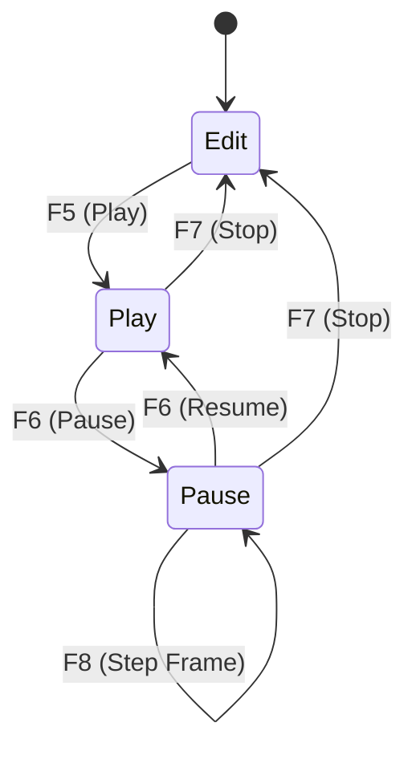
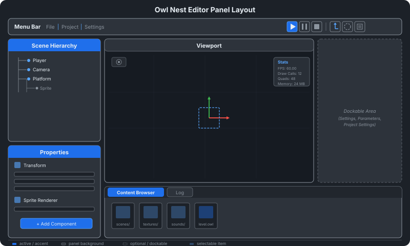

# Editor (Owl Nest) {#page-editor}

[TOC]

This page describes Owl Nest, the scene editor for the Owl engine: its panel layout,
project management workflow, and playback controls.

## Overview

Owl Nest is the primary development tool for the Owl engine. It provides a fully
dockable panel interface built on ImGui and ImGuizmo, allowing developers to compose
scenes, inspect entities, browse project assets, and test gameplay in real time. Its colours, fonts, icons and
widgets follow the [Owl Nest style guide](design/nest-style-guide.md).

The editor ships as two executables:

| Executable   | Purpose                                                        |
|--------------|----------------------------------------------------------------|
| `owl_nest`   | Scene editor with full docking UI, gizmos, and project tools   |
| `owl_runner` | Standalone game runner that loads a packed or unpacked project |

Both executables share the same scene runtime. The editor adds the editing chrome
(panels, gizmos, toolbar) while the runner provides a clean playback environment.

The editor operates as a state machine with three states:



| State     | Description                                                     |
|-----------|-----------------------------------------------------------------|
| **Edit**  | Editor camera active, no simulation, scene is directly editable |
| **Play**  | Scene copy is simulated, runtime camera active, physics running |
| **Pause** | Simulation frozen, render-only mode with step-frame support     |

## Panel Layout



The default arrangement uses ImGui docking:

- **Centre** -- the open documents (scenes, scripts, graphs, tilemaps...) as tabs, the viewport with its overlaid
  toolbar; the Help pages open there too, or float
- **Right column** -- Scene Hierarchy (top) and Properties (bottom); Tile Palette, Voxel Palette and Scene Settings
  join Properties as tabs
- **Bottom strip** -- Content Browser, Log, Console and Stats as tabs under the documents
- **Status bar** -- one line under everything: the simulation mode (`EDIT`, `PLAYING`, `PAUSED`, the bar turns blue
  while the scene runs), the active document and its entity count, the last autosave, the graphics backend, and the
  warnings and errors logged since you last looked (clicking a counter opens the Log), the graphics device, the
  Content Browser previews still to make, a bell holding the last 30 notifications (the toasts), with the count
  of unread ones, and the MCP indicator (`MCP off`, `MCP listening`, `MCP client active` for 10 s after a request;
  its tooltip gives the endpoint and the token file, a click opens its settings tab)

Two presets are available from **View > Layout** and the shortcuts: **Default** (`Alt+1`) and **Hierarchy Left**
(`Alt+2`), which moves the Scene Hierarchy to its own column left of the documents. **Reset Layout** puts every panel
back in the place of the current preset. The preset is saved in `OwlNest_settings.yml` (`layoutPreset`).

Panels tied to a document only show with it: the Tile Palette with the active tilemap, the Voxel Palette when the
active document is a scene holding a `VoxelWorld`, in Edit mode. Both palettes, like the tilemap and tileset editors'
panels, use the inspector layout: collapsible sections, property grids, swatches of the tiles or blocks
(`gui::widgets::imageTile`) with their name in the tooltip. Document tabs carry the glyph of their type, and a
document opened from the Content Browser, by a drop or by an inspector **Open** button comes to the front. Asset
fields of the inspector (tilemap, tileset, script) show a swatch of their atlas when they have one, their path,
**Open** (in its editor) and **Clear**.

All panels can still be rearranged, resized and tabbed together freely; the arrangement persists in
`OwlNest_imgui.ini`. The default layout is built on the first launch, when the saved one has no split, and once
after an editor update changes it (`layoutVersion`).

## Ribbon Menu

The menu is an Office-style **ribbon** between the window title and the dockspace: tabs hold groups of buttons,
one **large** button (icon above the label) at most per group and columns of three **small** ones (icon then label).
Every button has a tooltip with its shortcut; a greyed button is not applicable right now.

- **File** — the amber button on the left opens the **File screen**, which covers the editor: new / open project,
  save, save as, package the game, editor / project / engine settings, help, close project and exit, with the open
  project and the recent ones on the right. It opens by itself at start-up when no project is open. `Escape` or
  **Back to the editor** closes it.
- **Home** — Edit (Undo, Redo, Duplicate), Create (New scene / animation / tilemap / tileset), Project (Scene Flow,
  project Settings, Pack Game).
- **View** — Layout (Hierarchy Left, Reset Layout), Camera (Reset View, Axis Views, Frame Scene, Camera Viewpoint),
  Panels (Frame Stats, Help), Appearance (Owl Dark, Owl Light), Settings (Editor, Engine).
- **Document tab** — the last tab, in the accent colour, follows the active document and is selected when its type
  changes: **Scene** (Document, Scene; playback and gizmo tools sit on the viewport), **Text**, **Graph**, **Animation**, **Tilemap** or
  **Tileset**.

The right end of the tab row holds the quick access buttons (Save, Undo, Redo) and the collapse toggle:
**Ctrl+F1**, or a click on the selected tab, keeps only the tab row.

The widget is `gui::widgets::Ribbon` (`source/owl/public/gui/widgets/Ribbon.h`), filled by `RibbonBuilder` and
plugged into the dockspace through `UiLayer::setTopBarCallback`.

## Fonts

The editor uses two font families, shipped as loose TTFs under `engine_assets/fonts/` (SIL Open Font License):

- **Inter** (Regular, SemiBold) in `engine_assets/fonts/inter/` — the UI font at `EditorSettings::uiFontSize`
  (default 16 px, range 14–24).
- **JetBrains Mono** Regular in `engine_assets/fonts/jetbrainsmono/` — code documents at
  `EditorSettings::codeEditorFontSize` (default 17 px, range 8–48), and numbers aligned in columns.

Text roles (`gui::TextStyle`) pick a font and a size relative to the UI size: `Body`, `Strong`, `Title` (1.15×),
`Section` (0.96×), `Label` (0.92×), `Caption` (0.8×), `Value` (mono, 0.92×) and `Code`, pushed with
`UiLayer::pushTextStyle` / `popTextStyle`. The style sizes and the fonts follow the content scale of the primary
monitor (`UiLayer::getDpiScale`; under Wayland the framebuffer scale already covers it).

Both sizes are applied when the atlas is built in `UiLayer::onAttach`, so
changing them from the Editor Settings panel takes effect on the **next startup**.
`main.cpp` reads the persisted settings before constructing the `Application` and
pushes the values via `UiLayer::setUiFontSize` / `setCodeFontSize`.

## Code Documents

Owl Nest opens text / source files as their own tab (`DocumentType::Code`).
Double-click a supported file in the Content Browser and a code editor tab
appears next to the scene tabs.

| Language | Extensions                                      | Highlighter |
|----------|-------------------------------------------------|-------------|
| Lua      | `.lua`                                          | built-in    |
| C        | `.c`                                            | built-in    |
| C++      | `.cpp`, `.cc`, `.cxx`, `.h`, `.hpp`, `.hxx`     | built-in    |
| Python   | `.py`                                           | built-in    |
| YAML     | `.yml`, `.yaml`                                 | custom      |
| JSON     | `.json`                                         | built-in    |
| Markdown | `.md`, `.markdown`                              | built-in    |
| XML/SVG  | `.xml`, `.svg`                                  | custom      |

- Powered by the **imgui_color_text_edit** widget (MIT), from a local Conan recipe
  (`imgui-color-text-edit` in `conan/recipes/`, see [Conan migration](design/conan-migration.md)).
- Ctrl+S saves in place; `Scene > Close` (or Ctrl+W) closes with a
  discard/cancel prompt when the buffer is dirty.
- The footer status line shows the detected language, cursor line/column, and
  INS/OVR insert mode.

### Live Preview (Markdown, SVG)

When the active document is Markdown or XML/SVG the editor splits horizontally
into the source buffer (left) and a live preview pane (right). A draggable
splitter sets the per-document ratio; the **Text → Preview** ribbon button
toggles the preview off when more horizontal room is needed.

- Markdown is parsed by `md4c` (CommonMark + GFM tables / strikethrough /
  autolinks, Conan package) into a typed block list — `MdHeading`,
  `MdParagraph`, `MdCodeBlock`, `MdImage`, `MdTable`, `MdList`, `MdBlockQuote`,
  `MdHRule` (`MarkdownDocument.h`). The renderer walks the list and emits
  ImGui calls directly: scaled headings via `PushFont(font, baseSize × ratio)`,
  inline emphasis / strong / strikethrough / inline code / links, GFM tables
  through `BeginTable`, code blocks through cached read-only `TextEditor`
  widgets with full syntax highlighting (Lua, C, C++, Python, YAML, JSON,
  Markdown, XML, **Bash**), local images via `lunasvg` (SVG) or `stb_image`
  (raster), and external `https://` links / images that open in the user's
  default browser via `platform::openExternalUrl`.
- SVG is rasterised by `lunasvg` into a `Texture2D` capped at 2048 px per side;
  parse failures render a "Failed to parse SVG" message in place of the image.
- Both renderers are debounced (~250 ms) so editing doesn't re-rasterise on
  every keystroke. The same `MarkdownPreview` widget is also used by the in-
  editor help browser (see **Help & Documentation** below).

## Documents

Owl Nest is multi-document: each open scene, code file or node graph lives
in its own tab. Internally the editor owns a `DocumentManager` that holds
the open documents and tracks which one is **active**. Global panels
(Scene Hierarchy, Properties, Viewport) always reflect the active document.

| Kind        | File                                        | Description                                                         |
|-------------|---------------------------------------------|---------------------------------------------------------------------|
| Scene       | `.owl`                                      | Scene graph editor with viewport, per-document undo/redo stack      |
| Code        | `.lua`, `.py`, `.json`, `.md`, `.svg`...    | Syntax-highlighted text editor (ImGuiColorTextEdit)                 |
| Node Graph  | `.owlflow` (or derived like **Scene Flow**) | Generic node canvas — see [Node Graph](node_graph.md)               |
| Animation   | `.owlanim`                                  | Spritesheet animation clip editor (timeline + preview + properties) |
| Font        | `.ttf`, `.otf`, `.owlfont`                  | Charset of a font: extra code-point ranges, glyph atlas             |

- **Document tabs** — each open scene has its own `Viewport` window (stable
  `##scene_<uuid>` id). ImGui's docking groups viewports in the same dock node
  as tabs automatically; drag a tab out to float it or dock it somewhere else
  and see several scenes side-by-side. The unsaved-document flag
  (`ImGuiWindowFlags_UnsavedDocument`) renders a dot on the tab when dirty.
- **Close** — the tab's `x` closes it immediately when clean; a "Discard
  changes / Cancel" modal appears if the document has unsaved edits.
- **Shortcuts** — `Ctrl+W` close active document, `Ctrl+Tab` / `Ctrl+Shift+Tab`
  cycle forward/backward.
- **Play scope** — only one document can run at a time. When a document is in
  Play or Pause and the user switches to a different tab, the toolbar
  (Play/Pause/Stop/Step) and gizmo controls are hidden; the playing document
  keeps running in the background (physics/scripts advance without rendering)
  and its tab badge makes its state visible.
- **Per-document state** — each document owns its own undo stack, dirty flag,
  selection, and playback state.

Key types live in `source/owlnest/sources/document/`: `Document` (interface),
`DocumentManager`, `SceneDocument`, `CodeEditorDocument`, `NodeGraphDocument`,
`SceneFlowDocument`, `AnimationDocument`, `TilemapDocument`, `TilesetDocument`, `FontDocument`.

### Tilemap document

A `.owltilemap` opens in a `TilemapDocument`: the canvas paints the selected tile of the Tile Palette into the active
layer (left button) or erases (right button); the hierarchy panel holds the tileset, the grid size and the layers; the
properties panel shows the clicked cell (position, layer, tile, collision) and edits its overlay tile and its flags.
A paint stroke or a cell edit is one undo step recording only the 32 × 32 chunks it changed
(`commands::ModifyTilemapChunksCommand`, one chunk for a one-cell edit, whatever the map size); a layout edit (tileset,
size, layers) keeps the asset before and after, whose layers share their chunks. A resize drag previews from the grid
of its start, so shrinking then growing back in one drag loses nothing.

When the tileset is `kind: Isometric` the canvas is an isometric preview (middle drag pans, the wheel zooms) drawn back
to front with the slope tiles, the foundations and the overlays; a toolbar picks the tool. **Paint** uses the Tile
Palette brushes on the cell under the cursor (picked on the sloped surface, not on a flat grid), **Raise** and **Lower**
move the corner nearest to the cursor by one step (left button; right button does the opposite) or an area of 1 to 16
corners, **Level** brings the area to the level height (Ctrl + click reads the height of a corner), **Overlay** paints
the overlay (tracks, roads) of the active layer with the primary brush and clears it with the right button. The
neighbouring corners follow so every cell keeps one of the 19 slopes. A click or a drag is one undo step
(`commands::ModifyTerrainHeightsCommand`, only the corners that moved); the properties panel shows the slope and the
four corner heights of the clicked cell. The `TilemapDocument` keeps its own undo stack, so these edits are not
registry commands.

### Tileset document

A `.owltileset` opens in a `TilesetDocument`: the Atlas section sets the texture, the grid, the tile size, the filter
and the **Kind** (`Orthogonal` square tiles of the 2D tilemaps, `Isometric` 2:1 diamond tiles drawn by the isometric
layer, written `kind: Isometric`); the properties panel edits the clicked tile. For an isometric tileset the **Slopes**
section holds one table per terrain or overlay id with the tile of each of the 19 slopes and the foundation tile of
each slope (`-1` falls back on the flat tile); the cells of a map find their tile through it. Every edit is one undo
step of the tileset document.

### Scene Flow view

Opens from **Home > Project > Scene Flow** in the ribbon. Presents every `.owl`
scene in the current project as a node on a canvas, with Teleport triggers
drawn as output pins wired to the destination scene's entry pin. Scenes
unreachable from `Project::firstScene` are drawn with a red title (via BFS).
**Double-click** a node to navigate to that scene. Link create/delete is
planned as a follow-up — see [Node Graph](node_graph.md) for details.

## Panels Reference

### Viewport

The viewport is the main rendering surface. It draws the active scene into an
off-screen `Framebuffer` with two colour attachments:

| Attachment | Format          | Purpose                     |
|------------|-----------------|-----------------------------|
| 0          | Surface (RGBA8) | Visible colour output       |
| 1          | RedInteger      | Entity ID for mouse picking |

**Overlays.** Controls float over the scene in translucent pills, so the view stays visible:

- top-left (Edit mode): Select / Move / Rotate / Scale, the Local / World axes of the gizmo, then Snap and the
  current snap step (a click opens its presets);
- top-centre: Play (or Resume), Pause, Step and Stop, with their shortcuts in the tooltips; while the scene plays,
  a banner under them recalls that the changes are reverted on Stop;
- top-right (Edit mode): the view (**2D** orthographic front view, **3D** perspective, or **Iso** locked in the
  isometric mode), **Show** (grid, camera
  markers, trigger icons, and in the isometric mode the navigation graph of the tilemaps with a Shift-click test path,
  see [Pathfinding](pathfinding.md)), **Frame selection** (`F`), the **Camera** menu and the frame stats toggle;
- bottom-left: frame rate, frame time and draw calls (a click opens the Stats panel);
- bottom-right: the view-cube of the editor camera.

While the scene plays or is paused, a frame in the play colour outlines the viewport and the status bar turns blue.

**Editor camera.** In Edit mode the viewport uses a `CameraEditor` (orbit
camera) controlled by mouse drag and scroll. The camera updates only when the
viewport is hovered, preventing accidental movement while interacting with other
panels. Its 2D view (`CameraEditor::Projection::Orthographic`) faces the XY plane, keeps the framing of the 3D
view at the reference point and ignores rotations; the wheel zooms both. `CameraEditor::frame` centres the view on
the selection. The grid follows the snap step (doubled while the lines would be too dense), the X and Y axes in
their colours.

| Gesture                     | Effect                                       |
|-----------------------------|----------------------------------------------|
| Ctrl + left drag            | Orbit around the reference point             |
| Ctrl + right or middle drag | Pan                                          |
| Alt + left drag             | Look around from the eye                     |
| Alt + right drag            | Pan                                          |
| Alt + middle drag           | Dolly (the eye and the reference point move) |
| Wheel                       | Zoom towards the reference point             |

**Isometric mode.** When the scene's stack holds an isometric layer with content (`Scene::getSelfDrawnLayer`), the
viewport switches to the isometric mode: the scene is drawn layer by layer as in Play, through the viewport's own
`IsometricCamera` built from the layer's tile size and height step, and the dimetric projection stays locked (the view
button reads **Iso**, the view-cube is hidden). The middle or right drag (or Alt + left drag) pans, the wheel zooms by
powers of two around the cursor; **Reset View**, **Frame Selection**, **Frame Scene** and **Selected Camera
Viewpoint** move the target. A world-axis cursor (X red, Y green, Z blue, one tile long) follows the ground under the
mouse and the cell of the first isometric tilemap under it is outlined along its slope (`pickTerrain`); the grid lies on the
ground plane. The gizmo receives the isometric view and projection, so it moves the selection along the world axes of
the map; picking reads the entity id the billboards write, so the slices of an `IsometricObject` select their entity.
The **Isometric Object** component of the inspector takes the sheet (`.json`) from the Content Browser, lists its
buildings and shows the footprint, slice count and height; every edit is a component command, so it is undoable.

**Camera presets.** The **Camera** menu of the overlay, the **View > Camera** ribbon group and the command palette
offer:

- **Reset View** (`Home`): face the XY plane from +Z, ten units from the origin (`CameraEditor::resetView`);
- **Frame Selection** (`F`) and **Frame Scene** (`Shift+F`): back off until the selection, or every entity of the
  scene, fits the view;
- **Selected Camera Viewpoint**: move the view onto the selected camera entity, the 2D view framing its orthographic
  size or the 3D view from its eye; disabled for a camera of a `RendererRaycast` layer, whose scene the editor draws
  flat;
- the six axis views (**Front** XY, **Back**, **Top** XZ, **Bottom**, **Right** YZ, **Left**) around the same
  reference point (`CameraEditor::viewAlong`); in the 2D view they give the orthographic views of each plane.

**View-cube.** The bottom-right gizmo shows the six axis ends of the scene as the camera sees them, the positive
ones labelled. A click on an end looks from that side, a click on the centre resets the view.

**Camera settings.** The **Camera** tab of the Editor Settings scales the orbit, pan and zoom speeds (10 to 300 %),
inverts the vertical drag and sets a dead zone: the pixels the cursor travels before a drag moves the view
(`CameraEditor::Navigation`).

**Context menus.** A right click that does not drag opens a menu on the entity under the cursor (Frame, Duplicate,
Hide in the Editor, Delete) or, on the empty scene, the view options (2D / 3D, grid). A right click on a document tab
offers Save, Close, Close Others, Reveal in Content Browser and Copy Path; on a node graph it deletes the node under
the cursor or fits the view to the graph. A camera entity adds **Camera Viewpoint**, the empty scene **Reset View** and
**Frame Scene**. Every menu has a title, Lucide icons, the shortcuts and its destructive
entries in red (`gui::widgets::menuHeader`, `menuItem`).

**Gizmos.** When an entity is selected, ImGuizmo renders a manipulator gizmo in
the viewport. The gizmo type is controlled by the overlay buttons or keyboard
shortcuts (Q/W/E/R/T):

| Type        | Key | Description                         |
|-------------|-----|-------------------------------------|
| None        | Q   | No gizmo, click-to-select only      |
| Translation | W   | Move the entity along axes          |
| Rotation    | E   | Rotate the entity around axes       |
| Scale       | R   | Scale the entity along axes         |
| All         | T   | Combined translate + rotate + scale |

**Snap to grid.** The **Snap** toggle of the viewport toolbar enables a
grid-aligned mode for translation gizmos. When enabled, dragging a translation
handle clamps the result to multiples of the configured snap step. Holding
`Ctrl` during a drag also forces snap on the same step (works whether the
toggle is on or off, matching the legacy behaviour).

The **Step** small button next to Snap opens a preset dropdown with
context-aware values:

- when a `Tilemap` exists in the active scene and *Auto step from tilemap* is
  on, the choices are `1/4 cell`, `1/2 cell`, `1 cell`, `2 cells`, `5 cells`,
  `10 cells` — they update `snapMultiplier`;
- otherwise the choices are raw world units `0.25`, `0.5`, `1`, `5`, `10` —
  they update `snapStep`.

The snap step is resolved every frame:

- when **Auto step from tilemap** is on (default) and the active scene has at
  least one `Tilemap` component, the step is `cellSize × snapMultiplier` and
  the entity's final position on drag-end is realigned to the nearest
  cell-center grid point (with a half-cell offset for even-sized tilemaps),
  so newly placed entities visually align with cell centers;
- otherwise the manual `snapStep` value (in world units) is used.

All four knobs (`snapEnabled`, `snapStep`, `snapMultiplier`,
`snapAutoFromTilemap`) live in the **Gizmo Snap** tab of the Editor Settings.
Rotation snap remains fixed at 45° and Scale snap at 0.5.

**Entity picking.** Clicking in the viewport reads the RedInteger attachment at the
mouse position. If the value is a valid entity ID (not -1), the corresponding entity
is selected in the Scene Hierarchy and Properties panels.

**Overlays.** During Edit mode the viewport renders additional debug overlays:

- Physics collider wireframes (box and circle shapes)
- Camera frustum visualization for non-primary cameras
- Trigger zone icons (victory, death, target, teleport, timer, interaction, lua callback), hidden from **Show**

### Scene Hierarchy

The Scene Hierarchy panel displays all entities in the active scene as a tree view.
Entities with children (via the `Hierarchy` component) expand to show nested items.
Root entities have `parentId == 0` and appear at the top level.

**Toolbar.** The **Add** button creates an empty entity or a child of the selection; the search field filters the
entities by name (every word, case-insensitive) and shows the matches as a flat list.

**Rows.** A thin chevron folds the children, the glyph of the main component comes in the colour of its kind
(camera blue, sprite pink, text violet, UI teal, world gold...), and a parent shows its child count. The eye and
camera switches (visible in the editor, in the game) show when the row is hovered, and stay while the entity is
hidden. Prefab instances are drawn in the info colour, entities hidden in the editor greyed out; the selection has
an accent bar on its left.

**Selection.** Clicking an entity selects it. The selection is shared with the
Properties panel and the viewport gizmo; with nothing selected, Properties says how to select one.

**Drag-drop reparenting.** Drag an entity node onto another entity to make it a
child. The engine calls `Scene::setParent()` which checks for circular references
and recomputes the local transform to preserve the entity's world position.

**Context menu.** Right-clicking an entity (or the panel background) opens a context
menu with the following actions:

| Action               | Description                                               |
|----------------------|-----------------------------------------------------------|
| Create Root Entity   | Add a new entity at the root level                        |
| Create Child Entity  | Add a new entity as a child of the selected entity        |
| Duplicate            | Shallow-copy the selected entity (root copy)              |
| Duplicate Subtree    | Recursively duplicate the entity and all descendants      |
| Create Prefab...     | Save the entity subtree as a `.owlprefab` file            |
| Update from Prefab   | Refresh non-overridden components from the prefab file    |
| Revert to Prefab     | Reset all overrides (the instance placement is kept)      |
| Unlink Prefab        | Remove the PrefabLink, turning it into a regular entity   |
| Unparent             | Move the entity to root level, preserving world transform |
| Delete               | Remove the entity, reparenting children to grandparent    |
| Delete with Children | Cascade-delete the entity and all descendants             |

Prefab-related actions only appear when the selected entity is a prefab instance (has a
`PrefabLink` component). Prefab instance entities are displayed with a blue text tint in
the hierarchy tree.

### Properties

The Properties panel shows all components attached to the currently selected entity.
Each component has a collapsible header (its icon, its name and a **⋮** menu: revert to the prefab, remove) and a
dedicated editor widget. Vector fields (position, rotation, scale, sizes, directions) sit in a label / value grid,
each component marked by a thin axis colour, with a reset button that appears when the value leaves its default.

- **Transform** -- Position, rotation, and scale drag-float fields (local space)
- **Sprite Renderer** -- Colour picker, texture picker (drag from Content Browser)
- **Animated Sprite** -- Sprite sheet configuration with frame timing
- **Circle Renderer** -- Colour, thickness, and fade controls
- **Text Renderer** -- Text content, font selection, colour, line spacing
- **Camera** -- Projection type dropdown, field-of-view / ortho size sliders
- **Rigidbody 2D** -- Body type dropdown (static / dynamic / kinematic)
- **Box Collider 2D** -- Size, offset, density, friction, restitution
- **Circle Collider 2D** -- Radius, offset, density, friction, restitution
- **Native Script** -- Script class name
- **Sound Source** -- Sound asset picker, volume, pitch, loop, spatial, play-on-start
- **Sound Listener** -- Primary listener toggle
- **Trigger** -- Trigger type dropdown (Victory, Death, Target, Teleport, Timer, Interaction,
  LuaCallback), configurable callback name, type-specific fields (duration, range, level name)
- **Player** -- Player tag configuration
- **Link** -- External entity reference
- **Background** -- Background layer settings
- **Visibility** -- Per-entity visibility toggle (inherited by children)
- **Lua Script** -- Script asset path, editable property list
- **Canvas** -- HUD root: sort order, reference resolution and scale mode (`ConstantPixels`, `ScaleWithHeight`,
  `MatchSmallerSide`)
- **UI Rect** -- Anchor preset (Custom when the anchors stretch), Anchor Min / Max, Pivot, Size and Offset, in
  Y-down reference pixels of the parent rectangle; the HUD is drawn in pixels over the viewport, a click on a widget
  selects it
- **UI Text / Image / Panel / Button / Slider / Progress Bar** -- In-game UI elements
- **UI Window / Layout / Tooltip / Tool Cursor** -- Management-game widgets: a window with a title bar (draggable,
  closable, clipped content), a row, column or grid arrangement of the children, a hover tooltip and a sprite following
  the mouse; every field is edited in the inspector, undoable through `component.set`, and a click on a window in the
  viewport selects it
- **UI Focus** -- Keyboard and gamepad navigation of a button or a slider: focusable, initial focus, neighbours picked by name in
  the scene (stored as UUIDs), focus callback and frame colour; a Canvas option wraps the focus at the ends of a menu; edited in the inspector like the other widgets, undoable through `component.set`;
  in Play (editor or runner) the `ui_*` actions move the focus over the widgets
- **Prefab Link** -- Read-only display: source asset path, synced version, mapped entity count,
  override count

**Add Component.** The "Add Component" button at the bottom opens a dropdown listing
all optional component types that the entity does not already have.

**Remove Component.** Right-clicking a component header shows a "Remove Component"
option (except for mandatory components like Transform and Hierarchy).

#### Inspector field interactions

Asset fields in the Properties panel accept drag-drops from the Content Browser via the
shared `gui::widgets::assetDropTarget` helper. The drop is filtered by extension; payloads
that do not match the field's `AssetKind` are silently rejected.

| Field                                                       | Accepted extensions                             |
|-------------------------------------------------------------|-------------------------------------------------|
| `SpriteRenderer.texture`                                    | `.png`, `.jpg`, `.jpeg`, `.bmp`, `.tga`, `.hdr` |
| `AnimatedSpriteRenderer.texture`                            | same as Texture                                 |
| `BackgroundTexture.texture` (Background-Texture and Skybox) | same as Texture                                 |
| `UiImage.texture`                                           | same as Texture                                 |
| `Text.font`                                                 | `.ttf`, `.otf`                                  |
| `SoundSource.soundAsset`                                    | `.wav`, `.mp3`, `.ogg`, `.flac`                 |
| `LuaScript.scriptPath`                                      | `.lua`                                          |

**Texture preview.** Texture fields render a 100x100 thumbnail of the loaded image. While an
async-loaded texture is still decoding, a `(loading...)` overlay is drawn over the bottom of
the thumbnail; failed loads show a red `(failed)` overlay and keep the placeholder visible.

**Font preview.** Selecting a non-default font in a Text component displays a 220x44 strip
showing the sample string `Aa Bb 1!? éàüÇœ€` rendered with the selected font (lower/upper
case, digits, punctuation, accented Latin, `œ` and `€` beyond Latin-1). Previews are produced by `gui::FontPreviewCache`
on first request and cached for subsequent frames; the cache is pumped from
`EditorLayer::onUpdate` and freed on editor shutdown. While the first frame's render is
in flight, the panel temporarily falls back to the font's MSDF atlas thumbnail.

**Curve editor.** `AnimatedSpriteRenderer` exposes an optional `Speed Curve` collapsible
section powered by ImCurveEdit. Drag points to adjust the curve, double-click to add a key,
right-click to remove. The interpolation combo selects between Constant, Linear, and Smooth
modes. An empty curve (the default) keeps playback at constant speed and is omitted from the
serialized YAML, so existing scenes are byte-identical.

```yaml
AnimatedSpriteRenderer:
  columns: 4
  rows: 2
  firstFrame: 0
  lastFrame: 7
  frameDuration: 0.05
  loop: true
  speedCurve:
    interpolation: Smooth
    keys:
      - [0.0, 0.5]
      - [0.5, 2.0]
      - [1.0, 1.0]
```

### Animation Editor (`.owlanim`)

`.owlanim` files are reusable spritesheet animation clips, edited in their own document
tab (the fourth `DocumentType` after Scene, Code, and NodeGraph). Behind the scenes the
clip is `scene::AnimationClip` — the same playback parameters as
`AnimatedSpriteRenderer` minus the per-instance tint, which stays on the consuming
component.

**Opening / creating.**

- Double-click any `.owlanim` in the Content Browser, or drag-drop one onto the editor.
- **Home > Create > New** (animation) spawns an empty untitled clip; the first `Save` /
  `Save As` writes it to disk.

**Layout.** Collapsible sections with an icon, like the inspector:

- **Preview** — live spritesheet thumbnail at the current frame (an empty state without a texture), with the
  Previous / Play-Pause / Stop / Next icon buttons and the current frame underneath.
- **Spritesheet** — texture drop target, columns and rows in a property grid; **Show Current Frame** outlines the
  current frame on the thumbnail (frames run row by row from the top left).
- **Playback** — first frame, last frame, frame duration and loop, each with its reset button and tooltip.
- **Speed Curve** — the optional speed curve (embedded `curveEditor`).
- **Timeline** — `gui::widgets::sequencer()` bar in the accent colour; drag the handles to move
  `firstFrame` / `lastFrame`, click the ruler to scrub the playhead (which pauses
  playback so the user sees the picked frame).

**Ribbon `Animation` tab.** Shown only when an `AnimationDocument` is active.

| Group    | Buttons                                          |
| -------- | ------------------------------------------------ |
| Playback | Play, Pause, Stop                                |
| Frame    | Previous, Next                                   |
| File     | Save, Save As, Close                             |

**On-disk format.**

```yaml
AnimationClip: walk
FormatVersion: 1
texture: characters/hero
columns: 4
rows: 2
firstFrame: 0
lastFrame: 7
frameDuration: 0.1
loop: true
speedCurve:
  interpolation: Linear
  keys:
    - [0.0, 1.0]
    - [1.0, 1.0]
```

The schema mirrors the corresponding fields of `AnimatedSpriteRenderer` 1:1, so a future
"Source clip" reference on the component can be added without a YAML migration.

### Font Editor (`.ttf`, `.otf`)

Double-click a font (or its `.owlfont` sidecar) in the Content Browser to open its charset in a font document. The
window shows the glyph atlas of the loaded font; the **Font** panel gives its file, glyph count and atlas size (marked
*cached* when read from the disk cache).

The **Font Charset** panel lists the default Latin charset, read only, then the **extra ranges**:

- **Add** (`+`) offers Unicode blocks (Latin Extended-B, Greek, Cyrillic, arrows, box drawing...) or a custom range.
- Each range has its first and last code point in hexadecimal; a range matching a block shows its name.
- Click a range to select it, Ctrl+click to select several; the trash button or `Delete` removes the selection, the
  eraser removes every range.

Every edit is undoable (`Ctrl+Z` / `Ctrl+Y`; consecutive edits of one bound merge). **Save** (`Ctrl+S` or the Font
ribbon tab) writes the `.owlfont` sidecar, or deletes it when no extra range is left, and rebuilds the atlas of the
loaded font in place: every text using it shows the new glyphs at once.

### Action Map Editor (`input_actions.yml`) {#editor-action-map}

Double-click `input_actions.yml` in the Content Browser, press **Home > Project > Input Actions** or **Edit Input Actions**
in the Input section of Project Settings to open the action map of the project in an action map document. A project
without the file starts from the built-in actions, and the first save creates it.

- The left list holds the actions with a live bar of their reading; **+** adds an action (a free name, `Button`), the trash
  removes the selected one, the circular arrow puts the built-in actions back. The built-in actions the file leaves out
  are listed below, dimmed, and **+** copies one with its default bindings into the file to edit it.
- The details give the **Name** (applied on Enter, refused when empty or taken) and the **Kind** (`Button`, `Axis`,
  `Vector`), the **Live reading** (held, just pressed, value or vector) and the **Bindings**: source (key, mouse button,
  gamepad button, axis or stick), the key or button, the gamepad slot (-1 for any), the vector component, the scale and,
  for an axis or a stick, the dead zone, curve and exponent.
- **Add by pressing an input** waits for the next key, mouse button, gamepad button or axis push and adds it as a binding
  (a `Vector` action takes a whole stick); the keyboard button of a binding rebinds it and keeps its scale and
  component. What is held when the capture starts is ignored until released, **Esc** cancels (bind Escape itself from the
  Input list), and the editor shortcuts are suspended meanwhile.
- The live reading evaluates the edited map on the real devices every frame, in Edit and in Play alike, so a binding
  can be tried before it is saved.
- Every edit is an undo step (`Ctrl+Z` / `Ctrl+Y`; a slider drag is one step) and the tab shows the unsaved mark.
  **Save** (`Ctrl+S`) writes the file atomically and reloads it in the engine context: the editor, and a Play running
  meanwhile, read the new bindings from their next frame.

### HUD documents {#editor-hud}

An `.owlhud` opens (double click in the Content Browser) in a scene document: the hierarchy, the inspector and the
undo history work as for a scene, and Save writes the `Hud:` file atomically. **New > HUD** (Home ribbon) creates an
untitled one holding a full-screen canvas, saved as `.owlhud`. The scenes drawing a HUD read it again once it is
saved; Play starts and ends with the HUD files read again, so the widget values changed by the game never stay in
the editor.

The tab shows the **HUD editor** instead of the 3D viewport; a scene with canvases gets it too with **HUD Editor**
(Scene ribbon tab; *Scene View* in its toolbar goes back; Play always shows the scene). It has three parts:

- **Toolbar**: preview resolution (presets or a custom size), fit / 1:1 zoom (mouse wheel zooms, middle button pans,
  `F` fits), widget outlines and the reference resolution frame, backdrop (colour, or an image dropped from the
  Content Browser), snapping (pixel grid and its step, edges), draw order (later / earlier) and delete.
- **Palette** (left): Canvas, Panel, Label, Image, Button, Slider, Progress Bar, Window, Layout, Scroll View, List. Click one to add it at
  the centre, or drag it into the preview: it goes into the panel, window or scroll view under the mouse, else under the canvas
  (created when the scene has none). A texture dragged from the Content Browser makes an Image.
- **Preview**: the HUD at the chosen resolution over the backdrop. Click selects, Ctrl-click adds or removes, dragging
  on empty space draws a selection box; the selection is the one of the Scene Hierarchy and the Properties panel.

| Gesture                                    | Effect                                                    |
|--------------------------------------------|-----------------------------------------------------------|
| Drag the body                              | Move the selected widgets together                        |
| Drag an edge or a corner handle            | Resize; the opposite edge stays                           |
| Alt + drag the circle                      | Move the pivot; the widget stays where it is              |
| Drag a diamond (Ctrl+Alt when under pivot) | Move the anchors; the widget stays where it is            |
| Arrow keys (Shift: 10 pixels)              | Nudge the selection                                       |
| Delete                                     | Delete the selection and its children                     |
| Shift while dragging                       | Snap nothing                                              |
| Right click                                | Add a widget here, bring to front, send to back, delete   |

Positions snap to whole reference pixels and stick to the edges and centres of the siblings, the parent and the
screen (red guides). Every gesture is one undo step and runs a `hud.*` command (see
[Editor commands](#editor-commands)), so it is journaled and available from the console and the MCP server.
Details in [HUD system](design/hud-system.md).

### Content Browser

The Content Browser provides a file grid view of the project's asset directory. It
supports navigation, file operations, and drag-drop integration with other panels.

**Folder tree.** The left column lists the asset roots (project, application, engine) and their folders; a click
opens a folder, the chevrons fold them, and the tree unfolds down to the folder shown. Drag its right edge to resize
it.

**Toolbar.** The parent folder button, a clickable breadcrumb from the root (named after it) to the current folder, a
search field filtering the folder by name, the grid / list toggle and the thumbnail size. The browser never goes
above the selected root. Below, one chip per family present in the folder (`All 14`, `Texture 11`...) shows that
family alone; the chips hide when the folder holds a single family.

**Tiles.** Images (`.png`, `.jpg`) show their own thumbnail, filling the tile and cropped to its square; tilesets
show their atlas; HUDs are rendered in pixels on a dark backdrop; scenes are rendered through their primary camera, prefabs framed whole by an orthographic camera;
3D models (`.obj`, `.fbx`, `.gltf`, `.glb`) show their faces in an isometric view, shaded and sorted back to front
(`AssetThumbnails::projectMesh`, at most 6000 triangles); sounds show their waveform (`sound::readWaveform`).
`AssetThumbnails` reads a few images, sounds and tilesets per frame (a mesh takes the frame) and renders one scene or
prefab at a time, for 0.75 s so its textures finish loading, into a pool of 48 framebuffers it reuses; the status bar
shows the previews still to make with a progress bar. A preview is made again when its file changes. Other files show
the duotone icon of their kind, centred. A bar under the tile carries the colour of the family (scene, prefab,
texture, tileset, tilemap, sound, script, code, shader, font, animation, node graph, 3D model, data, folder), the kind
is written in capitals under the name, and a badge in the corner gives a short extension. An empty folder, or a search
with no match, says so and how to go on. A dragged tile, like a dragged entity, follows the cursor as its glyph, its
name and its kind (`gui::widgets::dragPreview`); drop targets light up in the accent.

**Interactions:**

| Action                        | Effect                                        |
|-------------------------------|-----------------------------------------------|
| Double-click folder           | Navigate into the folder                      |
| Double-click `.owl` file      | Open the scene in the editor                  |
| Double-click a font           | Open its charset in a font document           |
| Drag `.owlprefab` to Viewport | Instantiate the prefab into the scene         |
| Drag texture to Properties    | Assign the texture to a Sprite Renderer field |
| Drag sound to Properties      | Assign the sound to a Sound Source field      |
| Right-click background        | Context menu: New Folder, Import File/Folder  |
| Right-click file/folder       | Context menu: Open, Rename, Delete            |
| OS file drop                  | Copy dropped files into the current directory |

### Log Panel

The Log panel displays a scrolling view of engine and application log messages. It
supports filtering by log level and logger source.

**Level filters.** One chip per severity level, with its message count: Trace, Debug, Info, Warning, Error,
Critical. A level whose chip is off is hidden from the output. The tab title adds the count of warnings and errors.
The search field and the **Clear** button sit on the right of the toolbar.

**Logger filters.** Two more chips: Engine (the `OWL` logger) and Game (the `APP` logger).

**Text search.** A search field filters visible messages by substring match.

**Auto-scroll.** Enabled by default, the panel automatically scrolls to the newest
message. Scrolling up manually disables auto-scroll until re-enabled.

**Actionable errors.** A failed scene load, Lua script or pack names the file, the entity
(tag, id, line) and ends with a `Fix:` hint; the runner prints the same messages:

```
SceneSerializer: Cannot load scene 'scenes/level.owl': entity #1 (id 42) 'Broken' at line 5 is malformed
(YAML: Bad conversion at line 7.). Fix: fix or remove the reported entity in the file, then
reload the scene.
LuaEngine: Error in on_update of script 'scripts/hero.lua' on entity 'Hero' (77): [string "scripts/hero.lua"]:2:
boom. Fix: fix the script at the first line of the traceback; the callback runs again on its next call.
```

### Console {#editor-console}

The Console panel (Ctrl+&#96;, action `view.console`) is a command line over the
[editor commands](#editor-commands) and the journal of every command run in the session.

**Command line.** One [command line](#editor-command-line) per input, run with `Enter` on the active scene; the
result shows as `$n  description  (data)`, an error with its column, a command refused while the scene plays as
*refused during Play*. `help` lists the commands, `help <command>` prints its arguments, types, defaults and choices.
`Tab` completes the command name, then the argument names not given yet, then the choices of an enum or a bool;
`↑` / `↓` browse the history, kept in `OwlNest_settings.yml` (`consoleHistory`, 100 lines).

**Journal.** Every command executed in the session appears as one line, whatever asked for it: a gesture (hierarchy,
inspector, gizmo, menus, shortcuts, Content Browser), the console, the palette, an external tool (MCP), a macro
replay or a scenario step. Each line shows its number `$n`, its source and the command in the command syntax, then
its undo description or its error. The source chips filter the lines; **Clear** empties the view (the numbers go on).

**Macros.** Click journal lines to select them, then **Save as Macro** writes them to a `.owlmacro` file: the
commands that ran, in order, the entities they created replaced by `$n` references (`commands::Macro::fromJournal`).
A macro is replayed by a double-click in the Content Browser (its context menu also offers **Edit as Text**), by
`macro.run path=...` in the console or from MCP. A replay is one undo step (one `Ctrl+Z` cancels it); the first line
that fails stops it, undoes what it did and reports its line number.

### Stats

The Stats panel, a tab of the bottom strip, displays real-time performance
information. It can be toggled via the **Stats Panel** switch in the **General** tab of the Editor Settings.

Displayed metrics:

| Metric               | Source                                  |
|----------------------|-----------------------------------------|
| FPS                  | `Timestep::getFps()`                    |
| Current memory       | `TrackerAPI::globals().allocatedMemory` |
| Peak memory          | `TrackerAPI::globals().memoryPeek`      |
| Allocation calls     | Per-frame allocation count              |
| Deallocation calls   | Per-frame deallocation count            |
| Hovered entity       | Entity name under the mouse cursor      |
| Draw calls           | `Renderer2D::Statistics::drawCalls`     |
| Quad count           | `Renderer2D::Statistics::quadCount`     |
| Vertex / index count | Derived from quad count                 |
| Viewport size        | Current framebuffer dimensions          |
| Vulkan submits       | `RenderCounters::submits`, per frame    |
| Vulkan queue drains  | `queueWaitIdles` / `deviceWaitIdles`    |
| Vulkan fence waits   | `RenderCounters::fenceWaits`, per frame |
| Vulkan pace wait     | `RenderCounters::paceWaitMs`, per frame |

The Vulkan rows show each counter of `RenderCommand::getRenderCounters()` as the delta of the last frame and
the maximum over the last 2 s, so a one-off queue drain stays readable; they are greyed out on another backend.

### Settings

The Settings panel is a dockable window opened via **View > Settings > Editor**, with one tab per topic, each tab
with its icon; each row has its label on the left and a reset button once it differs from the default. The engine
parameters dialog (Window, Backends, Debug), Project Settings and Scene Settings use the same grids under
collapsible sections with an icon:

**General.** The Stats Panel switch, the text size (75 to 150 %, applied at once, `UiLayer::setTextScale`; also
`Ctrl+=`, `Ctrl+-` and `Ctrl+0`), the UI and code font sizes (next startup), and the autosave interval
(see [Autosave and crash recovery](#autosave-and-crash-recovery)).

**Gizmo Snap.** Snap to grid, step from the tilemap, manual step and cell multiplier.

**Camera.** Orbit, pan and zoom speeds, vertical inversion and dead zone of the viewport navigation, see
[Viewport](#viewport).

**Shortcuts.** The keyboard shortcuts, see [Rebinding](#rebinding).

**MCP Server.** Off by default (no socket is opened): **Enabled** starts the [MCP server](#editor-mcp-server) on
`127.0.0.1`, **Port** (47800 by default, 1024 to 65535) moves it once the field is released, the status, the endpoint
and the token file are shown (click one to copy it), and **Regenerate Token** draws a new token, the old one being
refused from then on.

**Appearance.** **Owl Dark** (default) or **Owl Light**. A theme is a small set of tokens (`gui::Theme`:
five surfaces from the ground to the pressed state, the input well, lines, three text levels, one amber accent,
the play-mode blue, success / warning / error / info and the three axis colours); `UiLayer::setTheme` derives every
ImGui colour and state from them, so a hovered or pressed control is always one step brighter. Changing the theme
also re-tints the SVG icons (`IconBank::rebuild`): `#ffffff` becomes the text colour, `#ff00ff` the accent.
Settings saved with a retired preset (Dark, Dark Blue, Nord, Solarized, Custom) open in Owl Dark, Light in
Owl Light.

**Buttons.** Dialog and panel buttons are `gui::widgets::button` (Lucide glyph, label, tooltip, optional width;
the main action of a dialog in the accent colour) and `gui::widgets::iconButton` for glyph-only ones; menus use
`gui::widgets::menuItem`.

**Keybinding editor.** A table listing all registered actions with their current
shortcuts. Each row shows the action name, default shortcut, and current binding.
Click a binding cell to enter key-capture mode: press any key combination to rebind.
The panel detects conflicts (two actions sharing the same shortcut) and displays a
warning. A "Reset to Defaults" button restores all factory bindings.

Keybinding overrides and recent projects are persisted in `OwlNest_settings.yml`
alongside other editor settings.

### Hot reload {#editor-hot-reload}

Owl Nest and the development runner watch the asset directories (project and engine assets) and reload what changes
on disk, at the start of the next frame:

| File                         | What reloads                                                                             |
|------------------------------|------------------------------------------------------------------------------------------|
| `.png`, `.jpg`               | Every texture of the library loaded from it (the size may change)                        |
| `.slang`                     | Every shader compiled from it, Vulkan and OpenGL; its pipelines are rebuilt              |
| `.owltileset`, `.owltilemap` | The tilemaps, doors, push walls and voxel worlds using it, edited and played scenes      |
| `.lua`                       | Every running instance of the script, see [Scripting](scripting.md#scripting-hot-reload) |
| `.owl`                       | The scene document of that file, when it is not playing and has no unsaved edit          |

- **A failed reload keeps the previous version**: an unreadable image keeps its pixels, a shader that does not compile
  keeps its binaries, a script that does not load keeps running. The error goes to the Log panel with the file, and
  the Slang or Lua diagnostic (file, line, message).
- A scene with unsaved edits is never replaced: a warning says the file changed on disk. The editor's own saves are
  recognised (the file holds what the editor would write) and reload nothing.
- **Cost**: a background thread compares modification times every 500 ms and the frame reads one atomic flag; the
  frame bench measures it with `OwlRunner --frame-bench <scene> --hot-reload`.
- **Turn it off**: the *Hot Reload* switch of the *Debug* section of the *Parameters* dialog (`hotReload` in `config.yml`), `OwlRunner
  --no-hot-reload`. A packaged game never watches: the hot reload stays off whenever an asset pack is open.
- Not reloaded: colliders built when the play started (a tilemap's collision flags apply at the next play), new
  bindings in a shader (restart), C++ game code (a v0.6.0 evaluation).

### Project Settings

The Project Settings dialog is opened via **Project > Project Settings**. It edits the
active project's configuration in five sections (General, Window, Input, Simulation, Renderer Stack) laid out as property
grids, like the inspector:

| Field               | Description                                                                       |
|---------------------|-----------------------------------------------------------------------------------|
| Project Name        | Display name shown in the window title bar                                        |
| First Scene         | Dropdown of `.owl` files found in the project directory                           |
| Default HUD         | Dropdown of `.owlhud` files: the HUD of the scenes that name none (`DefaultHud`)  |
| Version             | Freeform version string (e.g., "1.0.0")                                           |
| Author              | Author or studio name                                                             |
| Description         | Short project description                                                         |
| Icon                | Relative path to a PNG icon for the game window                                   |
| Width               | Default window width in pixels (320–7680)                                         |
| Height              | Default window height in pixels (240–4320)                                        |
| Fullscreen          | Whether the game starts in fullscreen mode                                        |
| Resizable           | Whether the game window can be resized                                            |
| Gamepad Mappings    | Optional SDL_GameControllerDB file, relative to the project; packed with the game |
| Edit Input Actions  | Closes the dialog (changes dropped) and opens the action map editor               |
| Tick Rate           | Fixed simulation ticks per second (1–1000, 60 by default): `on_tick`, physics     |
| Max Ticks per Frame | Ticks one frame runs at most (1–64, 8 by default); the time beyond is dropped     |

Changes are applied on confirmation (**Cancel** drops them, every field reverts to its default with its reset
button) and saved to `owl_project.yml`; the project settings are not on the scene undo stack. The window and
simulation settings are also written to `runner.yml` during game export (`Project > Pack Game`) and applied by the
Runner at startup; the tick rate applies from the next Play (see [Fixed simulation tick](scene.md#fixed-tick)). A
new gamepad mapping file is loaded on confirmation (see [Gamepads](event_input.md)).

### Scene Settings

The Scene Settings panel is a dockable window opened via the ribbon
(**Scene > Scene > Settings**). It edits the active scene's *global* settings —
the `EnabledRenderers` and `Physics` blocks in the `.owl` file — without requiring the user
to hand-edit YAML.

The **Physics** section edits the scene's `physics::PhysicsSettings`: solver sub-steps, solver threads (`auto` = 0)
and transform interpolation (see [Physics](physics.md)); the world steps once per simulation tick, whose rate is a
project setting. Each change pushes an undoable
`ModifyPhysicsSettingsCommand`; the settings are read when Play starts. It is shown even when the project
declares no renderer stack.

The **HUD** section chooses the `.owlhud` the scene draws (its `Hud:` key): *Project default*, *None*, a file listed
from the project, or a file dropped from the Content Browser. The choice runs the undoable `scene.set_hud` command
(`path`, or `use_default`), so the console, macros and MCP issue it too.

A root canvas of a scene moves to a shared HUD with **Extract Canvas to .owlhud...** in its Scene Hierarchy context
menu: the canvas and its widgets are written to the chosen `.owlhud` (inside an asset folder), removed from the scene,
and the scene's `Hud:` key points at the file (`hud.extract_canvas`, one undo step; the file stays on disk after an
undo).

The renderer-stack section mirrors `renderer::EnabledRenderersConfig`:

| Control                                  | Effect                                                                                               |
|------------------------------------------|------------------------------------------------------------------------------------------------------|
| Layer row (per scene-listed entry)       | The layer name and its type (`Renderer2D`, `RendererRaycast`, …).                                    |
| Enabled switch                           | Toggle the scene-level enable flag. Disabled layers are skipped without affecting the order.         |
| Up / Down chevrons                       | Reorder the scene listing. Listed layers run in this order; unlisted layers append in project order. |
| Detach button                            | Remove the scene-level entry — the layer reverts to the project's default config.                    |
| `Overrides` sub-section                  | Per-layer-type override editor for known keys (see below).                                           |
| Add layer slot (`+` next to a name)      | Add a project layer absent from the scene listing — equivalent to declaring a new override.          |

The `Overrides` collapsible exposes typed widgets per layer type:

- **`Renderer2D`** — `Space` combo (`World` for sprite layers, `Screen` for
  HUD / pixel-overlay layers immune to camera rotation).
- **`RendererRaycast`** — Field of View, Max Distance and Rays numeric drags (keys `Fov`, `MaxDistance`,
  `NumRays`); Ceiling / Floor colour pickers (`CeilingColor` / `FloorColor`).
- **`RendererIsometric`** — Tile Width, Tile Height, Height Step and Zoom (keys `TileWidth`, `TileHeight`, `ZStep`,
  `Zoom`, the zoom level used in Play).

Every change pushes a `ModifyEnabledRenderersCommand` onto the active scene's
undo manager and rebuilds the live `RenderStack` so the visual effect is
immediate. Successive edits within 1 s coalesce into a single undo step
(matches the inspector's slider-coalescing behaviour).

## Editor State Machine

The editor maintains a `State` enum (`Edit`, `Play`, `Pause`) that governs which
systems are active and how the scene is presented.

### Edit

The default state. The editor camera is active, physics and scripts are not running,
and the scene can be freely modified. All editing operations (entity creation, deletion,
reparenting, component editing, gizmo manipulation) are available.

### Play

Entered by pressing Play (or the configured shortcut). The editor:

1. Copies the current scene (`m_editorScene`) into `m_activeScene`
2. Calls `onStartRuntime()` on the copy, which initializes physics bodies and starts
   sounds with `playOnStart=true`
3. Switches to the runtime camera (the scene's primary camera entity)

Each frame calls `onUpdateRuntime()` which steps the physics simulation, updates
spatial sound positions, and invokes native scripts.

### Pause

Entered by pressing Pause during Play. The simulation freezes: `onUpdateRuntime()` is
skipped, but the scene continues to render. The Step Frame action advances the
simulation by exactly one simulation tick, useful for debugging physics or animation timing.

### Stop

Pressing Stop discards the runtime copy and restores the original `m_editorScene`.
All runtime handles (physics bodies, sound sources) are cleaned up by `onEndRuntime()`.
The editor returns to Edit state.

**Cross-level teleport.** When a teleport trigger fires during Play, the editor loads
the target scene into `m_activeScene` (which enters Editing status). On the next frame
the editor detects this state mismatch, calls `onStartRuntime()` on the new scene, and
applies the pending velocity to the player at the target spawn point. Stopping always
restores the original `m_editorScene`.

## Project Workflow

Owl Nest organizes assets and scenes through a project system. A project is a directory
containing an `owl_project.yml` configuration file and asset subdirectories.

### Project Structure

```
my_game/
  owl_project.yml
  game_settings.yml
  scenes/
    main.owl
    level_2.owl
  textures/
    player.png
  sounds/
    jump.wav
  fonts/
    main.ttf
  scripts/
    player.lua
```

The optional `game_settings.yml` file defines default game settings (player speed, volumes,
etc.) as key-value pairs. These defaults are loaded by the Runner at startup and can be
overridden by the player via the Lua `settings` API. See
[Lua Scripting > settings](scripting.md) for details.

### owl_project.yml

```yaml
name: "My Game"
firstScene: "scenes/main.owl"
```

The `Project` class (`source/owlnest/sources/Project.h`) holds three fields: `name`,
`firstScene`, and `projectDirectory`. The configuration is loaded and saved via
`loadFromFile()` / `saveToFile()`.

### Workflow Operations

The workflow commands live in the **File** screen (project), the **Home** tab (edit, create, project) and the
**Scene** tab (active scene, shown while a scene document is active).

**File screen** — project operations:

| Operation        | Entry                     | Description                                            |
|------------------|---------------------------|--------------------------------------------------------|
| New Project      | New project               | Name, folder and template of a new project (below)     |
| Open Project     | Open project              | Select a directory containing `owl_project.yml`        |
| Save Project     | Save project, as...       | Write the project settings to YAML                     |
| Package the game | Package the game          | Scan and pack all project assets (async, see below)    |
| Settings         | Editor / Project / Engine | Editor settings, project metadata, engine parameters   |
| Close Project    | Close project             | Unload the project and clear the asset browser         |
| Recent projects  | Right column              | The recently opened projects (up to 10), click to open |

**Home** — edit, create and project:

| Operation        | Ribbon button             | Description                                             |
|------------------|---------------------------|---------------------------------------------------------|
| Undo / Redo      | Home > Edit               | Reverse or re-apply an editing action (Ctrl+Z / Ctrl+Y) |
| Duplicate        | Home > Edit > Duplicate   | Duplicate the selected entity                           |
| New object       | Home > Create > New       | New scene, animation, tilemap or tileset                |
| Scene Flow       | Home > Project            | Open the scene flow graph of the project                |
| Project Settings | Home > Project > Settings | Edit the active project's metadata                      |
| Pack Game        | Home > Project            | Same as Package the game                                |

**Scene** — active scene operations:

| Operation      | Ribbon button              | Description                                             |
|----------------|----------------------------|---------------------------------------------------------|
| New Scene      | Scene > Document > New     | Start a fresh scene                                     |
| Open Scene     | Scene > Document > Open    | Load a `.owl` file (async read + deserialize)           |
| Save Scene     | Scene > Document > Save    | Save to the current path (async write)                  |
| Save Scene as  | Scene > Document > Save As | Save to a new path                                      |
| Import Scene   | Scene > Document > Import  | Copy an external `.owl` file into the project           |
| Scene Settings | Scene > Scene > Settings   | Enabled renderers and physics of the scene              |
| Pack Scene     | Scene > Scene > Pack Scene | Pack the current scene's assets into `.owlpack` (async) |

**File screen at start-up.** When the editor starts without a loaded project, the File screen opens with **New
project**, **Open project**, **Getting started**, **Engine Demo** and the recent projects. The sample card shows
when a `engine_demo/` sits next to `bin/` in the archive, or at the root of the sources
(`panel::findSampleProject`, from the asset folders upwards).

**Async operations.** Pack Game, Pack Scene, Open Scene, and Save Scene all run off the
main thread via a progress modal (`AsyncProgressModal`). Pack Game additionally runs a
**pre-packaging validation** step that lists missing references (textures, sounds,
scripts, scenes) before proceeding — the user can either cancel or confirm to pack anyway.

**Exporting a game.** Pack Game writes `<output>/<GameName>/` (the name with spaces and reserved characters
turned into `_`):

| File                       | Content                                                            |
|----------------------------|--------------------------------------------------------------------|
| `<GameName>.owlpack`       | Every scanned asset, engine shaders and fonts, `game_settings.yml` |
| `<GameName>` / `.exe`      | Copy of `OwlRunner`                                                |
| `*.so` / `*.dll`           | Shared libraries found next to the editor                          |
| `runner.yml`               | First scene, pack, window defaults, renderer stack, icon           |
| `game_info.yml`            | Name, version, author, description, engine version, date, platform |
| `launch.sh` (Linux)        | Sets `LD_LIBRARY_PATH` to the game folder and starts the game      |
| `<GameName>.zip` (Windows) | Archive of the game folder, next to it                             |
| icon                       | The project icon, at its project-relative path                     |

`OwlNest --project <project dir or owl_project.yml>` opens a project at start-up, its last session included, instead
of showing the File screen. The same export runs without a window from the command line, which CI uses:

```bash
OwlNest --export <project dir or owl_project.yml> <output dir>
<output dir>/<GameName>/launch.sh --headless --smoke-test 60
```

`--headless` uses the Null window, renderer and sound backends; `--smoke-test [frames]` plays every scene of the
pack for that many frames and exits with code 1 if any error was logged. See [Game export](design/game-export.md).

### Project templates

**New Project** asks for a name, a location and a template; the project is created in `<location>/<name>`, which
must be new or empty, and opened on its first scene. The templates are folders of
`engine_assets/project_templates/`, each holding a `template.yml` (name, description, order), an `owl_project.yml`
(renamed to the chosen name) and the scenes and assets copied into the project:

| Template     | Renderer stack           | Content                                                    |
|--------------|--------------------------|------------------------------------------------------------|
| Empty 2D     | `world` (2D), `ui`       | Camera, ground and player sprites, HUD title               |
| Raycast      | `raycast_world`, `ui`    | Tilemap room, Lua first-person player (W/S, A/D), HUD hint |
| Voxel        | `voxel_world`            | Procedural streamed terrain, `VoxelPlayer` (WASD, space)   |
| Mixed styles | 2D, raycast, voxel, `ui` | Raycast room under a 2D HUD, voxel `terrain.owl`           |

Every template ships an `input_actions.yml` holding the built-in actions, ready to edit (see the
[action map editor](#editor-action-map)). A new folder in `project_templates/` with these two files is offered as a
template too. Without any template
installed, the project starts empty (an `owl_project.yml` and a `scenes/` folder).

### Session restore

Closing a project or quitting the editor records its session in `OwlNest_settings.yml`: the files of the open tabs
(relative to the project), the active tab and the entity selected in the active scene. Opening the project again
reopens them instead of `firstScene`; a file that no longer exists is skipped with a warning. Only the projects of
the recent list keep a session. The dock layout is shared by all projects (`OwlNest_imgui.ini`).

### Autosave and crash recovery

While a project is open, every modified document (scene, script or text file, tilemap, tileset, animation clip,
node graph) is copied aside every 60 seconds (*Settings > General > Autosave every*, 0 disables it), and once more
when the editor quits or the project closes. The copies live outside the project, in
`OwlNest_recovery/<project>-<hash>/` next to `OwlNest_settings.yml`: one snapshot per document and a
`recovery.yml` manifest. Saving a document drops its snapshot; the Scene Flow view is not autosaved (it is rebuilt
from the scenes).

When a project is opened and snapshots are left (crash, or quit without saving), the *Recover Unsaved Work?* modal
lists them with their file and time. **Recover** reopens each document with the autosaved content, marked as
modified so that nothing is written until you save; **Discard** deletes the snapshots. A snapshot older than its
file (saved after the autosave) is never offered. A snapshot that cannot be restored is kept in a
`<folder>-kept-<time>` folder named in the log.

### Scripted headless runs (`--scenario`)

`OwlRunner --scenario <file.owltest>` loads a scene straight from a source project (Null window, renderer, sound and
input) and plays steps that inject inputs and check the world, at a fixed time step. Asynchronous work (scene
transitions, texture decodes) is finished before every frame, so a scenario counts frames, not seconds, and gives
the same result on any machine. It exits with 0 when every expectation holds and no error was logged, 1 otherwise,
2 on a file it cannot read.

```yaml
# test/scenarios/platformer_walk.owltest
scene: ../../engine_demo/scenes/platformer_house.owl   # relative to the file; project found above it
timestep_ms: 16.667                                       # optional
steps:
  - frames: 30                                            # play 30 frames, no input
  - input: {key: Right, frames: 20}                       # hold keys (or `keys: [...]`, `mouse: Left`,
                                                          # `mouse_pos: [x, y]`) for 20 frames
  - expect: {player: true, translation.x: {greater: 5.0}}
  - expect: {entity: GameOverTitle, exists: false}
  - expect: {gamestate: health, equals: 1}
```

| Step      | Keys                                                                                          |
|-----------|-----------------------------------------------------------------------------------------------|
| `frames`  | Number of frames to play                                                                      |
| `input`   | `key` / `keys` (`A`..`Z`, `D0`..`D9`, `Space`, `Enter`, `Escape`, `Tab`, arrows, `LeftShift`, |
|           | `LeftControl` or a key code), `mouse` (`Left`, `Right`, `Middle`), `mouse_pos`, `frames` (1), |
|           | `gamepad`: `{pad: 0, button: A, buttons: [...], left_x: 1.0}` (buttons `A`, `B`, `X`, `Y`,    |
|           | `LeftBumper`, `RightBumper`, `Back`, `Start`, `Guide`, `LeftThumb`, `RightThumb`, `DpadUp`,   |
|           | `DpadRight`, `DpadDown`, `DpadLeft`; axes `left_x`, `left_y`, `right_x`, `right_y`,           |
|           | `left_trigger`, `right_trigger`): a connected pad in that slot                                |
| `actions` | Hold actions of the project map (`input_actions.yml`, built-in ones otherwise) by name:       |
|           | `{frames: 10, jump: true, move: [1, 0], zoom: 0.5}`: a button is `true`, an axis a number,    |
|           | a vector `[x, y]`; the first binding that can produce the value is injected (gamepad axes     |
|           | with the inverse of their dead zone and curve); `frames` defaults to 1                        |
| `expect`  | `entity: <tag>` or `player: true` with fields `translation.*`, `rotation.z`, `scale.*`,       |
|           | `exists`; or `gamestate: <key>`. Each check is a value or `equals` / `greater` / `less`,      |
|           | `tolerance` for a numeric `equals`                                                            |
| `command` | An editor command (see below) by name, its arguments under `args`:                            |
|           | `{command: entity.delete, args: {entity: Crate}}`; a vector or a colour is a list of numbers, |
|           | a text argument may be a map (`component.set` values)                                         |
| `macro`   | A `.owlmacro` file (relative to the scenario) replayed as one undo step                       |
| `undo`    | Number of commands to undo                                                                    |
| `redo`    | Number of commands to redo                                                                    |

Inputs go through the injection of the input layer (`input::Input::injectKey`, …), which works on any window
back-end: a key held over two consecutive `input` steps stays held, so `input.is_key_just_pressed` fires once
(`test/scenarios/platformer_jump.owltest`); a `gamepad` drives a pad on the Null back-end
(`test/scenarios/platformer_gamepad.owltest`); an `actions` step resolves the names against the project's action map
when the file is read, so it stays valid when a binding changes (`test/scenarios/platformer_actions.owltest`). Expectations due at a step see the world left by the frames before it; positions are world-space. Commands run on
the playing scene with an undo history of their own (`test/scenarios/editor_commands.owltest`, macros in
`test/scenarios/editor_macro.owltest`). Every
`test/scenarios/*.owltest` is a CTest case (label `scenario`).

### Editor commands

Every discrete change of a scene in Owl Nest (creating, deleting, duplicating, moving in the hierarchy, adding or
removing a component, editing its fields, instantiating a prefab) is a named command of `commands::CommandRegistry`,
run through the scene's undo manager: the hierarchy menus, the drag and drop, the Delete / Ctrl+D shortcuts, the
scenario runner and the tests call the same commands with typed arguments, so every change is undoable whoever asked
for it. A command that cannot run (unknown entity, wrong argument type, value outside the choices, missing file)
changes nothing and logs why; while the scene plays, commands that edit it are refused.

Argument types: bool, integer, number, text, entity, `Vec2` / `Vec3` / `Vec4` (numbers separated by commas or
spaces), `Color` (three or four numbers in [0, 1], or `#rrggbb[aa]`) and `Enum` (one of the declared choices). An
argument may declare a default value, given to the command when the caller omits it. A command returns its undo
description and structured data (`entity` UUID, plus the fields listed below).

| Command                | Arguments                                                                    |
|------------------------|------------------------------------------------------------------------------|
| `entity.create`        | `name` (text, `Empty Entity`), `parent` (entity, root when absent)           |
| `entity.delete`        | `entity`, `children` (bool: delete the subtree, else children move up)       |
| `entity.duplicate`     | `entity`, `children` (bool: duplicate the subtree)                           |
| `entity.reparent`      | `entity`, `parent` (root when absent); the world position is kept            |
| `entity.rename`        | `entity`, `name`                                                             |
| `entity.set_transform` | `entity`, `translation` / `rotation` (radians) / `scale` (three numbers)     |
| `component.add`        | `entity`, `component` (display name `Circle Renderer` or file key)           |
| `component.remove`     | `entity`, `component`                                                        |
| `prefab.instantiate`   | `path` (prefab file), `asset_path` (link recorded, found from the folders)   |
| `component.set`        | `entity`, `component`, `values` (YAML / JSON map merged into the component), |
|                        | `replace` (bool: `values` replaces every field, used by the inspector)       |
| `scene.save`           | `path` (the scene file when absent); returns `path`                          |
| `edit.undo`            | none; returns `can_undo`, `can_redo` and the entity to select                |
| `edit.redo`            | none; same result as `edit.undo`                                             |
| `macro.run`            | `path` (`.owlmacro`, absolute or in an asset folder); returns `commands`     |
| `hud.add_widget`       | `kind` (`panel`, `label`...), `name`, `parent`, `size`, `anchor`, `offset`   |
| `hud.set_rect`         | `entity`, `anchor_min`, `anchor_max`, `pivot`, `size`, `offset` (as given)   |
| `hud.set_anchors`      | `entity`, `anchor_min`, `anchor_max`, `keep_bounds`, `resolution`            |
| `hud.set_pivot`        | `entity`, `pivot`, `keep_bounds`, `resolution`                               |
| `hud.move`             | `entities` (UUIDs or tags, comma separated), `delta` (reference pixels)      |
| `hud.delete`           | `entities`: the widgets and their children, one step                         |
| `hud.reparent`         | `entity`, `parent`, `index`, `keep_bounds`, `resolution`                     |
| `hud.extract_canvas`   | `entity` (root canvas), `path` (`.owlhud`), `asset_path`; returns `hud`      |

An entity argument is a UUID (integer) or a tag (first match). Continuous edits previewed live (voxel brush strokes,
tile painting, node moves) are recorded as one command when the gesture ends. An inspector field edit and a gizmo drag
end as a registry command: the panel puts the entity back as it was before the gesture and runs `component.set`
(`replace=true`) or `entity.set_transform` with the final values, so the console journal and the macros see them.

Every command run through a registry bound to a journal (`CommandRegistry::setJournal`; the editor and the headless
session bind theirs to `EditorSession::getJournal()`) is appended to `commands::CommandJournal` with its source
(`CommandContext::source`: gesture, console, palette, MCP, replay, scenario) and its result or failure, numbered from
1 for the whole session.

#### Command line {#editor-command-line}

One command per line, `#` starting a comment at the start of a word, arguments as `name=value`:

```
entity.create name="Tree" parent=$1          # parent: the entity of command 1
entity.set_transform entity=$_ translation=(0, 2, 0) scale=(1, 1, 1)
component.add entity="Tree" component="Circle Renderer"
component.set entity=$1 component=Transform values="{translation: [4, 3, 0]}"
```

| Type    | Written as                                                                               |
|---------|------------------------------------------------------------------------------------------|
| bool    | `true`, `false`                                                                          |
| integer | `-12`                                                                                    |
| number  | `0.25`, `1e-3`                                                                           |
| text    | `"quoted"` (escapes `\"`, `\\`, `\n`, `\t`) or a bare word                               |
| entity  | a UUID, a tag (`"Tree"`), `$n` (the entity of command `n`) or `$_` (of the last command) |
| vectors | `(1, 2)`, `(1, 2, 3)`, `(1, 2, 3, 4)`                                                    |
| colour  | `#rrggbb`, `#rrggbbaa` or `(r, g, b[, a])`                                               |
| enum    | the choice, bare or quoted                                                               |

In the console `$n` counts the commands of the session journal; in a macro it counts the commands of the macro, so a
recorded sequence refers to the entities it creates without hard-coded ids. `commands::parseCommandLine` reads a line
(errors give their column) and `commands::printCommandLine` writes one back; every value printed reads back to the
same value.

### Editor session

`session::EditorSession` (`sources/session/`, in the commands library shared with the runner) is what tools drive the editor through: the
scene shown and its file, its undo history, the command registry (`execute` builds the `CommandContext`), bounded
plays, frame captures and statistics. Two implementations:

- `EditorLayer`, on the active scene document: a bounded play runs over the next frames of the main loop, at its fixed
  step, then stops (or pauses); the capture reads the viewport back.
- `HeadlessSession`, without window nor ImGui (tests, tools): loads a scene with its project (asset folder, renderer
  stack, simulation settings), plays synchronously into an offscreen frame, switches a windowless application to the
  Null input. On the Null renderer a capture is a blank image of the session size; scene transitions are not followed.

The session owns the journal of its commands (`getJournal()`); `execute` takes the source to record (an external tool
by default), `replay` runs a `commands::Macro` as one undo step, refused while the scene plays. `session::Console` is
the console without UI (parse, run, `help`, completion, history), so it works on a headless session too.

A `PlayRequest` gives `frames` and / or `ticks` (the first bound reached ends the play), `timestepMs` (0: one simulation
tick per frame, so N frames run exactly N ticks), held `keys`, `mouseButtons` and `gamepad` (through the input
injection, any window type), `stopAtEnd` and `capture`. Its `PlayReport` holds the frames and ticks played, the CPU time (total, longest),
the draw calls, the phase timings of the last frame, the entity count and the optional capture
(`FrameCapture::encodePng`). `getStatistics()` reports the frame count, the last and mean frame times, the draw calls
of the last frame, the entity count and the ticks since Play started.

### MCP server {#editor-mcp-server}

`mcp::McpServer` (`sources/mcp/`) serves the editor session to a local AI agent over the MCP Streamable HTTP
transport (JSON responses, no event stream), at `http://127.0.0.1:<port>/mcp`. It is off until the **MCP Server**
setting enables it, and lives and dies with the editor. Every tool is an editor command, journaled with the MCP source
and undoable; the design is in [MCP server](design/mcp-server.md).

- **Main thread only.** The server threads check a request and queue it (`McpHttpServer`); the editor loop runs up to
  8 queued messages per frame through the dispatcher, before the scene updates. While a gizmo drag, an inspector
  edit, a held widget or a popup or modal is in progress the messages wait; after 30 s the client gets a JSON-RPC
  error `-32001` and the message is dropped unrun. Stopping the server answers the queued ones with 503.
- **Token.** 256 bits from the system generator (`getrandom`, `BCryptGenRandom`), drawn at the first start of the
  editor run, written to `$XDG_RUNTIME_DIR/owlnest/mcp_token` (else `~/.config/owlnest/`, `%LOCALAPPDATA%\OwlNest`
  on Windows) with mode `0600`, removed when the server stops, never logged. Clients send
  `Authorization: Bearer <token>`.
- **Refusals**, checked before the body is read:

| Case                                                           | Answer |
|----------------------------------------------------------------|--------|
| `Host` other than `127.0.0.1:<port>` / `localhost:<port>`      | 403    |
| `Origin` present and not `http(s)://127.0.0.1` or `localhost`  | 403    |
| Missing or wrong bearer token                                  | 401    |
| `Content-Type` other than `application/json`                   | 415    |
| `Mcp-Session-Id` other than the one of this run                | 404    |
| `MCP-Protocol-Version` not supported                           | 400    |
| Body over 1 MiB                                                | 413    |
| 4 messages already queued, or the server stopping              | 503    |
| `GET` (no event stream) or `DELETE`                            | 405    |

- **Files.** A file argument (`ArgSpec::projectPath`: `prefab.instantiate`, `scene.save`, `macro.run`) is resolved
  relative to the project, symbolic links followed, and refused outside it or without a project. No tool evaluates
  Lua or runs a shell.

- **`play.run`.** The one tool that is not a command: it plays the scene for N frames or ticks with held input actions
  (`session::resolveActionHolds`, shared with the scenario `actions:` steps) and returns the viewport as an `image`
  content with the phase timings. The editor plays it over the next frames of its main loop, so the dispatcher
  answers later (`handleDeferrable`: the HTTP server keeps the request and polls it every frame; a stopped server or a
  play over 10 minutes cancels it).

Client setup, tools and `play.run` arguments: [MCP server (user guide)](mcp.md).

The Edit menu labels dynamically show the description of the next undo/redo action
(e.g., "Undo Delete 'Player'").

**Window title.** The editor window title reflects the active project name and current
scene, refreshed by `refreshWindowTitle()`. An asterisk (`*`) suffix indicates unsaved
changes. The flag compares the current undo state with the one that was saved, so undoing
back to the save point clears it, and any other state (an edit after an undo, an edit merged
into the saved step) sets it and makes closing the document ask to save.

## Prefab Workflow

Prefabs are reusable entity subtree templates stored as `.owlprefab` files. They allow
creating complex entity hierarchies once and reusing them across scenes.

### Creating a Prefab

Right-click any entity in the Scene Hierarchy and select **Create Prefab...**. A file save
dialog opens; the entity and all its descendants are serialized to the chosen `.owlprefab`
file. The current entity UUIDs become the canonical UUIDs for the prefab.

### Instantiating a Prefab

Drag a `.owlprefab` file from the Content Browser into the Viewport. The engine creates
new entities with fresh UUIDs and adds a `PrefabLink` component to the root entity. The
link stores the source asset path and a UUID mapping connecting each instance entity to its
canonical prefab counterpart.

### Overrides

Editing an entity of a prefab instance marks the edited component as an **override** of the prefab:
an inspector edit, a gizmo move, a rename, adding or removing a component, routing to a layer. The
Transform of the instance root is never an override: the placement of an instance always belongs to
the instance.

An overridden component shows an accent bar on its header in the Properties panel (hover it for a
tooltip). Its **+** menu offers **Revert this component**, which takes the prefab state back and clears
the override; an overridden name shows a **Revert name** button. Undoing an edit also removes the
override it created.

### Updating Instances

When the source `.owlprefab` file is edited (e.g., by modifying the original entity and
re-creating the prefab), instances can be updated in place, keeping their hierarchy and placement:

- **Update from Prefab** -- Refreshes every component that is not overridden. Entities added to
  the prefab appear under their parent, entities removed from it are deleted, and entities added
  to the instance only stay.
- **Revert to Prefab** -- Clears all overrides and makes the instance match the prefab, except for
  the placement of its root.
- **Unlink Prefab** -- Removes the `PrefabLink` component, turning the instance into a
  standalone entity subtree with no connection to the source file.

All prefab operations are fully undoable, Unlink included. The Engine Demo's
`platformer_house.owl` holds two instances of `prefabs/coin_pair.owlprefab`; the second one overrides
the colour of its right coin.

## Toolbar

The toolbar is rendered as a frameless overlay window centred at the top of the viewport.
Its contents change depending on the editor state.

### Playback Controls

| State | Buttons Available        |
|-------|--------------------------|
| Edit  | Play                     |
| Play  | Pause, Stop              |
| Pause | Resume, Stop, Step Frame |

### Gizmo Controls

In Edit mode a secondary button bar appears in the top-right corner of the viewport.
It contains toggle buttons for Translation, Rotation, and Scale gizmo modes. Clicking
an active gizmo button deactivates it (returning to None mode).

## Help & Documentation

Owl Nest ships a built-in help browser that mirrors the Doxygen documentation
maintained in `doc/pages/`. The bundle is produced by `cmake/HelpAssets.cmake`
at configure time:

- `doc/pages/*.md`, `doc/pages/design/*.md` (flattened) plus the root `README.md` and `CONTRIBUTING.md` are
  copied into `<build>/help_bundle/` (the configure writes nothing in the sources); both CPack components install it as
  `assets/help/`. `panel::HelpPanel` looks for `help/` in the asset directories first, then in its build tree.
- An `index.yml` describing every page (id, title, category, path) is generated
  alongside; `panel::HelpPanel` reads it on first open.

### Opening Help

| Action                              | How                                              |
|-------------------------------------|--------------------------------------------------|
| Default landing page (`Owl` README) | **File → Help** ribbon button                    |
| Contextual help                     | `F1` (`help.context` action)                     |
| Getting Started guide               | **Getting started** card of the File screen      |

`F1` reads the component header most recently hovered in the SceneHierarchy
inspector (`SceneHierarchy::lastHoveredComponentName`) and routes to the page
that documents that area — e.g. hovering `LuaScript` opens `scripting.md`,
hovering `PhysicBody` opens `physics.md`. When nothing is hovered the help
panel opens on the editor overview.

### Inside the Panel

- **Left side** — tree of pages grouped by category, with a search filter.
- **Right side** — Markdown content rendered through the same
  `MarkdownPreview` widget that powers the live preview pane in code documents.
- **Splitter** — a draggable handle between the two panes adjusts the tree
  width; both sides are clamped to a minimum of 120 px.
- **Back / Forward** — navigation history; clicking an internal link
  (`[scripting](scripting.md)`) pushes the current page onto the back stack.
- External `http(s)://` and `mailto:` links open in the user's default browser
  via `platform::openExternalUrl` (Linux: `xdg-open`; Windows:
  `ShellExecuteW`). Other schemes are rejected and logged at warn level.
- HTTPS images referenced from the markdown (e.g. shields.io badges in the
  README) are cached under `<build>/help_bundle/images/badges/<sha1>.svg` and rewritten
  in the bundled markdown so the runtime renders them as ordinary local SVGs; a
  configure downloads the missing ones only with `OWL_HELP_FETCH_BADGES=ON`
  (set by the packaged presets).

To add a new page: create the `.md` under `doc/pages/`, start with the
`# Title {#page-name}` / `[TOC]` header pair (Doxygen anchor), and re-run
`cmake --preset ...` so the bundle is regenerated. The bundle step strips
`{#page-name}` and `[TOC]` lines from the in-editor copy so the rendered
view stays clean.

## Keyboard Shortcuts

All shortcuts are managed by the `ActionRegistry` class and can be rebound via the
Settings panel. The table below lists factory defaults.

### Scene Operations

| Action        | Default Shortcut | Action ID      |
|---------------|------------------|----------------|
| New Scene     | Ctrl+N           | `scene.new`    |
| Open Scene    | Ctrl+O           | `scene.open`   |
| Save Scene    | Ctrl+S           | `scene.save`   |
| Save Scene As | Ctrl+Shift+S     | `scene.saveAs` |

### Edit Operations

| Action | Default Shortcut | Action ID   |
|--------|------------------|-------------|
| Undo   | Ctrl+Z           | `edit.undo` |
| Redo   | Ctrl+Y           | `edit.redo` |

All entity, component, hierarchy, and gizmo editing operations are undoable. Rapid
consecutive edits on the same property (e.g. dragging a slider) are automatically
coalesced into a single undo step.

An inspector edit is recorded when it ends — on release of a drag, on validation of a text
field, on the click of a checkbox, on the choice in a combo or on a drop into an asset slot.
Nothing is serialized while the inspector is only displayed: the edited component is captured
when the interaction starts, so the panel costs no more than drawing its widgets.

Undo and redo restore an entity **in place**: it keeps its UUID, its children and its slot
in the hierarchy, and the selection stays on it. Undoing the deletion of a parent puts its
children back under it, at their original position and in their original order.

### Entity Operations

| Action           | Default Shortcut | Action ID          |
|------------------|------------------|--------------------|
| Duplicate Entity | Ctrl+D           | `entity.duplicate` |
| Delete Entity    | Delete           | `entity.delete`    |

### Gizmo Modes

| Action           | Default Shortcut | Action ID          |
|------------------|------------------|--------------------|
| Gizmo: None      | Q                | `guizmo.none`      |
| Gizmo: Translate | W                | `guizmo.translate` |
| Gizmo: Rotate    | E                | `guizmo.rotate`    |
| Gizmo: Scale     | R                | `guizmo.scale`     |
| Gizmo: All       | T                | `guizmo.all`       |

Gizmo shortcuts are only active when the viewport is focused or hovered, and no
gizmo manipulation is in progress.

### Playback

| Action      | Default Shortcut | Action ID     |
|-------------|------------------|---------------|
| Play/Resume | F5               | `scene.play`  |
| Pause       | F6               | `scene.pause` |
| Stop        | F7               | `scene.stop`  |
| Step Frame  | F8               | `scene.step`  |

### View

| Action                       | Default Shortcut | Action ID                  |
|------------------------------|------------------|----------------------------|
| Command Palette              | Shift, Shift     | `view.commandPalette`      |
| Console                      | Ctrl+&#96;       | `view.console`             |
| Layout: Default              | Alt+1            | `view.layoutDefault`       |
| Layout: Hierarchy Left       | Alt+2            | `view.layoutHierarchyLeft` |
| Collapse / Expand the Ribbon | Ctrl+F1          | `view.toggleRibbon`        |
| Help                         | F1               | `help.context`             |
| Frame Selection              | F                | `view.frameSelection`      |
| Camera: Frame Scene          | Shift+F          | `view.frameScene`          |
| Camera: Reset View           | Home             | `view.resetCamera`         |
| Camera: axis views           |                  | `view.cameraFront`, …      |
| Camera: Selected Viewpoint   |                  | `view.cameraViewpoint`     |
| Toggle 2D / 3D View          |                  | `view.toggleProjection`    |
| Text Size: Larger            | Ctrl+=           | `view.textLarger`          |
| Text Size: Smaller           | Ctrl+-           | `view.textSmaller`         |
| Text Size: Reset             | Ctrl+0           | `view.textReset`           |

### Command palette

Pressing `Shift` twice (within 0.4 s, outside a text field), or a click on the search box in the middle of the
ribbon tab row, opens a search box at the top of the editor listing every action of the registry, with its category
and its shortcut, then the entities of the active scene and the files of the asset folders. Type a few letters in
order (`svdoc` finds *Save Document*), move with the arrows, run with `Enter`, close with `Escape` or a click
elsewhere. Choosing an entity selects it, choosing an asset opens it. The action `view.commandPalette` has no key of
its own and can be given one in the Shortcuts tab. Matches at the start of a word and runs of contiguous letters rank first (`CommandPalette::score`).

The palette also lists every [editor command](#editor-commands) (category *Command*, e.g. `component.set`). A
command without arguments runs at once; otherwise an argument form opens in place of the palette, one row per
argument: a field for a text or a number, a checkbox for a bool, drag fields for a vector, a colour picker, a list for
an enum (its choices) or an entity (the entities of the scene, the selection given by default). The rows start from
the declared defaults; an optional argument has a checkbox to give it or not. **Run** (or `Ctrl+Enter`) stays
disabled, with the reason shown, until the form is valid (`commands::CommandForm`). The result shows in a toast: the
undo description and the result data, or the error. While the scene plays, the commands that edit it are greyed out.

### Rebinding

All shortcuts can be rebound through the **Editor Settings** panel (Settings >
Editor Settings). The `ActionRegistry` stores factory defaults alongside current
bindings. Non-default overrides are persisted in `OwlNest_settings.yml` under the
`keybindingOverrides` key.

The registry provides conflict detection: when a new binding collides with an existing
action, a warning is displayed showing the conflicting action name. Dispatch can be
temporarily suspended (e.g. during key capture) via `ActionRegistry::setSuspended()`.

See [Architecture](architecture.md) for the overall engine structure and
[Sound](sound.md) for the audio system integrated with the editor.
