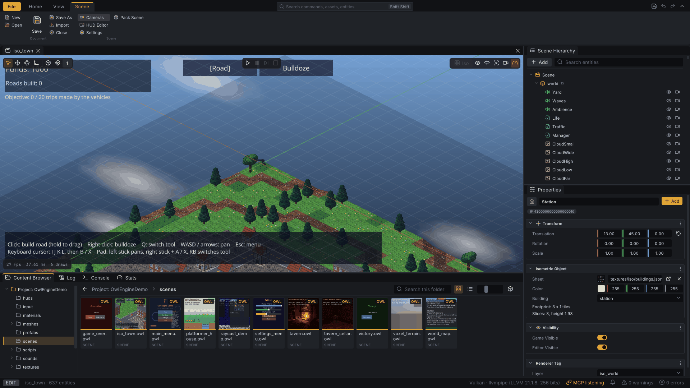
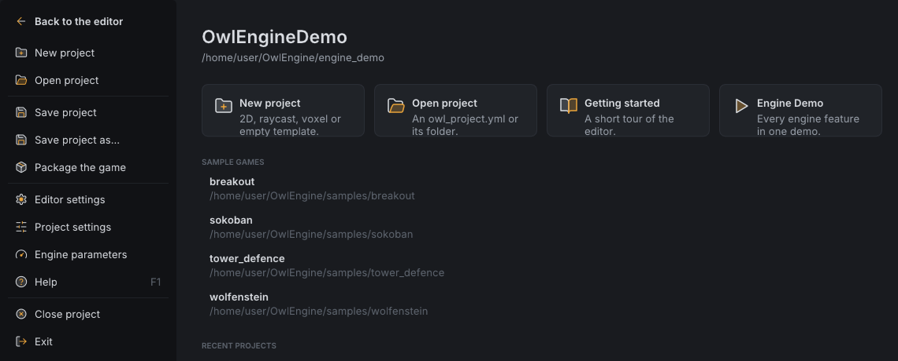
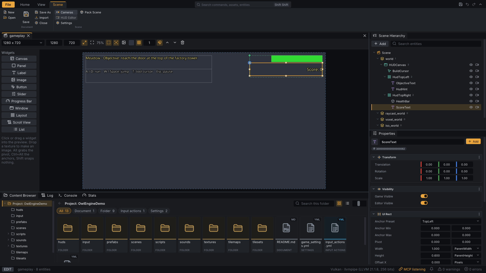
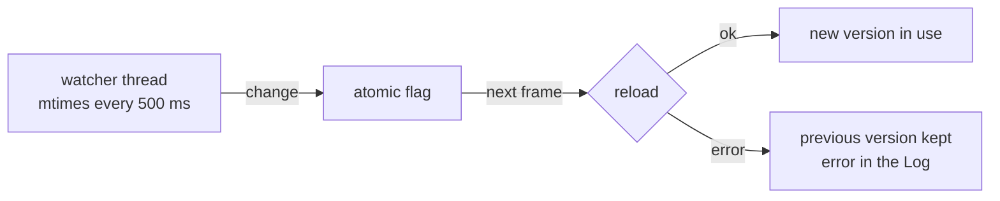
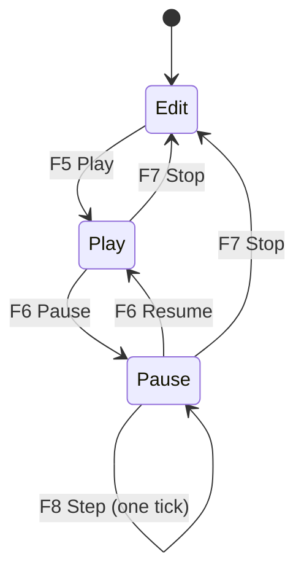
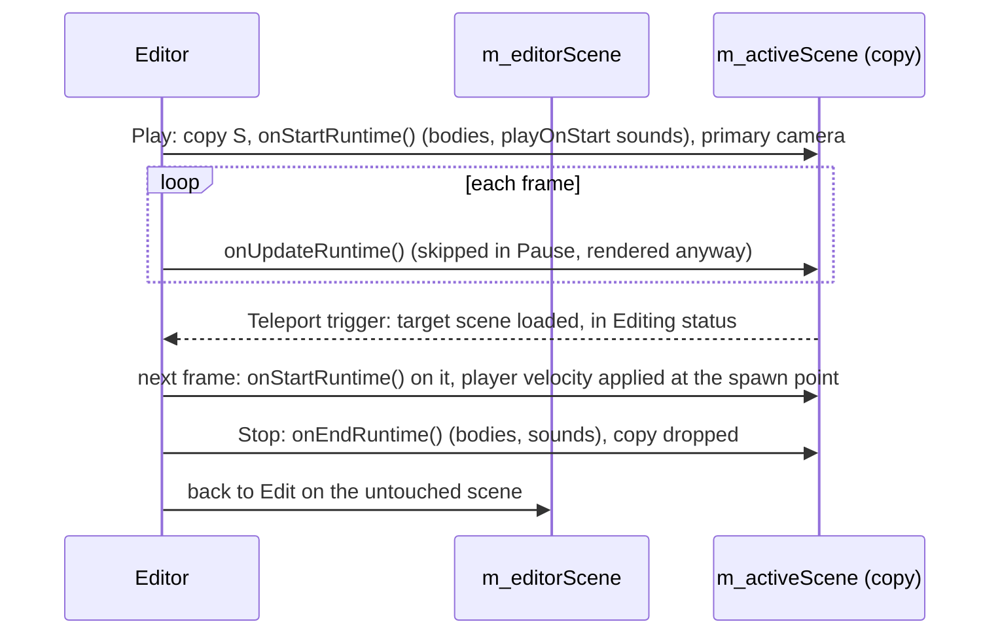
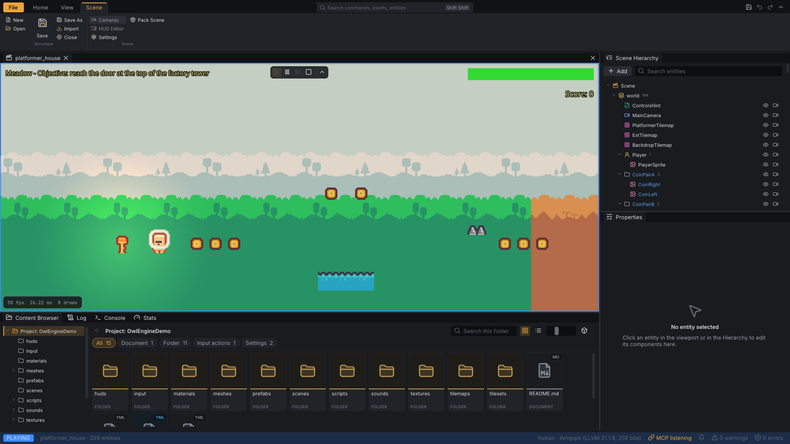
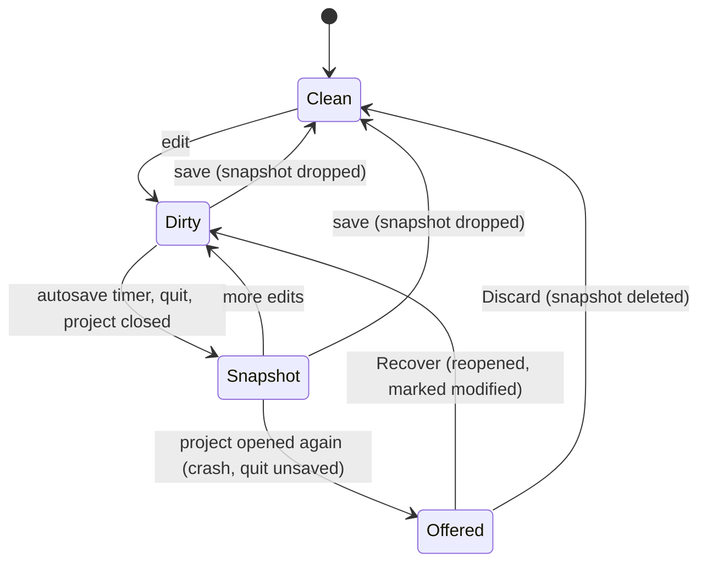
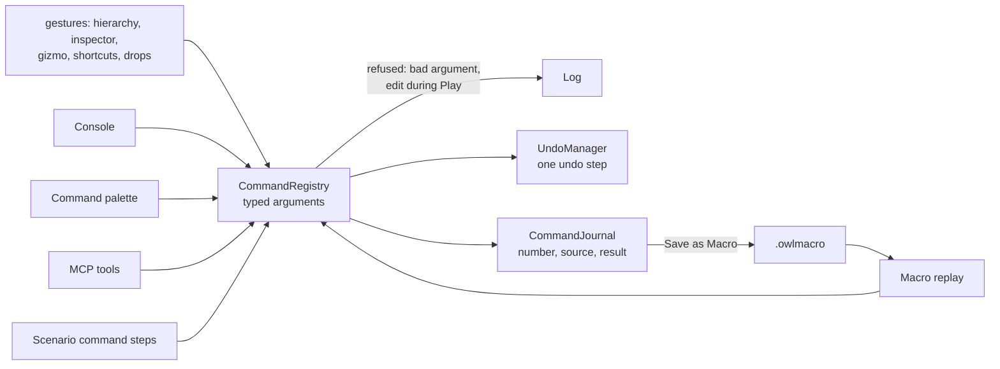

# Editor (Owl Nest) {#page-editor}

[TOC]

Owl Nest is the scene editor of Owl Engine: a dockable ImGui / ImGuizmo workspace to compose scenes, inspect
entities, browse assets and play the game in place. Its colours, fonts, icons and widgets follow the
[Owl Nest style guide](design/nest-style-guide.md).

## Overview

| Executable  | Purpose                                                                 |
|-------------|-------------------------------------------------------------------------|
| `OwlNest`   | The editor: docking UI, gizmos, project tools, export                   |
| `OwlRunner` | The game runner: plays a packed or unpacked project, scenarios, benches |

Both share the scene runtime; the editor adds the chrome (panels, gizmos, overlays) and plays a copy of the scene
(see [Editor State Machine](#editor-state-machine)).

## Panel Layout



- **Centre** -- the open documents as tabs (scenes, scripts, graphs, tilemaps...), the viewport and its overlays; the
  Help pages open there too, or float
- **Right column** -- Scene Hierarchy (top) and Properties (bottom); Tile Palette, Voxel Palette and Scene Settings
  join Properties as tabs
- **Bottom strip** -- Content Browser, Log, Console and Stats
- **Status bar** -- the mode (`EDIT`, `PLAYING`, `PAUSED`; blue while the scene runs), the active document and its
  entity count, the last autosave, the graphics backend and device, the warnings and errors since you last looked (a
  click opens the Log), the previews still to make, a bell with the last 30 notifications, and the MCP indicator
  (`MCP off`, `MCP listening`, `MCP client active` for 10 s after a request; a click opens its settings)

**View > Layout** offers two presets, **Default** (`Alt+1`) and **Hierarchy Left** (`Alt+2`, the hierarchy in its own
left column); **Reset Layout** puts every panel back. The preset is saved in `OwlNest_settings.yml` (`layoutPreset`),
the free arrangement in `OwlNest_imgui.ini`; the default layout is rebuilt on the first launch, when the saved one has
no split, and once after an editor update changes it (`layoutVersion`).

Document-bound panels show only with their document: the Tile Palette with the active tilemap, the Voxel Palette with
a scene holding a `VoxelWorld`, in Edit. They use the inspector layout (collapsible sections, property grids, tile
swatches from `gui::widgets::imageTile`). Document tabs carry the glyph of their type; a document opened from the
Content Browser, a drop or an inspector **Open** button comes to the front. Asset fields of the inspector show a
swatch of their atlas, their path, **Open** and **Clear**.

## Ribbon Menu

An Office-style **ribbon** sits between the window title and the dockspace: groups of buttons, at most one **large**
one per group and columns of three **small** ones, each with a tooltip and its shortcut (greyed when not applicable).

- **File** — the amber button opens the **File screen** over the editor: new / open project, save, save as, package
  the game, editor / project / engine settings, help, close project and exit, with the open and recent projects on
  the right. It opens by itself when no project is open; `Escape` or **Back to the editor** closes it.

  
- **Home** — Edit (Undo, Redo, Duplicate), Create (New scene / animation / tilemap / tileset), Project (Scene Flow,
  project Settings, Pack Game).
- **View** — Layout, Camera (Reset View, Axis Views, Frame Scene, Camera Viewpoint), Panels (Frame Stats, Help),
  Appearance (Owl Dark, Owl Light), Settings (Editor, Engine).
- **Document tab** — the last tab, in the accent colour, follows the active document: **Scene**, **Text**,
  **Graph**, **Animation**, **Tilemap** or **Tileset**.

The right end of the tab row holds Save, Undo, Redo and the collapse toggle (**Ctrl+F1**, or a click on the selected
tab). The widget is `gui::widgets::Ribbon` (`source/owl/public/gui/widgets/Ribbon.h`), filled by `RibbonBuilder` and
plugged into the dockspace through `UiLayer::setTopBarCallback`.

## Fonts

Two families, loose TTFs in `engine_assets/fonts/` (SIL Open Font License):

- **Inter** (Regular, SemiBold): the UI, at `EditorSettings::uiFontSize` (16 px, 14–24);
- **JetBrains Mono** Regular: code documents at `EditorSettings::codeEditorFontSize` (17 px, 8–48) and numbers in
  columns.

Text roles (`gui::TextStyle`: `Body`, `Strong`, `Title` 1.15×, `Section` 0.96×, `Label` 0.92×, `Caption` 0.8×,
`Value` mono 0.92×, `Code`) are pushed with `UiLayer::pushTextStyle` / `popTextStyle` and follow the content scale of
the primary monitor (`UiLayer::getDpiScale`; under Wayland the framebuffer scale covers it). The font sizes are read
by `main.cpp` before the `Application` exists and applied when `UiLayer::onAttach` builds the atlas
(`UiLayer::setUiFontSize` / `setCodeFontSize`): a change takes effect on the **next start**.

## Code Documents

Text and source files open in their own tab (`DocumentType::Code`), from a double-click in the Content Browser.

| Language | Extensions                                  | Highlighter |
|----------|---------------------------------------------|-------------|
| Lua      | `.lua`                                      | built-in    |
| C        | `.c`                                        | built-in    |
| C++      | `.cpp`, `.cc`, `.cxx`, `.h`, `.hpp`, `.hxx` | built-in    |
| Python   | `.py`                                       | built-in    |
| YAML     | `.yml`, `.yaml`                             | custom      |
| JSON     | `.json`                                     | built-in    |
| Markdown | `.md`, `.markdown`                          | built-in    |
| XML/SVG  | `.xml`, `.svg`                              | custom      |
| Slang    | `.slang`                                    | custom      |

- The widget is **imgui_color_text_edit** (MIT), from a local Conan recipe (`imgui-color-text-edit` in
  `conan/recipes/`, see [Conan migration](design/conan-migration.md)).
- Slang colours comments, strings, numbers, `#` lines, keywords (`struct`, `import`, `uniform`...), types (`float4`,
  `Texture2D`...), semantics (`SV_Position`...) and intrinsics (`mul`, `Sample`...); there is no compile on save, the
  errors show in the log when the engine loads the shader.
- `Ctrl+S` saves in place, `Ctrl+W` closes (discard / cancel prompt when dirty); the footer gives the language, the
  cursor line / column and INS / OVR.

### Live Preview (Markdown, SVG)

Markdown and XML / SVG documents split into the source and a live preview, with a draggable splitter per document;
**Text → Preview** hides the preview.

- Markdown is parsed by `md4c` (CommonMark + GFM tables, strikethrough, autolinks) into typed blocks (`MdHeading`,
  `MdParagraph`, `MdCodeBlock`, `MdImage`, `MdTable`, `MdList`, `MdBlockQuote`, `MdHRule`, in `MarkdownDocument.h`)
  drawn as ImGui calls: scaled headings, inline styles and links, tables, highlighted code blocks (read-only
  `TextEditor`, **Bash** included), local images through `lunasvg` or `stb_image`, external links and images opened
  in the browser (`platform::openExternalUrl`).
- SVG is rasterised by `lunasvg` into a `Texture2D` of at most 2048 px per side; a parse failure shows "Failed to parse
  SVG".
- Both previews are debounced (~250 ms). The same `MarkdownPreview` widget draws the help browser (below).

## Documents

Owl Nest is multi-document: a `DocumentManager` holds the open documents and the **active** one, which the Scene
Hierarchy, Properties and Viewport always reflect.

| Kind       | File                                        | Description                                                           |
|------------|---------------------------------------------|-----------------------------------------------------------------------|
| Scene      | `.owl`                                      | Scene graph editor with viewport, per-document undo/redo stack        |
| Code       | `.lua`, `.py`, `.json`, `.md`, `.svg`...    | Syntax-highlighted text editor (ImGuiColorTextEdit)                   |
| Node Graph | `.owlflow` (or derived like **Scene Flow**) | Generic node canvas — see [Node Graph](node_graph.md)                 |
| Animation  | `.owlanim`                                  | Spritesheet animation clip editor (timeline + preview + properties)   |
| Font       | `.ttf`, `.otf`, `.owlfont`                  | Font viewer (samples, atlas) and its charset: extra code-point ranges |
| Image      | `.png`, `.jpg`, `.jpeg`, `.bmp`, `.tga`     | Read-only image viewer: zoom, pan, pixel grid, tileset tile overlay   |
| Mesh       | `.gltf`, `.glb`, `.obj`                     | Read-only mesh viewer: orbit, zoom, textured or shaded, mesh figures  |

- Each document owns its undo stack, dirty flag, selection and play state; each scene has its own viewport window
  (`##scene_<uuid>`), tabbed by ImGui docking and detachable to see scenes side by side. A dirty document shows a dot
  (`ImGuiWindowFlags_UnsavedDocument`); closing it asks to discard or cancel.
- `Ctrl+W` closes, `Ctrl+Tab` / `Ctrl+Shift+Tab` cycle.
- One document plays at a time; switched away from, it keeps running in the background (no rendering), its tab badge
  shows its state and the play and gizmo controls hide.

The types live in `source/owlnest/sources/document/`: `Document`, `DocumentManager`, `SceneDocument`,
`CodeEditorDocument`, `NodeGraphDocument`, `SceneFlowDocument`, `AnimationDocument`, `TilemapDocument`,
`TilesetDocument`, `FontDocument`, `ImageDocument`.

### Tilemap document

A `.owltilemap` opens in a `TilemapDocument`: the left button paints the Tile Palette tile into the active layer, the
right one erases; the hierarchy panel holds the tileset, the grid size and the layers; the properties panel shows the
clicked cell and edits its overlay tile and flags. A stroke or a cell edit is one undo step holding only the 32 × 32
chunks it changed (`commands::ModifyTilemapChunksCommand`); a layout edit (tileset, size, layers) keeps the asset
before and after. A resize drag previews from the grid of its start, so shrinking then growing back loses nothing.

With a `kind: Isometric` tileset the canvas is an isometric preview (middle drag pans, wheel zooms) with slopes,
foundations and overlays, and a toolbar picks the tool:

| Tool        | Effect                                                                                                    |
|-------------|-----------------------------------------------------------------------------------------------------------|
| **Paint**   | Tile Palette brushes on the cell under the cursor, picked on the sloped surface                           |
| **Raise**   | Raise the nearest corner, or an area of 1 to 16 corners, by one step (right button: lower)                |
| **Lower**   | The opposite of Raise                                                                                     |
| **Level**   | Bring the area to the level height (Ctrl + click reads a corner)                                          |
| **Overlay** | Paint the overlay (tracks, roads) of the active layer; right button clears                                |
| **Node**    | Select corners (Shift adds or removes), drag up / down or **+** / **-** to move them one step per `zStep` |

Neighbouring corners follow (`TilemapAsset::setCornerHeight`) so every cell keeps one of the 19 slopes; a click, a
drag or a key press is one undo step (`commands::ModifyTerrainHeightsCommand`, only the corners that moved). Cell
Properties shows the slope and edits the four corner heights with the same rule. A flat tilemap has no heights and no
Node tool. The document keeps its own undo stack: these edits are not registry commands.


### Tileset document

A `.owltileset` opens in a `TilesetDocument`: **Atlas** sets the texture, grid, tile size, filter and **Kind**
(`Orthogonal` square tiles, `Isometric` 2:1 diamonds written `kind: Isometric`); the properties panel edits the
clicked tile. An isometric tileset adds **Slopes**: per terrain or overlay id, the tile of each of the 19 slopes and
its foundation (`-1` falls back on the flat tile). A tile's **Navigation** section puts it in a road graph, its joined
sides shown as four arrows as on screen ([Pathfinding](pathfinding.md)). Every edit is one undo step of the document.

### Scene Flow view

**Home > Project > Scene Flow** shows every `.owl` scene of the project as a node, Teleport triggers wired to the
scene they lead to; scenes unreachable from `Project::firstScene` get a red title. A double-click opens the scene.
Details in [Node Graph](node_graph.md).


## Panels Reference

### Viewport

The viewport draws the active scene into an off-screen `Framebuffer`:

| Attachment | Format          | Purpose                     |
|------------|-----------------|-----------------------------|
| 0          | Surface (RGBA8) | Visible colour output       |
| 1          | RedInteger      | Entity ID for mouse picking |

A click reads attachment 1 under the mouse and selects that entity (-1: none) in the hierarchy and the inspector.
Every layer writes it: sprites, tilemaps, isometric billboards, voxel worlds and static meshes (`MeshRenderer`).

**Overlays**, in translucent pills over the scene:

- top-left (Edit): Select / Move / Rotate / Scale, Local / World, Snap and its step (a click opens the presets);
- top-centre: Play (Resume), Pause, Step, Stop; while playing, a chevron (or **F10**) folds them into a handle in the
  top-right corner showing the state (kept as `playControlsCollapsed`); a "Playing" / "Paused" message fades after
  about two seconds;
- top-right (Edit): the view (**2D**, **3D**, or **Iso** locked in the isometric mode), **Show** (grid, camera
  markers, trigger icons, in isometric mode the navigation graph with a Shift-click test path), the isometric
  **Navigation tool** (one-way roads, closed sides, slower cells, [Pathfinding](pathfinding.md); it turns the graph on
  and off with it), **Frame selection** (`F`), the **Camera** menu and the frame stats toggle;
- bottom-left: frame rate, frame time and draw calls (a click opens Stats);
- bottom-right: the view-cube; in Play of an isometric scene, the eye that draws the graph and the vehicle routes.

Edit mode also draws collider wireframes, the frustum of non-primary cameras and the trigger icons. In Play a click
that starts on an overlay or another panel never reaches the game, a drag started in the game survives leaving the
viewport, and a frame in the play colour outlines the viewport.

**Editor camera.** In Edit a `CameraEditor` (orbit camera) moves only while the viewport is hovered. Its 2D view
(`CameraEditor::Projection::Orthographic`) faces the XY plane with the framing of the 3D view; `CameraEditor::frame`
centres the selection. The grid follows the snap step (doubled while too dense), its axes in their colours: on the
ground (XZ plane, `y = 0`) in the 3D view, on the XY plane in the 2D and isometric views; **Show > Grid on the ground**
puts the 3D one back on the XY plane. The selection is outlined in orange: its quad for a 2D entity, the 12 edges of
its bounding box for a mesh. Camera markers (**Show > Camera markers**) are an icon, an arrow and the field of view in
the 2D views; the 3D view draws the model `meshes/camera.glb` of the editor assets (made by
`tools/editor/generate_camera_mesh.py`), pickable, with the frustum of the camera (field of view, or box when
orthographic) and a filled triangle above it pointing to the up of the camera.

| Gesture                     | Effect                                       |
|-----------------------------|----------------------------------------------|
| Right drag                  | Look around from the eye                     |
| Middle drag                 | Pan                                          |
| Ctrl + left drag            | Orbit around the reference point             |
| Ctrl + right or middle drag | Pan                                          |
| Alt + left drag             | Look around from the eye                     |
| Alt + right drag            | Pan                                          |
| Alt + middle drag           | Dolly (the eye and the reference point move) |
| Wheel                       | Zoom towards the reference point             |
| Right drag + W A S D        | Fly forward, left, back, right (3D view)     |
| Right drag + Q / E          | Fly down / up                                |
| Right drag + Shift          | Fly three times faster                       |
| Right drag + wheel          | Set the fly speed (0.1 to 100 units/s)       |

A left click selects (a camera by its 3D model too), a right click without drag opens the context menu; the right
drag belongs to the voxel brush while it is active. The fly keys follow the key positions, so Z Q S D fly on an AZERTY
keyboard, and while the right button flies the letter shortcuts (gizmo W E R) are off. The **Camera** tab of the Editor Settings scales orbit, pan and zoom (10 to 300 %), inverts the vertical drag and sets
a dead zone (`CameraEditor::Navigation`).

**Piloting a camera.** **Pilot Selected Camera** (Camera menu of the view, context menu of a camera, command
palette `view.pilotCamera`) renders the view through the selected camera entity: its projection, the aspect of the
viewport, its own model and frustum hidden. Every move of the view moves the camera, and each gesture (a drag, a fly,
a wheel step) is one undoable `entity.set_transform`; an orthographic camera slides across the XY plane only. The view
follows the camera when it moves otherwise (undo, inspector). **Stop** on the banner at the bottom of the viewport, or
Play, puts the editor view back where it was. Raycast cameras and the isometric mode cannot be piloted.

**Isometric mode.** When the scene's stack holds an isometric layer with content (`Scene::getSelfDrawnLayer`), the
viewport draws layer by layer as in Play through its own `IsometricCamera`, the projection locked (**Iso**, no
view-cube): middle or right drag (or Alt + left) pans, the wheel zooms by powers of two around the cursor. A world-axis
cursor follows the ground and the cell under it is outlined along its slope (`pickTerrain`); the gizmo moves along the
map axes, and picking reads the id the billboards write, so the slices of an `IsometricObject` select their entity.
The **Isometric Object** inspector takes the sheet (`.json`), lists its buildings and shows footprint, slices and
height; every edit is undoable.

**Camera presets** (overlay **Camera** menu, **View > Camera**, command palette):

- **Reset View** (`Home`): the XY plane from +Z, ten units away (`CameraEditor::resetView`);
- **Frame Selection** (`F`), **Frame Scene** (`Shift+F`);
- **Selected Camera Viewpoint**: the view of the selected camera (disabled for a `RendererRaycast` camera, drawn flat);
- **Pilot Selected Camera** / **Stop Piloting**: render through the selected camera and move it with the view;
- six axis views (**Front** XY, **Back**, **Top** XZ, **Bottom**, **Right** YZ, **Left**) around the reference point
  (`CameraEditor::viewAlong`). The view-cube does the same: a click on an axis end looks from it, on the centre resets.

**Context menus.** A right click without drag offers, on an entity, Frame, Duplicate, Hide in the Editor, Delete
(plus **Camera Viewpoint** on a camera); on the empty scene, 2D / 3D, grid, **Reset View**, **Frame Scene**; on a
document tab, Save, Close, Close Others, Reveal in Content Browser, Copy Path; on a node graph, delete the node or fit
the view. Menus have a title, Lucide icons, shortcuts and destructive entries in red (`gui::widgets::menuHeader`,
`menuItem`).

**Gizmos.** ImGuizmo draws the manipulator of the selection: None (Q), Translation (W), Rotation (E), Scale (R), All
(T); see [Gizmo Modes](#gizmo-modes).

**Snap.** The **Snap** toggle (or `Ctrl` held during a drag) clamps translations to the snap step; rotation snaps by
the **Rotation Step** (`snapRotationDegrees`, 45° by default, 0.1° to 180°). With **Auto step from tilemap** (default)
and a `Tilemap` in the scene, the step is `cellSize × snapMultiplier` (**Step** presets `1/4 cell` to `10 cells`) and a
dropped entity is realigned to the nearest cell centre; otherwise the step is `snapStep` in world units (presets `0.25`
to `10`). The five settings (`snapEnabled`, `snapStep`, `snapMultiplier`, `snapAutoFromTilemap`,
`snapRotationDegrees`) are in the **Gizmo Snap** tab.

**Placing meshes.** A `.gltf`, `.glb` or `.obj` dragged from the Content Browser onto the viewport becomes an entity
with a `MeshRenderer` at the point under the cursor: on the hovered mesh or voxel world, else on the ground plane
(`y = 0`), else on the `z = 0` plane of the 2D view. It runs `mesh.create`, one undo step; the entity is tagged for the
first `RendererMesh` layer of the render stack when that layer is not the first one. Without such a layer, a modal
offers to add one (`mesh_world`, after the first layer of the project stack, through `project.add_render_layer`, which
saves the project), to place the mesh anyway (not drawn), or to cancel; when the project has a mesh layer that the
scene disables, it points to the Scene Settings instead of adding one. A double-click on the file (or **Place in
Scene** in its context menu) places it at the origin; **Open**, from the context menu or the **Mesh** field of the
inspector, shows it in the mesh viewer. The gizmos move, rotate and scale it in 3D like any entity. With no
**Texture** of its own, the inspector shows the texture of the material, faded.

### Scene Hierarchy

The active scene as a tree (roots have `parentId == 0`; see [Transform Hierarchy](scene.md#transform-hierarchy)).

- **Toolbar**: **Add** creates an empty entity or a child of the selection; the search field filters by name (every
  word, case-insensitive) as a flat list.
- **Rows**: a chevron folds the children, the glyph of the main component in its kind colour, the child count, the
  eye and camera switches (editor, game) on hover or while hidden; prefab instances in the info colour, entities
  hidden in the editor greyed, the selection with an accent bar. The selection is shared with Properties and the
  gizmo.
- **Drag and drop** onto another entity reparents it (`Scene::setParent()`: cycle check, world position kept).
- **Context menu** (on an entity or the background):

| Action               | Description                                               |
|----------------------|-----------------------------------------------------------|
| Create Root Entity   | Add a new entity at the root level                        |
| Create Child Entity  | Add a new entity as a child of the selected entity        |
| Duplicate            | Shallow-copy the selected entity (root copy)              |
| Duplicate Subtree    | Recursively duplicate the entity and all descendants      |
| Create Prefab...     | Save the entity subtree as a `.owlprefab` file            |
| Update from Prefab   | Refresh non-overridden components from the prefab file    |
| Revert to Prefab     | Reset all overrides (the instance placement is kept)      |
| Unlink Prefab        | Remove the PrefabLink, turning it into a regular entity   |
| Unparent             | Move the entity to root level, preserving world transform |
| Delete               | Remove the entity, reparenting children to grandparent    |
| Delete with Children | Cascade-delete the entity and all descendants             |

The prefab entries show only on a prefab instance (a `PrefabLink`), see [Prefab Workflow](#prefab-workflow).

### Properties

The components of the selection, each under a collapsible header (icon, name, **⋮** menu: revert to the prefab,
remove) with its own editor; vectors sit in a label / value grid with axis colours and a reset button once off their
default. **Add Component** lists the optional components the entity lacks; mandatory ones (Transform, Hierarchy) cannot
be removed. Every edit is a registry command ([Editor commands](#editor-commands)).

- **Transform** (local), **Sprite Renderer**, **Animated Sprite**, **Circle Renderer**, **Mesh Renderer** (mesh file
  drop field with the base-colour preview, tint, texture override, transparency, vertex and triangle counts),
  **Text Renderer**, **Camera**,
  **Rigidbody 2D**, **Box / Circle Collider 2D**, **Native Script**, **Sound Source**, **Sound Listener**, **Player**,
  **Link**, **Background**, **Visibility** (inherited), **Lua Script** (path and property list): their fields, see
  [Scene components](scene.md#components)
- **Trigger** -- type (Victory, Death, Target, Teleport, Timer, Interaction, LuaCallback), callback name and the
  fields of the type
- **Canvas** -- HUD root: sort order, reference resolution, scale mode (`ConstantPixels`, `ScaleWithHeight`,
  `MatchSmallerSide`)
- **UI Rect** -- anchor preset (Custom when stretched), Anchor Min / Max, Pivot, Width, Height, Offset X / Y in Y-down
  reference pixels or, with the unit selector, a ratio of the parent or screen width or height (changing the unit
  converts, the widget does not move); a click on a widget in the viewport selects it
- **UI Text / Image / Panel / Button / Slider / Progress Bar**, **UI Window / Layout / Tooltip / Tool Cursor**
  (draggable closable window, row / column / grid, hover tooltip, sprite following the mouse) and **UI Focus**
  (focusable, initial, neighbours by name stored as UUIDs, callback, frame colour; the Canvas can wrap the focus) --
  see [HUD documents](#editor-hud)
- **Prefab Link** -- read only: source path, synced version, mapped entities, overrides

#### Inspector field interactions

Asset fields take drops from the Content Browser (`gui::widgets::assetDropTarget`), filtered by extension; a payload of
another `AssetKind` is ignored.

| Field                                                       | Accepted extensions                             |
|-------------------------------------------------------------|-------------------------------------------------|
| `SpriteRenderer.texture`                                    | `.png`, `.jpg`, `.jpeg`, `.bmp`, `.tga`, `.hdr` |
| `AnimatedSpriteRenderer.texture`                            | same as Texture                                 |
| `BackgroundTexture.texture` (Background-Texture and Skybox) | same as Texture                                 |
| `UiImage.texture`                                           | same as Texture                                 |
| `Text.font`                                                 | `.ttf`, `.otf`                                  |
| `SoundSource.soundAsset`                                    | `.wav`, `.mp3`, `.ogg`, `.flac`                 |
| `LuaScript.scriptPath`                                      | `.lua`                                          |

- **Texture preview**: a 100x100 thumbnail, `(loading...)` while it decodes, `(failed)` in red on an error.
- **Font preview**: a 220x44 strip of `Aa Bb 1!? éàüÇœ€` in the selected font, made by `gui::FontPreviewCache`
  (pumped from `EditorLayer::onUpdate`), the MSDF atlas shown until it is ready.
- **Curve editor**: the optional **Speed Curve** of `AnimatedSpriteRenderer` (ImCurveEdit: drag points, double-click
  adds, right-click removes; Constant, Linear or Smooth). An empty curve keeps a constant speed and is not written:

```yaml
AnimatedSpriteRenderer:
  columns: 4
  rows: 2
  firstFrame: 0
  lastFrame: 7
  frameDuration: 0.05
  loop: true
  speedCurve:
    interpolation: Smooth
    keys:
      - [0.0, 0.5]
      - [0.5, 2.0]
      - [1.0, 1.0]
```

### Animation Editor (`.owlanim`)

An `.owlanim` is a reusable spritesheet clip (`scene::AnimationClip`: the playback fields of `AnimatedSpriteRenderer`
without the tint). Double-click or drop one to open it; **Home > Create > New** (animation) starts an untitled clip
written by the first Save.

Sections, like the inspector: **Preview** (current frame, Previous / Play-Pause / Stop / Next), **Spritesheet**
(texture, columns, rows; **Show Current Frame** outlines it, frames run row by row from the top left), **Playback**
(first and last frame, duration, loop), **Speed Curve** and **Timeline** (`gui::widgets::sequencer()`: drag the
handles to move `firstFrame` / `lastFrame`, click the ruler to scrub, which pauses). The **Animation** ribbon tab
(active document only) holds Play, Pause, Stop, Previous, Next, Save, Save As and Close.

```yaml
AnimationClip: walk
FormatVersion: 1
texture: characters/hero
columns: 4
rows: 2
firstFrame: 0
lastFrame: 7
frameDuration: 0.1
loop: true
speedCurve:
  interpolation: Linear
  keys:
    - [0.0, 1.0]
    - [1.0, 1.0]
```

### Image Viewer (`.png`, `.jpg`, `.jpeg`, `.bmp`, `.tga`)

A read-only tab (no undo, never dirty), opened by a double-click or **Open** in the Content Browser.

- Wheel zoom around the cursor (5 % to 3200 %), left or middle drag pans; **Fit** (`F`, double-click) and **1:1**
  (`1`). Enlarged images use the nearest texel, reduced ones are smoothed.
- A checkerboard behind transparent pixels, a pixel grid from 800 % (toggle in *Image View*); the status line gives
  zoom, size and the pixel under the cursor.
- The **Image** panel gives size, channels, file size and the filter of the tilesets using it; *Image View* lists those
  tilesets and draws the tile grid of the one picked, with the index of the hovered tile.

### Mesh Viewer (`.gltf`, `.glb`, `.obj`)

A read-only tab (`MeshDocument`, no undo, never dirty), opened by **Open** in the context menu of the Content Browser
or the **Mesh** field of the inspector.

- The mesh alone under an orbit camera (`viewer::renderMeshPreview`): drag to orbit, wheel to zoom, double-click to
  reset; *Mesh View* switches between the material (textured) and a plain grey, and **Place in Scene** adds it to
  the active scene.
- The **Mesh** panel gives the vertex and triangle counts, the size of the bounds, the base colour and the texture
  of the material.

### Font Viewer and Editor (`.ttf`, `.otf`)

A font (or its `.owlfont` sidecar) opens in a font document, loaded by the document if no text uses it yet:

- **Samples**: an editable text at 12, 18, 24, 36 and 64 px drawn by the engine's text renderer, with **Outline** and
  **Box** toggles;
- **Atlas**: the MSDF atlas; hover a glyph for its code point, Unicode block and advance.

The **Font** panel gives file, glyph count, charset size and atlas size (*cached* when read from the disk cache). The
**Font Charset** panel lists the default Latin charset, read only, its **Coverage** per Unicode block, and the
**extra ranges**: **+** adds a block (Latin Extended-B, Greek, Cyrillic, arrows, box drawing...) or a custom range,
each range edits its first and last code point in hexadecimal, click / Ctrl+click selects, the trash or `Delete`
removes the selection, the eraser every range. Edits are undoable (consecutive edits of one bound merge); **Save**
writes the `.owlfont` (or deletes it when no range is left) and rebuilds the loaded atlas in place.

### Action Map Editor (`input_actions.yml`) {#editor-action-map}

`input_actions.yml` opens from the Content Browser, **Home > Project > Input Actions** or **Edit Input Actions** in
Project Settings. Without the file the document starts from the built-in actions and the first save creates it. The
format is in [Actions](event_input.md#actions).


- **Left list**: the actions with a live bar; **+** adds one (`Button`), the trash removes, the circular arrow restores
  the built-in ones; built-in actions left out of the file are listed dimmed, **+** copies one into the file.
- **Details**: **Name** (applied on Enter, refused when empty or taken), **Kind** (`Button`, `Axis`, `Vector`), the
  **Live reading** and the **Bindings** (source, key or button, gamepad slot, -1 for any, vector component, scale and,
  for an axis or a stick, dead zone, curve and exponent).
- **Add by pressing an input** binds the next key, button or axis push (a `Vector` takes a whole stick); a binding's
  key button rebinds it. Inputs held at the start are ignored until released, **Esc** cancels, the editor shortcuts
  wait meanwhile.
- The live reading evaluates the edited map on the real devices, in Edit and Play, before it is saved.
- Every edit is an undo step (a slider drag one step); **Save** writes atomically and reloads the map in the engine
  context, so the editor and a running Play read it from the next frame.

### HUD documents {#editor-hud}

An `.owlhud` opens in a scene document (hierarchy, inspector and undo as for a scene; Save writes the `Hud:` file
atomically); **New > HUD** creates one holding a full-screen canvas. The scenes drawing a HUD read it again once
saved, and Play starts and ends with the HUD files read again, so values changed by the game never stay. The format is
in [HUD system](design/hud-system.md).

The tab shows the **HUD editor** instead of the 3D viewport; a scene with canvases gets it with **HUD Editor** (Scene
ribbon; *Scene View* goes back; Play always shows the scene):



- **Toolbar**: preview resolution (presets or custom), fit / 1:1 (wheel zooms, middle drag pans, `F` fits), outlines
  and reference frame, backdrop (colour or a dropped image), snapping (pixel grid, edges), draw order and delete.
- **Palette**: Canvas, Panel, Label, Image, Button, Slider, Progress Bar, Window, Layout, Scroll View, List; a click
  adds at the centre, a drag drops into the panel, window or scroll view under the mouse, else the canvas (created when
  missing). A dragged texture makes an Image.
- **Preview**: click selects, Ctrl-click toggles, a drag on empty space draws a box; the selection is the hierarchy's.

| Gesture                                    | Effect                                                  |
|--------------------------------------------|---------------------------------------------------------|
| Drag the body                              | Move the selected widgets together                      |
| Drag an edge or a corner handle            | Resize; the opposite edge stays                         |
| Alt + drag the circle                      | Move the pivot; the widget stays where it is            |
| Drag a diamond (Ctrl+Alt when under pivot) | Move the anchors; the widget stays where it is          |
| Arrow keys (Shift: 10 pixels)              | Nudge the selection                                     |
| Delete                                     | Delete the selection and its children                   |
| Shift while dragging                       | Snap nothing                                            |
| Right click                                | Add a widget here, bring to front, send to back, delete |

Positions snap to whole reference pixels and to the edges and centres of siblings, parent and screen (red guides).
Every gesture is one undo step running a `hud.*` [command](#editor-commands).

### Content Browser

A file grid of the asset directories, with navigation, file operations and drag and drop.

- **Folder tree** (left, resizable): the asset roots (project, application, engine) and their folders, unfolded down
  to the folder shown.
- **Toolbar**: parent folder, a clickable breadcrumb (never above the root), a name filter, grid / list, thumbnail
  size, the style of the mesh thumbnails (**Textured**, **Shaded**, **Flat**); below, one chip per family present (`All 14`, `Texture 11`...) filters it, hidden when there is one family.
- **Tiles**: images show themselves (cropped square), tilesets their atlas, HUDs a pixel render, scenes their primary
  camera, prefabs an orthographic framing, meshes (`.obj`, `.gltf`, `.glb`) a GPU render of their material or in grey
  (`viewer::renderMeshPreview`), or in **Flat** style their faces in an isometric view (`AssetThumbnails::projectMesh`,
  at most 6000 triangles, `.fbx` included), sounds their waveform (`sound::readWaveform`); other
  files the duotone icon of their kind. `AssetThumbnails` reads a few files per frame and renders one scene, prefab or mesh
  at a time for 0.75 s into a pool of 48 framebuffers; a preview is redone when its file changes. Each tile has a
  family colour bar, the kind in capitals and an extension badge; an empty folder or search says so. A dragged tile
  follows the cursor (`gui::widgets::dragPreview`) and drop targets light up.

| Action                        | Effect                                        |
|-------------------------------|-----------------------------------------------|
| Double-click folder           | Navigate into the folder                      |
| Double-click `.owl` file      | Open the scene in the editor                  |
| Double-click a font           | Open the font viewer and its charset          |
| Double-click an image         | Open it in the read-only image viewer         |
| Double-click `.slang` file    | Open the shader in the code editor            |
| Drag `.owlprefab` to Viewport | Instantiate the prefab into the scene         |
| Drag a mesh to Viewport       | Place a `MeshRenderer` entity under the mouse |
| Double-click a mesh           | Place a `MeshRenderer` entity at the origin   |
| Right-click a mesh > Open     | Open it in the read-only mesh viewer          |
| Drag texture to Properties    | Assign the texture to a Sprite Renderer field |
| Drag sound to Properties      | Assign the sound to a Sound Source field      |
| Right-click background        | Context menu: New Folder, Import File/Folder  |
| Right-click file/folder       | Context menu: Open, Rename, Delete            |
| OS file drop                  | Copy dropped files into the current directory |

### Log Panel

Engine and game messages. Chips filter by level (Trace, Debug, Info, Warning, Error, Critical, with their counts) and
by logger (Engine `OWL`, Game `APP`); a search field filters by substring; **Clear** empties; the tab title counts the
warnings and errors. Auto-scroll follows the newest line until you scroll up.

A failed scene load, Lua script or pack names the file, the entity (tag, id, line) and ends with a `Fix:` hint; the
runner prints the same messages:

```
SceneSerializer: Cannot load scene 'scenes/level.owl': entity #1 (id 42) 'Broken' at line 5 is malformed
(YAML: Bad conversion at line 7.). Fix: fix or remove the reported entity in the file, then
reload the scene.
LuaEngine: Error in on_update of script 'scripts/hero.lua' on entity 'Hero' (77): [string "scripts/hero.lua"]:2:
boom. Fix: fix the script at the first line of the traceback; the callback runs again on its next call.
```

### Console {#editor-console}

The Console panel (Ctrl+&#96;, `view.console`) is a command line over the [editor commands](#editor-commands) and the
journal of every command of the session.


- **Command line**: one [command line](#editor-command-line) per input, run on the active scene with `Enter`; the
  result shows as `$n  description  (data)`, an error with its column, an edit during Play as *refused during Play*.
  `help` lists the commands, `help <command>` its arguments; `Tab` completes the command, then argument names, then
  choices; `↑` / `↓` browse the history (`consoleHistory` in `OwlNest_settings.yml`, 100 lines).
- **Journal**: one line per command run, whatever its source, with `$n`, the source, the command and its undo
  description or error; source chips filter, **Clear** empties the view (numbers go on).
- **Macros**: select journal lines, **Save as Macro** writes a `.owlmacro` with the created entities as `$n`
  references (`commands::Macro::fromJournal`). A replay (double-click in the Content Browser, which also offers
  **Edit as Text**, `macro.run path=...`, MCP, a scenario step) is one undo step; the first failing line stops it,
  undoes it and reports its line.

### Stats

Real-time metrics, a tab of the bottom strip (the **Stats Panel** switch of the **General** settings):

| Metric               | Source                                  |
|----------------------|-----------------------------------------|
| FPS                  | `Timestep::getFps()`                    |
| Current memory       | `TrackerAPI::globals().allocatedMemory` |
| Peak memory          | `TrackerAPI::globals().memoryPeek`      |
| Allocation calls     | Per-frame allocation count              |
| Deallocation calls   | Per-frame deallocation count            |
| Hovered entity       | Entity name under the mouse cursor      |
| Draw calls           | `Renderer2D::Statistics::drawCalls`     |
| Quad count           | `Renderer2D::Statistics::quadCount`     |
| Vertex / index count | Derived from quad count                 |
| Viewport size        | Current framebuffer dimensions          |
| Vulkan submits       | `RenderCounters::submits`, per frame    |
| Vulkan queue drains  | `queueWaitIdles` / `deviceWaitIdles`    |
| Vulkan fence waits   | `RenderCounters::fenceWaits`, per frame |
| Vulkan pace wait     | `RenderCounters::paceWaitMs`, per frame |

The Vulkan rows show each counter of `RenderCommand::getRenderCounters()` for the last frame and its maximum over the
last 2 s; they are greyed on another backend.

### Settings

**View > Settings > Editor** opens a dockable window, one tab per topic, each row with a reset button once off its
default. The engine parameters (Window, Backends, Debug), Project Settings and Scene Settings use the same grids.

- **General**: the Stats Panel switch, the text size (75 to 150 %, at once, `UiLayer::setTextScale`; `Ctrl+=`,
  `Ctrl+-`, `Ctrl+0`), the UI and code font sizes (next start) and the [autosave](#autosave-and-crash-recovery)
  interval.
- **Gizmo Snap**: see [Viewport](#viewport). **Camera**: navigation speeds, inversion, dead zone.
- **Shortcuts**: every action and its binding, see [Rebinding](#rebinding).
- **MCP Server**: off by default; **Enabled** starts the [MCP server](#editor-mcp-server) on `127.0.0.1`, **Port**
  (47800, 1024 to 65535) applies on release, status / endpoint / token file are shown (a click copies), **Regenerate
  Token** refuses the old token at once.
- **Appearance**: **Owl Dark** (default) or **Owl Light**. A theme is a few tokens (`gui::Theme`: five surfaces, the
  input well, lines, three text levels, the amber accent, the play blue, the status colours, the three axis colours)
  from which `UiLayer::setTheme` derives every ImGui colour; `IconBank::rebuild` re-tints the SVG icons (`#ffffff` the
  text colour, `#ff00ff` the accent). Settings of a retired preset (Dark, Dark Blue, Nord, Solarized, Custom) open in
  Owl Dark, Light in Owl Light.

Dialog buttons are `gui::widgets::button` (glyph, label, tooltip; the main action in the accent),
`gui::widgets::iconButton` for glyph-only ones, menus `gui::widgets::menuItem`. Settings, keybinding overrides and the
recent projects live in `OwlNest_settings.yml`.

### Hot reload {#editor-hot-reload}

Owl Nest and the development runner watch the asset directories (project and engine) and reload what changes, at the
start of the next frame:



| File                         | What reloads                                                                             |
|------------------------------|------------------------------------------------------------------------------------------|
| `.png`, `.jpg`               | Every texture of the library loaded from it (the size may change)                        |
| `.slang`                     | Every shader compiled from it, Vulkan and OpenGL; its pipelines are rebuilt              |
| `.owltileset`, `.owltilemap` | The tilemaps, doors, push walls and voxel worlds using it, edited and played scenes      |
| `.lua`                       | Every running instance of the script, see [Scripting](scripting.md#scripting-hot-reload) |
| `.owl`                       | The scene document of that file, when it is not playing and has no unsaved edit          |

- A failed reload keeps the previous version (pixels, shader binaries, running script) and logs the file and the Slang
  or Lua diagnostic.
- A scene with unsaved edits is never replaced (a warning says the file changed); the editor's own saves reload nothing.
- The frame reads one atomic flag; `OwlRunner --frame-bench <scene> --hot-reload` measures it.
- Off with *Hot Reload* in *Parameters > Debug* (`hotReload` in `config.yml`) or `OwlRunner --no-hot-reload`; a game
  with an open asset pack never watches.
- Not reloaded: colliders built at Play start (tilemap collision flags apply at the next Play), new shader bindings
  (restart), C++ game code.

### Project Settings

**Home > Project > Settings** edits the project in five sections (General, Window, Input, Simulation, Renderer Stack):

| Field               | Description                                                                       |
|---------------------|-----------------------------------------------------------------------------------|
| Project Name        | Display name shown in the window title bar                                        |
| First Scene         | Dropdown of `.owl` files found in the project directory                           |
| Default HUD         | Dropdown of `.owlhud` files: the HUD of the scenes that name none (`DefaultHud`)  |
| Version             | Game version (e.g., "1.0.0"); empty, the game follows the engine version          |
| Author              | Author or studio name                                                             |
| Description         | Short project description                                                         |
| Icon                | Relative path to a PNG icon for the game window                                   |
| Width               | Default window width in pixels (320–7680)                                         |
| Height              | Default window height in pixels (240–4320)                                        |
| Fullscreen          | Whether the game starts in fullscreen mode                                        |
| Resizable           | Whether the game window can be resized                                            |
| Gamepad Mappings    | Optional SDL_GameControllerDB file, relative to the project; packed with the game |
| Edit Input Actions  | Closes the dialog (changes dropped) and opens the action map editor               |
| Tick Rate           | Fixed simulation ticks per second (1–1000, 60 by default): `on_tick`, physics     |
| Max Ticks per Frame | Ticks one frame runs at most (1–64, 8 by default); the time beyond is dropped     |

Changes apply on confirmation (**Cancel** drops them) and go to `owl_project.yml`, outside the scene undo stack. Window
and simulation settings are also written to `runner.yml` by the export; the tick rate applies from the next Play
([Fixed simulation tick](scene.md#fixed-tick)); a new gamepad mapping file loads on confirmation
([Gamepads](event_input.md#gamepads)).

### Scene Settings

**Scene > Scene > Settings** edits the scene's global blocks (`EnabledRenderers`, `Physics`, `Hud:`), each change an
undoable command:

- **Physics**: `physics::PhysicsSettings` (sub-steps, solver threads, `auto` = 0, interpolation, see
  [Physics](physics.md)), `ModifyPhysicsSettingsCommand`, read at Play start; shown even without a renderer stack.
- **HUD**: *Project default*, *None*, a project file or a dropped one, through `scene.set_hud` (`path` or
  `use_default`). **Extract Canvas to .owlhud...** (Scene Hierarchy menu of a root canvas) writes the canvas to a
  `.owlhud`, removes it from the scene and points `Hud:` at the file (`hud.extract_canvas`, one undo step; the file
  stays after an undo).
- **Renderer stack**, mirroring `renderer::EnabledRenderersConfig`:

| Control                             | Effect                                                                                               |
|-------------------------------------|------------------------------------------------------------------------------------------------------|
| Layer row (per scene-listed entry)  | The layer name and its type (`Renderer2D`, `RendererRaycast`, …).                                    |
| Enabled switch                      | Toggle the scene-level enable flag. Disabled layers are skipped without affecting the order.         |
| Up / Down chevrons                  | Reorder the scene listing. Listed layers run in this order; unlisted layers append in project order. |
| Detach button                       | Remove the scene-level entry — the layer reverts to the project's default config.                    |
| `Overrides` sub-section             | Per-layer-type override editor for known keys (see below).                                           |
| Add layer slot (`+` next to a name) | Add a project layer absent from the scene listing — equivalent to declaring a new override.          |

`Overrides` per layer type: **`Renderer2D`** `Space` (`World`, or `Screen` for overlays immune to the camera) and
`ReferenceHeight` (0 for pixels, 720 to scale with the resolution); **`RendererRaycast`** `Fov`, `MaxDistance`,
`NumRays`, `CeilingColor`, `FloorColor`; **`RendererIsometric`** `TileWidth`, `TileHeight`, `ZStep`, `Zoom` (the
zoom level of Play). Each change pushes a `ModifyEnabledRenderersCommand` and rebuilds the live `RenderStack`; edits
within 1 s coalesce into one undo step.

## Editor State Machine

The editor's `State` (`Edit`, `Play`, `Pause`) decides what runs and what is shown:



| State     | Description                                                     | Play controls            |
|-----------|-----------------------------------------------------------------|--------------------------|
| **Edit**  | Editor camera active, no simulation, scene is directly editable | Play                     |
| **Play**  | Scene copy is simulated, runtime camera active, physics running | Pause, Stop              |
| **Pause** | Simulation frozen, render-only mode with step-frame support     | Resume, Stop, Step Frame |





## Project Workflow

A project is a folder holding an `owl_project.yml` and its assets; its layout, the export flow and the
`owl_project.yml` keys are in [Architecture > Project System](architecture.md#project-system). The optional
`game_settings.yml` holds the default game settings, overridden by the player through the Lua `settings` API
([Lua Scripting](scripting.md)). The `Project` class (`source/owlnest/sources/Project.h`) loads and saves it
(`loadFromFile()` / `saveToFile()`).

### Workflow Operations

**File screen** — project operations:

| Operation        | Entry                     | Description                                            |
|------------------|---------------------------|--------------------------------------------------------|
| New Project      | New project               | Name, folder and template of a new project (below)     |
| Open Project     | Open project              | Select a directory containing `owl_project.yml`        |
| Save Project     | Save project, as...       | Write the project settings to YAML                     |
| Package the game | Package the game          | Scan and pack all project assets (async, see below)    |
| Settings         | Editor / Project / Engine | Editor settings, project metadata, engine parameters   |
| Close Project    | Close project             | Close its documents and unload all its assets          |
| Recent projects  | Right column              | The recently opened projects (up to 10), click to open |

**Home** — edit, create and project:

| Operation        | Ribbon button             | Description                                             |
|------------------|---------------------------|---------------------------------------------------------|
| Undo / Redo      | Home > Edit               | Reverse or re-apply an editing action (Ctrl+Z / Ctrl+Y) |
| Duplicate        | Home > Edit > Duplicate   | Duplicate the selected entity                           |
| New object       | Home > Create > New       | New scene, animation, tilemap or tileset                |
| Scene Flow       | Home > Project            | Open the scene flow graph of the project                |
| Project Settings | Home > Project > Settings | Edit the active project's metadata                      |
| Pack Game        | Home > Project            | Same as Package the game                                |

**Scene** — active scene operations:

| Operation      | Ribbon button              | Description                                             |
|----------------|----------------------------|---------------------------------------------------------|
| New Scene      | Scene > Document > New     | Start a fresh scene                                     |
| Open Scene     | Scene > Document > Open    | Load a `.owl` file (async read + deserialize)           |
| Save Scene     | Scene > Document > Save    | Save to the current path (async write)                  |
| Save Scene as  | Scene > Document > Save As | Save to a new path                                      |
| Import Scene   | Scene > Document > Import  | Copy an external `.owl` file into the project           |
| Scene Settings | Scene > Scene > Settings   | Enabled renderers and physics of the scene              |
| Pack Scene     | Scene > Scene > Pack Scene | Pack the current scene's assets into `.owlpack` (async) |

**File screen at start-up.** Without a project the File screen opens with **New project**, **Open project**,
**Getting started**, **Engine Demo**, the sample games and the recent projects. The **Engine Demo** card shows when an
`engine_demo/` sits next to `bin/` in the archive or at the root of the sources (`panel::findSampleProject`, from the
asset folders upwards); the sample games are the `samples/<game>/` projects beside it (`panel::findSampleGames`).
`OwlNest --project <project dir or owl_project.yml>` opens a project, its last session included, instead.

**Switching project.** Opening a project closes the current one first, at the start of the next frame, so two projects
using the same asset names (`nam:textures/…`, `huds/…`, a font name) never show each other's files. Closing stops
Play, saves the session, puts unsaved changes in recovery and closes every document (one empty scene stays), then
removes the project folder from the asset folders (`Application::removeAssetDirectory`, which unloads what was read
from it through `Application::unloadAssetsFrom`: textures, sounds, fonts, HUDs, voxel meshes) and clears the
previews and any transition. Editor resources and engine assets stay; GPU resources go with their last holder,
through the Vulkan deferred release.

**Exporting a game.** Pack Game, Pack Scene, Open Scene and Save Scene run off the main thread behind a progress modal
(`AsyncProgressModal`, see [Async Packaging Flow](architecture.md#async-packaging-flow)); Pack Game first lists the
missing references (textures, sounds, scripts, scenes), to cancel or pack anyway. It writes `<output>/<GameName>/`
(spaces and reserved characters turned into `_`):

| File                       | Content                                                            |
|----------------------------|--------------------------------------------------------------------|
| `<GameName>.owlpack`       | Every scanned asset, engine shaders and fonts, `game_settings.yml` |
| `<GameName>` / `.exe`      | Copy of `OwlRunner`                                                |
| `*.so` / `*.dll`           | Shared libraries found next to the editor                          |
| `runner.yml`               | First scene, pack, window defaults, renderer stack, icon           |
| `game_info.yml`            | Name, version, author, description, engine version, date, platform |
| `launch.sh` (Linux)        | Sets `LD_LIBRARY_PATH` to the game folder and starts the game      |
| `<GameName>.zip` (Windows) | Archive of the game folder, next to it                             |
| icon                       | The project icon, at its project-relative path                     |

The same export runs without a window, as the CI does; `--headless` uses the Null backends and `--smoke-test [frames]`
plays every scene of the pack, exiting with 1 on any logged error ([Game export](design/game-export.md)):

```bash
OwlNest --export <project dir or owl_project.yml> <output dir>
<output dir>/<GameName>/launch.sh --headless --smoke-test 60
```

### Project templates

**New Project** asks for a name, a location and a template, creates `<location>/<name>` (new or empty) and opens its
first scene. Templates are the folders of `engine_assets/project_templates/`, each with a `template.yml` (name,
description, order), an `owl_project.yml` (renamed) and the files to copy; a new folder with these two files is a
template too, and without any the project starts empty (`owl_project.yml` and `scenes/`).

| Template     | Renderer stack           | Content                                                    |
|--------------|--------------------------|------------------------------------------------------------|
| Empty 2D     | `world` (2D), `ui`       | Camera, ground and player sprites, HUD title               |
| Raycast      | `raycast_world`, `ui`    | Tilemap room, Lua first-person player (W/S, A/D), HUD hint |
| Voxel        | `voxel_world`            | Procedural streamed terrain, `VoxelPlayer` (WASD, space)   |
| Mixed styles | 2D, raycast, voxel, `ui` | Raycast room under a 2D HUD, voxel `terrain.owl`           |

Every template ships an `input_actions.yml` with the built-in actions ([action map editor](#editor-action-map)).

### Session restore

Closing a project or quitting records its session in `OwlNest_settings.yml`: the open tabs (relative paths), the active
tab and the selected entity. Reopening the project restores them instead of `firstScene` (a missing file is skipped
with a warning). Only recent projects keep a session; the dock layout (`OwlNest_imgui.ini`) is shared.

### Autosave and crash recovery

Every modified document of the open project (scene, script or text, tilemap, tileset, animation clip, node graph; not
the Scene Flow, rebuilt from the scenes) is copied aside every 60 s (*Settings > General > Autosave every*, 0
disables) and once more when the editor quits or the project closes, into `OwlNest_recovery/<project>-<hash>/` next
to `OwlNest_settings.yml` (one snapshot per document and a `recovery.yml` manifest):



A snapshot older than its file is never offered; one that cannot be restored is kept in a `<folder>-kept-<time>`
folder named in the log (`RecoveryManager`).

### Scripted headless runs (`--scenario`)

`OwlRunner --scenario <file.owltest>` loads a scene straight from a source project (Null window, renderer, sound and
input) and plays steps that inject inputs and check the world, at a fixed time step. Asynchronous work (scene
transitions, texture decodes) is finished before every frame, so a scenario counts frames, not seconds, and gives
the same result on any machine. It exits with 0 when every expectation holds and no error was logged, 1 otherwise,
2 on a file it cannot read. A watchdog ends a run that plays no frame for 120 s (times `OWL_SCRIPT_TIME_SCALE`), or that
does not exit as long after its verdict, with code 7 and the phase, step and frame where it stalled.

In `test/unit/scenarios/`, a first line `# slow` labels the scenario `slow`: it plays minutes of game time and runs in the
nightly suite only.

```yaml
# test/unit/scenarios/platformer_walk.owltest
scene: ../../engine_demo/scenes/platformer_house.owl   # relative to the file; project found above it
timestep_ms: 16.667                                       # optional
# project: ../../engine_demo                              # optional: the project, when the scene is a test fixture
# assets: assets                                          # optional: extra asset folder(s) of the fixture
steps:
  - frames: 30                                            # play 30 frames, no input
  - input: {key: Right, frames: 20}                       # hold keys (or `keys: [...]`, `mouse: Left`,
                                                          # `mouse_pos: [x, y]`) for 20 frames
  - expect: {player: true, translation.x: {greater: 5.0}}
  - expect: {entity: GameOverTitle, exists: false}
  - expect: {gamestate: health, equals: 1}
```

| Step      | Keys                                                                                          |
|-----------|-----------------------------------------------------------------------------------------------|
| `frames`  | Number of frames to play                                                                      |
| `input`   | `key` / `keys` (`A`..`Z`, `D0`..`D9`, `Space`, `Enter`, `Escape`, `Tab`, arrows, `LeftShift`, |
|           | `LeftControl` or a key code), `mouse` (`Left`, `Right`, `Middle`), `mouse_pos`, `frames` (1), |
|           | `gamepad`: `{pad: 0, button: A, buttons: [...], left_x: 1.0}` (buttons `A`, `B`, `X`, `Y`,    |
|           | `LeftBumper`, `RightBumper`, `Back`, `Start`, `Guide`, `LeftThumb`, `RightThumb`, `DpadUp`,   |
|           | `DpadRight`, `DpadDown`, `DpadLeft`; axes `left_x`, `left_y`, `right_x`, `right_y`,           |
|           | `left_trigger`, `right_trigger`): a connected pad in that slot                                |
| `actions` | Hold actions of the project map (`input_actions.yml`, built-in ones otherwise) by name:       |
|           | `{frames: 10, jump: true, move: [1, 0], zoom: 0.5}`: a button is `true`, an axis a number,    |
|           | a vector `[x, y]`; the first binding that can produce the value is injected (gamepad axes     |
|           | with the inverse of their dead zone and curve); `frames` defaults to 1                        |
| `expect`  | `entity: <tag>` or `player: true` with fields `translation.*`, `rotation.z`, `scale.*`,       |
|           | `exists`; or `gamestate: <key>`. Each check is a value or `equals` / `greater` / `less`,      |
|           | `tolerance` for a numeric `equals`                                                            |
| `command` | An editor command (see below) by name, its arguments under `args`:                            |
|           | `{command: entity.delete, args: {entity: Crate}}`; a vector or a colour is a list of numbers, |
|           | a text argument may be a map (`component.set` values)                                         |
| `macro`   | A `.owlmacro` file (relative to the scenario) replayed as one undo step                       |
| `undo`    | Number of commands to undo                                                                    |
| `redo`    | Number of commands to redo                                                                    |

- Inputs go through the input layer's injection (`input::Input::injectKey`, …), on any window back-end: a key held
  over two consecutive `input` steps stays held, so `input.is_key_just_pressed` fires once
  (`test/unit/scenarios/platformer_jump.owltest`); a `gamepad` drives a pad on the Null back-end
  (`test/unit/scenarios/platformer_gamepad.owltest`).
- An `actions` step resolves its names against the action map when the file is read, so it survives a rebinding
  (`test/unit/scenarios/platformer_actions.owltest`).
- An expectation sees the world left by the frames before it, positions in world space.
- Commands run on the playing scene with an undo history of their own (`test/unit/scenarios/editor_commands.owltest`,
  macros in `test/unit/scenarios/editor_macro.owltest`).
- Every `test/unit/scenarios/*.owltest` is a CTest case (label `scenario`).

### Editor commands

Every discrete change of a scene (create, delete, duplicate, reparent, add or remove a component, edit its fields,
instantiate a prefab) is a named command of `commands::CommandRegistry`, run through the scene's `UndoManager`,
whoever asks for it:



A refused command changes nothing and logs why. Arguments: bool, integer, number, text, entity (a UUID or a tag,
first match), `Vec2` / `Vec3` / `Vec4`, `Color` (three or four numbers in [0, 1], or `#rrggbb[aa]`) and `Enum` (a
declared choice), each with an optional default. A command returns its undo description and structured data (`entity`
UUID, plus the fields below).

| Command                | Arguments                                                                                              |
|------------------------|--------------------------------------------------------------------------------------------------------|
| `entity.create`        | `name` (text, `Empty Entity`), `parent` (entity, root when absent)                                     |
| `entity.delete`        | `entity`, `children` (bool: delete the subtree, else children move up)                                 |
| `entity.duplicate`     | `entity`, `children` (bool: duplicate the subtree)                                                     |
| `entity.reparent`      | `entity`, `parent` (root when absent); the world position is kept                                      |
| `entity.rename`        | `entity`, `name`                                                                                       |
| `entity.set_transform` | `entity`, `translation` / `rotation` (radians) / `scale` (three numbers)                               |
| `component.add`        | `entity`, `component` (display name `Circle Renderer` or file key)                                     |
| `component.remove`     | `entity`, `component`                                                                                  |
| `prefab.instantiate`   | `path` (prefab file), `asset_path` (link recorded, found from the folders)                             |
| `mesh.create`          | `path` (mesh file), `asset_path`, `name`, `translation` (world), `parent`, `layer` (RendererTag)       |
| `component.set`        | `entity`, `component`, `values` (YAML / JSON map merged into the component),                           |
|                        | `replace` (bool: `values` replaces every field, used by the inspector)                                 |
| `scene.save`           | `path` (the scene file when absent); returns `path`                                                    |
| `edit.undo`            | none; returns `can_undo`, `can_redo` and the entity to select                                          |
| `edit.redo`            | none; same result as `edit.undo`                                                                       |
| `macro.run`            | `path` (`.owlmacro`, absolute or in an asset folder); returns `commands`                               |
| `hud.add_widget`       | `kind` (`panel`, `label`...), `name`, `parent`, `size`, `anchor`, `offset`, `size_unit`, `offset_unit` |
| `hud.set_rect`         | `entity`, `anchor_min`, `anchor_max`, `pivot`, `size`, `offset`, `size_unit`, `offset_unit` (as given) |
| `hud.set_anchors`      | `entity`, `anchor_min`, `anchor_max`, `keep_bounds`, `resolution`                                      |
| `hud.set_pivot`        | `entity`, `pivot`, `keep_bounds`, `resolution`                                                         |
| `hud.move`             | `entities` (UUIDs or tags, comma separated), `delta` (reference pixels), `resolution`                  |
| `hud.delete`           | `entities`: the widgets and their children, one step                                                   |
| `hud.reparent`         | `entity`, `parent`, `index`, `keep_bounds`, `resolution`                                               |
| `hud.extract_canvas`   | `entity` (root canvas), `path` (`.owlhud`), `asset_path`; returns `hud`                                |

- **Gestures.** A live-previewed edit (voxel brush, tile painting, node moves) becomes one command when the gesture
  ends. An inspector field or a gizmo drag puts the entity back as it was and runs `component.set` (`replace=true`) or
  `entity.set_transform` with the final values. An inspector edit is recorded when it ends (drag released, text
  validated, checkbox clicked, combo chosen, asset dropped); nothing is serialized while the panel is only drawn, and
  rapid edits of one property coalesce into one step.
- **Undo** restores an entity in place (UUID, children, hierarchy slot, selection); undoing a parent's deletion puts
  its children back in order. The Edit labels name the next step ("Undo Delete 'Player'").
- **Dirty flag.** The window title (`refreshWindowTitle()`) shows the project, the scene and `*` when the undo state
  differs from the saved one: undoing back to the save point clears it, any other state sets it and makes closing ask
  to save.
- **Journal.** A registry bound to a journal (`CommandRegistry::setJournal`, the editor and headless sessions bind
  `EditorSession::getJournal()`) appends every command to `commands::CommandJournal` with its source
  (`CommandContext::source`: gesture, console, palette, MCP, replay, scenario) and result, numbered from 1 per session.

#### Command line {#editor-command-line}

One command per line, `#` starting a comment at the start of a word, arguments as `name=value`:

```
entity.create name="Tree" parent=$1          # parent: the entity of command 1
entity.set_transform entity=$_ translation=(0, 2, 0) scale=(1, 1, 1)
component.add entity="Tree" component="Circle Renderer"
component.set entity=$1 component=Transform values="{translation: [4, 3, 0]}"
```

| Type    | Written as                                                                               |
|---------|------------------------------------------------------------------------------------------|
| bool    | `true`, `false`                                                                          |
| integer | `-12`                                                                                    |
| number  | `0.25`, `1e-3`                                                                           |
| text    | `"quoted"` (escapes `\"`, `\\`, `\n`, `\t`) or a bare word                               |
| entity  | a UUID, a tag (`"Tree"`), `$n` (the entity of command `n`) or `$_` (of the last command) |
| vectors | `(1, 2)`, `(1, 2, 3)`, `(1, 2, 3, 4)`                                                    |
| colour  | `#rrggbb`, `#rrggbbaa` or `(r, g, b[, a])`                                               |
| enum    | the choice, bare or quoted                                                               |

`$n` counts the session journal in the console and the macro's own commands in a macro, so a recording needs no
hard-coded id. `commands::parseCommandLine` reads a line (errors give their column), `commands::printCommandLine`
writes one back; every printed value reads back the same.

### Editor session

`session::EditorSession` (`sources/session/`, in the commands library shared with the runner) is what tools drive: the
scene and its file, its undo history, the command registry (`execute` builds the `CommandContext`, recording an
external source by default), bounded plays, captures, statistics and the journal (`getJournal()`); `replay` runs a
`commands::Macro` as one undo step (refused during Play), and `session::Console` is the console without UI.

- `EditorLayer`, on the active scene document: a bounded play runs over the next frames of the main loop at its fixed
  step, then stops or pauses; the capture reads the viewport back.
- `HeadlessSession` (tests, tools): no window nor ImGui; loads a scene with its project (asset folder, renderer stack,
  simulation settings), plays synchronously offscreen with the Null input. On the Null renderer a capture is blank and
  scene transitions are not followed.

A `PlayRequest` gives `frames` and / or `ticks` (first bound wins), `timestepMs` (0: one tick per frame), held `keys`,
`mouseButtons` and `gamepad` (input injection), `stopAtEnd` and `capture`; its `PlayReport` holds frames and ticks
played, CPU time (total, longest), draw calls, last-frame phase timings, entity count and the optional capture
(`FrameCapture::encodePng`). `getStatistics()` gives frame count, last and mean frame times, draw calls, entity count
and ticks since Play.

### MCP server {#editor-mcp-server}

`mcp::McpServer` (`sources/mcp/`) serves the editor session over MCP Streamable HTTP (JSON responses, no event stream)
at `http://127.0.0.1:<port>/mcp`, off until the **MCP Server** setting enables it. Every tool is an editor command,
journaled with the MCP source and undoable. Client setup, tools, `play.run` and the refusals: [MCP server](mcp.md);
design and security: [MCP server design](design/mcp-server.md).

- **Main thread only.** Server threads check and queue (`McpHttpServer`); the editor loop runs up to 8 queued messages
  per frame, before the scene updates, unless a gesture, held widget, popup or modal is in progress; after 30 s unrun
  the client gets `-32001`. Stopping answers the queued messages with 503.
- **Token.** 256 bits from the system generator (`getrandom`, `BCryptGenRandom`), drawn at the first start of the
  editor run, in a `0600` file (`$XDG_RUNTIME_DIR/owlnest/mcp_token`, else `~/.config/owlnest/`, `%LOCALAPPDATA%\OwlNest`
  on Windows), removed when the server stops, never logged.
- **Refusals** are checked before the body is read; besides those of the user guide, another `Mcp-Session-Id` gets
  404, an unsupported `MCP-Protocol-Version` 400, `GET` and `DELETE` 405.
- **Files.** A file argument (`ArgSpec::projectPath`) is resolved in the project, links followed, refused outside it.
- **`play.run`** is not a command: it resolves held actions (`session::resolveActionHolds`, shared with the scenario
  `actions:` steps) and plays over the next frames, so the dispatcher answers later (`handleDeferrable`: the HTTP
  server polls it every frame; a stopped server or a play over 10 minutes cancels it).

## Prefab Workflow

A prefab is an entity subtree saved as `.owlprefab` and reused across scenes (format: [Scene](scene.md)).

- **Create**: **Create Prefab...** in the Scene Hierarchy menu saves the entity and its descendants; their UUIDs become
  the canonical ones.
- **Instantiate**: drag the file from the Content Browser into the viewport: new UUIDs, and a `PrefabLink` on the root
  with the source path and the instance-to-canonical UUID mapping.
- **Override**: editing an instance entity (inspector, gizmo, rename, add or remove a component, layer routing) marks
  the component overridden, except the Transform of the root (the placement belongs to the instance). An accent bar
  marks it in Properties; **Revert this component** (its **+** menu) or **Revert name** takes the prefab state back,
  and undoing an edit removes its override.
- **Update from Prefab** refreshes every non-overridden component in place (new prefab entities appear, removed ones go,
  instance-only ones stay); **Revert to Prefab** clears every override except the root placement; **Unlink Prefab**
  removes the `PrefabLink`. All are undoable.

The Engine Demo's `platformer_house.owl` holds two instances of `prefabs/coin_pair.owlprefab`; the second overrides the
colour of its right coin.

## Help & Documentation

The help browser shows the documentation of `doc/pages/`, bundled by `cmake/HelpAssets.cmake` at configure time:
`doc/pages/*.md`, `doc/pages/design/*.md` (flattened), the root `README.md` and `CONTRIBUTING.md` are copied into
`<build>/help_bundle/` with an `index.yml` (id, title, category, path of every page); both CPack components install it
as `assets/help/`, and `panel::HelpPanel` looks for `help/` in the asset directories, then its build tree.

| Action                              | How                                         |
|-------------------------------------|---------------------------------------------|
| Default landing page (`Owl` README) | **File → Help** ribbon button               |
| Contextual help                     | `F1` (`help.context` action)                |
| Getting Started guide               | **Getting started** card of the File screen |

`F1` opens the page of the component header last hovered in the inspector (`SceneHierarchy::lastHoveredComponentName`:
`LuaScript` opens `scripting.md`, `PhysicBody` `physics.md`), else the editor overview.

- A page tree by category with a search filter on the left (at least 120 px, splitter), the page on the right through
  the same `MarkdownPreview` as code documents, Back / Forward history over internal links.
- `http(s)://` and `mailto:` links open in the browser (`platform::openExternalUrl`: `xdg-open`, `ShellExecuteW`);
  other schemes are refused with a warning.
- HTTPS images (shields.io badges) are cached as `<build>/help_bundle/images/badges/<sha1>.svg` and rewritten to local
  files; a configure downloads the missing ones only with `OWL_HELP_FETCH_BADGES=ON` (packaged presets).

A new page goes in `doc/pages/` with the `# Title {#page-name}` / `[TOC]` header; configure again to bundle it (the
bundle strips both lines).

## Keyboard Shortcuts

Shortcuts are actions of the `ActionRegistry`; factory defaults below, rebinding in [Rebinding](#rebinding).

### Scene Operations

| Action        | Default Shortcut | Action ID      |
|---------------|------------------|----------------|
| New Scene     | Ctrl+N           | `scene.new`    |
| Open Scene    | Ctrl+O           | `scene.open`   |
| Save Scene    | Ctrl+S           | `scene.save`   |
| Save Scene As | Ctrl+Shift+S     | `scene.saveAs` |

### Edit Operations

| Action | Default Shortcut | Action ID   |
|--------|------------------|-------------|
| Undo   | Ctrl+Z           | `edit.undo` |
| Redo   | Ctrl+Y           | `edit.redo` |

What undo covers and how edits coalesce: [Editor commands](#editor-commands).

### Entity Operations

| Action           | Default Shortcut | Action ID          |
|------------------|------------------|--------------------|
| Duplicate Entity | Ctrl+D           | `entity.duplicate` |
| Delete Entity    | Delete           | `entity.delete`    |

### Gizmo Modes

| Action           | Default Shortcut | Action ID          |
|------------------|------------------|--------------------|
| Gizmo: None      | Q                | `guizmo.none`      |
| Gizmo: Translate | W                | `guizmo.translate` |
| Gizmo: Rotate    | E                | `guizmo.rotate`    |
| Gizmo: Scale     | R                | `guizmo.scale`     |
| Gizmo: All       | T                | `guizmo.all`       |

Gizmo shortcuts are only active when the viewport is focused or hovered, and no
gizmo manipulation is in progress.

### Playback

| Action      | Default Shortcut | Action ID     |
|-------------|------------------|---------------|
| Play/Resume | F5               | `scene.play`  |
| Pause       | F6               | `scene.pause` |
| Stop        | F7               | `scene.stop`  |
| Step Frame  | F8               | `scene.step`  |

### View

| Action                       | Default Shortcut | Action ID                  |
|------------------------------|------------------|----------------------------|
| Command Palette              | Shift, Shift     | `view.commandPalette`      |
| Console                      | Ctrl+&#96;       | `view.console`             |
| Layout: Default              | Alt+1            | `view.layoutDefault`       |
| Layout: Hierarchy Left       | Alt+2            | `view.layoutHierarchyLeft` |
| Collapse / Expand the Ribbon | Ctrl+F1          | `view.toggleRibbon`        |
| Help                         | F1               | `help.context`             |
| Frame Selection              | F                | `view.frameSelection`      |
| Camera: Frame Scene          | Shift+F          | `view.frameScene`          |
| Camera: Reset View           | Home             | `view.resetCamera`         |
| Camera: axis views           |                  | `view.cameraFront`, …      |
| Camera: Selected Viewpoint   |                  | `view.cameraViewpoint`     |
| Camera: Pilot Selected      |                  | `view.pilotCamera`         |
| Toggle 2D / 3D View          |                  | `view.toggleProjection`    |
| Text Size: Larger            | Ctrl+=           | `view.textLarger`          |
| Text Size: Smaller           | Ctrl+-           | `view.textSmaller`         |
| Text Size: Reset             | Ctrl+0           | `view.textReset`           |

### Command palette

`Shift` twice (within 0.4 s, outside a text field), or a click on the search box of the ribbon tab row, opens a search
over every registry action (category and shortcut), the entities of the active scene and the asset files. Letters in
order match (`svdoc` finds *Save Document*), word starts and contiguous runs first (`CommandPalette::score`); arrows
move, `Enter` runs, `Escape` closes. An entity is selected, an asset opened. `view.commandPalette` has no key of its
own and can get one in the Shortcuts tab.

Every [editor command](#editor-commands) is listed too (category *Command*). One without arguments runs at once;
otherwise an argument form replaces the palette (text and number fields, checkboxes, vector drags, colour picker, a
list for an enum or an entity, the selection by default; optional arguments have a checkbox). **Run** (`Ctrl+Enter`)
stays disabled with the reason until the form is valid (`commands::CommandForm`); the result shows in a toast. Commands
that edit the scene are greyed during Play.

### Rebinding

The **Shortcuts** tab of the Editor Settings lists every action with its default and current binding: click a binding
and press the new combination. A conflict with another action shows a warning naming it; **Reset to Defaults**
restores the factory bindings. The `ActionRegistry` keeps defaults and current bindings, saves the overrides in
`OwlNest_settings.yml` (`keybindingOverrides`) and can suspend dispatch during a capture
(`ActionRegistry::setSuspended()`).

See [Architecture](architecture.md) for the engine structure and [Sound](sound.md) for the audio used by the editor.
