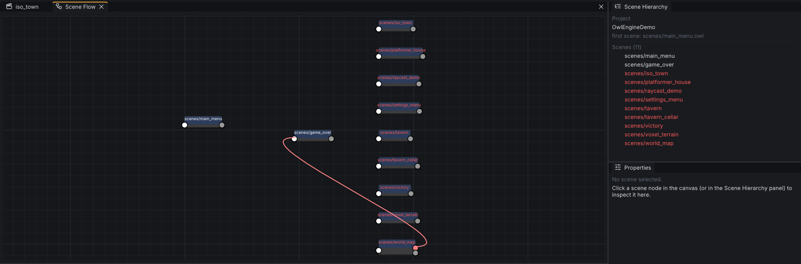

# Documents {#page-editor-documents}

[TOC]

Every file you open is a document: a tab in the centre with its own undo history, its unsaved-changes dot and, for a
scene, its own Play state. The ribbon's last tab holds the commands of the active document.

| Document   | Files                                       | Page or section                                                            |
|------------|---------------------------------------------|----------------------------------------------------------------------------|
| Scene      | `.owl`                                      | [Viewport](editor_viewport.md), [Hierarchy and inspector](editor_scene.md) |
| Prefab     | `.owlprefab`                                | [Prefabs](editor_scene.md#prefabs)                                         |
| HUD        | `.owlhud`                                   | [HUD editor](editor_hud.md)                                                |
| Tilemap    | `.owltilemap`                               | [Tilemaps and tilesets](editor_tilemaps.md)                                |
| Tileset    | `.owltileset`                               | [Tilemaps and tilesets](editor_tilemaps.md)                                |
| Code       | `.lua`, `.slang`, `.py`, `.json`, `.yml`... | [Code and text](#code-and-text)                                            |
| Node graph | `.owlflow`, the Scene Flow                  | [Scene Flow and node graphs](#scene-flow-and-node-graphs)                  |
| Animation  | `.owlanim`                                  | [Animation clips](#animation-clips)                                        |
| Material   | `.owlmat`                                   | [Materials](#materials)                                                    |
| Image      | `.png`, `.jpg`, `.jpeg`, `.bmp`, `.tga`     | [Image viewer](#image-viewer)                                              |
| Mesh       | `.gltf`, `.glb`, `.obj`                     | [Mesh viewer](#mesh-viewer)                                                |
| Font       | `.ttf`, `.otf`, `.owlfont`                  | [Fonts](#fonts)                                                            |
| Action map | `input_actions.yml`                         | [Input actions](#editor-action-map)                                        |

- `Ctrl+S` saves the active document, `Ctrl+W` closes it (save, discard or cancel when it has changes), `Ctrl+Tab`
  and `Ctrl+Shift+Tab` go to the next and previous tab.
- A tab's context menu: **Save**, **Close**, **Close Others**, **Reveal in Content Browser**, **Copy Path**.
- One scene plays at a time; a scene left while playing keeps running without being drawn, its tab shows its state.
- **Home > Create > New** starts an untitled scene, HUD, animation, tilemap or tileset, written by its first Save.

## Code and text

Text files open in a code editor with syntax colours for Lua, C, C++, Python, YAML, JSON, Markdown, XML / SVG and
Slang. The footer gives the language, the cursor line and column and the insert mode. A Slang shader is checked
when the engine loads it: its errors show in the Log.

Markdown and SVG documents split into the source and a live preview, with a draggable splitter; **Text > Preview**
hides the preview. The Markdown preview is the renderer of this help: headings, tables, lists, code, images and
links (web links open in your browser).

## Scene Flow and node graphs

**Home > Project > Scene Flow** shows every scene of the project as a node, each Teleport trigger wired to the scene
it leads to; a scene the first scene cannot reach has a red title. A double-click opens the scene.

A node graph pans with the middle button, zooms with the wheel, moves nodes by drag; its context menu deletes the
node or fits the view. More in [Node graph](node_graph.md).

## Animation clips

An `.owlanim` is a reusable sprite-sheet clip. Its document has a **Preview** (the current frame, Previous /
Play-Pause / Stop / Next), the **Spritesheet** (texture, columns, rows; **Show Current Frame** outlines it), the
**Playback** (first and last frame, frame duration, loop), the **Speed Curve** and a **Timeline**: drag its handles
to move the first and last frames, click the ruler to scrub (it pauses). The **Animation** ribbon tab repeats the
playback buttons.

## Materials

An `.owlmat` is a material for meshes. Open one with a double-click, **New Material** in the Content Browser, or the
open button of a mesh slot.

- **Parameters**, in sections: **Surface** (shading model `Standard`, `Unlit` or `Toon`, base colour, metallic,
  roughness, normal scale, occlusion strength), **Maps** (base colour, metallic, roughness, normal, occlusion,
  emissive, filled by drops from the Content Browser, with the channel to read), **Emission**, **Layers**
  (clearcoat, sheen, anisotropy), **Toon** (bands, rim) and **Alpha** (mode, cutoff, double-sided).
- **Reset**: the ↺ left of a field restores its default; **Reset all** does it for every field. **Use the occlusion
  map as ARM** reads metallic and roughness from the same image.
- **Parent**: drop another `.owlmat` to make this one an instance of it; a box per field says whether the instance
  overrides it, the others follow the parent.
- **Preview**: a sphere or a cube drawn with the material; drag to orbit, wheel to zoom, double-click to reset.
- **Save** updates every entity using the material, in every open scene.

## Image viewer

A read-only tab: the wheel zooms around the cursor (5 % to 3200 %), a left or middle drag pans, **Fit** (`F`,
double-click) and **1:1** (`1`). A checkerboard shows behind transparent pixels and a pixel grid from 800 %; the
status line gives the zoom, the size and the pixel under the cursor. The **Image** panel gives size, channels, file
size and the tilesets that use the image; pick one to draw its tile grid with the index of the hovered tile.

## Mesh viewer

A read-only tab, opened by **Open** in the context menu of a mesh or the **Mesh** field of the inspector: drag to
orbit, wheel to zoom, double-click to reset; **Mesh View** shows the material or plain grey, **Place in Scene** adds
the mesh to the active scene. The **Mesh** panel gives vertex and triangle counts, bounds, base colour and texture.

## Fonts

A font opens on **Samples** (an editable text at 12 to 64 px, drawn by the engine, with **Outline** and **Box**) and
its **Atlas** (hover a glyph for its code point and Unicode block). The **Font Charset** panel lists the default
Latin set, its coverage per Unicode block and the **extra ranges**: **+** adds a block (Greek, Cyrillic, arrows,
box drawing...) or a custom range, each range edits its first and last code point, `Delete` removes the selected
ones. **Save** writes the `.owlfont` beside the font and rebuilds the atlas.

## Input actions {#editor-action-map}

`input_actions.yml` is the action map of the project: what the game reads as `jump` or `move`, whatever the key or
pad. Open it from the Content Browser, **Home > Project > Input Actions** or **Edit Input Actions** in the Project
Settings; without the file the document starts from the built-in actions and the first save creates it. The format
is in [Actions](event_input.md#actions).

- **Left list**: the actions with a live bar; **+** adds one, the trash removes it, the circular arrow restores the
  built-in ones; a built-in action missing from the file shows dimmed, **+** copies it in.
- **Details**: **Name** (applied on `Enter`), **Kind** (`Button`, `Axis`, `Vector`), the **Live reading** and the
  **Bindings** (source, key or button, pad slot, `-1` for any, vector component, scale; for an axis or a stick, dead
  zone, curve and exponent).
- **Add by pressing an input** binds the next key, button or axis you push (a `Vector` takes a whole stick); a
  binding's key button rebinds it; `Esc` cancels.
- The live reading uses the real devices, in Edit and in Play, before you save. **Save** applies the map to the
  editor and to a running Play from the next frame.
