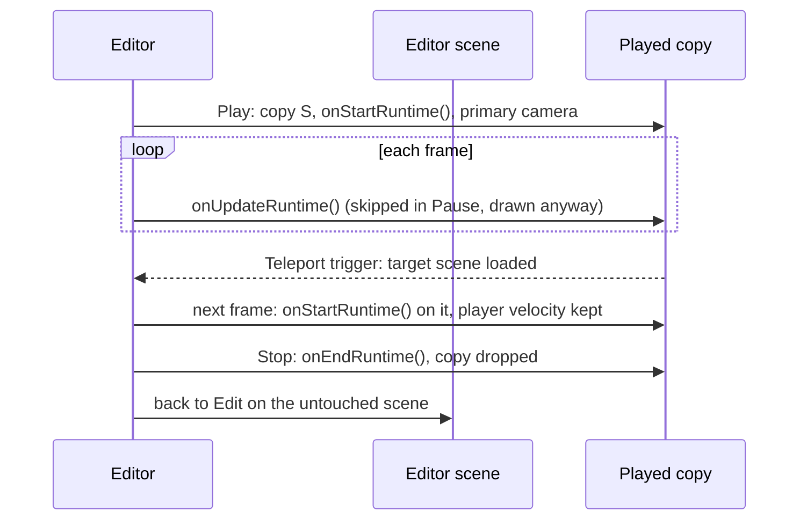
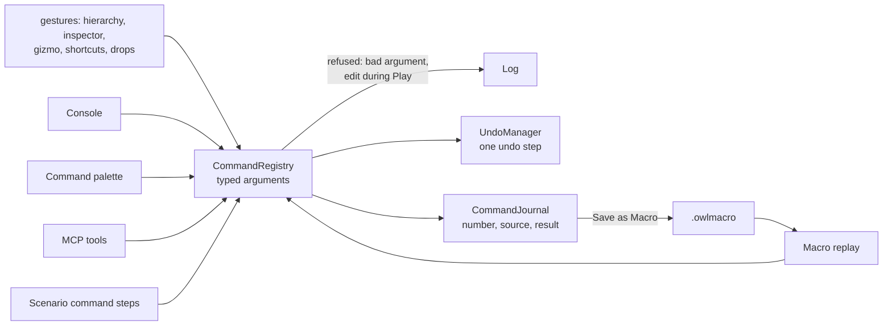

# Owl Nest Internals {#page-editor-internals}

[TOC]

How Owl Nest is built, for those who change it. The user side of each part is in the editor pages
([The Owl Nest window](editor.md) and the pages after it). Sources: `source/owlnest/sources/`; the rules every panel
follows are in the [Owl Nest style guide](design/nest-style-guide.md).

| Executable  | Purpose                                                                 |
|-------------|-------------------------------------------------------------------------|
| `OwlNest`   | The editor: docking UI, gizmos, project tools, export                   |
| `OwlRunner` | The game runner: plays a packed or unpacked project, scenarios, benches |

## Structure

`EditorLayer` only routes: the ribbon is `RibbonBuilder` (on `gui::widgets::Ribbon`, plugged into the dockspace by
`UiLayer::setTopBarCallback`), the File screen `panel::Backstage`, packaging `GamePackager`, project and asset
opening `EditorLayerProject.cpp` (extension table `classifyAsset`), the dock layout `DockLayout` (presets, a
`layoutVersion` that rebuilds the default layout once after it changes). A `DocumentManager` holds the documents
(`document/`: `SceneDocument`, `CodeEditorDocument`, `NodeGraphDocument`, `SceneFlowDocument`, `AnimationDocument`,
`TilemapDocument`, `TilesetDocument`, `FontDocument`, `ImageDocument`, `MeshDocument`, `MaterialDocument`,
`ActionMapDocument`, `HudDocument`); each scene document owns its viewport window, undo stack and play state.

The viewport draws into an off-screen `Framebuffer`: attachment 0 is the colour, attachment 1 (`RedInteger`) the
entity id every layer writes, read under the mouse for picking.

## Edit and Play



## Commands, undo and journal

Every discrete change of a scene is a named command of `commands::CommandRegistry` (the commands library, also
linked by the runner), run through the scene's `UndoManager`, whoever asks for it:



- Arguments: bool, integer, number, text, entity (a UUID or a tag, first match), `Vec2` / `Vec3` / `Vec4`, `Color`
  and `Enum`, each with an optional default. A command returns its undo description and structured data.
- A live-previewed edit (voxel brush, tile painting, node moves) becomes one command when the gesture ends. An
  inspector field (`panel::InspectorEditTracker`) or a gizmo drag puts the entity back as it was and runs
  `component.set` (`replace=true`) or `entity.set_transform` with the final values; nothing is serialized while the
  panel is only drawn.
- `CommandRegistry::setJournal` binds the session's `commands::CommandJournal`: every command is recorded with its
  `CommandContext::source` and its result, numbered from 1 per session. `commands::parseCommandLine` and
  `printCommandLine` read and write the [command line](editor_console.md#command-line); `commands::Macro` replays a
  `.owlmacro` as one undo group.
- The dirty flag compares the undo state with the saved one; `refreshWindowTitle()` shows it.

## Editor session

`session::EditorSession` (`sources/session/`) is what tools drive: the scene and its file, its undo history, the
command registry, bounded plays, captures, statistics and the journal; `replay` runs a macro as one undo step
(refused during Play), and `session::Console` is the console without UI.

- `EditorLayer`, on the active scene document: a bounded play runs over the next frames of the main loop at its
  fixed step, then stops or pauses; the capture reads the viewport back.
- `HeadlessSession` (tests, tools): no window nor ImGui; loads a scene with its project, plays synchronously
  offscreen with the Null input. On the Null renderer a capture is blank and scene transitions are not followed.

A `PlayRequest` gives `frames` and / or `ticks` (first bound wins), `timestepMs`, held `keys`, `mouseButtons` and
`gamepad`, `stopAtEnd` and `capture`; its `PlayReport` holds frames and ticks played, CPU time, draw calls, phase
timings, entity count and the optional capture.

## MCP server {#editor-mcp-server}

`mcp::McpServer` (`sources/mcp/`) serves the editor session over MCP Streamable HTTP at
`http://127.0.0.1:<port>/mcp`. Every tool is an editor command, journaled with the MCP source and undoable. Client
setup and tools: [MCP server](mcp.md); design: [MCP server design](design/mcp-server.md).

- **Main thread only.** Server threads check and queue (`McpHttpServer`); the editor loop runs up to 8 queued
  messages per frame, before the scene updates, unless a gesture, popup or modal is in progress; after 30 s unrun the
  client gets `-32001`. Stopping answers the queued messages with 503.
- **Token.** 256 bits from the system generator, drawn at the first start, in a `0600` file
  (`$XDG_RUNTIME_DIR/owlnest/mcp_token`, else `~/.config/owlnest/`, `%LOCALAPPDATA%\OwlNest` on Windows), removed
  when the server stops, never logged.
- **Refusals** are checked before the body is read: another `Mcp-Session-Id` gets 404, an unsupported
  `MCP-Protocol-Version` 400, `GET` and `DELETE` 405. A file argument (`ArgSpec::projectPath`) is resolved in the
  project, links followed, refused outside it.
- **`play.run`** is not a command: it resolves held actions (`session::resolveActionHolds`) and plays over the next
  frames, so the dispatcher answers later (`handleDeferrable`); a stopped server or a play over 10 minutes cancels it.

## Scripted headless runs (`--scenario`)

`OwlRunner --scenario <file.owltest>` loads a scene straight from a source project (Null window, renderer, sound and
input) and plays steps that inject inputs and check the world, at a fixed time step. Asynchronous work is finished
before every frame, so a scenario counts frames, not seconds, and gives the same result on any machine. It exits
with 0 when every expectation holds and no error was logged, 1 otherwise, 2 on a file it cannot read. A watchdog
ends a run that plays no frame for 120 s (times `OWL_SCRIPT_TIME_SCALE`), or that does not exit as long after its
verdict, with code 7 and the phase, step and frame where it stalled. In `test/unit/scenarios/`, a first line `# slow`
labels the scenario `slow`: it runs in the nightly suite only.

```yaml
# test/unit/scenarios/platformer_walk.owltest
scene: ../../engine_demo/scenes/platformer_house.owl   # relative to the file; project found above it
timestep_ms: 16.667                                       # optional
# project: ../../engine_demo                              # optional: the project, when the scene is a test fixture
# assets: assets                                          # optional: extra asset folder(s) of the fixture
steps:
  - frames: 30                                            # play 30 frames, no input
  - input: {key: Right, frames: 20}                       # hold keys (or `keys: [...]`, `mouse: Left`,
                                                          # `mouse_pos: [x, y]`) for 20 frames
  - expect: {player: true, translation.x: {greater: 5.0}}
  - expect: {entity: GameOverTitle, exists: false}
  - expect: {gamestate: health, equals: 1}
```

| Step      | Keys                                                                                          |
|-----------|-----------------------------------------------------------------------------------------------|
| `frames`  | Number of frames to play                                                                      |
| `input`   | `key` / `keys` (`A`..`Z`, `D0`..`D9`, `Space`, `Enter`, `Escape`, `Tab`, arrows, `LeftShift`, |
|           | `LeftControl` or a key code), `mouse` (`Left`, `Right`, `Middle`), `mouse_pos`, `frames` (1), |
|           | `gamepad`: `{pad: 0, button: A, buttons: [...], left_x: 1.0}` (buttons `A`, `B`, `X`, `Y`,    |
|           | `LeftBumper`, `RightBumper`, `Back`, `Start`, `Guide`, `LeftThumb`, `RightThumb`, `DpadUp`,   |
|           | `DpadRight`, `DpadDown`, `DpadLeft`; axes `left_x`, `left_y`, `right_x`, `right_y`,           |
|           | `left_trigger`, `right_trigger`): a connected pad in that slot                                |
| `actions` | Hold actions of the project map (`input_actions.yml`, built-in ones otherwise) by name:       |
|           | `{frames: 10, jump: true, move: [1, 0], zoom: 0.5}`: a button is `true`, an axis a number,    |
|           | a vector `[x, y]`; the first binding that can produce the value is injected (gamepad axes     |
|           | with the inverse of their dead zone and curve); `frames` defaults to 1                        |
| `expect`  | `entity: <tag>` or `player: true` with fields `translation.*`, `rotation.z`, `scale.*`,       |
|           | `exists`; or `gamestate: <key>`. Each check is a value or `equals` / `greater` / `less`,      |
|           | `tolerance` for a numeric `equals`                                                            |
| `command` | An editor command by name, its arguments under `args`:                                        |
|           | `{command: entity.delete, args: {entity: Crate}}`; a vector or a colour is a list of numbers, |
|           | a text argument may be a map (`component.set` values)                                         |
| `macro`   | A `.owlmacro` file (relative to the scenario) replayed as one undo step                       |
| `undo`    | Number of commands to undo                                                                    |
| `redo`    | Number of commands to redo                                                                    |

- Inputs go through the input layer's injection (`input::Input::injectKey`, …), on any window back-end: a key held
  over two consecutive `input` steps stays held (`test/unit/scenarios/platformer_jump.owltest`); a `gamepad` drives a
  pad on the Null back-end (`test/unit/scenarios/platformer_gamepad.owltest`).
- An `actions` step resolves its names against the action map when the file is read, so it survives a rebinding
  (`test/unit/scenarios/platformer_actions.owltest`).
- Commands run on the playing scene with an undo history of their own (`test/unit/scenarios/editor_commands.owltest`,
  macros in `test/unit/scenarios/editor_macro.owltest`). Every `test/unit/scenarios/*.owltest` is a CTest case
  (label `scenario`).

## Theme, fonts and widgets

- A theme is a few tokens (`gui::Theme`: surfaces, input well, lines, text levels, the amber accent, the play blue,
  status and axis colours) from which `UiLayer::setTheme` derives every ImGui colour; `IconBank::rebuild` re-tints
  the SVG icons (`#ffffff` the text colour, `#ff00ff` the accent).
- Text roles (`gui::TextStyle`) are pushed with `UiLayer::pushTextStyle` / `popTextStyle`; the font sizes are read
  by `main.cpp` before the `Application` exists and applied when `UiLayer::onAttach` builds the atlas.
- Dialog buttons are `gui::widgets::button`, glyph-only ones `gui::widgets::iconButton`, menus
  `gui::widgets::menuItem` and `menuHeader`; inspector asset fields `gui::widgets::assetDropTarget`.
- The code editor is imgui_color_text_edit from a local Conan recipe; the Markdown preview parses with md4c into
  typed blocks (`MarkdownDocument.h`) drawn as ImGui calls, SVG through lunasvg.
- Shortcuts are actions of the `ActionRegistry` (defaults, current bindings, overrides saved as
  `keybindingOverrides`, `setSuspended` during a key capture).

## Help bundle

`doc/help.yml` lists the help pages by group in sidebar order. At configure time `cmake/HelpAssets.cmake` copies them
flat into `<build>/help_bundle/` with an `index.yml` (id, title, group, path), strips the Doxygen syntax, rewrites the
image paths, renders the mermaid fences to `images/mermaid/<sha>.svg` (`tools/doc/mermaid_svg.py`: flowchart,
sequence, state and class diagrams; another kind fails the configure), turns links to pages outside the bundle into
text and status badges into `` images, drawn as coloured tags (`tools/doc/help_bundle.py`). The
heading anchors (`{#id}`) stay: `codeEditor::MarkdownDocument` takes them, or the GitHub slug of the heading, as the
link targets of the headings. Every `doc/pages/*.md` must be listed; the design pages
never are. Both CPack components install the bundle as `assets/help/`.

`panel::HelpPanel` reads the bundle of its build tree first (`OWL_HELP_BUILD_DIR`), then `help/` in the asset
directories, so a development build never shows another copy. The first page of the index is the start page. Links
to `.md` pages navigate inside the panel, to the top of the page or to the heading of their `#anchor`
(`HelpPanel::parseLink`, `MarkdownPreview::scrollToAnchor`); `http(s)://` and `mailto:` links open in the browser
(`platform::openExternalUrl`). The history keeps the scroll position of each page left, restored by Back and Forward.
A test follows every link of the bundle to its page and heading. Doxygen builds the same tree from `doc/help.yml` (`tools/doc/fix_md_links.py`).
