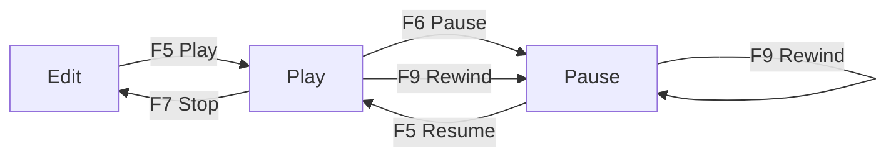
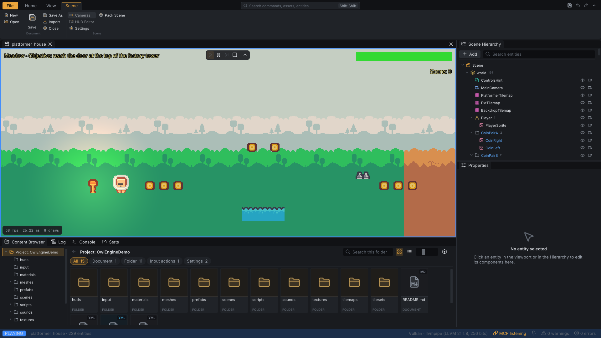

# Play Mode {#page-editor-play}

[TOC]

**Level:** Beginner. **Read first:** [The Owl Nest window](editor.md).

**Play** runs the active scene inside the editor: scripts, physics, sound, HUD and scene transitions, as the exported
game does. It plays a copy: **Stop** gives back the scene exactly as it was before Play.

## Controls

| Control | Key        | Ribbon / overlay                           | Effect                                                  |
|---------|------------|--------------------------------------------|---------------------------------------------------------|
| Play    | `F5`       | Play button over the viewport              | Start, or resume a paused scene                         |
| Pause   | `F6`       | Pause button                               | Freeze the simulation, keep drawing                     |
| Step    | `F8`       | Step button (paused)                       | Run one tick, then pause again                          |
| Stop    | `F7`       | Stop button                                | End Play, back to the scene as it was                   |
| Record  | `Shift+F5` | Record button (left of Play, editing only) | Write the next Plays to a `.owlreplay` (toggle)         |
| Rewind  | `F9`       | Timeline slider (playing or paused)        | Go back one second; drag the timeline to any frame      |
| Fold    | `F10`      | Chevron of the Play controls               | Fold the controls into a handle in the top-right corner |

## What changes while playing

- The status bar shows `PLAYING` or `PAUSED` in the play colour and a frame of that colour outlines the viewport; a
  "Playing" / "Paused" message fades after two seconds.
- The game camera replaces the editor camera; the gizmo, the view overlays and the scene markers hide.
- Edits that change the scene are refused while it plays (the console says *refused during Play*); the inspector
  shows the live values.
- Mouse and keys go to the game while the viewport is hovered. A click that starts on an overlay or another panel
  never reaches the game; a drag started in the game survives leaving the viewport.
- A Teleport trigger loads its target scene in place, the player keeping its speed; Stop comes back to the scene you
  played from.
- One scene plays at a time. Switching to another tab keeps the played scene running, undrawn; its tab shows its
  state and its controls come back when you return.

## Replays {#replays}

- **Record** (`scene.record`, a circle-dot glyph, highlighted when armed) arms the recording: every Play then records each
  frame until Record is toggled off; **Stop**
  writes `<project>/replays/<scene>-<YYYYMMDD-HHMMSS>.owlreplay` and shows a toast.
- A `.owlreplay` double-clicked (or **Open**) in the Content Browser opens its scene and plays it with the recorded
  inputs; its context menu has **Edit as Text**.
- The Play controls show `REC` while recording, then `Replay n / m`, `Replay diverged at frame n` when the world
  differs from the recording, and `Replay done, live input` once the recorded frames are over.
- A replay needs the project it was recorded in; only the first scene of a session is recorded
  ([design](design/simulation-networking.md#simulation-replay)).

## Rewind {#rewind}

- Every Play keeps its inputs in memory: the **timeline** slider beside the Play controls shows the frame reached and
  the seconds played. Dragging it, or `F9` (`scene.rewind`, one second back), seeks that frame and pauses there.
- A seek simulates the frames again with the recorded inputs, from a fresh copy of the scene when it goes back: the
  world is the one of that frame, bit for bit. The controls show `Rewinding n / m` while it runs, silent, a slice
  of each editor frame; its cost grows with the frames simulated again.
- **Play** or **Step** goes on live from the frame reached and drops the frames after it; **Stop** after a seek
  keeps the whole timeline. With **Record** armed, Stop writes the session as it ends up.
- A played `.owlreplay` and the scenes reached by a level transition are not rewound: the timeline covers the first
  scene of the Play ([design](design/simulation-networking.md#simulation-rewind)).

## Before you play

- The renderer stack, the HUD and the physics settings of the scene are read when Play starts; the tick rate comes
  from the [Project Settings](editor_projects.md#project-settings).
- Scripts and textures reload while playing ([hot reload](editor_assets.md#editor-hot-reload)); colliders do not.
- Errors of scripts and scenes go to the Log with the file, the entity and a `Fix:` hint
  ([Log](editor_console.md#log)).
