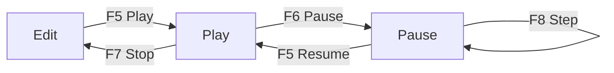

# Play Mode {#page-editor-play}

[TOC]

**Play** runs the active scene inside the editor: scripts, physics, sound, HUD and scene transitions, as the exported
game does. It plays a copy: **Stop** gives back the scene exactly as it was before Play.

## Controls

| Control | Key   | Ribbon / overlay              | Effect                                                  |
|---------|-------|-------------------------------|---------------------------------------------------------|
| Play    | `F5`  | Play button over the viewport | Start, or resume a paused scene                         |
| Pause   | `F6`  | Pause button                  | Freeze the simulation, keep drawing                     |
| Step    | `F8`  | Step button (paused)          | Run one tick, then pause again                          |
| Stop    | `F7`  | Stop button                   | End Play, back to the scene as it was                   |
| Fold    | `F10` | Chevron of the Play controls  | Fold the controls into a handle in the top-right corner |

## What changes while playing

- The status bar shows `PLAYING` or `PAUSED` in the play colour and a frame of that colour outlines the viewport; a
  "Playing" / "Paused" message fades after two seconds.
- The game camera replaces the editor camera; the gizmo, the view overlays and the scene markers hide.
- Edits that change the scene are refused while it plays (the console says *refused during Play*); the inspector
  shows the live values.
- Mouse and keys go to the game while the viewport is hovered. A click that starts on an overlay or another panel
  never reaches the game; a drag started in the game survives leaving the viewport.
- A Teleport trigger loads its target scene in place, the player keeping its speed; Stop comes back to the scene you
  played from.
- One scene plays at a time. Switching to another tab keeps the played scene running, undrawn; its tab shows its
  state and its controls come back when you return.

## Before you play

- The renderer stack, the HUD and the physics settings of the scene are read when Play starts; the tick rate comes
  from the [Project Settings](editor_projects.md#project-settings).
- Scripts and textures reload while playing ([hot reload](editor_assets.md#editor-hot-reload)); colliders do not.
- Errors of scripts and scenes go to the Log with the file, the entity and a `Fix:` hint
  ([Log](editor_console.md#log)).
