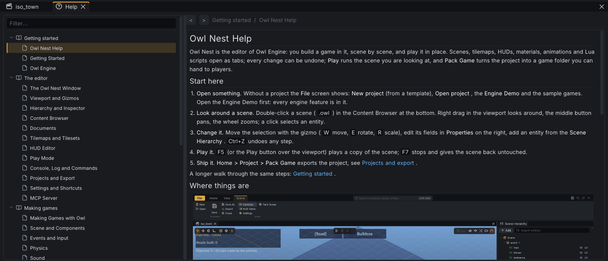

# Settings and Shortcuts {#page-editor-settings}

[TOC]

**View > Settings > Editor** (or **Editor settings** in the File screen) opens the editor settings, one tab per
topic; each row has a reset button once it differs from its default. They are saved in `OwlNest_settings.yml`, with
the recent projects and their sessions, in the `user/` folder beside Owl Nest
([user directory](architecture.md#architecture-user-directory)). **Import settings...** in the File screen, also offered
at the first start, takes them from the folder of a previous version and applies them at the next start.

## Editor settings

| Tab        | Settings                                                                                                                               |
|------------|----------------------------------------------------------------------------------------------------------------------------------------|
| General    | Stats panel, text size (75 to 150 %, at once), UI and code font sizes (next start), autosave interval, frame pacing (below)            |
| Gizmo Snap | Snap to grid, snap step, step from tilemap and its cell multiplier, rotation step ([snapping](editor_viewport.md#gizmos-and-snapping)) |
| Camera     | Orbit, pan and zoom speeds (10 to 300 %), invert vertical, dead zone                                                                   |
| Appearance | Theme: **Owl Dark** or **Owl Light**, applied at once (also **View > Appearance**)                                                     |
| Shortcuts  | Every action and its key ([below](#rebinding))                                                                                         |
| MCP Server | Enabled (off by default), port (47800), status, endpoint and token file (a click copies), **Regenerate Token**                         |

The frame pacing settings of **General** spare the GPU:

- **Frame Rate Limit**: most frames per second while the editor has the focus; 0 (the default) follows the display.
- **Background Frame Rate**: the limit while another window has the focus, 15 by default (0 keeps the first one);
  a detached panel counts as the editor, and a play driven from MCP is never slowed down.
- **Idle Wait**: while every scene is in Edit and nothing is held, shown as a notification or loading, the editor
  waits up to this long for an input before drawing again (250 ms by default, 0 draws every frame).

**View > Settings > Engine** (**Engine parameters** in the File screen) holds the engine's own options: window,
graphics and sound backends, **Low-Latency Present** (Vulkan MAILBOX: a lower input latency, but the GPU draws as
many frames as it can), debug options such as hot reload. They are written to the `config.yml` of the user
directory and apply at the next start.

## Shortcuts

The factory keys; every one can change in **Settings > Shortcuts**.

| Action                                         | Key                            |
|------------------------------------------------|--------------------------------|
| New Scene                                      | `Ctrl+N`                       |
| Open Scene                                     | `Ctrl+O`                       |
| Save Document                                  | `Ctrl+S`                       |
| Save Scene As                                  | `Ctrl+Shift+S`                 |
| Close Document                                 | `Ctrl+W`                       |
| Next / Previous Document                       | `Ctrl+Tab` / `Ctrl+Shift+Tab`  |
| Undo                                           | `Ctrl+Z`                       |
| Redo                                           | `Ctrl+Y`                       |
| Duplicate Entity                               | `Ctrl+D`                       |
| Delete Entity                                  | `Delete`                       |
| Gizmo: None / Translate / Rotate / Scale / All | `Q` / `W` / `E` / `R` / `T`    |
| Play / Resume                                  | `F5`                           |
| Pause                                          | `F6`                           |
| Stop                                           | `F7`                           |
| Step Frame                                     | `F8`                           |
| Fold Play Controls                             | `F10`                          |
| Help                                           | `F1`                           |
| Collapse / Expand the Ribbon                   | `Ctrl+F1`                      |
| Command Palette                                | `Shift`, `Shift`               |
| Console                                        | `Ctrl+`&#96;                   |
| Layout: Default                                | `Alt+1`                        |
| Layout: Hierarchy Left                         | `Alt+2`                        |
| Frame Selection                                | `F`                            |
| Camera: Frame Scene                            | `Shift+F`                      |
| Camera: Reset View                             | `Home`                         |
| Text Size: Larger / Smaller / Reset            | `Ctrl+=` / `Ctrl+-` / `Ctrl+0` |

Without a factory key, reachable from the command palette and bindable: the axis views, **Camera: Selected
Viewpoint**, **Camera: Pilot Selected Camera**, **Toggle 2D / 3D View**, **Reset Layout**. The gizmo letters act
while the viewport is hovered and nothing is being dragged; `Shift` twice opens the palette outside a text field only.

## Rebinding

In **Settings > Shortcuts**, click the key of an action and press the new combination. A key already used shows a
warning naming the other action; **Reset All to Defaults** restores the factory keys. Only the changed keys are saved.

## Help

`F1`, **View > Panels > Help** or **Help** in the File screen opens this help; over a component of the inspector `F1`
opens the page of that component. The help pages ship with the editor: they need no network.

The sidebar groups the pages by theme, in reading order; the filter keeps the titles holding what you type. Links
between pages, in the accent colour, stay in the panel and open the page at its top or at the heading they name; web
links, in blue with an arrow, open in the browser; a hovered link is underlined. The back and forward arrows of the
toolbar, the mouse side buttons and `Alt+Left` / `Alt+Right` go through the pages read, each back where you left it;
the house returns to the start page. An image shown smaller than its size opens larger on a click, and the status of
a roadmap item shows as a coloured tag.
