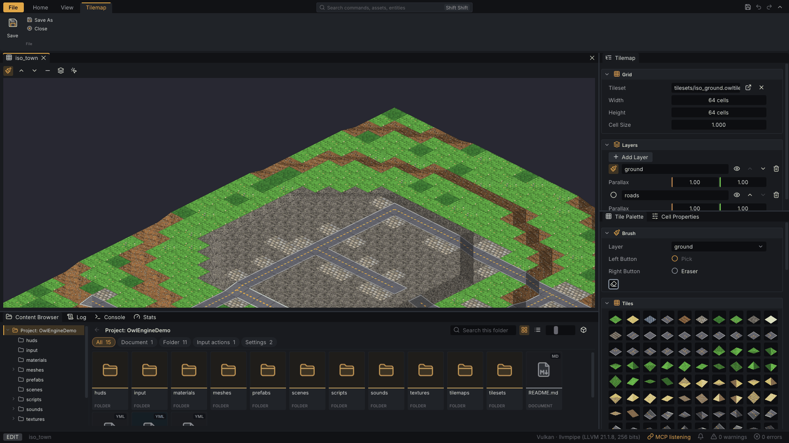

# Tilemaps and Tilesets {#page-editor-tilemaps}

[TOC]

A **tileset** (`.owltileset`) cuts a texture into tiles; a **tilemap** (`.owltilemap`) is a grid of layers painted
with the tiles of one tileset. A scene shows a tilemap through a Tilemap component; **Open in Tilemap Editor** in the
Scene Hierarchy menu opens its file.

## Tilemap editor

- The left button paints the tile picked in the **Tile Palette** into the active layer, the right button erases.
- The Scene Hierarchy column holds the tileset, the grid (cell size, rows, columns) and the layers: add, rename,
  move up or down, show or hide, delete, and their parallax.
- Properties shows the clicked cell: its tile, its overlay and its flags (passable...).
- A stroke or a cell edit is one undo step. Resizing the grid keeps the cells: shrinking then growing back loses
  nothing.

### Isometric tilemaps

With an isometric tileset the canvas is an isometric preview (middle drag pans, wheel zooms) with slopes, foundations
and overlays, and a toolbar picks the tool:

| Tool        | Effect                                                                                                    |
|-------------|-----------------------------------------------------------------------------------------------------------|
| **Paint**   | Tile Palette brushes on the cell under the cursor, picked on the sloped surface                           |
| **Raise**   | Raise the nearest corner, or an area of 1 to 16 corners, by one step (right button: lower)                |
| **Lower**   | The opposite of Raise                                                                                     |
| **Level**   | Bring the area to the level height (Ctrl + click reads a corner)                                          |
| **Overlay** | Paint the overlay (tracks, roads) of the active layer; right button clears                                |
| **Node**    | Select corners (Shift adds or removes), drag up / down or **+** / **-** to move them one step per `zStep` |

Neighbouring corners follow, so every cell keeps one of the 19 slopes; a click, a drag or a key press is one undo
step. The cell properties show the slope and edit the four corner heights with the same rule. A flat tilemap has no
heights and no Node tool.

## Tileset editor

- **Atlas**: the texture, the grid, the tile size, the filter and the **Kind**: `Orthogonal` square tiles or
  `Isometric` 2:1 diamonds. A voxel tileset also takes its normal and roughness maps here.
- Click a tile to edit it in Properties: its flags and, for a road network, its **Navigation** (the sides it joins,
  four arrows as on screen; see [Pathfinding](pathfinding.md)).
- An isometric tileset adds **Slopes**: per terrain or overlay, the tile of each of the 19 slopes and its foundation
  (`-1` uses the flat tile).

Every edit is one undo step. A saved tileset or tilemap reloads in the scenes that use it, even while they play.
