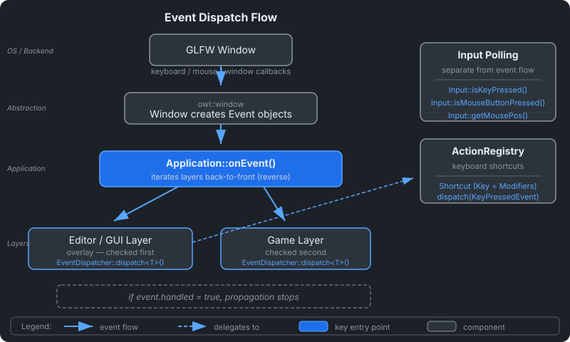

# Event and Input System {#page-event-input}

[TOC]

This page covers the Owl event system, input polling, and editor keybindings.

## Overview

Owl uses a synchronous event model. GLFW callbacks generate `owl::event::Event`
objects which are dispatched through `Application::onEvent()` to the layer stack
in reverse order (overlays first, then regular layers). Each layer can mark an
event as handled to stop further propagation. In parallel, the `Input` class
provides frame-by-frame polling for key and mouse state.

## Event System



### Event Base Class

Every event derives from `owl::event::Event` (declared in `event/Event.h`):

| Method               | Return Type   | Description                                 |
|----------------------|---------------|---------------------------------------------|
| `getType()`          | `Type`        | Runtime event type enum value               |
| `getCategoryFlags()` | `uint8_t`     | Bitmask of categories this event belongs to |
| `getName()`          | `std::string` | Human-readable event name                   |
| `toString()`         | `std::string` | Detailed string for logging                 |
| `isInCategory(cat)`  | `bool`        | Test against a `Category` bitmask           |

The `handled` flag (`bool`, default `false`) is public. Set it to `true` in a
dispatch callback to prevent layers below from seeing the event.

### Event Types

The `event::Type` enum lists all 19 event types:

| Group       | Type                  | Class                      |
|-------------|-----------------------|----------------------------|
| Window      | `WindowClose`         | `WindowCloseEvent`         |
| Window      | `WindowResize`        | `WindowResizeEvent`        |
| Window      | `WindowFocus`         | (reserved)                 |
| Window      | `WindowLostFocus`     | (reserved)                 |
| Window      | `WindowMoved`         | (reserved)                 |
| Application | `AppTick`             | `AppTickEvent`             |
| Application | `AppUpdate`           | `AppUpdateEvent`           |
| Application | `AppRender`           | `AppRenderEvent`           |
| Keyboard    | `KeyPressed`          | `KeyPressedEvent`          |
| Keyboard    | `KeyReleased`         | `KeyReleasedEvent`         |
| Keyboard    | `KeyTyped`            | `KeyTypedEvent`            |
| Mouse       | `MouseButtonPressed`  | `MouseButtonPressedEvent`  |
| Mouse       | `MouseButtonReleased` | `MouseButtonReleasedEvent` |
| Mouse       | `MouseMoved`          | `MouseMovedEvent`          |
| Mouse       | `MouseScrolled`       | `MouseScrolledEvent`       |
| File        | `FileDrop`            | `FileDropEvent`            |
| Gamepad     | `GamepadConnected`    | `GamepadConnectedEvent`    |
| Gamepad     | `GamepadDisconnected` | `GamepadDisconnectedEvent` |

### Category Bitmask

Categories allow testing multiple event types at once via `isInCategory()`:

| Category      | Value | Description                   |
|---------------|-------|-------------------------------|
| `Application` | 1     | Window and application events |
| `Input`       | 2     | Any user input event          |
| `Keyboard`    | 4     | Keyboard events               |
| `Mouse`       | 8     | Mouse movement and scroll     |
| `MouseButton` | 16    | Mouse button press/release    |
| `Gamepad`     | 32    | Gamepad connection            |

A single event can belong to multiple categories. For example, `MouseButtonPressedEvent`
has flags `Input | Mouse | MouseButton` (value `2 | 8 | 16 = 26`).

## EventDispatcher

The `EventDispatcher` pattern provides type-safe event handling. Create a
dispatcher from an `Event&`, then call `dispatch<T>()` with a callback for each
event type you care about:

```c++
void EditorLayer::onEvent(event::Event& ioEvent) {
    event::EventDispatcher dispatcher(ioEvent);
    dispatcher.dispatch<event::WindowResizeEvent>(
        [this](event::WindowResizeEvent& iEvent) -> bool {
            onWindowResize(iEvent);
            return false; // allow further propagation
        });
    dispatcher.dispatch<event::KeyPressedEvent>(
        [this](event::KeyPressedEvent& iEvent) -> bool {
            return onKeyPressed(iEvent); // true = handled
        });
    dispatcher.dispatch<event::MouseScrolledEvent>(
        [this](event::MouseScrolledEvent& iEvent) -> bool {
            return onMouseScrolled(iEvent);
        });
}
```

`dispatch<T>()` compares `event.getType()` against `T::getStaticType()`. If they
match, it casts the event to `T&` and calls the callback. The return value is
OR-ed into `event.handled`.

## Event Classes

### KeyEvent (base for keyboard events)

| Method         | Return Type      | Description              |
|----------------|------------------|--------------------------|
| `getKeyCode()` | `input::KeyCode` | GLFW-compatible key code |

### KeyPressedEvent

| Method             | Return Type | Description                         |
|--------------------|-------------|-------------------------------------|
| `getRepeatCount()` | `uint16_t`  | 0 for initial press, >0 for repeats |

### KeyReleasedEvent / KeyTypedEvent

No additional accessors beyond `getKeyCode()`. `KeyTypedEvent` is emitted for
character input (distinct from physical key presses).

### MouseMovedEvent

| Method   | Return Type | Description               |
|----------|-------------|---------------------------|
| `getX()` | `float`     | Mouse X position (pixels) |
| `getY()` | `float`     | Mouse Y position (pixels) |

### MouseScrolledEvent

| Method      | Return Type | Description              |
|-------------|-------------|--------------------------|
| `getXOff()` | `float`     | Horizontal scroll offset |
| `getYOff()` | `float`     | Vertical scroll offset   |

### MouseButtonPressedEvent / MouseButtonReleasedEvent

Both inherit from `MouseButtonEvent`:

| Method             | Return Type        | Description |
|--------------------|--------------------|-------------|
| `getMouseButton()` | `input::MouseCode` | Button code |

### WindowResizeEvent

| Method        | Return Type           | Description       |
|---------------|-----------------------|-------------------|
| `getWidth()`  | `uint32_t`            | New window width  |
| `getHeight()` | `uint32_t`            | New window height |
| `getSize()`   | `const math::vec2ui&` | Width and height  |

### FileDropEvent

| Method       | Return Type                                 | Description        |
|--------------|---------------------------------------------|--------------------|
| `getPaths()` | `const std::vector<std::filesystem::path>&` | Dropped file paths |

Emitted when the user drags files from the OS file manager onto the application
window. The editor uses this to import assets.

### GamepadConnectedEvent / GamepadDisconnectedEvent

| Method             | Return Type          | Description                                  |
|--------------------|----------------------|----------------------------------------------|
| `getPad()`         | `std::size_t`        | Gamepad slot (GLFW joystick id, 0 to 15)     |
| `getGamepadName()` | `const std::string&` | Name from the mapping (connected event only) |

Emitted by the GLFW window when a joystick with a gamepad mapping is plugged in, or when any joystick is unplugged
(GLFW joystick events are global: they go to the first window still open). `Application` logs them; game code reads
the pad state instead.

## Input Polling

The `owl::input::Input` static class provides per-frame state queries,
independent of the event dispatch flow. Initialize it once with
`Input::init(windowType)` (called automatically by `Application`).

| Method                              | Return Type    | Description                          |
|-------------------------------------|----------------|--------------------------------------|
| `isKeyPressed(KeyCode)`             | `bool`         | True if the key is currently held    |
| `isMouseButtonPressed(MouseCode)`   | `bool`         | True if the mouse button is held     |
| `getMouseX()`                       | `float`        | Current mouse X position             |
| `getMouseY()`                       | `float`        | Current mouse Y position             |
| `getMousePos()`                     | `math::vec2`   | Current mouse position as a vector   |
| `readState()`                       | `InputState`   | Keys, buttons, cursor and wheel      |
| `getGamepadState(pad)`              | `GamepadState` | Gamepad connection, buttons and axes |
| `isGamepadConnected(pad)`           | `bool`         | True if a gamepad is in the slot     |
| `getGamepadName(pad)`               | `std::string`  | Gamepad name from its mapping        |
| `addGamepadMappings(text)`          | `bool`         | Add SDL_GameControllerDB mappings    |
| `loadGamepadMappings(path)`         | `bool`         | Read and add a mapping file          |
| `injectKey(KeyCode)`                | `void`         | Simulate a key toggle (for testing)  |
| `injectMouseButton(MouseCode)`      | `void`         | Simulate a mouse button toggle       |
| `injectMousePos(const math::vec2&)` | `void`         | Simulate mouse movement              |
| `injectGamepadButton(pad, button)`  | `void`         | Simulate a gamepad button toggle     |
| `injectGamepadAxis(pad, axis, v)`   | `void`         | Simulate a gamepad axis value        |
| `injectGamepad(pad, GamepadState)`  | `void`         | Replace the state of a gamepad slot  |
| `resetInjection()`                  | `void`         | Clear all injected state             |

**Type aliases:** `KeyCode` is `uint16_t` (GLFW-compatible values defined in
`input/KeyCodes.h`). `MouseCode` is `uint8_t` (values in `input/MouseCode.h`,
e.g. `mouse::ButtonLeft`, `mouse::ButtonRight`, `mouse::ButtonMiddle`).

The `inject*` and `resetInjection` methods drive the input layer itself, merged with the device state whatever the
back-end (GLFW or Null): scenarios, tests and tools simulate input with or without a real window. `init` and
`invalidate` clear them.

### Edges: input frames {#edges-input-frames}

Game code reads the scene's `input::InputFrame` (`Scene::getInputFrame()`), a plain-data pair of `InputState`
samples (previous and current) built once per simulation tick inside the ticks and once per frame elsewhere:

| Method                                 | Description                                |
|----------------------------------------|--------------------------------------------|
| `isKeyPressed(KeyCode)`                | Key held at the current sample             |
| `isKeyJustPressed(KeyCode)`            | Key went down since the previous sample    |
| `isKeyJustReleased(KeyCode)`           | Key went up since the previous sample      |
| `isMouseButtonJustPressed(MouseCode)`  | Button went down since the previous sample |
| `isMouseButtonJustReleased(MouseCode)` | Button went up since the previous sample   |
| `getCursor()` / `getCursorDelta()`     | Cursor position and motion, in pixels      |
| `getWheel()`                           | Wheel offset scrolled since the sample     |
| `isGamepadConnected(pad)`              | Gamepad connected at the current sample    |
| `isGamepadButtonPressed(pad, button)`  | Gamepad button held at the current sample  |
| `isGamepadButtonJustPressed(pad, b)`   | Gamepad button went down since the sample  |
| `isGamepadButtonJustReleased(pad, b)`  | Gamepad button went up since the sample    |
| `getGamepadAxis(pad, axis)`            | Raw axis value at the current sample       |
| `getGamepadStick(pad, stick, resp)`    | Stick through a dead zone and a curve      |

```c++
void tickDoor(scene::Scene& ioScene, const scene::SystemContext&) {
    if (ioScene.getInputFrame().isKeyJustPressed(input::key::E))
        openDoor(ioScene);   // once per press, at any frame rate
}
```

No edge is lost or doubled when a frame runs several ticks or none; the rules are in
[Windowing and input](design/windowing-input.md#input-frames-in1).

### Gamepads

`InputState::gamepads` holds 16 `GamepadState` slots (GLFW joystick ids): `connected`, 15 buttons (`input/Gamepad.h`,
Xbox names: `gamepad::A`, `B`, `X`, `Y`, bumpers, `Back`, `Start`, `Guide`, thumbs, D-pad) and 6 axes (`LeftX`,
`LeftY`, `RightX`, `RightY` in [-1, 1] with y down, `LeftTrigger` / `RightTrigger` in [0, 1]). GLFW reads them with
`glfwGetGamepadState`; a joystick without a gamepad mapping is not connected as a gamepad. Pad buttons follow the
key rules in the tick sampler (a short press is kept); axes take the last frame.

An injected slot (`injectGamepad*`) replaces the device slot on any back-end, so the Null back-end and scenarios drive
pads without hardware; an injected disconnected state hides a real pad.

**Mappings.** GLFW ships the SDL_GameControllerDB of its release. A project can add or correct mappings with an
optional file in the same format (`gamepadMappings:` in `owl_project.yml`, *Project Settings → Input*): Owl Nest
loads it when the project opens, the export packs it and names it in `runner.yml` (`GamepadMappings`), and the
runner loads it from an asset directory or the pack. GLFW keeps the added mappings until the application exits.

**Dead zone and response curve.** `input::AxisResponse` (dead zone, 0.15 by default, and a `ResponseCurve`: `Linear`,
`Quadratic`, `Cubic` or `Custom` with an exponent) is the per-binding shaping, ready for the action map bindings (IN3):

- `applyStickResponse(stick, response)`: radial dead zone on the vector length (diagonals are not clipped), then the
  length past the dead zone is rescaled to [0, 1] and raised to the curve exponent, the direction kept;
- `applyAxisResponse(value, response)`: the same on the absolute value of one axis, sign kept.

```c++
const auto& frame = ioScene.getInputFrame();
const auto move = frame.getGamepadStick(0, input::gamepad::Stick::Left,
                                        {.deadZone = 0.2f, .curve = input::ResponseCurve::Quadratic});
if (frame.isGamepadButtonJustPressed(0, input::gamepad::A))
    jump();
```

## Actions {#actions}

Gameplay reads **actions**, not keys: a name (`jump`, `move`) bound to any mix of keys, mouse buttons and gamepad
inputs. A player can rebind it, a gamepad plays the game, and a scenario holds an action by name. Three kinds:

| Kind     | Reads                                         | Lua                                                           |
|----------|-----------------------------------------------|---------------------------------------------------------------|
| `button` | On or off, with press and release edges       | `is_action_pressed`, `is_action_just_pressed`, `..._released` |
| `axis`   | One value in [-1, 1]                          | `get_action_value`                                            |
| `vector` | Two values in the unit disc (x right, y down) | `get_action_vector`                                           |

An axis or a vector also counts as held past half deflection (`input::g_actionThreshold`), so `is_action_pressed("move")`
works for a menu. A vector longer than 1 is shortened: a keyboard diagonal is not faster.

### The `input_actions.yml` file

It sits at the root of the project, is packed with the game under the same name (the runner reads it from an asset
folder or the pack) and is loaded when Owl Nest opens the project. It carries a `FormatVersion` and is written
atomically by `ActionMap::saveFile`. Without the file, or with an unreadable one (logged), the game plays with the
built-in actions.

```yaml
FormatVersion: 1
actions:
  - name: jump
    type: button                          # button (default), axis or vector
    bindings:
      - {key: Space}
      - {gamepad_button: A}
      - {gamepad_axis: right_trigger}     # a trigger counts as held past half
  - name: throttle
    type: axis
    bindings:
      - {key: W}
      - {key: S, scale: -1}
      - {gamepad_axis: left_y, scale: -1, dead_zone: 0.2, curve: quadratic}
  - name: move
    type: vector
    bindings:
      - {key: D, component: x}
      - {key: A, component: x, scale: -1}
      - {key: S, component: y}
      - {key: W, component: y, scale: -1}
      - {gamepad_stick: left, pad: 0}
```

The map is edited in Owl Nest, with a "press a key" capture and a live reading of every action: see the
[action map editor](editor.md#editor-action-map).

| Binding key                                                              | Meaning                                                                    |
|--------------------------------------------------------------------------|----------------------------------------------------------------------------|
| `key`, `mouse_button`, `gamepad_button`, `gamepad_axis`, `gamepad_stick` | The source, one per binding; names of `input/InputNames.h` or a code       |
| `pad`                                                                    | Gamepad slot; any connected gamepad when left out                          |
| `component`                                                              | `x` or `y`: the component of a `vector` a one-dimensional source feeds     |
| `scale`                                                                  | Factor on the reading (`-1` reverses it)                                   |
| `dead_zone`, `curve`, `exponent`                                         | Shaping of an axis or stick (`AxisResponse`: 0.15 and `linear` by default) |

Bindings of an action add up, then the result is clamped. A file with an unknown key, type or name, a binding without
a source or two actions of one name is refused whole, with the reason in the log.

**Built-in actions.** The engine systems read these, so they exist even without a file; a project map is completed
with them (`ActionMap::withDefaults`) and an action of the same name replaces the built-in one.

| Action                                                              | Kind     | Default bindings                         | Read by                                   |
|---------------------------------------------------------------------|----------|------------------------------------------|-------------------------------------------|
| `move`                                                              | `vector` | W A S D, left stick                      | `Player`, `VoxelPlayer`                   |
| `look`                                                              | `vector` | arrows, right stick                      | `VoxelPlayer`                             |
| `jump`                                                              | `button` | Space, gamepad A                         | `Player`, `VoxelPlayer` (double tap: fly) |
| `descend`, `sprint`                                                 | `button` | Left Shift, left bumper / left thumb     | `VoxelPlayer`                             |
| `boost`                                                             | `button` | J, gamepad Y                             | `VoxelPlayer` (super speed in fly mode)   |
| `interact`                                                          | `button` | E, gamepad X                             | Interaction triggers, doors, pushwalls    |
| `primary`, `secondary`                                              | `button` | left / right mouse, right / left trigger | `VoxelPlayer` (break, place)              |
| `ui_up`, `ui_down`, `ui_left`, `ui_right`, `ui_accept`, `ui_cancel` | `button` | arrows, Enter, Escape, D-pad, A, B       | UI navigation (HUD5)                      |

### Reading actions

`Scene::getActions()` returns an `input::ActionFrame` evaluated each time the scene's input advances: the tick frame
inside a `tick` function or `on_tick`, the frame one elsewhere, with the same edge rules as the
[input frames](#edges-input-frames). An unknown name reads as released, zero.

```c++
void tickDoor(scene::Scene& ioScene, const scene::SystemContext&) {
    const auto& actions = ioScene.getActions();
    if (actions.isJustPressed("interact"))
        openDoor(ioScene);
    const math::vec2 steer = actions.getVector("move");   // x right, y down
    steerPlayer(ioScene, steer);
}
```

The map comes from `app::EngineContext::getActionMap()` (`loadActionMap(projectFolder)`, `loadActionMapFromText` for a
pack), the built-in one for a scene without a context. Evaluation is a pure function (`input::sampleAction`,
`evaluateAction`, `ActionFrame::update`): it needs no device, so tests and replays feed it plain `InputState`s.

```lua
function on_update(dt)
    local x, y = input.get_action_vector("move")
    if input.is_action_just_pressed("jump") then jump() end
end
```

`input.has_action(name)` tells a misspelt name from a released action. The raw `input.is_key_pressed`,
`is_key_just_*`, `is_mouse_button_pressed` and `is_mouse_button_just_*` stay but are **deprecated**: they hard-code a
device that a gamepad player or a rebinding cannot reach.

## CameraOrthoController

`owl::renderer::CameraOrthoController` wraps a `CameraOrtho` with keyboard and
mouse controls suitable for 2D scene editing or gameplay:

```c++
// Create with aspect ratio; enable rotation with second parameter
renderer::CameraOrthoController controller(16.0f / 9.0f, true);

// Each frame:
controller.onUpdate(timeStep);

// Forward events:
controller.onEvent(event);
```

### Controls

| Input         | Action                                                     |
|---------------|------------------------------------------------------------|
| W / A / S / D | Translate camera up / left / down / right                  |
| Mouse scroll  | Zoom in / out (adjusts zoom level)                         |
| Q / E         | Rotate counter-clockwise / clockwise (if rotation enabled) |

### Properties

| Property           | Type    | Default | Description                          |
|--------------------|---------|---------|--------------------------------------|
| `translationSpeed` | `float` | 5.0     | Camera movement speed (units/second) |
| `rotationSpeed`    | `float` | 180.0   | Rotation speed (degrees/second)      |
| `zoomLevel`        | `float` | 1.0     | Current zoom (affects ortho bounds)  |

Translation speed scales with the current zoom level so that movement feels
consistent regardless of zoom. The controller also handles `WindowResizeEvent`
to update the camera's aspect ratio.

## Action Registry

The `ActionRegistry` (in `owl::nest`) is the editor keybinding system used by
Owl Nest. It maps `Shortcut` objects (a `KeyCode` plus `Modifiers` bitmask)
to named actions with callbacks.

### Modifiers

| Value          | Description           |
|----------------|-----------------------|
| `None`         | No modifier           |
| `Ctrl`         | Control key           |
| `Shift`        | Shift key             |
| `Alt`          | Alt key               |
| `CtrlShift`    | Control + Shift       |
| `CtrlAlt`      | Control + Alt         |
| `ShiftAlt`     | Shift + Alt           |
| `CtrlShiftAlt` | Control + Shift + Alt |

### API

| Method                                          | Description                                 |
|-------------------------------------------------|---------------------------------------------|
| `registerAction(id, displayName, shortcut, cb)` | Register an action with its default binding |
| `dispatch(KeyPressedEvent)`                     | Match event to an action and invoke it      |
| `rebind(id, newShortcut)`                       | Change an action's shortcut at runtime      |
| `findConflict(shortcut, excludeId)`             | Check if a shortcut is already in use       |
| `resetToDefaults()`                             | Restore all shortcuts to factory defaults   |
| `getShortcutString(id)`                         | Display string like "Ctrl+S"                |
| `loadOverrides(map)` / `getOverrides()`         | Persist custom bindings across sessions     |
| `setSuspended(bool)`                            | Pause dispatching during key capture UI     |

### Usage

Actions are registered during editor initialization in `EditorLayer`. The
settings panel (`SettingsPanel`) provides a UI for viewing and rebinding
shortcuts, including conflict detection.

```c++
m_actionRegistry.registerAction(
    "scene.save", "Save Scene",
    {input::key::S, Modifiers::Ctrl},
    [this]() { saveScene(); });
```

When a `KeyPressedEvent` reaches the editor layer, it is forwarded to the
registry:

```c++
auto EditorLayer::onKeyPressed(const event::KeyPressedEvent& iEvent) -> bool {
    if (iEvent.getRepeatCount() > 0)
        return false;
    return m_actionRegistry.dispatch(iEvent);
}
```

See [Architecture](architecture.md) for the overall engine structure,
[Editor](editor.md) for the Owl Nest application, and [Scene](scene.md) for
the entity-component system.
