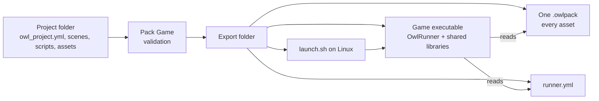
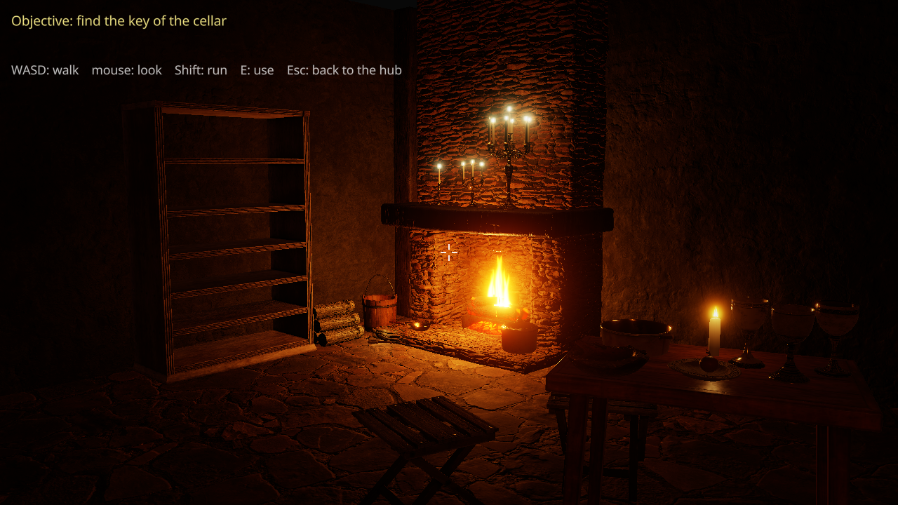
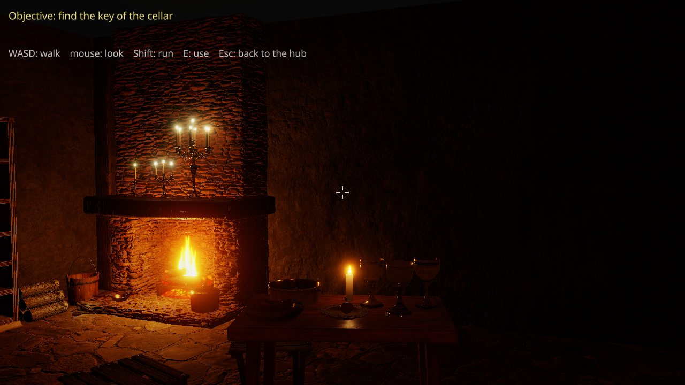
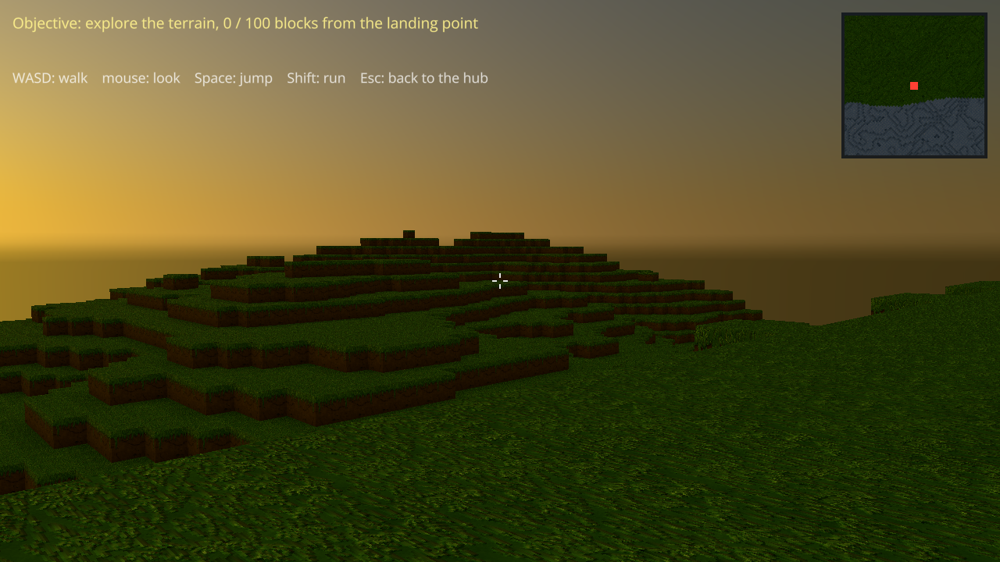
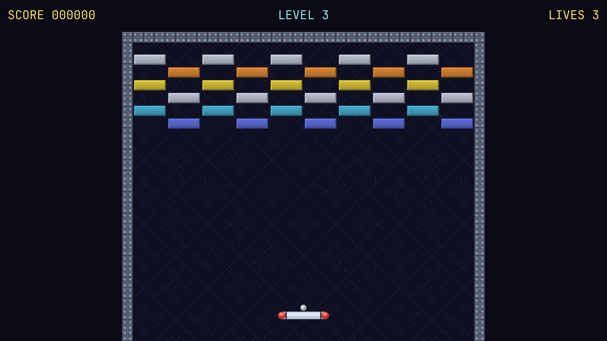
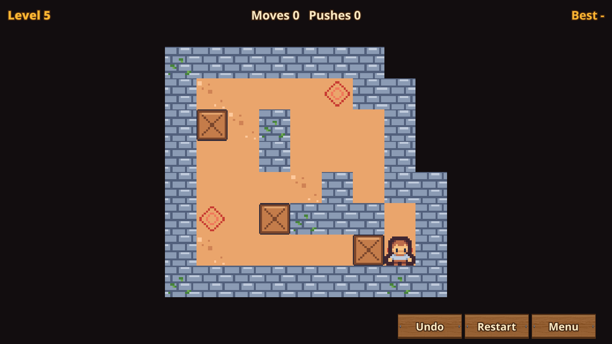
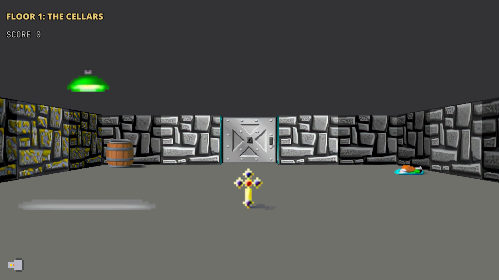

# Getting Started {#page-getting_started}

[TOC]

Welcome to **Owl Engine**, a C++23 game engine with a scene editor (Owl Nest), Lua scripting,
rendering styles mixed in one game (2D, raycast, voxel, isometric, 3D), physics, audio, packaging, and more.

This page gets Owl Nest running and a first game open. The guides are bundled with the editor, from the **Help**
ribbon button or `F1`.

## First Run

1. Launch **Owl Nest**.
2. The **File** screen opens: click **New project** to create a project from a template, or
   **Open project** to point at an existing folder containing an `owl_project.yml`.
3. The editor opens with the scene viewport, content browser, hierarchy and inspector
   docked around a central area. All panels are detachable — drag the title bar to
   tear them out into a floating window.

On Windows, the downloaded `OwlNest.exe` is not signed yet: SmartScreen may show "Windows protected your PC" at the
first start. Click **More info**, then **Run anyway** (once per downloaded version). An exported game shows the same
warning on the players' computers.

On Linux, Owl Engine runs natively under Wayland or under X11. Wayland is picked when available;
set `OWL_WINDOW_PLATFORM=x11` to use X11 instead (needed for panels torn out into separate
desktop windows, which GLFW cannot place under Wayland). See [Building](building.md).

If the graphics driver does not offer a Vulkan 1.3 device, Owl Nest and exported games start on OpenGL instead and
say so in the log (and in a toast in the editor); update the driver, or set `renderer: OpenGL` in the `config.yml` of
the `user/` folder beside the executable to skip the Vulkan attempt ([requirements](renderer.md#renderer-vulkan-requirements)).

## Shipping Your Game

**Home > Project > Pack Game** (or **Package the game** in the File screen) exports the open project to a folder you
can copy anywhere; fix the validation warnings first (a reference listed there is missing from the pack). Details in
[Projects and export](editor_projects.md#exporting-a-game).

## Engine Demo and Sample Games

Both ship next to `bin/` in the Owl Nest archive and open from the File screen:

- **Engine Demo** (`engine_demo/`, the **Engine Demo** card): the all-in-one showcase, an RPG hub leading to a
  platformer, a raycast level, an isometric town and a voxel terrain. Play any scene to see how Lua scripts, HUDs,
  sound and triggers fit together.
- **Sample games** (`samples/`, the **Sample games** list): Breakout, Sokoban, a Wolfenstein mini and a tower defence,
  small complete games of a readable size to start a project from.

|       |    |
|------------------------------------------------|----------------------------------------------------|
|  |  |

*Scenes of the Engine Demo, rendered headless by the game runner on Vulkan.*

|      |  |
|-----------------------------------------------------------------------------------|------------------------------------------------------------------------------------|
|             |    |

*The 3D world: glTF meshes with PBR materials, point lights and cascaded shadows in the tavern, and a procedural sky
driven by the day-night cycle over the voxel terrain.*

|  |  |  |
|----------------------------------------------|--------------------------------------------|---------------------------------------------------------|

|           |  |
|----------------------------------------------------------------------------------|----------------------------------------------------------------------------------------------------|

*The tower defence: the hand-inked world map between the levels, and a level in 3D with relief.*

## Where to Go Next

- Build a game: [The Owl Nest window](editor.md) and the editor pages after it, then
  [Scripting Games in Lua](scripting.md)
- Every page by audience: [game makers](guide_game_maker.md), [C++ engine developers](guide_engine_developer.md),
  [contributors](guide_contributor.md)
- Build the editor yourself: [Building from Source](building.md)
