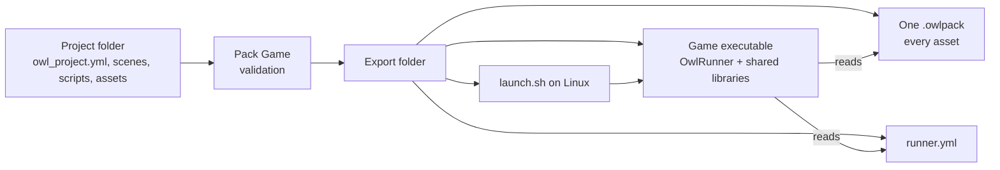

# Getting Started {#page-getting_started}

[TOC]

Welcome to **Owl Engine**, a C++23 game engine with a scene editor (Owl Nest), Lua scripting,
rendering styles mixed in one game (2D, raycast, voxel, isometric, 3D), physics, audio, packaging, and more.

This page is your entry point. It points to the in-depth guides bundled with the editor
and accessible from the **Help** ribbon button or by pressing `F1`.

## First Run

1. Launch **Owl Nest**.
2. The **File** screen opens: click **New project** to create a project from a template, or
   **Open project** to point at an existing folder containing an `owl_project.yml`.
3. The editor opens with the scene viewport, content browser, hierarchy and inspector
   docked around a central area. All panels are detachable — drag the title bar to
   tear them out into a floating window.

On Windows, the downloaded `OwlNest.exe` is not signed yet: SmartScreen may show "Windows protected your PC" at the
first start. Click **More info**, then **Run anyway** (once per downloaded version). An exported game shows the same
warning on the players' computers.

On Linux, Owl Engine runs natively under Wayland or under X11. Wayland is picked when available;
set `OWL_WINDOW_PLATFORM=x11` to use X11 instead (needed for panels torn out into separate
desktop windows, which GLFW cannot place under Wayland). See [Building](building.md).

## Where to Go Next

| Topic                             | Page                               |
|-----------------------------------|------------------------------------|
| Editor panels, ribbon, shortcuts  | [editor.md](editor.md)             |
| Scene system and components       | [scene.md](scene.md)               |
| Lua scripting (gameplay)          | [scripting.md](scripting.md)       |
| Renderers, sprites, text, tiles   | [renderer.md](renderer.md)         |
| Voxel engine (blocks, chunks)     | [voxel.md](voxel.md)               |
| Tile-graph pathfinding            | [pathfinding.md](pathfinding.md)   |
| Input actions and gamepad         | [event_input.md](event_input.md)   |
| Physics (Box2D bodies, triggers)  | [physics.md](physics.md)           |
| Sound (effects, music, listeners) | [sound.md](sound.md)               |
| Node graph editor                 | [node_graph.md](node_graph.md)     |
| Driving Owl Nest from an AI agent | [mcp.md](mcp.md)                   |
| Building from source              | [building.md](building.md)         |
| Engine architecture               | [architecture.md](architecture.md) |
| How to contribute                 | [contributing.md](contributing.md) |

## Shipping Your Game

**Home > Project > Pack Game** (or **Package the game** in the File screen) exports the open project to a folder you
can copy anywhere; fix the validation warnings first (a reference listed there is missing from the pack). Details in
[editor.md](editor.md) and [Game export](design/game-export.md).

## Useful Shortcuts

| Shortcut            | Action                     |
|---------------------|----------------------------|
| `F1`                | Open contextual help       |
| `Ctrl+Z` / `Ctrl+Y` | Undo / redo                |
| `Ctrl+S`            | Save active document       |
| `Ctrl+W`            | Close active document      |
| `Ctrl+Tab`          | Cycle to the next document |
| `F5` / `F6` / `F7`  | Play / Pause / Stop        |

## Engine Demo and sample games

Both ship next to `bin/` in the Owl Nest archive and open from the File screen:

- **Engine Demo** (`engine_demo/`, the **Engine Demo** card): the all-in-one showcase, an RPG hub leading to a
  platformer, a raycast level, an isometric town and a voxel terrain. Play any scene to see how Lua scripts, HUDs,
  sound and triggers fit together.
- **Sample games** (`samples/`, the **Sample games** list): Breakout, Sokoban and a Wolfenstein mini, small complete
  games of a readable size to start a project from.

