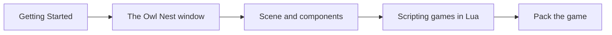

# Making Games with Owl {#page-guide-game-maker}

[TOC]

The pages for people who make a game with Owl Nest and Lua, without touching the engine's C++. Start with
[Getting Started](getting_started.md), then follow the path below.

## Core path

| Page                                   | What you learn                                                       |
|----------------------------------------|----------------------------------------------------------------------|
| [Getting Started](getting_started.md)  | Run Owl Nest, open the Engine Demo and the sample games, ship a game |
| [The Owl Nest window](editor.md)       | The editor, then one page per part: viewport, inspector, documents   |
| [Scene and Components](scene.md)       | Entities, hierarchy, every component, HUD, triggers, serialization   |
| [Scripting Games in Lua](scripting.md) | Scripts on entities, lifecycle, properties, sandbox                  |
| [Lua API Reference](lua-api.md)        | Every Lua table and function, one page per theme (generated)         |

## Gameplay systems

| Page                               | What you learn                           |
|------------------------------------|------------------------------------------|
| [Events and Input](event_input.md) | Keyboard, mouse, gamepad, input actions  |
| [Physics](physics.md)              | Box2D bodies, colliders, triggers        |
| [Sound](sound.md)                  | Effects, music, listeners, spatial audio |
| [Pathfinding](pathfinding.md)      | Tile-graph navigation on tilemaps        |
| [Particles](particles.md)          | Particles, trails and lens flares        |
| [MCP Server](mcp.md)               | Drive Owl Nest from an AI agent          |

## Rendering styles

| Page                                    | What you learn                                                  |
|-----------------------------------------|-----------------------------------------------------------------|
| [Renderer](renderer.md)                 | Renderer stack, sprites, text, tilemaps, isometric, 3D, shaders |
| [Voxel Engine](voxel.md)                | Blocks, chunks, voxel terrain                                   |
| [Raycaster Method](raycaster_method.md) | The raycast renderer                                            |

What is planned and what shipped: [Roadmap](roadmap.md) and [Changelog](changelog.md). The other guides:
[C++ engine developers](guide_engine_developer.md), [contributors](guide_contributor.md).
