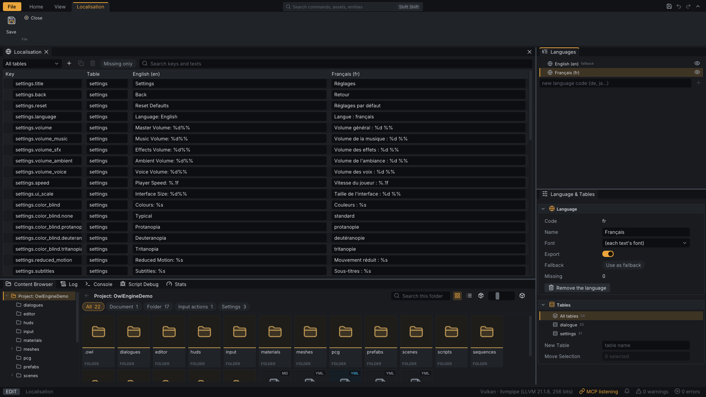

# Localisation {#page-languages}

[TOC]

**Level:** Confirmed. **Read first:** [Scene and Components](scene.md).

A game ships its texts in several languages, authored in Owl Nest. Plan and decisions:
[Localisation design](design/localisation.md).

## The localisation file

`localisation.yml`, at the root of the project, holds the languages of the game, the fallback language and the
strings, each in a string table (a group of keys: `menu`, `dialogue`...):

```yaml
Localisation: ''
FormatVersion: 1
fallback: en
languages:
  - {code: en, name: English, export: true}
  - {code: ja, name: 日本語, font: NotoSansJP, export: true}
strings:
  - key: menu.start
    table: menu
    values: {en: Start, ja: 開始}
```

- A text missing in a language shows its value in the fallback language, else its key.
- `font` names the font (`FontLibrary`) of the localised HUD texts in that language, chosen for its glyphs; without
  one, each text keeps its own font.
- The game export packs the languages marked `export` only, with their fonts.

## Editing in Owl Nest

**Home > Project > Localisation** (or a double-click on `localisation.yml`) opens the localisation document:



The string table fills the document; two panels sit beside it.

- **String table**: one row per key, one column per shown language; a missing value is tinted and shows the fallback
  text as a hint. With more than 3 shown languages the table scrolls sideways, the columns keeping a fixed width. Click
  the handle of a row to select it, **Ctrl** and **Shift** to select many; **Ctrl+D** duplicates the rows, **Delete**
  removes them. The toolbar holds the table filter, add, duplicate and remove buttons, a **Missing only** chip (the
  strings missing a text in a shown language) and a search field for keys and texts.
- **Languages** (the left panel): every language, with an eye to show or hide its column in the string table (a view
  setting, not saved). The right-click menu has **Show only this language**, **Show every language**, **Use as
  fallback** and **Remove**. The field under the list adds a language by its code.
- **Language & Tables** (the properties panel): the selected language, with its code, name, font, **Export**, the
  **Fallback** button, the number of missing texts and **Remove the language**; then the **Tables** section: **All
  tables** and each table with its string count. A click on one filters the string list. With a table selected, the
  name field renames it on Enter and **Remove the table** removes its strings; with **All tables**, the field creates a
  table with a first string. **Move Selection** moves the selected strings into a table.
- Every edit is one undo step; **Save** updates the texts shown by the editor.

A `UI Text` takes a **Text Key** in the inspector, picked among the keys: the HUD then shows its translation, the
`Text` field staying the text written in the scene.

## Scripts and settings

```lua
ui.set_text(label, string.format(tr("settings.volume"), 80))   -- tr is locale.tr
locale.set_language("fr")                                      -- also kept in the `language` setting
for _, language in ipairs(locale.get_languages()) do log.info(language.name) end
```

The built-in setting `language` (`game_settings.yml` default, user override in `settings.yml`) chooses the language
at start; an unknown code falls back. Reference: [Lua API: Localisation](lua-api-locale.md).
