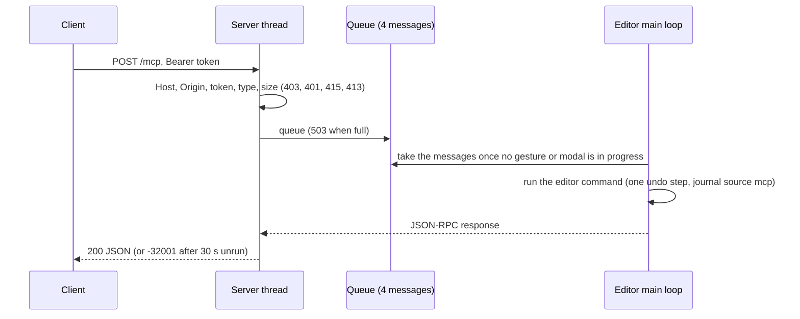

# MCP server {#page-mcp}

[TOC]

Owl Nest embeds a [Model Context Protocol](https://modelcontextprotocol.io) server: a local AI agent (Claude Code, or
any MCP client) lists the scene, edits it through the editor commands, runs Play for a number of frames and gets the
viewport back as an image. Everything it changes goes through the undo history, so one `Ctrl+Z` in the editor
cancels it. The design and the security model are in [MCP server](design/mcp-server.md).

## Enable the server

The server is **off by default**: no socket is open until you ask for it.

1. Open **Settings**, tab **MCP Server**.
2. Tick **Enabled**. The status bar shows `MCP listening` and the settings tab shows the endpoint
   (`http://127.0.0.1:47800/mcp` by default) and the token file. **Port** moves it (1024 to 65535).
3. Leave Owl Nest running: the server lives and dies with the editor, and the token changes at every editor run.

The server only listens on `127.0.0.1`. Every request must carry the bearer token written by the editor:

- Linux: `$XDG_RUNTIME_DIR/owlnest/mcp_token`, else `$XDG_CONFIG_HOME/owlnest/mcp_token`, else
  `~/.config/owlnest/mcp_token`.
- Windows: `%LOCALAPPDATA%\owlnest\mcp_token`.

The file is readable by you only, exists while the server listens and holds nothing but the token. **Regenerate
Token** in the settings draws a new one and refuses the old one at once.

## Connect a client

### Claude Code

```bash
claude mcp add --transport http owl-nest http://127.0.0.1:47800/mcp \
    --header "Authorization: Bearer $(cat $XDG_RUNTIME_DIR/owlnest/mcp_token)"
```

The same thing as a project-scoped MCP configuration file (named .mcp.json) at the root of your project; the token
is read from the environment, so the file can be committed:

```json
{
  "mcpServers": {
    "owl-nest": {
      "type": "http",
      "url": "http://127.0.0.1:47800/mcp",
      "headers": { "Authorization": "Bearer ${OWL_MCP_TOKEN}" }
    }
  }
}
```

```bash
export OWL_MCP_TOKEN="$(cat $XDG_RUNTIME_DIR/owlnest/mcp_token)"
```

The token changes every time the editor starts: run the `export` again (or re-run `claude mcp add`) after a restart.
`claude mcp list` shows whether the server answers.

### Any other client

Send JSON-RPC 2.0 messages with `POST` to the endpoint, with `Content-Type: application/json` and
`Authorization: Bearer <token>`. The protocol revisions 2025-11-25 and 2026-07-28 are accepted. There is no event
stream: `GET` and `DELETE` answer 405. A quick check:

```bash
curl -s http://127.0.0.1:47800/mcp \
    -H "Authorization: Bearer $(cat $XDG_RUNTIME_DIR/owlnest/mcp_token)" -H 'Content-Type: application/json' \
    -d '{"jsonrpc":"2.0","id":1,"method":"tools/list"}'
```

## Tools

`tools/list` gives one tool per editor command, so whatever the console, the command palette and the macros can do,
the agent can: `entity.create`, `entity.delete`, `entity.duplicate`, `entity.reparent`, `entity.rename`,
`entity.set_transform`, `entity.create_light`, `component.add`, `component.remove`, `component.set`, `prefab.instantiate`, `mesh.create`,
`scene.save`, `project.add_render_layer`, `edit.undo`, `edit.redo`, `macro.run`, and the commands of the open documents. Each tool declares its arguments (type,
default, choices) in its input schema. Entities are named by their UUID or their tag.

- A command runs as one undo step and is recorded in the command journal with the `mcp` source (see the
  [Console](editor.md)).
- Editing tools are refused while the scene plays (`RefusedDuringPlay`): stop it first.
- A file argument (`prefab.instantiate`, `mesh.create`, `scene.save`, `macro.run`) is resolved inside the open project
  and refused outside it. No tool evaluates Lua or runs a shell command.
- A failure is a tool result with `isError: true` and a `structuredContent.error` name, not a protocol error.


### `play.run`

Plays the open scene headlessly at a fixed time step with held inputs, then returns what the viewport shows and how
long the frames took. The edited scene is untouched: the play runs on a copy, and the editor goes back to Edit at the
end unless `stop_at_end` is false.

| Argument      | Type    | Default | Meaning                                                                 |
|---------------|---------|---------|-------------------------------------------------------------------------|
| `frames`      | integer | 0       | Frames to play (at most 100000).                                        |
| `ticks`       | integer | 0       | Simulation ticks to run; `ticks: 1` steps the simulation once.          |
| `timestep_ms` | number  | 0       | Duration of every frame; 0 plays one simulation tick per frame.         |
| `actions`     | object  | none    | Input actions held during the whole play: `true`, a number or `[x, y]`. |
| `keys`        | array   | none    | Keyboard keys held during the whole play, by name (`Space`, `D`).       |
| `capture`     | boolean | true    | Return the last frame as a PNG image.                                   |
| `stop_at_end` | boolean | true    | Stop the scene at the end; false leaves it paused on the last frame.    |

Give `frames`, `ticks` or both: the play ends at the first bound reached. An action is held through its first
binding that produces the value (a key, a mouse button or a gamepad input), exactly as in a scenario `actions:` step
(see [Editor](editor.md)): `{"actions": {"platformer_move": 1, "jump": true, "move": [0, -1]}}`.

The result has a text part (the same JSON as `structuredContent`) and, when a capture was asked for, an `image` part
(`image/png`, base64):

| Field                                       | Content                                                                |
|---------------------------------------------|------------------------------------------------------------------------|
| `frames`, `ticks`, `timestep_ms`            | What was played.                                                       |
| `total_ms`, `mean_frame_ms`, `max_frame_ms` | CPU time of the frames.                                                |
| `draw_calls`, `entity_count`                | Draw calls of all the frames, entities of the scene at the end.        |
| `phases`                                    | `scripts_ms`, `physics_ms`, `render_ms`, `total_ms` of the last frame. |
| `interrupted`                               | True when the play stopped before its bound (you pressed Stop).        |
| `capture`                                   | `width`, `height`, `png_bytes` of the image.                           |

In the editor the frames are played by the main loop, so the answer comes when the last frame is done; meanwhile the
editor stays usable and a second `play.run` is refused. A play still running after 10 minutes is stopped and
reported as interrupted. Only the editor viewport is captured: the image is what the active scene document shows.

## Resources

`resources/list` and `resources/templates/list` give read-only data, never instructions:

| URI                       | Content                                                               |
|---------------------------|-----------------------------------------------------------------------|
| `owl://scene`             | Open scene: path, playing, entity count, entity tree.                 |
| `owl://scene/entity/{id}` | One entity and its components, as YAML (same text as the scene file). |
| `owl://assets`            | Files of the asset directories.                                       |
| `owl://prefabs`           | The `.owlprefab` files of the asset directories.                      |
| `owl://statistics`        | Frame times, draw calls, entity count, last phase timings.            |
| `owl://help/{page}`       | A page of the editor help.                                            |

## Limits and refusals

| Case                                                      | Answer |
|-----------------------------------------------------------|--------|
| `Host` other than `127.0.0.1:<port>` / `localhost:<port>` | 403    |
| `Origin` present and not on `127.0.0.1` or `localhost`    | 403    |
| Missing or wrong bearer token                             | 401    |
| `Content-Type` other than `application/json`              | 415    |
| Body over 1 MiB                                           | 413    |
| 4 messages already waiting for the editor                 | 503    |

A message is checked and queued by the server threads, then run by the editor's main loop, which waits while a gizmo
drag, an inspector edit, a menu or a dialogue is in progress; after 30 seconds unrun the client gets the JSON-RPC
error `-32001` and the message is dropped.



## See also

[Editor](editor.md), section MCP server, for the implementation notes, and [MCP server](design/mcp-server.md) for the
design.
