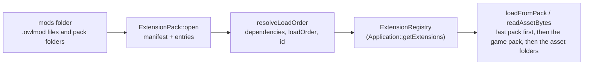
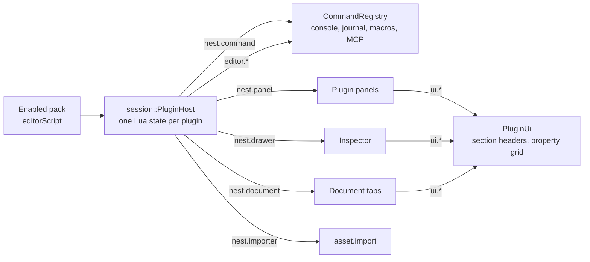

# Mods and extension packs {#page-mods}

[TOC]

**Level:** Confirmed. **Read first:** [Projects](editor_projects.md).

An extension pack adds assets and scripts to a game, or replaces some of them. One format serves both roles: a game
loads a pack as a **mod**, a project or Owl Nest as a **plugin**. The manifest only says what the pack is; the host
decides the role. A pack can run a script and add components ([entry script](#mods-script)), the player orders the mods of a game with
the [mod manager](#mods-manager), a project shares nodes and templates as [plugins](#mods-plugins), and a pack extends
the editor itself as an [Owl Nest plugin](#mods-nest-plugins). Plan of what comes next (native plugins):
[Modding and platforms](design/modding-platforms.md#modding-plugins).

## A pack

A pack is a folder holding `extension.yml` and assets laid out as in the game: an asset at the path of a game asset
replaces it, any other one is added. Packed, the same folder is a `.owlmod` file, written in the `.owlpack` format.

```text
extensions/demo.recolour/
├── extension.yml
└── textures/items/health.png      # replaces textures/items/health.png of the game
```

The manifest (format version 1):

```yaml
FormatVersion: 1
OwlExtension:
  id: demo.recolour            # lower-case letters, digits, `.`, `_`, `-`; what other packs name
  name: Recoloured first-aid kit
  version: 1.0.0               # major.minor.patch
  kind: Data                   # Data: assets only; Script: assets and scripts
  # script: scripts/mods/demo.bounty/main.lua   # Script packs: entry script, an asset path in the pack
  # editorScript: editor/demo.notes/main.lua    # Script packs: script of the Owl Nest plugin
  loadOrder: 0                 # rank among the packs that do not depend on each other
  author: Silmaen
  description: Overrides the first-aid kit of the raycast level with a blue one.
  dependencies:                # packs mounted before this one
    - id: base.items
      version: 1.2.0           # lowest version accepted
```

| Field          | Meaning                                                                                         |
|----------------|-------------------------------------------------------------------------------------------------|
| `id`           | Unique name of the pack; a second pack with the same id is not mounted                          |
| `name`         | Name shown to the player and in Owl Nest (the id when empty)                                    |
| `version`      | Compared number by number by the dependencies of other packs                                    |
| `kind`         | `Data`: its scripts (`.lua`, `.owlvs`) are not mounted; `Script`: they are                      |
| `loadOrder`    | Lower first; of two packs holding the same asset, the later one wins                            |
| `script`       | `Script` packs: asset path of the entry script, run while a scene plays ([below](#mods-script)) |
| `editorScript` | `Script` packs: asset path of the Owl Nest plugin script ([below](#mods-nest-plugins))          |
| `dependencies` | Each one mounted before the pack; a missing, older or left out dependency leaves the pack out   |

The manifest, the `.owlmeta` sidecars and the hidden files (a name starting with `.`) are never entries of a pack.

## Load order



Every dependency is mounted before the packs that need it; among the packs free to go, the lowest `loadOrder` first,
then the id in alphabetical order. A pack is left out, with a warning naming the reason, when its manifest cannot be
read, when its id is taken, when a dependency is missing, older than asked or left out itself, or when its
dependencies form a cycle. The others are still mounted.

A lookup asks the last pack mounted first: a pack overrides the game and every pack mounted before it. Textures,
scripts, scenes, sounds, HUDs, materials and every asset read through `data::assets::readAssetBytes` or
`AssetLibrary::find` follow it, in a packed game as in a game run from its project folder.

## Playing with mods

The game runner mounts the packs of the folder named by `ModsDirectory` in `runner.yml` (`mods` by default, beside the
game) before its first scene: drop a `.owlmod` in that folder and start the game. The log lists the packs mounted and the
ones left out.

A scenario mounts packs with its `mods:` key (a file, a pack folder or a folder of packs, relative to the
`.owltest`) and checks where an asset comes from with `expect: {asset: <path>, provider: <id or game>}`
([Scripted headless runs](editor_internals.md)). The Engine Demo holds one pack,
`engine_demo/extensions/demo.recolour`, played by `test/unit/scenarios/mod_recolour.owltest`.

## Entry script and game events {#mods-script}

A `kind: Script` pack names an entry script with `script:`. Each mounted pack with one gets its own Lua state in Play,
loaded after the scene and HUD scripts, in load order (`scene::loadModScripts`, `Scene::getModScripts`). The sandbox and
the quotas are those of every script: no filesystem, and `require` reads its modules through the packs.

| Hook                    | When                                                      |
|-------------------------|-----------------------------------------------------------|
| `on_create()`           | The scene enters Play                                     |
| `on_scene_load()`       | Every script of the level is created                      |
| `on_entity_spawn(id)`   | An entity is spawned at run time (a prefab, for instance) |
| `on_entity_destroy(id)` | An entity is destroyed at run time, before it goes        |
| `on_update(dt)`         | Every frame                                               |
| `on_tick(dt)`           | Every fixed simulation tick                               |
| `on_destroy()`          | Play ends                                                 |

A mod script also receives the HUD widget callbacks that no scene or HUD script defines.

### Lua components {#mods-components}

The global `components` table of the entry script declares components; the fields use the syntax of the script
`properties`:

```lua
components = {
    ["demo.bounty.Bounty"] = {
        { name = "gold", type = "int", default = 10, min = 0, max = 1000, step = 1 },
    },
}
```

A key must start with `<pack id>.`. While the pack is mounted, `scene::ScriptedComponents` registers the key on the
`ComponentRegistry`: the component is saved with scenes as `key: {field: value}`, copied by prefabs, duplication and
Play, listed in the Add Component menu and drawn by the inspector of Owl Nest (every edit undoable). Lua reads and writes
it with `entity.get_field(id, key, field)` and `entity.set_field(id, key, field, value)`; `entity.has_component`
accepts any registry key and `entity.add_component` works with them. A scene saved without the pack mounted loses the
component: its key is unknown.

## Mod manager {#mods-manager}

`data::assets::pack::ModManager` (`Application::getModManager`) lists the packs of the mods folder, with the order and
the enabled state the player chose. The runner configures it with `ModsDirectory` and saves the choices (order,
disabled ids) in `mods.yml` of the user folder of the game; a game without a name saves nothing. A lower mod in the
list loads later and wins the assets it shares; dependencies still load first. `Application::applyMods` mounts the
choices. `ExtensionRegistry::getConflicts()` lists the assets held by several mounted packs, the last one serving
each. A scenario `mods:` entry that is a folder of packs configures the mod manager with it.

The Lua `mods` table drives it:

| Function                   | Role                                                                                              |
|----------------------------|---------------------------------------------------------------------------------------------------|
| `mods.is_managed()`        | A mod manager is configured (false in Owl Nest: the plugins of a project are chosen in the panel) |
| `mods.count()`             | Number of mods                                                                                    |
| `mods.get(index)`          | Table `id`, `name`, `version`, `author`, `description`, `enabled`, `mounted`, `issue`             |
| `mods.set_enabled(id, on)` | Enable or disable a mod                                                                           |
| `mods.move(id, offset)`    | Move a mod in the list                                                                            |
| `mods.is_dirty()`          | The choices differ from what is mounted                                                           |
| `mods.apply([level])`      | After the frame: mount the choices, save them, load the level (the current one when none)         |
| `mods.conflicts()`         | Assets held by several mods                                                                       |
| `mods.open_screen(level)`  | Open the mod screen; `level` is where Back returns                                                |
| `mods.return_level()`      | The level the mod screen goes back to                                                             |

The default mod screen is `engine_assets/mods/mod_manager.owl` with `mod_manager.lua`: the list, Enable / Disable,
Move up / down, Apply and Back. The project setting **Mod Screen** (`ModScreen` in `owl_project.yml` and `runner.yml`,
[Project Settings](editor_projects.md#project-settings)) replaces it; Pack Game packs the screen in use. The Engine Demo
main menu has a **Mods** button (`engine_demo/scripts/ui/mods_button.lua`).

The Engine Demo packs: `demo.bounty` (a Script mod: a Bounty component on `PickupAmmo1`, gold added to the game state
`mod_gold` on pickup, played by `test/unit/scenarios/mod_bounty.owltest`), `demo.nodes` (the plugin below) and the
`test/unit/scenarios/mod_screen.owltest` scenario for the screen.

## Plugins {#mods-plugins}

The same pack, enabled in a project, is a plugin. `ExtensionRegistry::findEntries(extension)` lists what the packs
serve. The `demo.nodes` pack holds one of each:

- **Script nodes**: an annotated Lua module (`scripts/lib/demo_nodes.lua`) and library graphs, listed in the palette of
  the visual script editor at their mounted paths.
- **Material nodes**: `engine_demo/extensions/demo.nodes/materials/demo_nodes/library.owlmat` with the custom node `pulse`. The material editor palette
  lists the custom nodes and functions of the `.owlmat` files the packs serve, in the category `Plugin <id>`;
  `material.import_node` copies the definition into the graph, so the material stays self-contained.
- **Templates**: `engine_demo/extensions/demo.nodes/prefabs/demo_nodes/spinning_coin.owlprefab`. The hierarchy right-click **Plugins** submenu
  instantiates the prefabs of folder packs (`prefab.instantiate`).

## Owl Nest plugins {#mods-nest-plugins}

A `kind: Script` pack that names an `editorScript` is an Owl Nest plugin: enabled in a project, it adds to the editor,
while it runs, commands, panels, inspector drawers, document types and importers. The script is Lua; it runs once when
the pack is mounted, in a Lua state of its own with the sandbox of every script (no file system) and the `editor`
module of the [Lua console](editor_console.md#editor-lua).



The script declares what it adds with the `nest` module; each declaration names a global function of the script, its
**handler**, which receives one table and may return one:

| Declaration     | Fields                                                                     | The handler receives                                           | Role                                                   |
|-----------------|----------------------------------------------------------------------------|----------------------------------------------------------------|--------------------------------------------------------|
| `nest.command`  | `name`, `description`, `handler`, `play`, `scene`                          | The arguments of the command                                   | A registry command; the table returned is its result   |
| `nest.argument` | `command`, `name`, `type`, `description`, `required`, `default`, `choices` | -                                                              | One argument of a command declared above               |
| `nest.panel`    | `id`, `title`, `handler`                                                   | `playing`, `entity_count`, `selection`, `selection_name`       | A panel, shown from **Home > Project > Plugin Panels** |
| `nest.drawer`   | `component`, `handler`                                                     | `entity`, `name`, `component`, the fields of a Lua component   | The body of that component in the inspector            |
| `nest.document` | `id`, `extension`, `title`, `handler`                                      | `path`, `name`, `text`                                         | The tab the files of that extension open in            |
| `nest.importer` | `id`, `extension`, `description`, `handler`                                | `path`, `name`, `text`; returns `path` and `text` of the asset | **Import: ...** in the Content Browser, `asset.import` |

- A command name and the ids start with `<pack id>.`; a declaration the host refuses stops the script, and the plugin
  then adds nothing.
- Argument types: `bool`, `integer`, `number`, `text`, `entity`, `vec2`, `vec3`, `vec4`, `color`, `enum` (with
  `choices = "a, b"`). `play = true` lets the command run during Play, `scene = false` without a scene.
- A plugin command is one undo step whatever it runs, and is undone when its handler raises an error. It appears in
  the console, the command palette, the journal, macros, the MCP tools and `editor.<name>` of the other scripts.
- A document type only takes files that would open as text: the built-in types keep theirs. The handler changes the
  text with `editor.plugin.document_set{path = args.path, text = ...}`, one undo step of the tab.
- An importer returns the file to write, relative to the folder of the source; it stays inside the project.
  `asset.import` writes it, and undo puts the previous file back or removes it.
- An entity id is a text of digits in Lua: pass it back as it is.

A handler reads the scene with the `nest` functions below, from a panel, a drawer, a document or a command. They only
read: every change goes through an `editor.*` command. A component is read through the serialisation of the scene (the
one of the scene files and of `component.set_field`), so a built-in component and one declared in Lua read alike; a
vector or a colour is a list of numbers, a map or a list of maps its YAML on one line.

| Function          | Fields                      | Returns                                                                                  |
|-------------------|-----------------------------|------------------------------------------------------------------------------------------|
| `nest.entity`     | `entity` (id or name), `component` | `exists`, `entity`, `name`, `has` (with `component`)                                |
| `nest.entities`   | `component`, `max` (1000)   | `count`, `ids`, `names` (lists), `selection`, `selection_name`; with `component`, only the entities that have it |
| `nest.components` | `entity`                    | `exists`, `keys` (the components the entity has)                                         |
| `nest.fields`     | `entity`, `component`       | `exists`, `has`, `names` (the fields of the component)                                   |
| `nest.field`      | `entity`, `component`, `field` | `exists`, `has`, `found`, `value`                                                     |

The handler of a drawer also receives the fields of its component by name, a built-in component (`translation` of a
`Transform`) as well as a Lua one; `entity`, `name` and `component` keep their meaning.

A handler that draws (panel, drawer, document) asks for widgets with the `ui` module, called again on every frame;
Owl Nest draws them with its panel style. A row returns `value` (the value shown, the one being typed included) and
`changed`, true once when the edit ends:

| Widget        | Fields                                 | Returns            |
|---------------|----------------------------------------|--------------------|
| `ui.section`  | `label`                                | `open`             |
| `ui.text`     | `text`, `dim`                          | -                  |
| `ui.value`    | `label`, `value`                       | -                  |
| `ui.button`   | `label`, `tooltip`, `primary`          | `clicked`          |
| `ui.checkbox` | `label`, `value`                       | `value`, `changed` |
| `ui.number`   | `label`, `value`, `min`, `max`, `step` | `value`, `changed` |
| `ui.integer`  | `label`, `value`, `min`, `max`, `step` | `value`, `changed` |
| `ui.input`    | `label`, `value`                       | `value`, `changed` |
| `ui.vec3`     | `label`, `value` (`{x, y, z}`)         | `value`, `changed` |
| `ui.color`    | `label`, `value` (`{r, g, b, a}`)      | `value`, `changed` |
| `ui.choice`   | `label`, `value`, `choices` (`"a, b"`) | `value`, `changed` |

A plugin never writes a scene or an asset itself: it runs commands (`editor.component.set_field{...}`,
`editor.entity.create{...}`), so every change is in the journal and can be undone.

```lua
nest.command{name = "demo.notes.pin", description = "Pin a design note on an entity", handler = "pin_note"}
nest.argument{command = "demo.notes.pin", name = "entity", type = "entity", required = true}

function pin_note(args)
    editor.component.add{entity = args.entity, component = "demo.notes.Note"}
    return {description = "Pin a note"}
end

nest.drawer{component = "demo.notes.Note", handler = "draw_note"}

function draw_note(args)
    local done = ui.checkbox{label = "Done", value = args.done}
    if done.changed then
        editor.component.set_field{entity = args.entity, component = args.component, field = "done", value = done.value}
    end
end
```

The Engine Demo pack `demo.notes` adds one of each: the command `demo.notes.pin`, the panel **Design Notes** (it lists
the entities of the scene that carry a note, read with `nest.entities`), the
drawer of its `demo.notes.Note` component, the `.owlnote` check list document
(`engine_demo/extensions/demo.notes/notes/demo_level.owlnote`) and an importer turning a `.txt` file into a `.owlnote`.
`test/unit/scenarios/nest_plugin.owltest` runs its command: a scenario loads the plugins of its `mods:`.

## In Owl Nest

**Home > Project > Extensions** shows the panel of the packs of the project, the sub-folders of
`<project>/extensions`:

- **Packs**: the list (name, version, kind); the check box enables or disables a pack (`extension.enable`, saved in
  `owl_project.yml` as `disabledExtensions`); type an id and **Create** to add a pack (`extension.create`).
- **Manifest**: name, version, kind, load order, author and description of the selected pack; every change is one
  undo step (`extension.set`) in the history of the active scene.
- **Dependencies**: the packs needed, each with its lowest version, removed with the bin button or added with
  **Add**.
- **Entry script** (Script packs): the `script` field, then a section with **Open**, **Create** from a template
  (`extension.script`), the game events defined or not with a jump to their line, and the declared components.
- **Owl Nest plugin** (Script packs): the `Editor script` field, then a section with **Open**, **Create** from a
  template (`extension.script editor=true`) and **Reload** (`plugin.reload`, after a change of the script); the errors
  of the plugin; and everything it adds, each with its handler, defined or not, and a jump to its line. The check box
  of a panel shows it (`plugin.show_panel`).
- **Conflicts**: the assets held by several enabled packs, with the pack serving each.
- **Export .owlmod** writes `exports/<id>.owlmod` of the project (`extension.export`), the file a player drops in the
  `mods` folder of the game.

The enabled packs of the project are its plugins: Owl Nest mounts them when the project opens, so their overrides show
in the viewport, the documents and Play, and mounts them again after a change of the panel or of a file under
`extensions/` (the textures already loaded take the new pixels). The Owl Nest plugins are loaded with them: disabling
a pack takes its commands, panels, drawers, document types and importers out of the editor. **Pack Game** writes each enabled pack as
`mods/<id>.owlmod` of the exported game, which mounts them as mods; the editor side stays out of it: the file of the
manifest's `editorScript`, everything under `editor/`, and the `editorScript` field itself.

A headless session (the one the [MCP](mcp.md) tests and the scenario runner use) loads the plugins of the mounted packs
with `HeadlessSession::loadPlugins`: the same host, sandbox and rules as Owl Nest, so the commands of the plugins are
MCP tools, with the panels, drawers and document types left out for want of a window.

The same commands run from the console, the command palette, macros and the MCP server
([Console](editor_console.md#editor-console)). The assets of a pack are edited like any other asset of the project, in
the content browser.

## Engine API

| Type / function                          | Role                                                                                                  |
|------------------------------------------|-------------------------------------------------------------------------------------------------------|
| `pack::ExtensionManifest`                | The manifest: `parse`, `serialize`                                                                    |
| `pack::ExtensionPack`                    | One pack opened from a `.owlmod` or a folder: `contains`, `readEntry`                                 |
| `pack::writeExtensionPack`               | A pack folder written as a `.owlmod`                                                                  |
| `pack::resolveLoadOrder`                 | Load order of a set of manifests, and the packs left out                                              |
| `pack::ExtensionRegistry`                | The packs mounted: `mount`, `mountFolder`, `findProvider`, `readEntry`, `getConflicts`, `findEntries` |
| `pack::ModManager`                       | The player's mod list: order, enabled state, `mods.yml`                                               |
| `app::Application::getModManager()`      | The mod manager; `applyMods` mounts its choices                                                       |
| `scene::loadModScripts`                  | Loads the entry script of each mounted Script pack                                                    |
| `scene::ScriptedComponents`              | Registers the components of the entry scripts on the `ComponentRegistry`                              |
| `app::Application::getExtensions()`      | The registry asked by `loadFromPack` and `packContains`                                               |
| `app::Application::hasPackedAssets()`    | A pack is open or extension packs are mounted                                                         |
| `app::Application::setExtensionSources`  | Replace the mounted packs and reload the assets they change                                           |
| `pack::ExportSettings::extensionSources` | Packs written to the `mods` folder of a game by `GameExporter`                                        |
| `script::ScriptConsole::call`            | Calls a global function of a tool script with a table (the handlers of the Owl Nest plugins)          |

Owl Nest side (`source/owlnest/sources/session/`): `PluginHost` loads the plugins and holds what they add,
`EditorModule` gives a Lua state the `editor` functions, `PluginUi` is the widget surface (`panel::PluginUiRenderer`
draws it), `PluginDocument` is the tab of a plugin document type.
