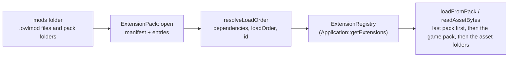

# Mods and extension packs {#page-mods}

[TOC]

**Level:** Confirmed. **Read first:** [Projects](editor_projects.md).

An extension pack adds assets and scripts to a game, or replaces some of them. One format serves both roles: a game
loads a pack as a **mod**, a project or Owl Nest as a **plugin**. The manifest only says what the pack is; the host
decides the role. Plan of what comes next (the Lua mod API, the in-game mod manager, the Owl Nest plugins):
[Modding and platforms](design/modding-platforms.md#modding-plugins).

## A pack

A pack is a folder holding `extension.yml` and assets laid out as in the game: an asset at the path of a game asset
replaces it, any other one is added. Packed, the same folder is a `.owlmod` file, written in the `.owlpack` format.

```text
extensions/demo.recolour/
├── extension.yml
└── textures/items/health.png      # replaces textures/items/health.png of the game
```

The manifest (format version 1):

```yaml
FormatVersion: 1
OwlExtension:
  id: demo.recolour            # lower-case letters, digits, `.`, `_`, `-`; what other packs name
  name: Recoloured first-aid kit
  version: 1.0.0               # major.minor.patch
  kind: Data                   # Data: assets only; Script: assets and scripts
  loadOrder: 0                 # rank among the packs that do not depend on each other
  author: Silmaen
  description: Overrides the first-aid kit of the raycast level with a blue one.
  dependencies:                # packs mounted before this one
    - id: base.items
      version: 1.2.0           # lowest version accepted
```

| Field          | Meaning                                                                                       |
|----------------|-----------------------------------------------------------------------------------------------|
| `id`           | Unique name of the pack; a second pack with the same id is not mounted                        |
| `name`         | Name shown to the player and in Owl Nest (the id when empty)                                  |
| `version`      | Compared number by number by the dependencies of other packs                                  |
| `kind`         | `Data`: its scripts (`.lua`, `.owlvs`) are not mounted; `Script`: they are                    |
| `loadOrder`    | Lower first; of two packs holding the same asset, the later one wins                          |
| `dependencies` | Each one mounted before the pack; a missing, older or left out dependency leaves the pack out |

The manifest, the `.owlmeta` sidecars and the hidden files (a name starting with `.`) are never entries of a pack.

## Load order



Every dependency is mounted before the packs that need it; among the packs free to go, the lowest `loadOrder` first,
then the id in alphabetical order. A pack is left out, with a warning naming the reason, when its manifest cannot be
read, when its id is taken, when a dependency is missing, older than asked or left out itself, or when its
dependencies form a cycle. The others are still mounted.

A lookup asks the last pack mounted first: a pack overrides the game and every pack mounted before it. Textures,
scripts, scenes, sounds, HUDs, materials and every asset read through `data::assets::readAssetBytes` or
`AssetLibrary::find` follow it, in a packed game as in a game run from its project folder.

## Playing with mods

The game runner mounts the packs of the folder named by `ModsDirectory` in `runner.yml` (`mods` by default, beside the
game) before its first scene: drop a `.owlmod` in that folder and start the game. The log lists the packs mounted and the
ones left out.

A scenario mounts packs with its `mods:` key (a file, a pack folder or a folder of packs, relative to the
`.owltest`) and checks where an asset comes from with `expect: {asset: <path>, provider: <id or game>}`
([Scripted headless runs](editor_internals.md)). The Engine Demo holds one pack,
`engine_demo/extensions/demo.recolour`, played by `test/unit/scenarios/mod_recolour.owltest`.

## In Owl Nest

**Home > Project > Extensions** shows the panel of the packs of the project, the sub-folders of
`<project>/extensions`:

- **Packs**: the list (name, version, kind); the check box enables or disables a pack (`extension.enable`, saved in
  `owl_project.yml` as `disabledExtensions`); type an id and **Create** to add a pack (`extension.create`).
- **Manifest**: name, version, kind, load order, author and description of the selected pack; every change is one
  undo step (`extension.set`) in the history of the active scene.
- **Dependencies**: the packs needed, each with its lowest version, removed with the bin button or added with
  **Add**.
- **Export .owlmod** writes `exports/<id>.owlmod` of the project (`extension.export`), the file a player drops in the
  `mods` folder of the game.

The enabled packs of the project are its plugins: Owl Nest mounts them when the project opens, so their overrides show
in the viewport, the documents and Play, and mounts them again after a change of the panel or of a file under
`extensions/` (the textures already loaded take the new pixels). **Pack Game** writes each enabled pack as
`mods/<id>.owlmod` of the exported game, which mounts them as mods.

The same commands run from the console, the command palette, macros and the MCP server
([Console](editor_console.md#editor-console)). The assets of a pack are edited like any other asset of the project, in
the content browser.

## Engine API

| Type / function                          | Role                                                                     |
|------------------------------------------|--------------------------------------------------------------------------|
| `pack::ExtensionManifest`                | The manifest: `parse`, `serialize`                                       |
| `pack::ExtensionPack`                    | One pack opened from a `.owlmod` or a folder: `contains`, `readEntry`    |
| `pack::writeExtensionPack`               | A pack folder written as a `.owlmod`                                     |
| `pack::resolveLoadOrder`                 | Load order of a set of manifests, and the packs left out                 |
| `pack::ExtensionRegistry`                | The packs mounted: `mount`, `mountFolder`, `findProvider`, `readEntry`   |
| `app::Application::getExtensions()`      | The registry asked by `loadFromPack` and `packContains`                  |
| `app::Application::hasPackedAssets()`    | A pack is open or extension packs are mounted                            |
| `app::Application::setExtensionSources`  | Replace the mounted packs and reload the assets they change              |
| `pack::ExportSettings::extensionSources` | Packs written to the `mods` folder of a game by `GameExporter`           |
