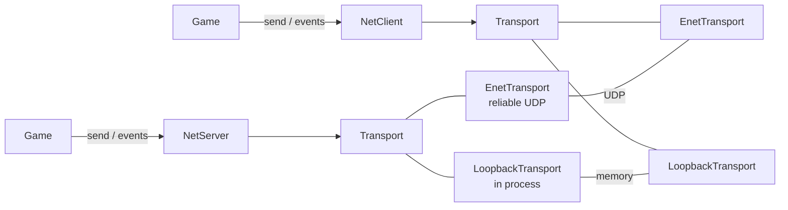
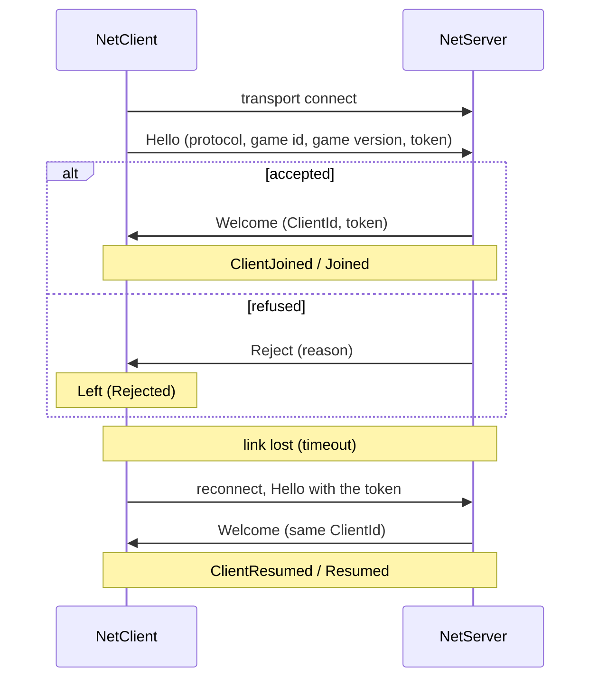
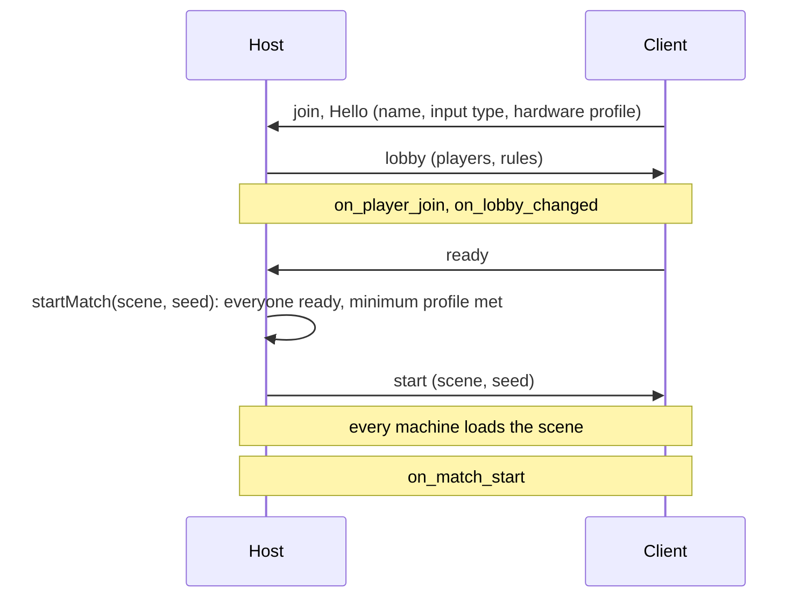

# Networking {#page-networking}

[TOC]

**Level:** Engine developer. **Read first:** [Architecture](architecture.md).

This page describes the network module of Owl Engine: the transports that carry messages between processes, the server
and client sessions built on them, and the game session on top: lobby, remote calls, lockstep or authoritative
matches with replication, interest management and fair play.

## Overview {#networking-overview}



- A **transport** (`network::Transport`) moves byte messages between this process and its peers: a listener accepts
  peers, a client connects to one. It knows nothing of games or sessions.
- A **session** (`NetServer`, `NetClient`) runs on a transport: the client greets the server with its game and
  version, the server answers with a `ClientId`, and both exchange game messages. The server is authoritative:
  clients only talk to it.
- Everything runs on the thread that calls `onUpdate()` (or `poll()` for a bare transport): nothing is sent or
  received in between, no callback runs on another thread.

## Transports {#networking-transports}

| Backend              | `Transport::Type` | What it is                                                                            | Module                                                                            |
|----------------------|-------------------|---------------------------------------------------------------------------------------|-----------------------------------------------------------------------------------|
| `EnetTransport`      | `Enet`            | Reliable UDP on ENet: retransmission, ordering, fragmentation, timeouts               | `OWL_MODULE_NETWORK` (ENet)                                                       |
| `LoopbackTransport`  | `Loopback`        | Links between transports of one process, no socket; every message arrives, in order   | always built                                                                      |
| `WebSocketTransport` | `WebSocket`       | Binary WebSocket messages on `ws://<host>:<port>/owl`, a channel byte first, over TCP | `OWL_MODULE_NETWORK` (cpp-httplib on desktop, the browser's WebSocket on the Web) |
| `MixedTransport`     | `Mixed`           | Several backends as one: ENet and WebSocket listening on the same port number         | `OWL_MODULE_NETWORK`, desktop                                                     |

`WebSocketTransport` is the transport of a page, which has no UDP: a desktop server listens with cpp-httplib (a thread
per peer, the events queued until `poll`) and a page connects through Emscripten's WebSocket API; a page cannot listen.
TCP delivers every message once and in order, the unreliable ones too, and hides the round trip and the losses
(`getStats` gives the bytes only).

`MixedTransport` listens with each of its backends on the port the first one got, and gives every peer of every
backend an identifier of its own (`getPeerType` tells which backend it came through); `connect` goes through the
first backend. A `GameSession` uses `Mixed` (ENet, then WebSocket) on the desktop and WebSocket in a page
(`setTransportType`): a desktop host takes desktop clients over UDP and Web clients over TCP in one match, on one port
number.

`Transport::create(type)` returns the backend, or `NetworkError::BackendUnavailable` when ENet is not built in. A
loopback listener is named by its port within the process: tests, local play and a host playing on its own server use
it. `LoopbackTransport::severLink()` cuts a link the way a lost connection does, to exercise reconnection.

Every transport has `g_ChannelCount` (4) channels: the messages of one channel keep their order, channels do not wait
for each other. Each message is `Delivery::Reliable` (resent until acknowledged) or `Delivery::Unreliable` (sent once,
a late one is dropped). `poll()` appends `TransportEvent`s: `Connected`, `Received` (channel and bytes) and
`Disconnected` with a `DisconnectReason` (`Graceful`, `Timeout`, `Refused`). `getStats()` gives the round trip, the
loss and the byte counts of a peer.

### Simulated network conditions {#networking-conditions}

`ConditionedTransport` wraps any transport and sends its messages through a simulated bad network, to try a game on a
poor link without one. Its `LinkConditions` hold a `latencyMs`, a random `jitterMs` on top of it, the `loss` and
`duplicate` shares of unreliable messages, and a `seed`: one seed and one sequence of sends give the same outcome, so a
test stays reproducible. Only the sending side is conditioned; wrap both ends for a delay both ways.

- Reliable messages are only delayed, as on a real link where the backend resends them, and keep their order within a
  channel; unreliable ones may be lost, duplicated or overtaken.
- `disconnect()` waits for the messages held for the peer, so a `Reject` or a `Goodbye` still arrives first.
- `getStats()` adds the simulated delay to the round trip and the simulated loss to the packet loss;
  `setConditions()` changes them while connected, an optional clock replaces the steady clock in tests.

```c++
#include <network/ConditionedTransport.h>

const LinkConditions bad{.latencyMs = 80, .jitterMs = 40, .loss = 0.05f, .seed = 1};
NetClient client{mkUniq<ConditionedTransport>(std::move(*Transport::create(Transport::Type::Enet)), bad), config};
```

## Sessions {#networking-sessions}



A `SessionConfig` holds what both ends agree on: the `gameId` and `gameVersion` a client must match, `maxClients`,
the `handshakeTimeout` a connected peer has to greet the server, the `reconnectGrace` a lost client keeps its place,
and the `reconnectInterval` between the client's attempts.

- **Server**: `start(port)` (0 for a port chosen by the system, read back with `getPort()`), `send()` to one client,
  `broadcast()` to all, `kick()`, `stop()`. Each `onUpdate()` replaces `getEvents()`: `ClientJoined`, `ClientLost`,
  `ClientResumed`, `ClientLeft` (with a `LeaveReason`) and `Message`.
- **Client**: `connect(host, port)`, `send()`, `disconnect()`; its `State` goes `Connecting`, `Handshaking`,
  `Connected`, and `Reconnecting` while a lost link is restored. Events: `Joined`, `Lost`, `Resumed`, `Left` (with a
  `LeaveReason` and, when refused, a `RejectReason`) and `Message`.
- A **lost link** (a transport timeout) keeps the client's `ClientId` for the grace time: the client retries on its
  own with the token the server gave it, and the server binds the new link to the same client. A client that leaves,
  is kicked or outlasts the grace is gone for good.
- A client of another session protocol, game or game version is refused (`WrongProtocol`, `WrongGame`); so is a new
  client of a full server (`ServerFull`) and a reconnection whose session expired (`UnknownSession`).

```c++
#include <network/NetClient.h>
#include <network/NetServer.h>

using namespace owl::network;

const SessionConfig config{.gameId = "my.game", .gameVersion = 1};
NetServer server{std::move(*Transport::create(Transport::Type::Enet)), config};
server.start(7777);

NetClient client{std::move(*Transport::create(Transport::Type::Enet)), config};
client.connect("127.0.0.1", 7777);

// Each frame:
server.onUpdate(timestep);
for (const auto& event: server.getEvents())
	if (event.kind == ServerEvent::Kind::Message)
		server.broadcast(0, Delivery::Reliable, event.payload);
```

## Game session and lobby {#networking-game-session}

`network::GameSession` is a networked game on top of `NetServer` and `NetClient`: the lobby, the remote calls, the
match and its fairness. There is one per game, `app::EngineContext::getNetworkSession()` (created on first use), and it
goes on across level changes. A scene reports to it through `scene::NetworkHook`, which the scene takes when its
runtime starts, or as soon as a script opens the session while the scene plays; a scene played offline never touches
it.

- **Roles**: `NetRole::Offline`, `Host` (the server, with a local player) or `Client`; `MatchState` goes `Idle`,
  `Lobby`, `Playing`.
- **Players**: the host is player 0, a client is its `ClientId`. Each `PlayerInfo` holds a name, a ready flag, an input
  type (`InputType::KeyboardMouse`, `Gamepad`, `Touch`) and the hardware profile of its machine
  (`HardwareProfile`: hardware threads and mean frame time, measured by `observeFrame()`).
- **Game version**: the number clients and server compare is `getVersionNumber()` of the project version (FNV-1a of
  the text, the same on every target).
- **Match start**: `startMatch(scene, seed)` on the host checks that everyone is ready and that every machine meets
  the minimum profile (`StartError::NotReady`, `BelowMinimum`), then every machine loads the scene through a teleport
  request and the scripts get `on_match_start`. A full match, a started match and, without crossplay, a player of
  another input type refuse a joiner (`RefuseReason`).



```lua
function on_create()
    net.set_player_name("Ada")
end

function on_lobby_changed()
    if net.is_server() and net.is_everyone_ready() then
        local ok, why = net.start_match("scenes/arena.owl")
        if not ok then ui.show_subtitle(why, 3) end
    end
end
```

The `net` Lua table is listed in [Lua API: Multiplayer](lua-api-network.md). The scripts get six hooks, defined in the
scene script or in an entity script: `on_player_join(player)`, `on_player_leave(player)`, `on_lobby_changed()`,
`on_match_start()`, `on_desync(tick)` and `on_disconnected(reason)`.

## Remote calls {#networking-rpc}

A script calls a function of another machine's script: `net.rpc_server(entity, name, ...)`,
`net.rpc_client(player, entity, name, ...)` and `net.rpc_all(entity, name, ...)` (every machine, the caller's
included), reliable, plus `_unreliable` variants sent once (a late or lost call is dropped).

- The entity is the one whose script runs the function; `0` is the scene script. `net.uuid(entity)` gives an entity's
  identity as text, the same on every machine, and `scene.find_by_uuid` finds it back.
- Arguments are nil, booleans, numbers and strings.
- The callee reads the caller with `net.get_sender()`. The host relays calls and trusts the link a call came in on,
  never the sender a message claims.
- Offline, the calls run locally, so a game plays the same without a session.

```lua
function on_interact()
    net.rpc_all(entity_id, "flap", net.get_local_player())
end

function flap(player)
    ui.show_subtitle(string.format("Player %d flaps", player), 2)
end
```

## Lockstep {#networking-lockstep}

With `model: Lockstep` every machine simulates every tick from the inputs of all the players, on the
[bit-exact simulation](design/simulation-networking.md#simulation-cross-platform). Nothing but inputs crosses the
network.

- The action map states of the local player are sampled each tick and played `inputDelay` ticks later, which hides the
  latency. `SimulationClock::setTickLimit` holds the clock until the input of every player for a tick is known; the
  frames that waited are counted in the figures (`stalled`).
- Scripts read the inputs of any player in `on_tick` with `net.is_held(player, action)`, `net.is_pressed`,
  `net.get_value` and `net.get_vector`.
- Every `hashInterval` ticks the clients send the world hash of the tick; the host compares them, and a difference
  reports the first diverging tick: `on_desync(tick)` and the figures of [debugging](#networking-debugging).

```lua
function on_tick(dt)
    for _, p in ipairs(net.get_players()) do
        local x, y = net.get_vector(p.id, "move")
        move_unit(p.id, x, y, dt)
    end
end
```

## Replication {#networking-replication}

With `model: Authoritative` the host simulates and the clients show what it sends. An entity is shared when it has the
`Replicated` component ([Scene](scene.md#components)):

| Field         | Meaning                                                                                  |
|---------------|------------------------------------------------------------------------------------------|
| `authority`   | `Server` (the host decides) or `Owner` (the owner decides, the host passes it on)        |
| `owner`       | The player owning the entity, 0 for the host; `net.set_owner(entity, player)` changes it |
| `transform`   | Whether the transform is sent                                                            |
| `components`  | Keys of other components (`Text`, `SpriteRenderer`...), sent when their YAML changes     |
| `interpolate` | The client shows the received transforms interpolated, else as they arrive               |
| `predict`     | The owner simulates the entity itself and only corrects it when the host disagrees       |
| `relevance`   | Distance within which a client receives the entity (0: everywhere)                       |
| `priority`    | Share of the snapshot budget                                                             |
| `hitRadius`   | Radius of the hit sphere rewound by the lag compensation (0: none)                       |

- The host sends snapshots at `snapshotRate`; a client shows them `interpolationDelay` in the past, so it always has
  two to blend.
- A predicted entity runs on its owner at once; when the host's state is farther than `correctionThreshold`, the
  client corrects it.
- Entities spawned at run time are spawned on the clients with their children, and despawned when they are gone or
  leave the client's interest.
- A client keeps the physics bodies of the entities it does not decide out of its own simulation: it places them from
  the snapshots.
- `net.has_authority(entity)` tells a script whether this machine moves an entity (always true offline).

## Interest management {#networking-interest}

The host does not send everything to everyone. Each client has viewpoints: the entities it owns, and the points a
script places with `net.set_viewpoint(player, x, y, z)` (`net.clear_viewpoint` removes it). An entity with a
`relevance` radius reaches only the clients with a viewpoint inside it. Among the relevant entities, priorities
accumulate each snapshot and the most overdue are sent within `snapshotBudget`, so a crowded world degrades into
slower updates of the far or unimportant entities instead of a flooded link.

## Fair play {#networking-fair-play}

- **Input type and crossplay**: the lobby knows how each player plays. With `crossplay: false` the host refuses a
  player of another input type than its own.
- **Minimum profile**: `minimumCpuThreads` and `minimumFrameMs` of the rules; `startMatch` refuses to start when a
  machine is below it, and the Network panel marks it.
- **Lag compensation**: on the host, `net.rewind_raycast(player, ox, oy, oz, dx, dy, dz, range, ignored)` tests a shot
  against the `hitRadius` spheres of the replicated entities where the shooter saw them: rewound by the shooter's half
  round trip plus the interpolation delay, never beyond `lagCompensationWindow`. It returns the entity and the
  distance, or nil.
- **Outcome**: the host decides; a platform difference only costs a prediction correction.

The design reasons are in [Fair play](design/simulation-networking.md#networking-fairness).

## Match rules {#networking-rules}

The rules of the matches are the `network:` block of `owl_project.yml`, edited in **Project Settings > Network**
([Editor projects](editor_projects.md)); the exported game reads them as `Network:` of `runner.yml`.
A missing key keeps its default, a value out of range is clamped.

| Key                     | Default         | Range     | Meaning                                                                |
|-------------------------|-----------------|-----------|------------------------------------------------------------------------|
| `model`                 | `Authoritative` | 2 models  | `Authoritative` (snapshots, prediction) or `Lockstep` (inputs only)    |
| `maxPlayers`            | 8               | 1 to 64   | Most players of a match, the host included                             |
| `crossplay`             | true            |           | Players of every input type play together                              |
| `minimumCpuThreads`     | 0               | 0 to 256  | Hardware threads a machine needs, 0 for none                           |
| `minimumFrameMs`        | 0               | 0 to 1000 | Slowest mean frame allowed, 0 for none                                 |
| `inputDelay`            | 3               | 1 to 30   | Lockstep: ticks between an input and the tick it plays in              |
| `hashInterval`          | 60              | 1 to 3600 | Lockstep: ticks between two world hash comparisons                     |
| `snapshotRate`          | 20              | 1 to 120  | Authoritative: snapshots per second and client                         |
| `interpolationDelay`    | 0.1             | 0 to 1    | Authoritative: how far in the past a client shows entities, in seconds |
| `snapshotBudget`        | 64              | 1 to 1024 | Authoritative: most entities of a snapshot                             |
| `lagCompensationWindow` | 1               | 0 to 5    | Authoritative: seconds of hit history kept for the rewind              |
| `correctionThreshold`   | 0.25            | 0 to 100  | Authoritative: prediction error above which a client is corrected      |

```yaml
network:
  model: Lockstep
  maxPlayers: 4
  inputDelay: 4
```

## Debugging tools {#networking-debugging}

- **Simulated link**: `ConditionedTransport` ([above](#networking-conditions)) sits under every session of Owl Nest,
  its latency, jitter, loss and duplication set in the Network panel.
- **Network panel** (**Scene > Show > Network**): *Session* hosts or joins a lobby by hand (the same as `net.host` and
  `net.join`) and leaves it; *Simulated Link* sets the conditions, applied to what this machine sends in every
  session of the editor; *Figures* shows the round trip, loss, bytes per second, replicated entities, tick, stalled
  frames, first desync and remote calls; *Players* lists name, ready flag, input type and machine, marking one below
  the minimum profile.
- **Viewport chip**: during a networked Play a chip at the bottom left of the viewport shows the role, players, round
  trip, bytes per second, replicated entities and, in lockstep, the tick of a desync; **Show > Network stats** turns it
  on or off.
- **Stop** closes the session, and the rewind of the Play refuses to seek a networked Play.
- `net.get_stats()` gives a script the same figures.

## Demo {#networking-demo}

The Engine Demo hub has a pigeon loft (`scripts/hub/pigeon_loft.lua`): **E** opens a session, hosting on port 47770 or
joining it when another runner hosts; **E** again flaps on every machine through `net.rpc_all`, and a replicated pigeon
flies over the loft. The scenario `test/unit/scenarios/hub_pigeon_loft.owltest` hosts and sends one call.

## Not yet

- Android: the ENet backend built and run on the device.

## Message bytes {#networking-bytes}

`ByteWriter` and `ByteReader` write and read little-endian integers, floats and length-prefixed strings, the byte
order of every Owl network message. A read past the end returns nothing and leaves the reader failed, so a truncated
or hostile message never reads out of bounds. Session messages start with one kind byte; the game's bytes follow it
untouched. The `net_session` fuzz target ([Continuous integration](continuous_integration.md))
sends arbitrary messages to a server and to a client.

## Build {#networking-build}

ENet comes with `OWL_MODULE_NETWORK` (on by default, [Building](building.md#engine-modules)). Without it, the module's
public API stays: `Transport::create(Type::Enet)` fails and the loopback transport works. The Web build has no ENet:
the network module there is the WebSocket client.
