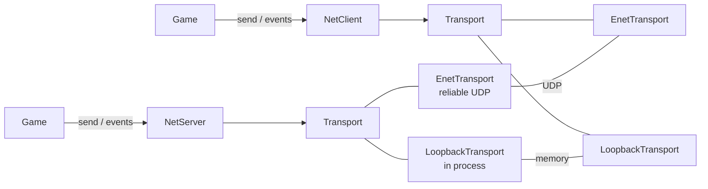
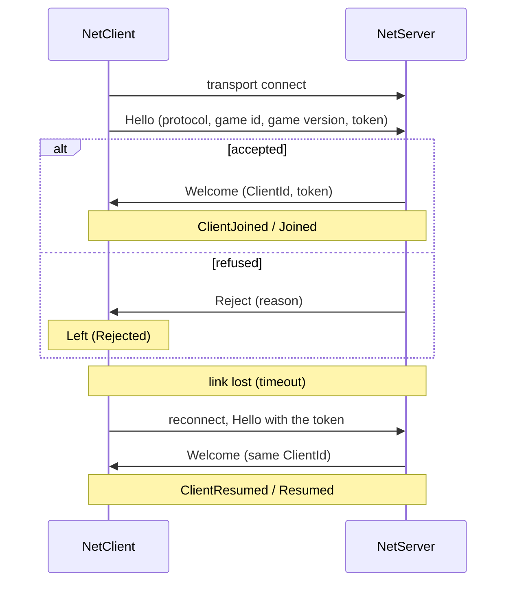

# Networking {#page-networking}

[TOC]

**Level:** Engine developer. **Read first:** [Architecture](architecture.md).

This page describes the network module of Owl Engine: the transports that carry messages between processes, and the
server and client sessions built on them. Replication, RPC and lobbies build on these sessions
([roadmap](roadmap.md)).

## Overview {#networking-overview}



- A **transport** (`network::Transport`) moves byte messages between this process and its peers: a listener accepts
  peers, a client connects to one. It knows nothing of games or sessions.
- A **session** (`NetServer`, `NetClient`) runs on a transport: the client greets the server with its game and
  version, the server answers with a `ClientId`, and both exchange game messages. The server is authoritative:
  clients only talk to it.
- Everything runs on the thread that calls `onUpdate()` (or `poll()` for a bare transport): nothing is sent or
  received in between, no callback runs on another thread.

## Transports {#networking-transports}

| Backend             | `Transport::Type` | What it is                                                                          | Module                      |
|---------------------|-------------------|-------------------------------------------------------------------------------------|-----------------------------|
| `EnetTransport`     | `Enet`            | Reliable UDP on ENet: retransmission, ordering, fragmentation, timeouts             | `OWL_MODULE_NETWORK` (ENet) |
| `LoopbackTransport` | `Loopback`        | Links between transports of one process, no socket; every message arrives, in order | always built                |

`Transport::create(type)` returns the backend, or `NetworkError::BackendUnavailable` when ENet is not built in. A
loopback listener is named by its port within the process: tests, local play and a host playing on its own server use
it. `LoopbackTransport::severLink()` cuts a link the way a lost connection does, to exercise reconnection.

Every transport has `g_ChannelCount` (4) channels: the messages of one channel keep their order, channels do not wait
for each other. Each message is `Delivery::Reliable` (resent until acknowledged) or `Delivery::Unreliable` (sent once,
a late one is dropped). `poll()` appends `TransportEvent`s: `Connected`, `Received` (channel and bytes) and
`Disconnected` with a `DisconnectReason` (`Graceful`, `Timeout`, `Refused`). `getStats()` gives the round trip, the
loss and the byte counts of a peer.

### Simulated network conditions {#networking-conditions}

`ConditionedTransport` wraps any transport and sends its messages through a simulated bad network, to try a game on a
poor link without one. Its `LinkConditions` hold a `latencyMs`, a random `jitterMs` on top of it, the `loss` and
`duplicate` shares of unreliable messages, and a `seed`: one seed and one sequence of sends give the same outcome, so a
test stays reproducible. Only the sending side is conditioned; wrap both ends for a delay both ways.

- Reliable messages are only delayed, as on a real link where the backend resends them, and keep their order within a
  channel; unreliable ones may be lost, duplicated or overtaken.
- `disconnect()` waits for the messages held for the peer, so a `Reject` or a `Goodbye` still arrives first.
- `getStats()` adds the simulated delay to the round trip and the simulated loss to the packet loss;
  `setConditions()` changes them while connected, an optional clock replaces the steady clock in tests.

```c++
#include <network/ConditionedTransport.h>

const LinkConditions bad{.latencyMs = 80, .jitterMs = 40, .loss = 0.05f, .seed = 1};
NetClient client{mkUniq<ConditionedTransport>(std::move(*Transport::create(Transport::Type::Enet)), bad), config};
```

## Sessions {#networking-sessions}



A `SessionConfig` holds what both ends agree on: the `gameId` and `gameVersion` a client must match, `maxClients`,
the `handshakeTimeout` a connected peer has to greet the server, the `reconnectGrace` a lost client keeps its place,
and the `reconnectInterval` between the client's attempts.

- **Server**: `start(port)` (0 for a port chosen by the system, read back with `getPort()`), `send()` to one client,
  `broadcast()` to all, `kick()`, `stop()`. Each `onUpdate()` replaces `getEvents()`: `ClientJoined`, `ClientLost`,
  `ClientResumed`, `ClientLeft` (with a `LeaveReason`) and `Message`.
- **Client**: `connect(host, port)`, `send()`, `disconnect()`; its `State` goes `Connecting`, `Handshaking`,
  `Connected`, and `Reconnecting` while a lost link is restored. Events: `Joined`, `Lost`, `Resumed`, `Left` (with a
  `LeaveReason` and, when refused, a `RejectReason`) and `Message`.
- A **lost link** (a transport timeout) keeps the client's `ClientId` for the grace time: the client retries on its
  own with the token the server gave it, and the server binds the new link to the same client. A client that leaves,
  is kicked or outlasts the grace is gone for good.
- A client of another session protocol, game or game version is refused (`WrongProtocol`, `WrongGame`); so is a new
  client of a full server (`ServerFull`) and a reconnection whose session expired (`UnknownSession`).

```c++
#include <network/NetClient.h>
#include <network/NetServer.h>

using namespace owl::network;

const SessionConfig config{.gameId = "my.game", .gameVersion = 1};
NetServer server{std::move(*Transport::create(Transport::Type::Enet)), config};
server.start(7777);

NetClient client{std::move(*Transport::create(Transport::Type::Enet)), config};
client.connect("127.0.0.1", 7777);

// Each frame:
server.onUpdate(timestep);
for (const auto& event: server.getEvents())
	if (event.kind == ServerEvent::Kind::Message)
		server.broadcast(0, Delivery::Reliable, event.payload);
```

## Message bytes {#networking-bytes}

`ByteWriter` and `ByteReader` write and read little-endian integers, floats and length-prefixed strings, the byte
order of every Owl network message. A read past the end returns nothing and leaves the reader failed, so a truncated
or hostile message never reads out of bounds. Session messages start with one kind byte; the game's bytes follow it
untouched. The `net_session` fuzz target ([Continuous integration](continuous_integration.md))
sends arbitrary messages to a server and to a client.

## Build {#networking-build}

ENet comes with `OWL_MODULE_NETWORK` (on by default, [Building](building.md#engine-modules)). Without it, the module's
public API stays: `Transport::create(Type::Enet)` fails and the loopback transport works.
