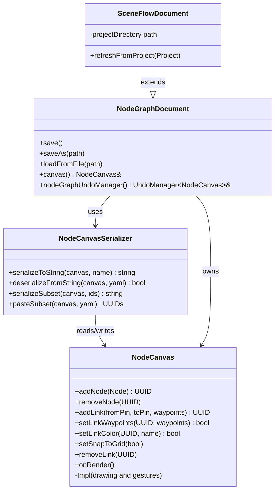

# Node Graph {#page-node-graph}

[TOC]

This page documents Owl Engine's generic node-graph widget and the editor subsystems built on top of it. The framework is
designed to be **reusable**: visual scripts and [PCG graphs](pcg_graphs.md) are consumers; future releases reuse the
same canvas for animation graphs, behaviour trees and dialogue trees.

## Current status

| Piece                                                 | Status                        |
|-------------------------------------------------------|-------------------------------|
| `gui::widgets::NodeCanvas` widget                     | Done                          |
| `UndoCommand<T>` / `UndoManager<T>`                   | Done                          |
| `NodeCanvasSerializer` (YAML round-trip + copy/paste) | Done                          |
| `NodeGraphDocument` (third tab kind)                  | Done                          |
| Node-graph undo commands                              | Done                          |

## Architecture



## `gui::widgets::NodeCanvas`

Location: `source/owl/public/gui/widgets/NodeCanvas.h` +
`source/owl/private/gui/widgets/NodeCanvas.cpp`.

The canvas is a **data container**: it holds nodes and links, routes user events to callbacks, and draws itself. It
never touches scene, physics or any business data — domain side effects (e.g. creating a teleport trigger when the user
connects two scenes) belong to the callbacks the client installs.

### Types

| Type      | Role                                                                   |
|-----------|------------------------------------------------------------------------|
| `PinKind` | `Input` / `Output` — side of the node the pin sits on                  |
| `NodePin` | UUID + label + `typeTag` (opaque string for client-side validation)    |
|           | + colour + `exec` (an execution chevron rather than a data circle)     |
| `Node`    | UUID + title + 2D position + input/output pins + `customData` + colour |
|           | + a glyph before the title, in its own colour (the kind of the node)   |
| `Link`    | UUID + source output pin UUID + destination input pin UUID + waypoints |
|           | + `color`, a name of `getLinkColors` (empty: the colour of its pin)    |

`customData` is an opaque YAML blob owned by the client — it travels through copy/paste and serialization unchanged. The
Scene Flow view stores the relative scene path there.

### Callbacks

Every callback is optional. Install them with `setOn*` methods before the first `onRender()` call.

| Callback                    | Fires when                                                          |
|-----------------------------|---------------------------------------------------------------------|
| `setLinkValidator`          | User attempts to draw a link — return false to veto                 |
| `setOnLinkCreated`          | After a link was accepted and added to the canvas                   |
| `setOnLinkDeleted`          | User deleted a link (keyboard / context menu)                       |
| `setOnLinkWaypointsChanged` | Waypoints inserted, moved or deleted; receives the ones before      |
| `setOnLinkColorChanged`     | Colour chosen in the link menu (`setLinkColorsEnabled`); the before |
| `setOnNodeMoved`            | User dragged a node — receives the new top-left position            |
| `setOnNodeSelected`         | Single click on a node                                              |
| `setOnNodeDoubleClicked`    | Double click on the same node within 300 ms (detected in wrapper)   |
| `setOnContextMenu`          | Right click; `std::optional<UUID>` set when a specific node was hit |

### Drawing and gestures

The canvas draws itself with the node style of `gui/widgets/NodeStyle.h`, shared with the visual script editor: grid,
title bar, round pins on one row each (inputs and outputs aligned), links as curves coloured by their source pin. A link
with waypoints is a chain of curves, one from each point to the next, to steer it around nodes: the pins keep their
sides and each waypoint is crossed level towards where the link goes, so a link routed backwards does not loop. A
coloured link draws its pins in its colour. With `setSnapToGrid`, the node under the mouse and the dragged waypoints
land on the grid (`snapToNodeGrid`), the other selected nodes keep their place relative to it.

| Gesture                        | Action                                                          |
|--------------------------------|-----------------------------------------------------------------|
| Click a node                   | Select it (**Ctrl** toggles, **Shift** adds); double-click      |
| Drag a node                    | Move the selection (`setOnNodeMoved` for each moved node)       |
| Drag on the background         | Select the nodes in the rectangle                               |
| Drag from a pin to a pin       | Link, through `setLinkValidator`                                |
| Hover a link, **Delete**       | Remove the link                                                 |
| **Alt**+click a link           | Cut it (`setOnLinkDeleted`)                                     |
| Right click a link             | Its menu: **Add Waypoint** here, **Colour**, **Delete Link**    |
| Drag a waypoint                | Move it; the waypoints of links inside a moved selection follow |
| Hover a waypoint, **Delete**   | Remove the waypoint                                             |
| Right-drag, middle-drag, wheel | Pan and zoom; the wheel zooms only with no popup open           |
| Right click off a link         | `setOnContextMenu`                                              |

## `gui::widgets::NodeCanvasSerializer`

YAML round-trip for a canvas. Format is domain-agnostic — each client (visual scripts, future animation graphs…) puts its
own schema into node
`customData`.

```yaml
NodeGraph: MyFlow
FormatVersion: 1
Nodes:
  - id: 12345
    title: "Level 1"
    position: [ 100, 50 ]
    titleColor: [ 1.0, 1.0, 1.0, 1.0 ]
    inputs:
      - { id: 1, label: "entry", typeTag: "scene_entry" }
    outputs:
      - { id: 2, label: "→ Level 2", typeTag: "scene_exit" }
    customData: |
      scenePath: scenes/level1.owl
Links:
  - { id: 10, from: 2, to: 11, waypoints: [ [ 180, 90 ] ] }
```

Copy/paste use `serializeSubset(canvas, selectedIds)` to emit a YAML document for just the selected nodes, then
`pasteSubset(canvas, yaml)`
to inject a copy with fresh UUIDs for every node, pin and link. The paste preserves internal link topology (links whose
endpoints are both inside the subset) and discards the rest.

## Templated undo system

The undo stack is parameterized over its **target type** so scene edits and node-graph edits coexist with full type
safety.

- `UndoCommand<Target>` — abstract base for all reversible actions
- `UndoManager<Target>` — per-target stack with merge coalescing and dirty tracking
- `SceneUndoCommand` / `SceneUndoManager` — aliases for `Target = scene::Scene`
  (the default editor case)
- `NodeGraphUndoManager` — alias for `UndoManager<gui::widgets::NodeCanvas>`, owned by every `NodeGraphDocument`

Every existing editor command (`CreateEntityCommand`, `ModifyEntityCommand`,
`ReparentCommand`, `InstantiatePrefabCommand`, ...) inherits from
`SceneUndoCommand` with no behaviour change.

The concrete node-graph commands live in
`source/owlnest/sources/commands/NodeGraphCommands.{h,cpp}`:

| Command             | Behaviour                                                                  |
|---------------------|----------------------------------------------------------------------------|
| `AddNodeCommand`    | Adds a node; undo removes it                                               |
| `RemoveNodeCommand` | Removes a node AND captures its attached links; undo restores both         |
| `MoveNodeCommand`   | Moves a node; merges rapid successive moves on the same node into one step |
| `AddLinkCommand`    | Adds a link between two pins                                               |
| `RemoveLinkCommand` | Removes a link; undo re-creates it (new UUID is reused on redo)            |

## `NodeGraphDocument`

Third concrete `DocumentType` (alongside `Scene` and `Code`). Owns a
`NodeCanvas` and a `NodeGraphUndoManager`. `save()`/`saveAs()` use
`NodeCanvasSerializer`; dirty is a full YAML diff against the snapshot captured at the last save.

Integration surface:

- `EditorLayer::openNodeGraphFile(path)` — loads a `.owlflow` and adds a tab (or activates an existing tab pointing at
  the same path).
- `ContentBrowser` — double-clicking a `.owlflow` file routes to the handler above; drag-drop targets also call it.
- Ribbon — the contextual "Graph" tab exposes Save / Close for the active node-graph document.

## Consumers

| Document type | Target type                                                     | Extension |
|---------------|-----------------------------------------------------------------|-----------|
| Visual script | Event graphs compiled to Lua                                    | `.owlvs`  |
| PCG graph     | Procedural generation of tilemaps ([PCG graphs](pcg_graphs.md)) | `.owlpcg` |

## Planned consumers

| Document type          | Target type                  | Extension  |
|------------------------|------------------------------|------------|
| Animation graph        | Anim state machine           | `.owlanim` |
| Behaviour tree         | AI behaviour trees           | `.owlbt`   |
| Dialogue tree          | Branching conversations      | `.owldlg`  |

The node canvas is free of domain knowledge so all of these can share a single widget and the single YAML serialization
format above.
