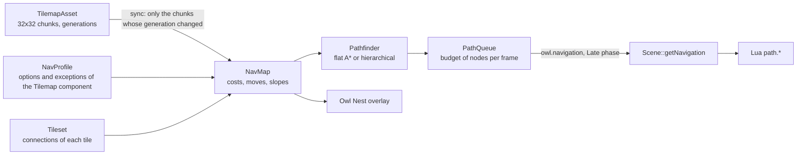

# Tile-graph pathfinding {#page-pathfinding}

[TOC]

Vehicles of a Transport Tycoon-like game follow a graph of tiles (roads, tracks), not a navigation mesh. A `Tilemap`
carries `navigation` options that turn one of its layers into a graph, the roads coming from the tileset; the engine searches shortest paths over it, spreads
the long queries over frames, and updates the graph chunk by chunk when a tile changes. The code is `scene::nav`
(`source/owl/public/scene/nav/`).



## The profile

The `navigation` key of the `Tilemap` component (inspector section **Navigation**) holds a `NavProfile`:

| Field        | Meaning                                                                                                                                                                           |
|--------------|-----------------------------------------------------------------------------------------------------------------------------------------------------------------------------------|
| `mode`       | How the graph is read: `connections` (the tileset says which tiles are roads), `cells` (any non-empty cell), `rules` (legacy, explicit rules; the mode of a file without `mode`). |
| `layer`      | Layer of the tilemap the graph is read from.                                                                                                                                      |
| `source`     | `overlay` (roads, tracks) or `terrain` (walking on the ground tile).                                                                                                              |
| `maxRise`    | Highest rise, in height steps, a move may cross over one cell (0 to 4).                                                                                                           |
| `climbCost`  | Extra cost, in cells, of climbing one height step.                                                                                                                                |
| `allowSteep` | Whether a cell on a steep slope can be crossed.                                                                                                                                   |
| `overrides`  | Exceptions of single cells: `cell: [x, y]`, `noExit` / `noEnter` (sides closed to leaving or entering) and `cost`.                                                                |
| `rules`      | Legacy, `mode: rules` only: one rule per tile (`tile`, `cost`, `exits`, `enters`).                                                                                                |

```yaml
Tilemap:
  tilemapPath: tilemaps/iso_town.owltilemap
  navigation:
    mode: connections
    layer: 1
    source: overlay
    maxRise: 1
    climbCost: 0.5
    allowSteep: false
    overrides:
      - {cell: [12, 7], noEnter: [north], cost: 2}   # exit only by the north side, twice as slow
```

### Roads come from the tileset

In `connections` mode a cell is a node when its tile has `connections` in the tileset (`.owltileset`, per tile):

```yaml
tiles:
  - {index: 3, name: road, connections: [east, west]}      # a straight road along x
  - {index: 13, name: road end n, connections: [north]}    # a dead end open to the north
  - {index: 12, name: road alone, connections: []}         # a road tile that joins nothing
```

A tile without `connections` is not part of the graph. The sides are the map directions (`east` is +x, `south` is +y,
`west` is -x, `north` is -y); in the isometric view they point to the lower right, lower left, upper left and upper
right of the screen. The `tools/iso_atlas` generator writes them for the 16 road shapes and the Tileset Editor edits
them (section **Navigation** of the tile properties). A move to a neighbour exists when both cells join each other
(the first one is connected towards it, the second one back), and no slope is in the way: a steep cell is blocked
unless `allowSteep`, and a cell whose rise along the move is above `maxRise` blocks it. The cost of a move is the sum
of the costs of both cells (a base move is 1) plus `climbCost` for the height climbed. Changing the connections of the
tileset rebuilds the graph.

### Exceptions

`overrides` only restrict what the tiles allow, they never open a side a tile keeps closed. Per cell side the state is
**two-way**, **exit only** (movers leave the cell by this side, none comes in), **enter only** or **closed**; the
neighbour cell is updated to agree, so a one-way road is one click. A cell can also carry its own `cost` (1 is a normal
road, 3 three times slower; absent keeps the cost of its tile). They are edited with the Navigation tool of the
isometric view, through the `nav.set_edge`, `nav.set_cell_cost` and `nav.clear_cell` commands (undoable, journaled).

### Legacy rules

A profile with `rules` and no `mode` still loads as `mode: rules` and builds the graph as before: a move exists when both
cells have a rule, the first one lets the mover leave in that direction (`exits`) and the second one lets it enter
heading that way (`enters`). The inspector offers **Use the tileset connections instead** to drop them.

## Searches

Both searches are exact and return paths of the same cost (a unit test compares them on random maps with one-way
tiles, costs and slopes):

- **Flat**: A* over the cells with the Manhattan distance at the lowest edge cost as heuristic.
- **Hierarchical**: A* over the border cells of the 32 x 32 chunks. Inside a chunk, the cost between two border cells
  is the best path that stays in it, computed once per border cell and kept in the map until that chunk changes. The
  path found is then refined chunk by chunk. It pays when the same network is queried again and again.
- **Auto** (default): flat, except hierarchical for cells at least 3 chunks apart on a sparse graph (at most one cell
  in five is a node).

- **No reverse** (`PathOptions`): for a vehicle that keeps its heading. A move back to the cell just left is forbidden
  unless the cell is a dead end (a single exit), and the first move cannot reverse the `heading` the vehicle has at the
  start. The state of the search is the cell and the direction it was entered by (5 entry states per cell, none when
  there is no heading), so the path is the cheapest one under the constraint, and a goal that only a U-turn reaches is
  `NotFound`. It is always a flat search: `Auto` and `Hierarchical` fall back to flat when `noReverse` is set. Sliced
  and resumable like the others, `PathQueue::request` keeps the options of each request.

`Pathfinder::begin` / `step(budget)` run a search in slices, `Pathfinder::find` runs it whole. The working arrays are
kept, so a search allocates nothing once they reached the size of the map.

## Changes of the map

`NavMap::sync` compares the generation of every chunk of the layer (and of the corner heights around it) with the one
it saw and rebuilds only the chunks that changed: a bulldozed road costs one chunk, about 5 µs. `getVersion` grows with
every change, a request being searched when it changes starts over, and `isPathValid` tells whether a path found
earlier still exists.

## Requests over frames

`PathQueue::request` queues a query, the `owl.navigation` system (`Late` phase) spends `NavWorld::getBudget` node
expansions per frame (4000 by default, about 0.2 ms) on the oldest ones, `getStatus` and `getResult` poll. Slots and
buffers of released requests are reused.

## Lua

```lua
local request = path.find(map, from_x, from_y, to_x, to_y)   -- 0 when the entity has no graph
-- next frames
if path.poll(map, request) == "found" then
    local cells, cost = path.get(map, request)               -- {x1, y1, x2, y2, ...}
    path.release(map, request)
end
if path.get_version(map) ~= version then ... end              -- a road was built or bulldozed
-- a vehicle heading East that never turns back, except at a dead end (options may replace the mode)
local request = path.find(map, x, y, to_x, to_y, { no_reverse = true, heading_x = 1, heading_y = 0 })
```

Every function is in the [Lua API reference](lua-api.md#path). The `iso_town` vehicles of the Engine Demo
(`scripts/iso/iso_town_traffic.lua`) drive to a random road cell (seeded, another one on arrival) that way, never turning back except at a dead end where
they loop round the middle of the cell, look for another way when a road of their route is bulldozed (scenario
`iso_town`), plan their route again at the next cell when a road was built (a vehicle left standing on a bulldozed cell
asks from the road cell it came from, without a heading), and wait when no route exists.

## Seeing the graph and the routes

`path.set_debug(true)` makes the scene draw the graph of every tilemap with a navigation graph (two-way moves in green, one-way
moves in orange with an arrow) and the routes scripts hand to `path.show_route(map, id, cells, r, g, b)` (one line per
id, a diamond on the last cell, `path.clear_routes(map)` removes them all). The overlay is drawn by the scene over the
isometric view, in the game and in the Play view of Owl Nest. In the Engine Demo **F3** (the `nav_debug` action) toggles
it and `iso_town_traffic.lua` gives each vehicle its own colour and gives the overlay its route at every plan.

## Owl Nest

The **Navigation** section of the `Tilemap` inspector holds the global options only, in plain words: the layer the
graph is read from (by its name), the tile read, the read mode (tileset connections or any non-empty cell), the maximum
slope rise, the climb cost, allow steep slopes and a **Show graph** button (undoable like any component edit). Roads are
described by the tileset: tick **Part of a road graph** and light the arrows of the sides a tile joins in the **Navigation**
section of its properties in the Tileset Editor (the arrows are oriented as on the screen of the isometric view).

In the isometric viewport, **Show > Navigation graph and routes** (or **Show graph**) draws the graph over the map: two-way
moves in green, one-way moves in orange with an arrow, moves cut or made one-way by an exception in magenta, a closed side
as a red cross and a cell with its own cost ringed in yellow. In Play, the eye button at the bottom-right of the view toggles
the same overlay, with the routes the running scripts give it. With the overlay on, **Shift + click** picks the start then
the goal of a test path drawn in yellow (a third click starts over, **Shift + right click** clears it).

The **Navigation tool** (signpost button of the view overlay) edits the exceptions directly on the map: hover a road cell
to see an arrow on each of its sides, the one nearest to the cursor is highlighted; a **left click** cycles it two-way,
exit only, enter only, closed; a **right click** opens the cell popup (its own cost, **Clear exceptions**). Every click is
undone with Ctrl+Z (clicks within a second merge into one step).

## Measures

`owl_bench --filter=path/` on a 1024 x 1024 map (`test/bench/cases/PathBench.cpp`, reference i9-13950HX, one core):

| Case                           | Flat    | Hierarchical (warm) | Hierarchical (cold) |
|--------------------------------|---------|---------------------|---------------------|
| Open ground, corner to corner  | 0.22 ms | 2.7 ms              | 5.2 ms              |
| Streets every 8 cells          | 0.14 ms | 0.46 ms             | 1.1 ms              |
| Comb (one avenue, 128 streets) | 3.7 ms  | 0.83 ms             | 10 ms               |
| Walls with one gap each        | 145 ms  | 171 ms              | 1.6 s               |

Building the graph of the whole map takes 7 ms, a one-cell edit 5 µs, an edit followed by a hierarchical query
0.43 ms. Hierarchical wins only on repeated queries over a sparse, maze-like network: that is why `Auto` rarely picks
it, and why a long open-ground query (the walls case) stays a job for several frames.
