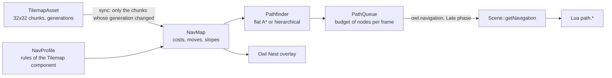

# Tile-graph pathfinding {#page-pathfinding}

[TOC]

Vehicles of a Transport Tycoon-like game follow a graph of tiles (roads, tracks), not a navigation mesh. A `Tilemap`
carries `navigation` rules that turn one of its layers into a graph; the engine searches shortest paths over it, spreads
the long queries over frames, and updates the graph chunk by chunk when a tile changes. The code is `scene::nav`
(`source/owl/public/scene/nav/`).



## The rules

The `navigation` key of the `Tilemap` component (inspector section **Navigation**) holds a `NavProfile`:

| Field        | Meaning                                                                                              |
|--------------|------------------------------------------------------------------------------------------------------|
| `layer`      | Layer of the tilemap the graph is read from.                                                         |
| `source`     | `overlay` (roads, tracks: only the listed overlay tiles are nodes) or `terrain` (walking on ground). |
| `rules`      | One rule per tile that is part of the graph: `tile`, `cost`, `exits`, `enters`.                      |
| `maxRise`    | Highest rise, in height steps, a move may cross over one cell (0 to 4).                              |
| `climbCost`  | Extra cost, in cells, of climbing one height step.                                                   |
| `allowSteep` | Whether a cell on a steep slope can be crossed.                                                      |

```yaml
Tilemap:
  tilemapPath: tilemaps/iso_town.owltilemap
  navigation:
    layer: 1
    source: overlay
    maxRise: 1
    climbCost: 0.5
    allowSteep: false
    rules:
      - {tile: 3, cost: 1, exits: [east, west], enters: [east, west]}
      - {tile: 13, cost: 1, exits: [north], enters: [south]}   # a dead end open to the north
```

A move to a neighbour (4 directions) exists when both cells have a rule, the first one lets the mover leave in that
direction (`exits`), the second one lets it enter heading that way (`enters`), and no slope is in the way: a steep cell
is blocked unless `allowSteep`, and a cell whose rise along the move is above `maxRise` blocks it. A **one-way** road
lists a single direction in `exits`. The cost of a move is the sum of the costs of both cells (a base move is 1) plus
`climbCost` for the height climbed.

## Searches

Both searches are exact and return paths of the same cost (a unit test compares them on random maps with one-way
tiles, costs and slopes):

- **Flat**: A* over the cells with the Manhattan distance at the lowest edge cost as heuristic.
- **Hierarchical**: A* over the border cells of the 32 x 32 chunks. Inside a chunk, the cost between two border cells
  is the best path that stays in it, computed once per border cell and kept in the map until that chunk changes. The
  path found is then refined chunk by chunk. It pays when the same network is queried again and again.
- **Auto** (default): flat, except hierarchical for cells at least 3 chunks apart on a sparse graph (at most one cell
  in five is a node).

`Pathfinder::begin` / `step(budget)` run a search in slices, `Pathfinder::find` runs it whole. The working arrays are
kept, so a search allocates nothing once they reached the size of the map.

## Changes of the map

`NavMap::sync` compares the generation of every chunk of the layer (and of the corner heights around it) with the one
it saw and rebuilds only the chunks that changed: a bulldozed road costs one chunk, about 5 µs. `getVersion` grows with
every change, a request being searched when it changes starts over, and `isPathValid` tells whether a path found
earlier still exists.

## Requests over frames

`PathQueue::request` queues a query, the `owl.navigation` system (`Late` phase) spends `NavWorld::getBudget` node
expansions per frame (4000 by default, about 0.2 ms) on the oldest ones, `getStatus` and `getResult` poll. Slots and
buffers of released requests are reused.

## Lua

```lua
local request = path.find(map, from_x, from_y, to_x, to_y)   -- 0 when the entity has no graph
-- next frames
if path.poll(map, request) == "found" then
    local cells, cost = path.get(map, request)               -- {x1, y1, x2, y2, ...}
    path.release(map, request)
end
if path.get_version(map) ~= version then ... end              -- a road was built or bulldozed
```

Every function is in the [Lua API reference](lua-api.md#path). The `iso_town` vehicles of the Engine Demo
(`scripts/iso_town_traffic.lua`) drive from stop to stop that way, look for another way when a road of their route is
bulldozed (scenario `iso_town`), and wait when no route exists.

## Owl Nest

The **Navigation** section of the `Tilemap` inspector edits the rules (undoable like any component edit). In the
isometric viewport, **Show > Navigation graph** draws the graph over the map: two-way moves in green, one-way moves in
orange with an arrow. With the overlay on, **Shift + click** picks the start then the goal of a test path drawn in
yellow (a third click starts over, **Shift + right click** clears it).

## Measures

`owl_bench --filter=path/` on a 1024 x 1024 map (`bench/cases/PathBench.cpp`, reference i9-13950HX, one core):

| Case                           | Flat    | Hierarchical (warm) | Hierarchical (cold) |
|--------------------------------|---------|---------------------|---------------------|
| Open ground, corner to corner  | 0.22 ms | 2.7 ms              | 5.2 ms              |
| Streets every 8 cells          | 0.14 ms | 0.46 ms             | 1.1 ms              |
| Comb (one avenue, 128 streets) | 3.7 ms  | 0.83 ms             | 10 ms               |
| Walls with one gap each        | 145 ms  | 171 ms              | 1.6 s               |

Building the graph of the whole map takes 7 ms, a one-cell edit 5 µs, an edit followed by a hierarchical query
0.43 ms. Hierarchical wins only on repeated queries over a sparse, maze-like network: that is why `Auto` rarely picks
it, and why a long open-ground query (the walls case) stays a job for several frames.
