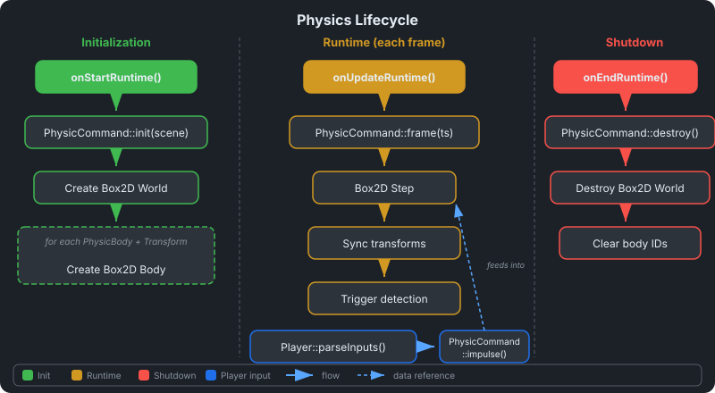
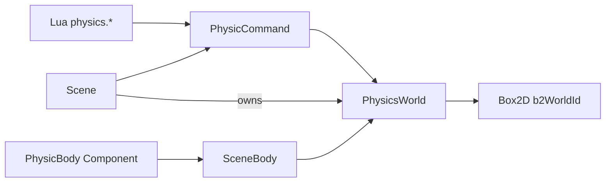
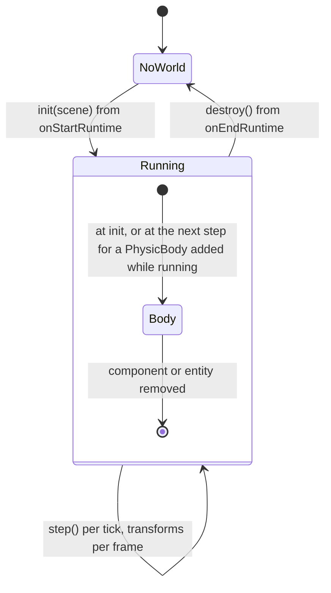
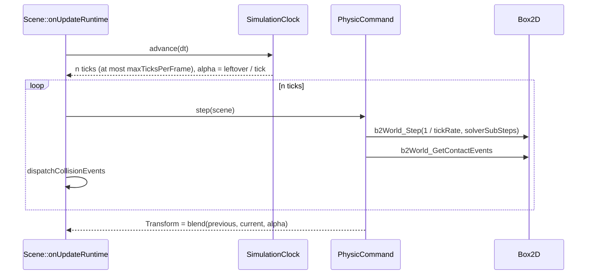
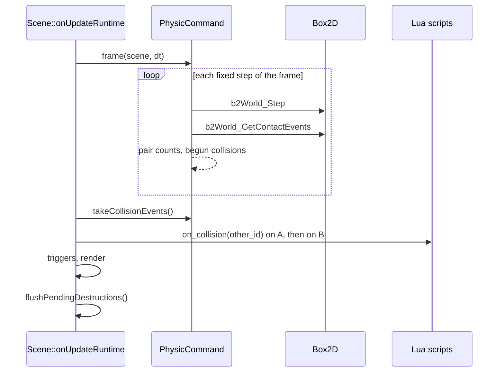

# Physics System {#page-physics}

[TOC]

This page describes the Owl Engine physics system: rigid bodies, the scene lifecycle and gameplay code.

## Overview

Owl Engine provides 2D rigid-body physics with [Box2D](https://box2d.org/), through the `PhysicCommand` static
facade and the `PhysicBody` component. Each scene owns its Box2D world, so several scenes simulate side by side. The
simulation works in **world space**, independent of the hierarchy ([Physics and Hierarchy](#hierarchy)), and only in
**Play mode**.

## Architecture



The module follows the facade + pimpl pattern of the sound and renderer modules ([Architecture](architecture.md)):



| Class                   | Role                                                                               |
|-------------------------|------------------------------------------------------------------------------------|
| `PhysicCommand`         | Static facade: `init` / `destroy` / `frame` / `impulse` / `velocity` / `transform` |
| `PhysicsWorld`          | Private class of one scene: the Box2D `b2WorldId`, its body map and solver pool    |
| `SceneBody`             | Data class holding physics properties (type, density, friction, ...)               |
| `component::PhysicBody` | ECS component wrapping a single `SceneBody` instance                               |

`PhysicCommand` holds no state: `init(scene)` creates the `PhysicsWorld` the scene keeps (`Scene::getPhysicsWorld()`)
until `destroy(scene)`, `onEndRuntime()` or its destructor, so nothing dangles. Scene-level calls (`frame`,
`takeCollisionEvents`, `getSettings`...) take the scene, body calls (`impulse`, `getVelocity`...) an entity.

## PhysicBody Component

`PhysicBody` wraps a `SceneBody` (YAML key `PhysicBody`):

| Field         | Type       | Default     | Description                                         |
|---------------|------------|-------------|-----------------------------------------------------|
| type          | `BodyType` | `Dynamic`   | How Box2D treats the body (see table below)         |
| fixedRotation | `bool`     | `false`     | Lock rotation so the body cannot spin               |
| colliderSize  | `vec3f`    | `{1, 1, 1}` | Half-extents of the box collider (x, y used for 2D) |
| density       | `float`    | `1.0`       | Material density, affects mass                      |
| restitution   | `float`    | `0.0`       | Bounciness coefficient (0 = no bounce, 1 = full)    |
| friction      | `float`    | `0.5`       | Surface friction coefficient                        |
| bodyId        | `uint64_t` | `0`         | Runtime-only internal id (not serialized)           |

`bodyId` is assigned by `PhysicCommand::init()` and maps to the `b2BodyId` of the body table.

### BodyType

| Value       | Description                                                        |
|-------------|--------------------------------------------------------------------|
| `Static`    | Immovable body, participates in collision but never moves          |
| `Dynamic`   | Fully simulated body, affected by forces, impulses, and gravity    |
| `Kinematic` | Moved programmatically, not affected by forces but can push others |

## Physics Lifecycle



### init(scene)

Called from `Scene::onStartRuntime()`: reads the scene's [physics settings](#fixed-step), creates the Box2D world
(gravity `(0, -9.81)`, plus the task callbacks of the [multi-threaded solver](#multi-threaded-solver) when several
threads are used), then for each entity with a `PhysicBody` and a `Transform`:

1. a `b2BodyId` at the **world** transform (`Scene::getWorldTransform()`), with its type and `fixedRotation`;
2. a box collider scaled by `colliderSize * worldScale`, with `density`, `friction`, `restitution` and contact events;
3. the maps `bodyId` → `b2BodyId` and Box2D body → entity UUID.

Collidable tilemaps, raycast doors and pushwalls get bodies the same way, owned by their entity. Then bodies follow
their components: a `PhysicBody` added while running gets its body at the next `step()`, a copied one never shares
the source's body, and removing the component (or a `Tilemap`, door, pushwall) or its entity destroys the body; a
door or pushwall added while running gets none.

### step() and writeFrameTransforms() {#step}

The `owl.physics` system (phase `Physics`, see [Systems and phases](scene.md#systems)) calls `step(scene)` once per
fixed tick of the scene's simulation clock, and writes the transforms once per frame:

1. **Fixed step** -- one Box2D step of the tick duration (`b2World_Step`, `solverSubSteps` sub-steps) (see
   [Fixed Step](#fixed-step)).
2. **Contact events** -- after the step, reads the begin / end touch events (`b2World_GetContactEvents`) and
   records the collisions that began (see [Collision Events](#collision-events)); they are dispatched to the
   scripts right after the step.
3. **Capture** -- keeps the body poses of the last two steps.
4. **Sync transforms** -- for each entity with a `PhysicBody`, writes the body position and rotation to the entity's
   `Transform` component: the simulated pose after a tick that is not the frame's last one, the drawn pose (blended
   between the last two steps when interpolation is on, `writeFrameTransforms`) after the last one or, in a frame
   without a tick, in the `Physics` update. If the entity has a parent in the hierarchy, the world position is
   converted back to **local space** using the inverse of the parent's world transform.

`frame(scene, timestep)` does the same outside the systems (benchmarks, tests): advance the clock, step, write.

### destroy()

Called from `Scene::onEndRuntime()`: destroys the world and the body map; `isInitialized()` is then `false`.

## Fixed Step {#fixed-step}

The world advances one step per tick of the scene's **simulation clock** (`Scene::getSimulationClock()`,
`scene::SimulationClock`), whatever the frame rate: the result of a simulation depends only on the number of ticks,
not on how frames are cut. The tick rate is a project setting (`simulation:` in `owl_project.yml`, see
[Fixed simulation tick](scene.md#fixed-tick)); at the default 60 Hz a frame of 40 ms runs two steps and keeps
6.7 ms, a frame of 4 ms runs none and only moves the interpolated transforms.

| Setting          | Default | Range   | Meaning                                                    |
|------------------|---------|---------|------------------------------------------------------------|
| `solverSubSteps` | `4`     | 1 to 16 | Box2D sub-steps inside one step                            |
| `interpolate`    | `true`  |         | Draw the transforms blended between the last two steps     |
| `workerCount`    | `0`     | 0 to 32 | Solver threads: 0 automatic, 1 single-threaded (see below) |

The settings belong to the scene (`Scene::getPhysicsSettings()`, `physics::PhysicsSettings`) and are saved in the
scene file only when they differ from the defaults:

```yaml
Scene: untitled
Physics:
  solverSubSteps: 4
  interpolate: true
  workerCount: 0
Entities: ...
```

The `tickRate` and `maxStepsPerFrame` keys a scene may still carry are ignored with a warning: the project's
tick rate and tick bound replace them. In Owl Nest the settings are edited in the **Physics** section of the *Scene
Settings* panel (undoable), the tick rate in *Project Settings*; they are read when Play starts.

- **Step bound.** A long frame (synchronous load, window drag) runs `maxTicksPerFrame` ticks and drops the rest:
  the game slows down for that frame instead of stalling under an ever larger backlog (spiral of death), and no
  single step grows large enough to tunnel or explode contacts.
- **Interpolation.** With `interpolate` on, `Transform` shows the pose between the last two steps, by the
  fraction of a tick left in the clock (`SimulationClock::getAlpha()`, `PhysicCommand::getInterpolationAlpha(scene)`):
  motion is smooth at any frame rate, at the cost of up to one step of display latency. Box2D stays the authority:
  velocities, impulses and `getVelocity` act on the simulated state. `setTransform` (teleport) moves both poses by the
  same offset, so a teleport is never blended across. Before the scripts, the `owl.physics_poses` system writes the
  simulated poses back into the transforms: gameplay code reads the simulation and only the drawing sees the blend.
  `SaveManager::save` calls `PhysicCommand::syncSimulatedTransforms(scene)` first, so a save stores the simulated
  positions that match its velocity snapshots.
- **Input.** `on_update` and `Player::parseInputs` run once per frame, before the frame's ticks: an impulse applied
  there lands before the frame's first step. Code that must run with the simulation, once per step, goes in
  `on_tick` (Lua) or a system's `tick` function.



## Multi-threaded Solver {#multi-threaded-solver}

Box2D 3 runs its collision, solver and body-finalisation passes as parallel tasks handed to the host through
`b2WorldDef.enqueueTask` / `finishTask`. Owl Engine backs them with a Taskflow executor (`SolverTaskPool`, private to
the engine), owned by each multi-threaded world and destroyed with it.

- **Worker count.** `workerCount = 1` keeps Box2D's single-threaded path (no task pool). `0` (automatic) uses
  half the hardware threads, at most 4, but only for worlds of at least 2 000 dynamic bodies counted at `init()`:
  below that, dispatching the tasks costs more than it saves. `PhysicCommand::getWorkerCount(scene)` reports the
  count in use.
- **Dedicated executor.** The pool does not share the `core::task::Scheduler` threads: within a step, Box2D's
  solver tasks spin-wait on each other, so they must all run at once, and a long Scheduler job holding a worker
  would stall the step.
- **No spare threads.** The executor has exactly `workerCount` threads. The tree rebuild and island split that
  Box2D runs beside its solver stage tasks do not need threads of their own: the worker 0 stage task claims every
  block left, so a stage task queued behind them does not stall the stage. Two spare threads slowed the 2-worker
  step by up to 60 % on a virtualised agent. The pose copies to the entities (`parallelFor`) run their last range
  on the calling thread.
- **Reproducibility.** Each task is split into at most `workerCount` ranges, and Box2D receives the range index
  as its worker index. A given worker count therefore gives the same result on every run; different counts
  differ slightly (Box2D merges per-worker state, such as the island-split candidate, in an order that depends
  on how bodies were partitioned).

- **AVX2.** On x86_64 the Box2D package can be built with AVX2 (8-wide solver instead of SSE2's 4-wide, about
  15 % faster; `-DOWL_PHYSICS_AVX2=ON`, recipe option `box2d/*:avx2`). It is off by default: virtualised CI agents
  and CPUs before Haswell or Excavator have no AVX2. Such a binary on such a CPU would crash on an illegal
  instruction: `PhysicCommand::init` checks the CPU first, logs an error and leaves the world uninitialised, so the
  game runs without physics. arm64 keeps Box2D's NEON path.

- **Pose copy.** Above 1 024 bodies, a multi-threaded world also spreads the per-frame copy of the poses to the
  entities over the executor; children of a hierarchy are written afterwards, on the calling thread, since they
  read their parent's world transform.

Measured on the 5 000-box pile of `test/bench/` (`physics/step_settled*`, i9-13950HX, `taskset -c 0-15`), per step:
4.5 ms single-threaded, 3.3 ms with 2 workers, 2.0 ms with 4, 1.44 ms with 8.

## Physics API

`PhysicCommand` exposes the following static methods for gameplay code:

| Method                                     | Description                                   |
|--------------------------------------------|-----------------------------------------------|
| `init(scene)`                              | Create Box2D world and bodies from scene      |
| `destroy()`                                | Destroy Box2D world and clear all bodies      |
| `isInitialized()`                          | Check if the physics world is active          |
| `step()`                                   | Run one fixed step of the scene's clock       |
| `writeFrameTransforms()`                   | Write the drawn (blended) poses               |
| `frame(timestep)`                          | Advance the clock, step and sync transforms   |
| `getSettings()`                            | Settings of the running world                 |
| `getLastFrameStepCount()`                  | Steps run before the last transform write     |
| `getWorkerCount()`                         | Solver threads in use (1 = single-threaded)   |
| `getInterpolationAlpha()`                  | Blend factor of the last transform write      |
| `syncSimulatedTransforms()`                | Write the last step's poses, not blended ones |
| `takeCollisionEvents()`                    | Hand over and clear the collisions begun      |
| `destroyBody(entity)`                      | Remove the entity's Box2D bodies              |
| `impulse(entity, vec2f)`                   | Apply a linear impulse to the entity's centre |
| `getVelocity(entity) -> vec2f`             | Read the entity's current linear velocity     |
| `setVelocity(entity, vec2f)`               | Override the entity's linear velocity         |
| `setTransform(entity, position, rotation)` | Teleport the body to a new position and angle |

Every method returns silently without a world or a `PhysicBody`; `impulse`, `getVelocity` and `setVelocity` skip
static bodies.

### Example: applying an impulse from a NativeScript

```c++
#include <physics/PhysicCommand.h>

void MyScript::onUpdate(const owl::core::Timestep& iTimeStep) {
    if (owl::input::Input::isKeyPressed(owl::input::key::Right)) {
        owl::physics::PhysicCommand::impulse(entity, {0.5f, 0.0f});
    }
    if (owl::input::Input::isKeyPressed(owl::input::key::Up)) {
        const auto vel = owl::physics::PhysicCommand::getVelocity(entity);
        if (std::abs(vel.y()) < 0.001f) {
            owl::physics::PhysicCommand::impulse(entity, {0.0f, 1.0f});
        }
    }
}
```

## Collision Events {#collision-events}

`step()` turns Box2D contact events into entity-level collisions. Each begin-touch event is resolved to the two
owning entities; Owl Engine counts the touching shape pairs of every entity pair and records a `CollisionEvent`
(`entityA`, `entityB` UUIDs) only when the count goes from 0 to 1. The events gathered since the last
`takeCollisionEvents()` record a pair at most once (with `frame()`, once per frame even if it touches, separates and
touches again within that frame's steps). End-touch events decrement the count, so a body
resting on the ground, or a player crossing the cells of a tilemap (one Box2D shape per cell), yields one collision,
not one per frame or per cell. `destroyBody()` forgets every pair of the destroyed entity.

The `owl.physics` system calls `Scene::dispatchCollisionEvents()` right after each `step()`: it takes
`PhysicCommand::takeCollisionEvents(scene)` and calls Lua `on_collision(other_id)` on both entities (see
[Lua Scripting](scripting.md)). Entities that are hidden or queued for destruction (`Scene::isPendingDestructionInTree()`)
are skipped, and the check is redone before each call. The events are read from a vector owned by the caller, not
from an EnTT view, and destruction from a callback is deferred to the end of the frame, so a callback cannot
invalidate the dispatch.



## Player Integration

Each frame the primary `Player` entity runs `ScenePlayer::parseInputs()`: the `move` (horizontal) and `jump`
actions of the [action map](event_input.md#actions) become `PhysicCommand` impulses:

| Field         | Type    | Default | Description                           |
|---------------|---------|---------|---------------------------------------|
| linearImpulse | `float` | `0.1`   | Horizontal impulse scaled by `move.x` |
| jumpImpulse   | `float` | `0.2`   | Vertical impulse applied on Space     |
| canJump       | `bool`  | `true`  | Whether jumping is allowed            |

A jump applies only when the vertical velocity is near zero (on the ground); `Player` needs a `PhysicBody`.

## Trigger Collision

Triggers react when the primary player overlaps them: after the physics step (`owl.triggers`, phase
`PostPhysics`) the scene intersects the axis-aligned boxes of each `Trigger` and of the player.

| Trigger Type | Effect                                                   |
|--------------|----------------------------------------------------------|
| `Victory`    | Sets scene status to `Victory`, displays win screen      |
| `Death`      | Sets scene status to `Death`, displays loss screen       |
| `Teleport`   | Queues a level load (optionally cross-level) to a target |
| `Target`     | Passive position marker, no action on collision          |

A teleport keeps the player's velocity ([Teleport System](scene.md#teleport-system)); the other types and the Lua
callbacks are in [Lua Scripting](scripting.md).

## Physics and Hierarchy {#hierarchy}

Bodies live in **world space**, independent of the hierarchy:

| Parent      | Child       | Behaviour                                                                                                  |
|-------------|-------------|------------------------------------------------------------------------------------------------------------|
| Non-physics | Physics     | Moving the parent does **not** move the physics child -- the child stays in its Box2D position             |
| Physics     | Physics     | Both bodies move **independently** -- Box2D simulates each body on its own regardless of parent-child link |
| Physics     | Non-physics | The non-physics child **follows** the parent via the normal hierarchy transform chain                      |

Written back, a world pose is converted to local space through the parent's inverse world transform, so `Transform`
stays consistent while Box2D keeps the authority. Hierarchy rules: [Scene System](scene.md#transform-hierarchy).
