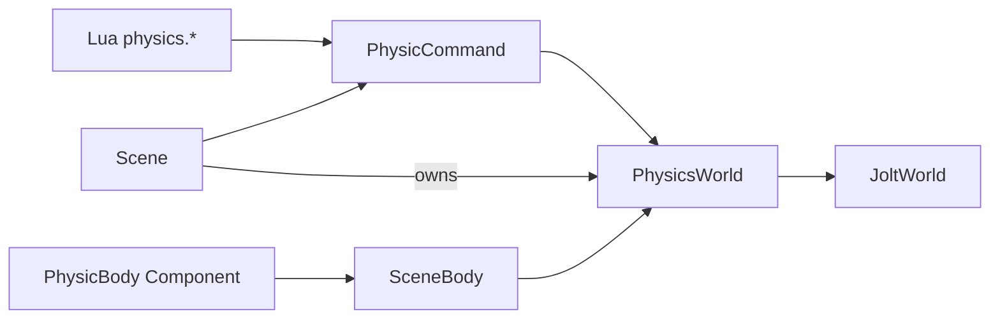
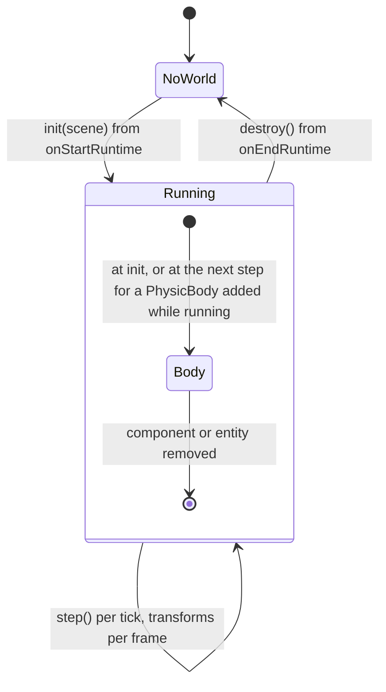
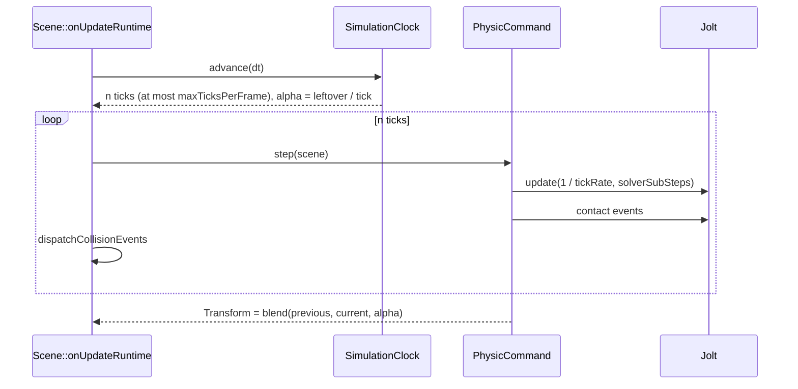
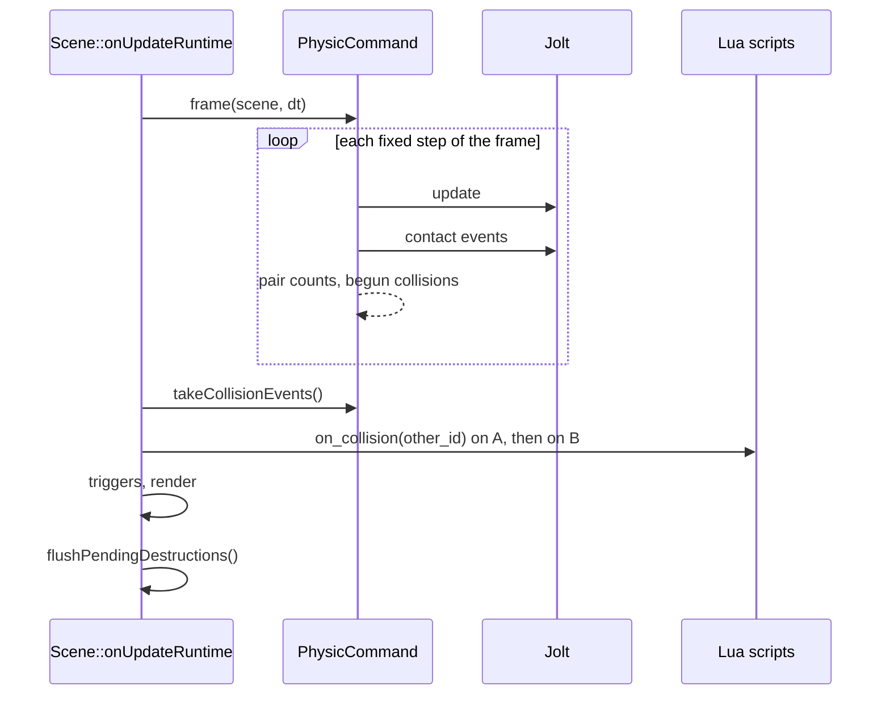

# Physics {#page-physics}

[TOC]

**Level:** Confirmed. **Read first:** [Scene and Components](scene.md).

This page describes the Owl Engine physics system: rigid bodies, the scene lifecycle and gameplay code.

## Overview

Owl Engine provides 2D rigid-body physics with [Jolt Physics](https://github.com/jrouwe/JoltPhysics), through the `PhysicCommand` static
facade and the `PhysicBody` component. Each scene owns its Jolt world, so several scenes simulate side by side. The
simulation works in **world space**, independent of the hierarchy ([Physics and Hierarchy](#hierarchy)), and only in
**Play mode**.

## Architecture

The module follows the facade + pimpl pattern of the sound and renderer modules ([Architecture](architecture.md)):



| Class                   | Role                                                                               |
|-------------------------|------------------------------------------------------------------------------------|
| `PhysicCommand`         | Static facade: `init` / `destroy` / `frame` / `impulse` / `velocity` / `transform` |
| `PhysicsWorld`          | Private class of one scene: the `JoltWorld`, its body map and solver pool          |
| `SceneBody`             | Data class holding physics properties (type, density, friction, ...)               |
| `component::PhysicBody` | ECS component wrapping a single `SceneBody` instance                               |

`PhysicCommand` holds no state: `init(scene)` creates the `PhysicsWorld` the scene keeps (`Scene::getPhysicsWorld()`)
until `destroy(scene)`, `onEndRuntime()` or its destructor, so nothing dangles. Scene-level calls (`frame`,
`takeCollisionEvents`, `getSettings`...) take the scene, body calls (`impulse`, `getVelocity`...) an entity.

## PhysicBody Component

`PhysicBody` wraps a `SceneBody` (YAML key `PhysicBody`):

| Field         | Type        | Default     | Description                                                     |
|---------------|-------------|-------------|-----------------------------------------------------------------|
| type          | `BodyType`  | `Dynamic`   | How Jolt treats the body (see table below)                      |
| dimension     | `Dimension` | `Plane`     | `Plane`: 2D, locked to the XY plane; `Space`: 3D, free in space |
| shape         | `Shape`     | `Box`       | `Box`, `Sphere`, `Capsule`, `Cylinder`, `ConvexHull`, `Mesh`    |
| fixedRotation | `bool`      | `false`     | Lock rotation so the body cannot spin                           |
| colliderSize  | `vec3f`     | `{1, 1, 1}` | Size of the collider, times the entity scale (see below)        |
| sensor        | `bool`      | `false`     | Detects bodies entering it without stopping them (see below)    |
| layer         | `uint8_t`   | `0`         | Collision layer, 0 to 7                                         |
| mask          | `uint8_t`   | `255`       | Layers the body collides with, one bit per layer                |
| density       | `float`     | `1.0`       | Material density, affects mass                                  |
| restitution   | `float`     | `0.0`       | Bounciness coefficient (0 = no bounce, 1 = full)                |
| friction      | `float`     | `0.5`       | Surface friction coefficient                                    |
| gravityScale  | `float`     | `1.0`       | Share of the gravity felt, 0 for none (see [Gravity](#gravity)) |
| gravityFields | `bool`      | `true`      | Feels the `GravitySource` fields; off leaves the world gravity  |
| bodyId        | `uint64_t`  | `0`         | Runtime-only internal id (not serialized)                       |

`bodyId` is assigned by `PhysicCommand::init()` and maps to the Jolt body of the body table.

### BodyType

| Value       | Description                                                        |
|-------------|--------------------------------------------------------------------|
| `Static`    | Immovable body, participates in collision but never moves          |
| `Dynamic`   | Fully simulated body, affected by forces, impulses, and gravity    |
| `Kinematic` | Moved programmatically, not affected by forces but can push others |

### Dimension and Shape

A `Plane` body and a `Space` body live in the same Jolt world and collide with each other: a 3D ball bounces on a 2D
ground. `dimension` and `shape` are written only when they differ from `Plane` and `Box`.

| Shape      | Collider                                                                 | In 2D         |
|------------|--------------------------------------------------------------------------|---------------|
| `Box`      | Box of `colliderSize` (full size)                                        | One unit deep |
| `Sphere`   | Sphere of diameter `colliderSize.x`                                      | A disc        |
| `Capsule`  | Capsule along Y, diameter `colliderSize.x`, full height `colliderSize.y` | A stadium     |
| `Cylinder` | Cylinder along Y, diameter `colliderSize.x`, height `colliderSize.y`     | A rectangle   |

A 2D body weighs `density` times its area, a 3D one `density` times its volume. A 3D body reads and writes the whole
transform: translation and Euler angles (X, then Y, then Z, as `math::Transform` composes them).
A save (`PhysicsSnapshot`) keeps the 3D state of a body: linear and angular velocity (a save writes `vz`, `avx` and
`avy` for a 3D body).

`ConvexHull` and `Mesh` are 3D shapes built from the mesh of the entity's `MeshRenderer`, scaled like the entity:
`ConvexHull` is the hull of the mesh, `Mesh` its triangles, for a static or kinematic body (a dynamic body gets the
hull). Without a mesh the body gets a box and a warning is logged.

### Layers and Sensors {#layers-sensors}

Two bodies collide when each one's `mask` holds the other's `layer`; the inspector shows `mask` as *Collides With*
checkboxes. A `sensor` stops nothing: the bodies entering and leaving it call Lua `on_trigger_enter(other)` and
`on_trigger_exit(other)` on both entities, and queries go through it. A solid body on layer 0 colliding with every
layer (the defaults) writes no YAML key for `sensor`, `layer` or `mask`.

## Physics Lifecycle



### init(scene)

Called from `Scene::onStartRuntime()`: reads the scene's [physics settings](#fixed-step), creates the Jolt world
(gravity from the [settings](#gravity), its jobs run on the [dedicated executor](#multi-threaded-solver) when several threads are
used), then for each entity with a `PhysicBody` and a `Transform`:

1. a Jolt body at the **world** transform (`Scene::getWorldTransform()`), with its type, locked to the XY plane
   (Jolt's Plane2D degrees of freedom, translation only with `fixedRotation`);
2. a box collider of unit depth scaled by `colliderSize * worldScale` (mass = `density` x area), with `friction`
   and `restitution`; dynamic bodies use linear-cast continuous collision and enhanced internal edge removal, with
   linear and angular damping at 0;
3. the maps `bodyId` → Jolt body and Jolt body → entity UUID.

Collidable tilemaps (one static compound body, a box per collidable cell), raycast doors and pushwalls (kinematic
boxes) get bodies the same way, owned by their entity. Then bodies follow
their components: a `PhysicBody` added while running gets its body at the next `step()`, a copied one never shares
the source's body, and removing the component (or a `Tilemap`, door, pushwall) or its entity destroys the body; a
door or pushwall added while running gets none.

### step() and writeFrameTransforms() {#step}

The `owl.physics` system (phase `Physics`, see [Systems and phases](scene.md#systems)) calls `step(scene)` once per
fixed tick of the scene's simulation clock, and writes the transforms once per frame:

1. **Fixed step** -- one Jolt update of the tick duration (`solverSubSteps` collision steps) (see
   [Fixed Step](#fixed-step)).
2. **Contact events** -- after the step, reads the contact added / removed events of Jolt and
   records the collisions that began (see [Collision Events](#collision-events)); they are dispatched to the
   scripts right after the step.
3. **Capture** -- keeps the body poses of the last two steps.
4. **Sync transforms** -- for each entity with a `PhysicBody`, writes the body position and rotation to the entity's
   `Transform` component: the simulated pose after a tick that is not the frame's last one, the drawn pose (blended
   between the last two steps when interpolation is on, `writeFrameTransforms`) after the last one or, in a frame
   without a tick, in the `Physics` update. If the entity has a parent in the hierarchy, the world position is
   converted back to **local space** using the inverse of the parent's world transform.

`frame(scene, timestep)` does the same outside the systems (benchmarks, tests): advance the clock, step, write.

### destroy()

Called from `Scene::onEndRuntime()`: destroys the world and the body map; `isInitialized()` is then `false`.

## Fixed Step {#fixed-step}

The world advances one step per tick of the scene's **simulation clock** (`Scene::getSimulationClock()`,
`scene::SimulationClock`), whatever the frame rate: the result of a simulation depends only on the number of ticks,
not on how frames are cut. The tick rate is a project setting (`simulation:` in `owl_project.yml`, see
[Fixed simulation tick](scene.md#fixed-tick)); at the default 60 Hz a frame of 40 ms runs two steps and keeps
6.7 ms, a frame of 4 ms runs none and only moves the interpolated transforms.

| Setting          | Default     | Range    | Meaning                                                                 |
|------------------|-------------|----------|-------------------------------------------------------------------------|
| `solverSubSteps` | `2`         | 1 to 16  | Jolt collision steps inside one step                                    |
| `interpolate`    | `true`      |          | Draw the transforms blended between the last two steps                  |
| `workerCount`    | `0`         | 0 to 32  | Solver threads: 0 automatic, 1 single-threaded (see below)              |
| `gravity`        | `0 -9.81 0` | max 1000 | World gravity of every dynamic body, per axis ([Gravity](#gravity))     |
| `railsTimeScale` | `8`         | 1 to 64  | Time scale above which the bodies go on rails ([Time Warp](#time-warp)) |
| `velocitySteps`  | `10`        | 1 to 64  | Velocity iterations of the solver: more keep long chains of joints stiff |
| `positionSteps`  | `2`         | 1 to 64  | Position iterations of the solver, against the drift of the joints      |

The settings belong to the scene (`Scene::getPhysicsSettings()`, `physics::PhysicsSettings`) and are saved in the
scene file only when they differ from the defaults:

```yaml
Scene: untitled
Physics:
  solverSubSteps: 3
  interpolate: true
  workerCount: 0
  gravity: [0, -9.81, 0]
  railsTimeScale: 8
  velocitySteps: 10
  positionSteps: 2
Entities: ...
```

The `tickRate` and `maxStepsPerFrame` keys a scene may still carry are ignored with a warning: the project's
tick rate and tick bound replace them. In Owl Nest the settings are edited in the **Physics** section of the *Scene
Settings* panel (undoable, through the `scene.set_physics_settings` command; `solverSubSteps` is labelled *Collision Steps*, `railsTimeScale` *Rails Time Scale*, `velocitySteps` and `positionSteps` *Velocity* and *Position Iterations*), the tick rate in *Project Settings*; they are read when Play starts.

- **Step bound.** A long frame (synchronous load, window drag) runs `maxTicksPerFrame` ticks and drops the rest:
  the game slows down for that frame instead of stalling under an ever larger backlog (spiral of death), and no
  single step grows large enough to tunnel or explode contacts.
- **Interpolation.** With `interpolate` on, `Transform` shows the pose between the last two steps, by the
  fraction of a tick left in the clock (`SimulationClock::getAlpha()`, `PhysicCommand::getInterpolationAlpha(scene)`):
  motion is smooth at any frame rate, at the cost of up to one step of display latency. Jolt stays the authority:
  velocities, impulses and `getVelocity` act on the simulated state. `setTransform` (teleport) moves both poses by the
  same offset, so a teleport is never blended across. Before the scripts, the `owl.physics_poses` system writes the
  simulated poses back into the transforms: gameplay code reads the simulation and only the drawing sees the blend.
  `SaveManager::save` calls `PhysicCommand::syncSimulatedTransforms(scene)` first, so a save stores the simulated
  positions that match its velocity snapshots.
- **Input.** `on_update` and `Player::parseInputs` run once per frame, before the frame's ticks: an impulse applied
  there lands before the frame's first step. Code that must run with the simulation, once per step, goes in
  `on_tick` (Lua) or a system's `tick` function.



## Multi-threaded Solver {#multi-threaded-solver}

Jolt runs its collision and solver jobs on a Taskflow executor (`SolverTaskPool`, private to the engine), owned by
each multi-threaded world and destroyed with it.

- **Worker count.** `workerCount = 1` keeps the single-threaded path (no task pool). `0` (automatic) uses
  half the hardware threads, at most 4, but only for worlds of at least 2 000 dynamic bodies counted at `init()`:
  below that, dispatching the tasks costs more than it saves. `PhysicCommand::getWorkerCount(scene)` reports the
  count in use.
- **Dedicated executor.** The pool does not share the `core::task::Scheduler` threads: a long Scheduler job holding
  a worker would stall the step. The pose copies to the entities (`parallelFor`) run their last range on the
  calling thread.
- **Reproducibility.** The result does not depend on the worker count: Jolt is built cross-platform deterministic
  (no FMA, `-ffp-contract=off`), so a scene gives the same bits on x86_64 and arm64, on every run and for every
  `workerCount`. Contact events are sorted by body, so their order is the same too.
- **CPU level.** On x86_64 Jolt is built with SSE4.2 and POPCNT, one fixed level with no runtime dispatch (only
  the files that include Jolt are compiled with `-msse4.2 -mpopcnt`); arm64 uses NEON. On an x86_64 CPU without
  them, `PhysicCommand::init` logs a warning (`Physics: Jolt is built with SSE4.2, which this CPU lacks; physics
  disabled.`) and leaves the world uninitialised, so the game runs without physics.

- **Pose copy.** Above 1 024 bodies, a multi-threaded world also spreads the per-frame copy of the poses to the
  entities over the executor; children of a hierarchy are written afterwards, on the calling thread, since they
  read their parent's world transform.

## Physics API

`PhysicCommand` exposes the following static methods for gameplay code:

| Method                                       | Description                                                                                       |
|----------------------------------------------|---------------------------------------------------------------------------------------------------|
| `init(scene)`                                | Create the Jolt world and bodies from scene                                                       |
| `destroy()`                                  | Destroy the Jolt world and clear all bodies                                                       |
| `isInitialized()`                            | Check if the physics world is active                                                              |
| `step()`                                     | Run one fixed step of the scene's clock                                                           |
| `writeFrameTransforms()`                     | Write the drawn (blended) poses                                                                   |
| `frame(timestep)`                            | Advance the clock, step and sync transforms                                                       |
| `getSettings()`                              | Settings of the running world                                                                     |
| `getLastFrameStepCount()`                    | Steps run before the last transform write                                                         |
| `getWorkerCount()`                           | Solver threads in use (1 = single-threaded)                                                       |
| `getInterpolationAlpha()`                    | Blend factor of the last transform write                                                          |
| `syncSimulatedTransforms()`                  | Write the last step's poses, not blended ones                                                     |
| `shiftOrigin(scene, shift)`                  | Move every body back by a shift of the world origin ([World positions](scene.md#world-positions)) |
| `takeCollisionEvents()`                      | Hand over and clear the collision events (begun and ended)                                        |
| `raycast`, `shapeCast`, `overlap`            | Queries of the world (see [Queries](#queries))                                                    |
| `saveState(scene)`                           | Bytes of the whole simulation, for rewind (see below)                                             |
| `restoreState(scene, bytes)`                 | Put back a saved simulation; refused if the bodies changed                                        |
| `destroyBody(entity)`                        | Remove the entity's bodies (the bodies resting on it wake up)                                     |
| `impulse(entity, vec2f)`                     | Apply a linear impulse to the entity's centre                                                     |
| `getVelocity(entity) -> vec2f`               | Read the entity's current linear velocity                                                         |
| `setVelocity(entity, vec2f)`                 | Override the entity's linear velocity                                                             |
| `setTransform(entity, position, rotation)`   | Teleport the body to a new position and angle                                                     |
| `impulse3D(entity, vec3f)`                   | Impulse in space; a 2D body takes X and Y                                                         |
| `getVelocity3D(entity) -> vec3f`             | Velocity in space (Z is 0 for a 2D body)                                                          |
| `setVelocity3D(entity, vec3f)`               | Velocity in space; a 2D body takes X and Y                                                        |
| `setTransform3D(entity, position, rotation)` | Teleport in space, rotation as Euler angles; a 2D body takes X, Y and Z rotation                  |

Every method returns silently without a world or a `PhysicBody`; `impulse`, `getVelocity` and `setVelocity` skip
static bodies.

`saveState()` holds every body (pose, velocities, sleep), Jolt's contact cache and the touching pairs of the collision
events; after `restoreState()`, the same steps give the same world, bit for bit, and the same `on_collision` calls. It
is the physics part of a rewind or rollback snapshot: the scene's simulation clock and the other components are saved
apart. The bytes belong to the running process (no format version), and a world that gained or lost a body since the
save refuses them.

### Example: applying an impulse from a NativeScript

```c++
#include <physics/PhysicCommand.h>

void MyScript::onUpdate(const owl::core::Timestep& iTimeStep) {
    if (owl::input::Input::isKeyPressed(owl::input::key::Right)) {
        owl::physics::PhysicCommand::impulse(entity, {0.5f, 0.0f});
    }
    if (owl::input::Input::isKeyPressed(owl::input::key::Up)) {
        const auto vel = owl::physics::PhysicCommand::getVelocity(entity);
        if (std::abs(vel.y()) < 0.001f) {
            owl::physics::PhysicCommand::impulse(entity, {0.0f, 1.0f});
        }
    }
}
```

## Collision Events {#collision-events}

A `CollisionEvent` carries `entityA`, `entityB`, `ended` (the pair stopped touching) and `sensor` (one side is a
sensor). A pair begins once and ends when its last contact ends; a pair that ends and begins again within one frame
reports nothing, a destroyed body ends its pairs, and a body falling asleep does not end its contacts (they are
tracked per sub-shape pair and stay dormant until the body wakes elsewhere). Lua receives `on_collision(other)` at the
begin, `on_collision_exit(other)` at the end, and `on_trigger_enter` / `on_trigger_exit` when one side is a sensor.

`step()` turns Jolt contact events into entity-level collisions. Each contact-added event, sorted by body, is resolved to the two
owning entities; Owl Engine counts the touching shape pairs of every entity pair and records a `CollisionEvent`
(`entityA`, `entityB` UUIDs) only when the count goes from 0 to 1. The events gathered since the last
`takeCollisionEvents()` record a pair at most once (with `frame()`, once per frame even if it touches, separates and
touches again within that frame's steps). Contact-removed events decrement the count, so a body
resting on the ground, or a player crossing the cells of a tilemap (one box per cell), yields one collision,
not one per frame or per cell. `destroyBody()` forgets every pair of the destroyed entity.

The `owl.physics` system calls `Scene::dispatchCollisionEvents()` right after each `step()`: it takes
`PhysicCommand::takeCollisionEvents(scene)` and calls Lua `on_collision(other_id)` on both entities (see
[Lua Scripting](scripting.md)). Entities that are hidden or queued for destruction (`Scene::isPendingDestructionInTree()`)
are skipped, and the check is redone before each call. The events are read from a vector owned by the caller, not
from an EnTT view, and destruction from a callback is deferred to the end of the frame, so a callback cannot
invalidate the dispatch.



## Queries {#queries}

`PhysicCommand::raycast`, `shapeCast` (a `QueryShape` swept along a direction) and `overlap` return the first solid
body met, as a `QueryHit`, or the entities inside a shape. Sensors are ignored. A 2D query runs in the plane z = 0 and
meets 2D bodies and the 3D ones crossing it. Overlaps return entity ids in a fixed order.

| Lua function                                                              | Returns              |
|---------------------------------------------------------------------------|----------------------|
| `physics.raycast`, `physics.raycast_3d`                                   | A hit table or `nil` |
| `physics.circle_cast`, `physics.box_cast`, `physics.sphere_cast`          | A hit table or `nil` |
| `physics.overlap_circle`, `physics.overlap_box`, `physics.overlap_sphere` | A list of entity ids |

The hit is `{entity, x, y, [z], nx, ny, [nz], distance}` (`z` and `nz` in 3D). Each function takes an optional `mask`
of layers to test.

## Joints {#joints}

The `PhysicJoint` component (YAML key `PhysicJoint`, inspector *Physics Joint*) links its entity to another body or to
the world:

| Field                        | Used by         | Description                                                   |
|------------------------------|-----------------|---------------------------------------------------------------|
| Type                         | All             | `Fixed`, `Distance`, `Hinge` or `Slider`                      |
| Connected entity             | All             | The other body; none = the world                              |
| Anchor                       | All             | Joint point, in the frame of the entity                       |
| Connected Anchor             | `Distance`      | Joint point on the connected body                             |
| Spring frequency, damping    | `Distance`      | A spring instead of a rod                                     |
| Axis                         | Hinge, Slider   | A 2D hinge turns around Z, a 2D slider stays in the plane     |
| Limited, lower, upper        | Hinge, Slider   | Angle or position limits                                      |
| Motor, speed, force          | Hinge, Slider   | Drives the joint to the speed, up to the force                |
| Break force, break torque    | All             | Load beyond which the joint breaks; 0 never breaks            |

A joint is built once both bodies exist; one whose connected entity has no body is not built and a warning is logged.
Lua `physics.set_joint_motor(id, speed, [enabled])` drives the motor and `physics.get_joint_position(id)` reads the
hinge angle from the start pose or the slider position, measured on the joint's own entity relative to the connected
body. Joints are part of `saveState` / `restoreState`. Owl Nest draws the selected joint in the viewport: anchor
cross, line to the connected body, axis.

A joint with a break force or a break torque breaks when the load it held in a step goes beyond it: the force and the
torque the solver applied in the last collision step, the motor left out. The joint is removed, its `jointId` goes back
to 0 and both entities get `on_joint_break(other_id)` (`other_id` is 0 for the world); in C++,
`PhysicCommand::takeJointBreaks(scene)` lists the breaks with the load they held. A broken joint is built again only
when Play starts again. A long chain of joints sags under its own weight at the default solver iterations: raise
`velocitySteps` (and `solverSubSteps`) in the scene settings.

## Forces and Torques {#forces}

`PhysicCommand::addForce(entity, force)` pushes a body over the next step at its centre of mass,
`addForceAtPoint(entity, force, point)` at a world point (off the centre, the body also turns) and
`addTorque(entity, torque)` turns it; a 2D body keeps X and Y of a force and Z of a torque, a static body is left alone.
Lua: `physics.add_force(id, fx, fy, [fz])`, `physics.add_force_at(id, fx, fy, px, py)`,
`physics.add_force_at_3d(id, fx, fy, fz, px, py, pz)`, `physics.add_torque(id, t)`,
`physics.add_torque_3d(id, tx, ty, tz)`. A force lasts one step: a steady thrust is applied in `on_tick` (or a system's
`tick`), once per step, so it does not depend on the frame rate.

## Assemblies {#assemblies}

An articulated body made of several entities is one rigid **assembly**: a child entity whose `PhysicBody` has `part`
set (inspector *Part of Parent Body*) has no body of its own, its collider merges into the body of its nearest ancestor
with a `PhysicBody` of the same dimension. The assembly weighs its parts (each by its density), its centre of mass and
its inertia add them up, and the parts follow the root through the hierarchy.

| Call                                          | Effect                                                                                       |
|-----------------------------------------------|----------------------------------------------------------------------------------------------|
| `attach(entity)`, Lua `physics.attach(id)`    | Merge the entity into its ancestor's body; false without one (it keeps its own body)          |
| `detach(entity)`, Lua `physics.detach(id)`    | Break the part off: it gets a body of its own, moving at the speed its point had             |
| `getAssemblyRoot(entity)`, `get_assembly(id)` | The entity whose body carries the part (0, nil when not a part)                              |
| `getMass`, `getCenterOfMass`, `get_mass`, `get_center_of_mass` | Mass and world centre of mass of the body the entity moves, its assembly for a part |

A force, an impulse or a velocity read on a part acts on its assembly; `addForce` on a part pushes at the part, so a
thruster turns the assembly it pushes. A joint on a part, or connected to one, holds the assembly, and moves to the
part's own body when it is detached. Removing the `PhysicBody` of a part rebuilds its assembly without it; removing the
root's gives each part a body of its own. The type, sensor flag, layers, friction and restitution of a part are the
root's, and collisions of a part are reported on the root entity.

## Gravity {#gravity}

A dynamic body feels the **world gravity** of the scene (`PhysicsSettings::gravity`, a `vec3`, `(0, -9.81, 0)` by
default; edited as *Gravity* in the *Physics* section of *Scene Settings*) plus the pull of every enabled
`GravitySource` that reaches it, the sum scaled by the body's `gravityScale`. A 2D body takes the X and Y of the
result. The fields are read at every fixed step as a force applied before the solver step, so the solver integrates
them like gravity.

A `GravitySource` ([Scene](scene.md#gravity-source-component)) is centred on its entity; `type` picks how the pull varies:

| Type        | Pull                                                                                  |
|-------------|---------------------------------------------------------------------------------------|
| `Uniform`   | `strength` along `direction` everywhere within `range`: a gravity zone                |
| `Point`     | Toward the entity, `strength` at `radius` and falling with the square of the distance |
| `Spherical` | As `Point` outside `radius`; inside, a solid ball pulling less toward its centre      |

Several sources add up. `range` bounds the reach of a source (0: the whole scene). A body opts out of the fields with
`gravityFields` off (it keeps the world gravity), and out of every gravity with `gravityScale` 0.

```c++
const auto g = physics::PhysicCommand::getGravityAt(scene, {0.f, 120.f, 0.f}); // acceleration at a point
const auto path = physics::PhysicCommand::predictTrajectory(entity, 600);      // one position per fixed step
```

`getGravityAt` reads the components, with or without a running world, for a body of gravity scale 1. `predictTrajectory`
integrates the position and velocity of a dynamic body step by step as the solver does, collisions ignored, and returns
at most `PhysicCommand::maxPredictionSteps` positions; the sources are taken where they stand. Lua `physics.get_gravity(x, y[, z])` and
`physics.predict_trajectory(id, steps)` ([reference](lua-api-physics.md)) read the same values, and
`entity.set_gravity_source_enabled` / `entity.is_gravity_source_enabled` switch a field.

Owl Nest draws the fields and the predicted path of the selection ([Viewport](editor_viewport.md#viewport-gravity)).

## Time Warp {#time-warp}

The scene clock runs up to `Scene::maxTimeScale` (100000; Lua `time.set_scale`). Up to `railsTimeScale` the ticks simply
come faster. Above it the time **warps**: the ticks run at `railsTimeScale` at most, each one lasting
`Scene::getRailsFactor()` times its normal duration (the scale over `railsTimeScale`), and the physics goes **on rails**
(`PhysicCommand::isOnRails`, Lua `physics.is_on_rails`):

- the solver stops stepping: no contact begins or ends;
- every awake dynamic body follows its conic arc around the strongest `Point` or `Spherical` source at its position,
  or the parabola of the uniform pull, for the warped duration of the step, its rotation held;
- a sleeping body stays where it rests;
- a body reaching the surface (`radius`) of its source stops on it;
- a source that moves (an orbiting moon) carries its orbiters along.

The arcs are closed-form Kepler orbits (`math::propagateKepler`, `math::propagateUniform` in `math/Orbit.h`), so any
warp duration costs one evaluation. When the scale drops back to `railsTimeScale` or below, the bodies are in the solver
again with the velocity of their arc.

## Simulation Level of Detail {#simulation-lod}

An entity with a `SimulationLod` ([Scene](scene.md#simulation-lod-component)) leaves the full simulation when it is far
from the **focus**: every enabled `StreamingSource`, else the primary camera. Beyond `radius + hysteresis` of all the
foci it is **demoted**; within `radius` it is **promoted** back. The system `owl.simulation_lod` runs on the fixed tick in
the `Scripts` phase, before `owl.scripts`, in a fixed order, so a replay meets promotions and demotions at the same ticks.

While demoted:

- its script gets `on_demoted()` once, then `on_coarse_tick(dt)` every `coarseInterval` ticks (`dt` spans the skipped
  ticks) instead of `on_update` and `on_tick`; `on_promoted()` follows the promotion;
- its physics body is held asleep by the solver (`PhysicCommand::setSimulated(entity, false, velocity)`), still in the
  world so snapshots and contacts stay consistent; with the `Rails` model it moves along its conic arc around the
  strongest source on every coarse tick (`PhysicCommand::followRails`), with `Hold` it stays put;
- on promotion the body wakes with its velocity (`isSimulated` tells which state it is in).

Lua `entity.is_demoted(id)` reads the state, `entity.set_simulation_lod_enabled` / `is_simulation_lod_enabled` switch the
component.

## Player Integration

Each frame the primary `Player` entity runs `ScenePlayer::parseInputs()`: the `move` (horizontal) and `jump`
actions of the [action map](event_input.md#actions) become `PhysicCommand` impulses:

| Field         | Type    | Default | Description                           |
|---------------|---------|---------|---------------------------------------|
| linearImpulse | `float` | `0.1`   | Horizontal impulse scaled by `move.x` |
| jumpImpulse   | `float` | `0.2`   | Vertical impulse applied on Space     |
| canJump       | `bool`  | `true`  | Whether jumping is allowed            |

A jump applies only when the vertical velocity is near zero (on the ground); `Player` needs a `PhysicBody`.

## Trigger Collision

Triggers react when the primary player overlaps them: after the physics step (`owl.triggers`, phase
`PostPhysics`) the scene intersects the axis-aligned boxes of each `Trigger` and of the player.

| Trigger Type | Effect                                                   |
|--------------|----------------------------------------------------------|
| `Victory`    | Sets scene status to `Victory`, displays win screen      |
| `Death`      | Sets scene status to `Death`, displays loss screen       |
| `Teleport`   | Queues a level load (optionally cross-level) to a target |
| `Target`     | Passive position marker, no action on collision          |

A teleport keeps the player's velocity ([Teleport System](scene.md#teleport-system)); the other types and the Lua
callbacks are in [Lua Scripting](scripting.md).

## Physics and Hierarchy {#hierarchy}

Bodies live in **world space**, independent of the hierarchy:

| Parent      | Child       | Behaviour                                                                                                 |
|-------------|-------------|-----------------------------------------------------------------------------------------------------------|
| Non-physics | Physics     | Moving the parent does **not** move the physics child -- the child stays in its physics position          |
| Physics     | Physics     | Both bodies move **independently** -- Jolt simulates each body on its own regardless of parent-child link |
| Physics     | Non-physics | The non-physics child **follows** the parent via the normal hierarchy transform chain                     |

Written back, a world pose is converted to local space through the parent's inverse world transform, so `Transform`
stays consistent while Jolt keeps the authority. Hierarchy rules: [Scene System](scene.md#transform-hierarchy).
