# Renderer {#page-renderer}

[TOC]

This page documents Owl Engine's rendering system: the 2D batch renderer, texture and shader
management, cameras, framebuffers, and backend abstraction.

## Overview

Every renderer draws through the [Owl RHI](#renderer-owl-rhi) (Vulkan 1.4 reference, OpenGL 4.5 fallback, Null for
headless) behind static facades: `RenderCommand` for low-level GPU operations, `Renderer2D` for batched 2D primitives
(quads, circles, lines, text), `BackgroundRenderer` for fullscreen backgrounds.

- Up to **20,000 instances per batch**, split automatically; quads, circles and glyphs drawn with an explicit
  transform share 20,000 transient matrices per batch.
- A batch finds a texture's slot by its backend identity (`Texture::getBackendId`, a hashed table, no scan).
- A frame allocates nothing once the batches reached their size (`Renderer2D.transientFrameDoesNotAllocate`).

### Text cache {#renderer-text-cache}

`Renderer2D::drawString` keeps the glyphs of a string laid out in its frame and lays it out again only when its font,
its text or its `TextLayout` changes; the transform, the colours and the outline are applied at each draw. The cache
is a direct-mapped table of 1024 slots chosen by a hash of the font, the text, the font size and the box: a collision
or a string that changes every frame is laid out again in the capacity of its slot, so a frame still allocates
nothing once the slots have grown. A static HUD costs a hash and a compare per string
(`renderer2d/text/100_strings_54_chars`); a string seen for the first time costs about 8 % more than without the cache
(`renderer2d/text/100_strings_changing`).

## Architecture

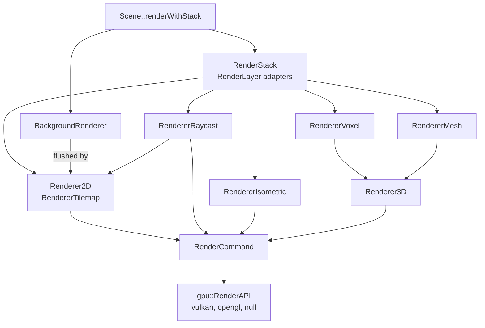

Every renderer kind, the render stack and the base building blocks (`Camera`, `Texture`, `Shader`, `Buffer`,
`Framebuffer`, `RenderAPI`, `RenderCommand`) live in the single `owl::renderer` namespace: the public facades in
`source/owl/public/renderer/`, the layer adapters (`Renderer2DLayer`, `RendererRaycastLayer`, `RendererVoxelLayer`)
in `source/owl/private/renderer/`. Only the GPU objects and their backends sit one level down, in
`owl::renderer::gpu` (`gpu::opengl`, `gpu::vulkan`, `gpu::null`).

| Class                   | Role                                                                       |
|-------------------------|----------------------------------------------------------------------------|
| `Renderer`              | Lifecycle (init/shutdown/reset), owns `ShaderLibrary` and `TextureLibrary` |
| `RenderStack`           | Ordered list of active `RenderLayer` instances for the current scene       |
| `RenderLayer`           | Abstract interface for one renderer in the stack (begin/render/end)        |
| `RenderLayerFactory`    | String-keyed registry of layer constructors (`"Renderer2D"`, ...)          |
| `Renderer2D`            | Static 2D batch renderer: quads, circles, lines, text                      |
| `Renderer2DLayer`       | `RenderLayer` adapter wrapping `Renderer2D` (registered at engine init)    |
| `RendererRaycast`       | Static facade for the CPU-DDA raycaster                                    |
| `RendererRaycastLayer`  | `RenderLayer` adapter for the raycaster (factory key `"RendererRaycast"`)  |
| `BackgroundRenderer`    | Deferred fullscreen background/skybox rendering                            |
| `RenderCommand`         | Static facade delegating to the active `RenderAPI`                         |
| `RenderAPI`             | Owl RHI backend interface (Vulkan, OpenGL, Null)                           |
| `GraphContext`          | Graphics context abstraction (init, buffer swapping)                       |
| `Camera`                | Base class: projection, view, viewProjection matrices                      |
| `CameraOrtho`           | Standalone orthographic camera with position/rotation                      |
| `CameraEditor`          | Editor orbit camera (focal point, pan, zoom, rotate)                       |
| `SceneCamera`           | Scene camera supporting both orthographic and perspective                  |
| `Framebuffer`           | Off-screen render target with typed attachments                            |
| `DrawData`              | Vertex/index buffers, shader and `PipelineState` of a draw                 |
| `Shader`                | Abstract shader (Slang source, SPIR-V compiled)                            |
| `Texture` / `Texture2D` | Abstract texture, 2D texture with file/spec creation                       |
| `UniformBuffer`         | GPU-side uniform data block                                                |

## Renderer Stack {#renderer-stack}

The renderer stack composes **several ordered renderers** in one frame (a raycast world under a 2D minimap, a 2D sky
behind an isometric map). The stack is declared in `owl_project.yml`, filtered and configured per scene (`.owl`), and
each entity is routed to a layer by its optional `RendererTag`.

`EditorLayer::syncActiveDocumentPanels` (and the runner equivalent) builds the `RenderStack` from
`Project::rendererStack` + `Scene::getEnabledRenderers()` and installs it with `Renderer::setRenderStack`;
`Scene::renderWithStack` then draws one frame:

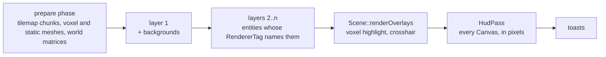

Untagged entities go to the first layer, and backgrounds draw on the first pass only. The HUD pass takes every
`Canvas` whatever its `RendererTag` (see [Scene](scene.md#ui-components)). A project without `RendererStack:` gets a
single implicit `Renderer2D`, drawn in a single pass.

### Configuration model

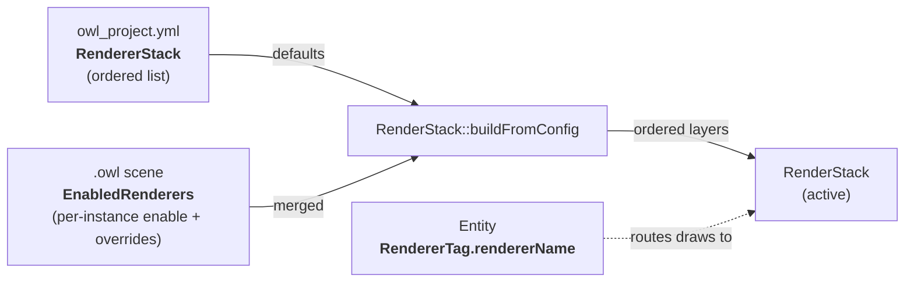

**Project YAML** (`owl_project.yml`):

```yaml
RendererStack:
  - Type: Renderer2D       # factory key — must match a registered type
    Name: world            # unique instance name within the stack
    DefaultConfig: {}      # optional, layer-specific knobs
  - Type: Renderer2D
    Name: hud
```

The list order is the back-to-front render order; no entry means `[{Type: Renderer2D, Name: default}]`.

**Scene YAML** (`.owl`):

```yaml
EnabledRenderers:
  - Name: world
    Enabled: true
    Overrides: {}
  - Name: hud
    Enabled: true
```

A scene with no `EnabledRenderers:` activates **every** project layer with its default config; `Overrides` is
deep-merged on top of `DefaultConfig` (the override wins).

A `Renderer2D` layer reads two keys (editable in the Scene Settings panel):

| Key               | Default | Effect                                                                                        |
|-------------------|---------|-----------------------------------------------------------------------------------------------|
| `Space`           | `World` | `World` draws with the scene camera; `Screen` in screen units, origin bottom left, Y up       |
| `ReferenceHeight` | `0`     | `Screen` only: the screen is this many units high, its width follows the aspect ratio; 0 = px |
| `Billboard`       | `None`  | `World` only: `Upright` turns the sprites around the world Y axis, `Full` into the screen     |
| `DepthTest`       | `false` | `World` only: tested against the depth of the layers before, without writing it              |

`Billboard` and `DepthTest` put 2D sprites into a 3D scene (the enemies and effects of the tower defence among its
meshes). A billboard layer draws each sprite, circle and text at its world position and size, turned to the camera of
the pass (`renderer::utils::billboardMatrix`), its own Z rotation kept in the screen plane (an arrow along its flight);
`Upright` keeps the world Y axis up, `Full` lays the sprite in the screen plane (art drawn as seen from above, and what
a top-down `RenderTarget` camera sees). Its 2D lights work on the ground plane (x, z) of the Y-up world
(`Lighting2D::groundPlane`), without normal maps nor 2D shadows. A depth-tested layer (`Renderer2D::setDepthTest`) is
hidden by the meshes and voxels drawn before it, writes no depth, and sorts its primitives back to front by their
distance along the view; picking sees billboards as drawn, and Owl Nest draws a stack holding such a layer layer by
layer instead of its 2D composite.

A billboard or depth-tested layer belongs to the 3D scene and follows its light: its ambient is the light a white
surface facing up receives from the sky, the directional lights and the layer sun (`Renderer3D::getSurfaceLight`,
pre-exposed like the meshes), times the `Ambient` `Light2D` when there is one; its point and spot `Light2D` and its
unlit sprites (`lit` false) are divided by the exposure compensation of the camera, which the colour encode applies to
the whole frame, so torches and markers keep their strength at night (`Lighting2D::exposureScale`, `inScene3D`). Only
quads take it; circles and texts of such a layer are drawn as they are.

With `ReferenceHeight: 720` an overlay authored at 1280×720 (the minimaps of the Engine Demo raycast level and of
Wolfenstein mini) keeps its share of the screen at 1080p or 1440p, like a `ScaleWithHeight` HUD canvas; the
`ui_scale` setting applies to HUD canvases only.

**Entity component** (`RendererTag`):

```yaml
- Entity:
    Components:
      RendererTag:
        Name: hud
      UiText:
        ...
```

| Tag state                                    | Routing                                               |
|----------------------------------------------|-------------------------------------------------------|
| Component absent                             | First layer of the active stack                       |
| Component present, name matches a layer      | That layer renders the entity                         |
| Component present, name unknown to the stack | Entity skipped, one-shot warning per scene activation |

None of these blocks is required: older `.owl` and `owl_project.yml` files load unchanged.

### Frame flow

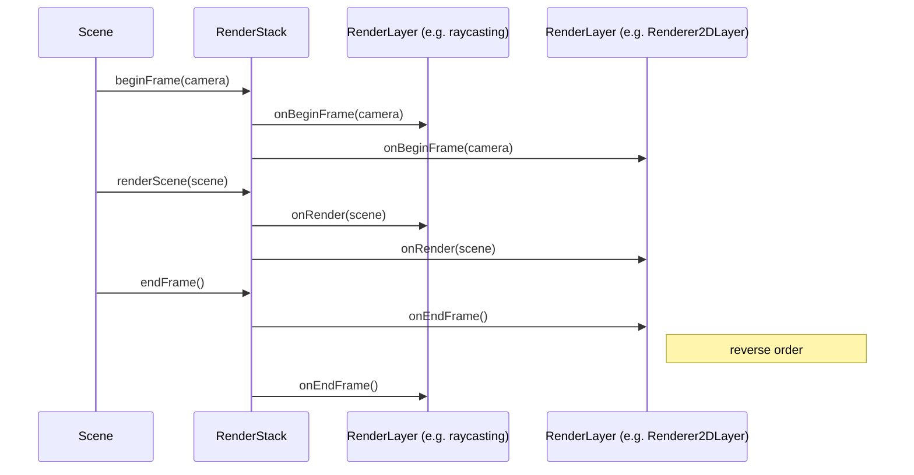

`onEndFrame` walks the stack in reverse so layers can flush nested resources cleanly.

### Frame graph {#renderer-frame-graph}

`renderer::RenderGraph` (`Renderer::getRenderGraph()`) records the passes of a frame. A pass declares the targets it
reads and writes; the graph derives the order (read-after-write, write-after-write, write-after-read, ties keep the
declaration order), drops the passes nothing needs, binds the right framebuffer around each pass and gives the
caller's framebuffer back.

- **Targets.** The imported target is the framebuffer bound when the graph runs, or the window surface. Transient
  targets are `Linear` (`Rgba16F` colour) or `Display` (`Surface`), both with the engine layout (colour, `RedInteger`
  entity id and `Depth32F`), or `Depth` (a single `RedFloat` attachment, for shadow maps). A target can carry an
  explicit size instead of the size of the frame.
- **Pool.** Transients come from a pool kept between frames and released after 120 idle runs; a transient released
  earlier in the frame is reused. A transient is cleared on its first write of a frame (clear colour decoded to linear
  for a `Linear` one, entity id -1).

`Scene::renderWithStack` records these passes:

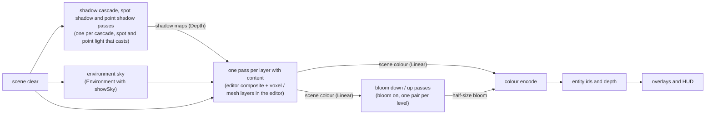

- **environment sky** draws the `Environment` image behind the layers into the scene colour ([Image-based
  lighting](#renderer-ibl)).
- **exposure** (`renderer::PostProcess::recordExposure`, auto exposure on) measures the brightness of the scene colour
  and adapts the exposure ([Post-process](#renderer-post-process)).
- **bloom down / up** (`renderer::PostProcess::recordBloom`) build the bloom image from the scene colour
  ([Post-process](#renderer-post-process)).
- **post depth**, **depth of field** and **motion blur** (`renderer::PostProcess::recordDepthOfField` /
  `recordMotionBlur`, `depth_effects/depth_effects.slang`), when the camera asks for them: the depth of the 3D layers, then the
  blurred scene colour the bloom and the encode read ([Post-process](#renderer-post-process)).
- **colour encode** (`renderer::ColorEncoder`, `color_encode.slang`) turns the linear scene colour into the display
  target: chromatic aberration, exposure, bloom, tone mapping, vignette, film grain, sRGB encoding, then the
  colour-grading LUT.
- **outline mask**, **outline scene depth** and **outline** (`renderer::OutlinePass`, `outline.slang`), when the scene
  has an outline (`Scene::setOutline`: the Owl Nest selection, what a first-person walker aims at): the meshes of the
  outlined subtree alone, then the whole 3D scene (the **post depth** of the frame, else the **occluder depth** when
  the occlusion culling made one), are drawn into depth targets, and the line is blended over the target
  around the silhouette, in full where it shows, dimmed where other geometry hides it; gaps thinner than the line close.
- **entity ids and depth** copies the id and depth attachments into the target, so picking and depth-tested editor
  overlays keep working; skipped when the target is the window surface.
- **overlays and HUD** (editor overlays, HUD, toast) draw after the encoding, in display space.

### Colour space {#renderer-colour-space}

Every world layer renders linear into the `Rgba16F` scene colour; encoding to sRGB happens once, in `colour encode`.

- **Shaders.** A shader drawing world colour gets a `linearOutput` flag (its uniform block, or a vertex attribute for
  the background), set from `gpu::Framebuffer::isLinearTargetBound()`. On a linear target the 2D-like shaders (quad,
  circle, line, text, background, isometric, tilemap, raycast stripe) decode their final colour from sRGB (opaque colours
  round-trip exactly, only blending becomes linear); the lit 3D shaders (mesh, voxel) decode texel and tint before
  lighting. On any other target (HUD, thumbnails, Owl Nest previews, ImGui) the shaders keep their previous maths.
- **Textures** stay UNORM and are decoded in the shaders: Owl Nest shows the same textures through ImGui, which an
  `_SRGB` format would darken. Data samplers (the MSDF coverage, ids) are not decoded.
- **Tone mapping** is per camera: `renderer::ToneMapping` (`None`, `PbrNeutral`, `Aces`) on `renderer::Camera`
  (`getToneMapping` / `setToneMapping`), `None` by default (clamp, exact 2D colours). The Camera component saves it as
  `camera.toneMapping` (absent means `None`) and the Owl Nest Camera inspector has a **Tone mapping** combo. The editor
  camera uses `None`; piloting or previewing a scene camera uses its setting.
- **Vulkan pipelines.** A draw keeps one pipeline per attachment layout (`Framebuffer::getPipelineFamily`, the dedup
  key of `pushPipeline`), created on its first bind to a framebuffer of that layout: linear (`Rgba16F`, `RedInteger`,
  `Depth32F`) and display (`Surface`, `RedInteger`, `Depth32F`, swapchain included).

### Lights and shadows {#renderer-lights}

The 3D layers (`RendererMesh`, `RendererVoxel`) are lit by the `Light` components of the scene
([Scene > Light](scene.md#light-component)); the 2D layers have their own [2D lighting](#renderer-lighting2d), the raycast layer is not lit.

- **Light buffer.** Up to 64 lights are uploaded each frame to a storage buffer (`renderer::GpuLight`), shaded by
  the material of the surface ([Materials](#renderer-materials)). Point and spot lights fall off with 1/d² (distance
  floored at 1 cm) and are cut off smoothly at `range` by the window `(1 - (d/range)^4)^2`; spots fade between the
  inner and outer cone. The layer sun (`SunDirection` and `SunIlluminance` of the layer config) lights only a scene
  that has no `Light` component at all (`Renderer3D::setLayerSun`, `isLayerSunEnabled`): once the scene has a light,
  even switched off, it gets no sun. The ambient comes from the `Environment`, else from the layer config
  (`Ambient` colour times `AmbientLuminance`), as a constant sky.
- **Physical units.** `Light.intensity` is an illuminance in lux for a directional light (`g_defaultSunIlluminance`,
  100 000) and a luminous power in lumens for a point or spot light (`g_defaultBulbPower`, 800); the shader turns the
  power into an intensity in candela, lm / 4π for a point or sphere light and lm / π for a spot, and into a
  luminance for a rectangle or disc ([Area lights](#renderer-lights)). Reference values: sun
  100 000 lx, overcast sky 10 000 lx, moon 0.25 lx; candle 12 lm, 60 W bulb 800 lm, fireplace 2 000 lm. The
  `Environment` and the emissive surfaces are luminances in cd/m² (nits), see [Image-based lighting](#renderer-ibl) and
  [Materials](#renderer-materials).
- **Pre-exposure.** The camera exposure ([Post-process](#renderer-post-process)) is applied on the CPU: `Renderer3D`
  multiplies every physical value (light, sun, ambient, environment, emissive) by `exposureOf(ev100)` before it
  reaches the shaders (`Renderer3D::setExposure`), so the HDR scene colour holds pre-exposed values near 1 for a
  well-exposed scene and fits `Rgba16F`.
- **Voxel emission.** A voxel block's `BlockSurface.emissive` is a luminance in nits up to `g_MaxBlockLuminance`
  (100 000), packed logarithmically in 8 bits per vertex ([Voxel](voxel.md)).
- **Cascades.** The first visible directional light with `castShadows` casts cascaded shadow maps.
  `renderer::computeShadowCascades` splits `[near, shadowDistance]` blending uniform and logarithmic splits (0.75);
  each cascade is an orthographic light camera around a sphere bounding its frustum slice (sliced relative to the eye;
  `ShadowSettings::relativeViewProjections` and `origins` give each cascade relative to its own light camera), its centre snapped to the
  texel grid (no shimmering) and pulled back so off-screen casters still cast.
- **Passes.** One `shadow cascade` pass per cascade renders the opaque meshes and voxel worlds (transparent ones cast
  no shadow) into a `Depth` target (`RedFloat`, `shadowResolution` squared). The 3D layer passes read the cascades
  (texture slots 16 to 19) with 3x3 PCF and a normal-offset bias of `shadowBias` texels.
- **Soft sun shadows.** A light with an `angularRadius` above 0 switches the cascades to PCSS: 16 Poisson taps
  within the cone of the light from the receiver find the blockers, their mean depth sets the penumbra
  `2 tan(angularRadius) (receiver - blocker)` converted to texels (`ShadowCascade::depthRange`, at most 16), and 16
  taps filter it; the disc turns with the shadow-map texel, so the noise stays still in the world. The same radius
  widens the GGX distribution of that light and renormalises it (Karis), so a rough sun highlight grows without
  gaining energy. At 0, the 3x3 path and the point-like highlight are unchanged.
- **Local shadows.** Point, spot and area lights with `castShadows` are ranked by distance from the camera to the sphere
  they reach, then by strength (`renderer::rankShadowCandidates`); the first ones within `getLocalShadowBudget()` cast
  (4 spot and 4 point lights on OpenGL, whose fragment shaders sample 32 textures at most; 16 of each on Vulkan), the
  others light without shadow. A `spot shadow` pass draws the casters into a perspective map covering the outer cone
  (`computeSpotShadowCamera`, texture slots 20 onward). A `point shadow` pass draws the six 90 degree faces of
  `computePointShadowFaces` one after the other into one `Depth` target per face size and copies each into the
  light's `TextureCube` (`R32F`, kept between frames); the face projections keep NDC Y up on both backends so the
  rows match the cube sampling convention. The shaders rebuild the depth of a face from the axis distance
  (`depth.x + depth.y / d`), take 3x3 taps around the direction and offset the point along its normal by `shadowBias`
  texels of the map at its distance (`Renderer3D::setLocalShadows`, `LocalShadow` table of the lighting block, entry
  in `GpuLight::spotCosines.z`).
- **Area lights.** A `Rectangle` or `Disc` light is a luminance (`getRectangleLuminance`, `getDiscLuminance`: the
  power over π times the area) integrated over its face by linearly transformed cosines: the shader turns the GGX lobe
  into a clamped cosine through the inverse matrix of `getLtcTable()` (texture slot 14, fitted once by
  `computeLtcTable` and stored in the engine), sums the edge integrals of the polygon (a disc is a 12-sided polygon of
  the same area) into a vector form factor and clips it by the horizon through `computeClippedSphereTable` (slot 15);
  the diffuse lobe takes the same path with the identity matrix, the base layer only (no sheen, clearcoat nor
  anisotropy). Both emit from their -Z face (`GpuLight::area` holds the half axes). A `Sphere` light is a point light
  whose highlight comes from the point of the sphere nearest to the reflected ray, its distribution widened by its
  apparent radius (Karis). Area lights cast through a cube like point lights, with PCSS: 16 taps towards the emitting
  surface find the blockers, the penumbra `lightSize (receiver - blocker) / blocker` (half diagonal or radius, at
  most 16 texels) sets the width of the 16 filtering taps.

### Reflection probes {#renderer-probes}

A `ReflectionProbe` ([Scene > ReflectionProbe](scene.md#reflectionprobe-component)) gives a place its own reflections.
`Scene::recordReflectionProbePasses` keeps the probes nearest to the camera within the point shadow budget and adds,
for each probe to capture, a pass drawing the sky and the 3D layers into the six faces of a cube (the face cameras
of `computePointShadowFaces`, without the probes), the passes building the mip chain of that capture, then one GGX
pass per level of the probe (`ReflectionProbes`, shader `probe_filter`): level `i` holds the roughness
`i / (levelCount - 1)`, down to faces of 8 texels (`getProbeLevelCount`), each sample read from the level of the chain
that matches its solid angle. The face cameras keep the OpenGL clip space on every backend so the faces follow the
cube convention; on Vulkan the faces then wind backwards, which the scene block tells the shader (`origin.w = -1`).
`Renderer3D::setReflectionProbes` binds the cubes after the point shadows; the shader takes the two probes of largest
influence at the point (1 inside the volume, fading over `blendDistance`), projects the reflected ray on the box or
sphere with `parallax`, and fills the rest with the environment. The captured radiance is pre-exposed: it is scaled by
the current exposure over the one of the capture.

### 2D lighting {#renderer-lighting2d}

The `Light2D` components of the scene ([Scene > Light2D](scene.md#light2d-component)) light the sprites, tilemaps and
isometric sprites of the 2D layers. A scene without any enabled `Light2D` draws unlit; with lights but no `Ambient` one
the ambient is white, so lights only add.

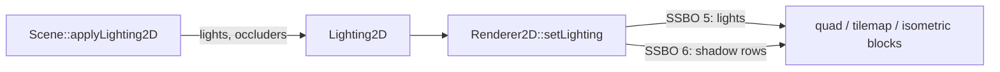

- **Data.** `Scene::applyLighting2D` gathers, per 2D layer, the enabled lights (`Light2DData`, at most `g_maxLights2D`
  = 64) and the sprites flagged `castShadows` (`Occluder2D`) into a `Lighting2D` given to `Renderer2D::setLighting`;
  `clearLighting` ends it and `isLightingEnabled` tells whether it is on. `lightAt2D` is the CPU reference of the
  shader sum.
- **Shading.** `engine_assets/shaders/common/light2d.slangh`: ambient plus, per light, `colour × intensity ×
  (1 - d / radius)^falloff`, times the spot cone between `innerAngle` and `outerAngle`. A sprite with a `normalMap` also
  gets the Lambert term of the light direction, raised by the light `height`; `Quad2DData::lit` false skips it.
- **Shadows.** A light with `castShadows` has a polar shadow map of `g_shadow2DBins` (512) angular bins, built on the CPU by
  `buildShadowRow2D` from the occluder quads (`Quad2DData::shadowCaster`) and uploaded as one row per light; the
  shader compares the distance of the pixel with the row at its angle, with a penumbra of `shadowSoftness` bins.
- **Tilemaps.** Chunked tilemaps are lit (no normal map) and receive the shadows.
- **Isometric layer.** The layer lights its sprites and tiles through the `_normal` and `_depth` atlases of
  `tools/iso_atlas` found beside an albedo atlas (`common/isometric_light.slangh`): albedo slots 0 to 9, normals at
  +10, depth at +20. The map position of a pixel is solved from its view position and its depth-atlas height, the
  ground tiles are lit per pixel; there are no 2D shadows in the isometric layer.
- **Bindings.** Lights are a storage buffer at binding 5 and shadow rows one at binding 6, the same in the quad,
  tilemap and isometric blocks: `Renderer2D` owns the buffers and OpenGL storage binding points are global.

### Adding a new layer type

1. Subclass `RenderLayer` and implement `onBeginFrame`, `onRender`, `onEndFrame` and `applyConfig`.
2. Give it a `static void registerWithFactory()` calling `RenderLayerFactory::registerType("MyType", ...)` once, and
   call it from `Renderer::initShaders` so the type exists before any project loads.
3. Reference `Type: MyType` in the project YAML. `applyConfig` receives the merged `DefaultConfig` + scene
   `Overrides` as YAML text (`{}` when empty), like `RendererStackEntry::defaultConfig` and
   `EnabledRenderersConfig::Entry::overrides`: the public headers never expose yaml-cpp.

Third-party code (mods, tests) registers layer types without touching engine sources.

### Per-renderer binding blocks {#renderer-blocks}

Each high-level renderer (`Renderer2D`, `RendererTilemap`, `Renderer3D`, `RendererRaycast`) owns a binding block,
the explicit bindings of the Owl RHI, matching exactly what its shaders declare:

- Vulkan: a `VkDescriptorSetLayout` and a `DescriptorRing` handing every draw its own descriptor set, from pools of
  each frame in flight reset in one call when the slot comes back.
- OpenGL: an `opengl::BindingTable` recording the uniform buffers and textures bound while the block is active; a
  draw binds them again only when another block changed the global GL bindings (all renderers share uniform binding
  0 and texture units from 0).
- Null ignores the blocks.

The API is backend-neutral:

```c++
// In MyRenderer::init(), declare the bindings the shaders use:
const std::array<gpu::BindingDecl, 2> myBindings{
    gpu::BindingDecl{.binding = 0, .type = gpu::BindingType::UniformBuffer,
                     .count = 1, .stages = gpu::ShaderStage::Vertex},
    gpu::BindingDecl{.binding = 1, .type = gpu::BindingType::CombinedImageSampler,
                     .count = 32, .stages = gpu::ShaderStage::Fragment},
};
gpu::RendererDescriptors::declare("MyRenderer", myBindings);

// Then scope `ScopedActive` around every operation that touches the
// renderer's GPU state — pipeline creation, UBO upload, texture binding,
// the draw itself. It takes the block identifier, resolved once from the name:
static const gpu::RendererId myBlock = gpu::RendererDescriptors::getId("MyRenderer");
const gpu::RendererDescriptors::ScopedActive scoped{myBlock};
// ... drawData->init(), UniformBuffer::create(), RenderCommand::bindTextures(),
// drawDataInstanced(), …

// And in MyRenderer::shutdown():
gpu::RendererDescriptors::release("MyRenderer");
```

The identifier of a name never changes (before `declare`, after `release`) and `ScopedActive` reads the block cached
for it: no string built, no lookup. While one is alive, `vulkan::UniformBuffer`, `RenderCommand::bindTextures`,
`vulkan::Texture2D::bind`, `VulkanHandler::pushPipeline` and `VulkanHandler::bindPipeline` route through the block;
outside any scope they fall back to the global `Descriptors` singleton (the `Texture2D` storage table and the call sites
without a block). Blocks also hold `BindingType::StorageBuffer` slots: `Renderer2D` declares binding 2 as an SSBO and
attaches its `vulkan::StorageBuffer` with `bindStorageBuffer`.

Per-renderer blocks keep a layout to the bindings its shaders sample (a shared global layout crashes NVIDIA's
`vkCmdBindPipeline` on the instanced tilemap path), and uniform blocks are copied into the frame ring at each change,
so two `Renderer2D` layers with different view projections in one frame do not flicker.

### Scene world matrices on the GPU

Per-entity world matrices reach the GPU as one SSBO per frame. `Scene::prepareWorldTransforms` composes every world
matrix on the CPU in a pre-order pass (no depth limit) and hands them to `Renderer2D::setSceneWorlds`, uploaded at
the next `flush()`; each quad / circle / text instance carries an `int32_t worldIndex` instead of a 64-byte matrix.

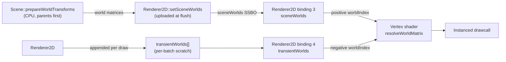

- Entity draws (sprites, animated sprites, circles, text in `Scene::render`) pass `Scene::getWorldIndex(entity)`, a
  positive slot of `sceneWorlds[]`; the CPU `math::Transform` is then never computed (`getWorldTransform()` only runs
  on the transient fallback path and for the CPU consumers below).
- Non-entity draws (UI widgets, gizmo and debug overlays, the glyphs of `drawString`) leave `worldIndex` at `-1`:
  `Renderer2D` appends their `math::Transform` to the per-batch `transientWorlds[]` SSBO (20 000 matrices) and emits
  a negative index into it. Quads and circles start a new batch every 4 096 transient matrices (a bigger batch leaves
  the CPU cache, about 30 % slower per quad); glyphs fill the 20 000, so a long text stays one draw call.
- `gpu::StorageBuffer::bind(uint32_t iBinding)` binds one SSBO at different slots across blocks.
- Instances: `QuadInstance` 80 bytes, `CircleInstance` 48, `TextInstance` 96 (128, 96, 128 with a matrix).
- Above `Scene::getParallelMinEntities()` (4096) entities and 16 roots, `prepareWorldTransforms` checks the root
  subtrees on the task scheduler, then gives the slots in the serial order (parents first), so the matrices are the
  ones of the serial pass; an entity the walk of `childrenIds` misses takes the serial walk. While no entity comes or
  goes and no parent changes, the slot order of the last frame is kept. `updateSpatialIndex` computes the moved world
  boxes in parallel and files them in the octree serially. A scene without scheduler, or smaller, stays serial
  (`Scene::setTaskScheduler`, `setParallelMinEntities`).
- `Scene` keeps the world matrices in a persistent per-entity cache, so the CPU consumers (raycast DDA, physics sync,
  `EntityLink`, the inspector and gizmo) read them without a read-back nor recomposition.

### Canonical instanced pipeline

Every renderer follows one shape: a compute pre-pass writes an SSBO, the graphics pass is instanced and indexes it
by instance id, the CPU does no per-vertex transform. New renderers build on it. Tilemaps draw persistent chunks
([Chunked tilemaps](#chunked-tilemaps)). Validate a change on a real GL or Vulkan backend (the Null backend runs no
GPU work) with the frame bench or `OWL_PROFILE_SCOPE`, on a 5 000-quad scene, a deep hierarchy and `raycast_demo`,
recording the GPU model: the path is bandwidth-bound, and CI checks correctness, not GPU timing.

## Chunked tilemaps {#chunked-tilemaps}

`RendererTilemap` keeps tilemap cells on the GPU between frames. Each layer of a `TilemapAsset` is cut into
`TilemapLayer::chunkSize`² (32 × 32) chunks, also the storage unit ([Tilemap storage](scene.md)); every write
(`setTile`, `setCell`, `setChunk`, `resize`, `assign`, `fill`) stamps the touched chunks with a fresh process-wide
generation. The renderer caches per asset one instance buffer per non-empty chunk (8 bytes per non-empty cell) and
rebuilds a chunk only when its generation changed.

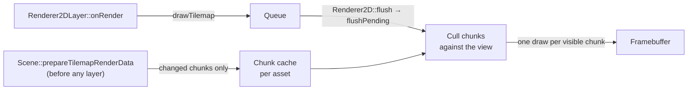

- **Prepare phase.** `Scene::renderWithStack` calls `RendererTilemap::beginPrepare` then `prepareTilemap` for every
  visible tilemap before any layer opens a render pass, so no upload splits a pass. A static map uploads nothing;
  a one-cell edit uploads its chunk. An asset drawn without a prepare is built inside `flushPending` and counted in
  `PrepareStatistics::lateBuiltChunkCount`. An asset neither prepared nor drawn for
  `RendererTilemap::cacheEvictionPrepares` prepare phases leaves the cache.
- **Layers draw from `onRender`.** `Renderer2DLayer::onRender` queues its tilemaps, `RendererRaycastLayer::onRender`
  casts their walls; `Scene::render` does not handle tilemaps, and the editor composite uses a `Renderer2DLayer`.
- **Draw.** For each queued entity and each visible layer, one update of the per-draw uniform block (camera, entity
  world transform with rotation and scale, grid origin, cell size, layer depth, parallax offset, atlas grid, entity id,
  texture slot), then one instanced draw per non-empty chunk whose transformed bounds touch the view. Layers keep
  their painter's order (each visible layer is `1e-4` in front of the previous one); there is no cell cap.
- **Parallax.** A layer is shifted by `cameraPosition × (1 − parallax)`: `(1, 1)` moves with the world, `(0, 0)`
  stays locked to the camera.
- **Budgets** (`test/bench/`, Null backend, `tilemap/*`): a static 256² map of 4 layers costs a few microseconds and uploads
  0 byte per frame, a one-cell edit uploads one chunk, building one 32² chunk takes about 1 µs.

## Isometric layer {#renderer-isometric}

`RendererIsometricLayer` (factory key `RendererIsometric`, `renderer/RendererIsometricLayer.h`) draws the entities
routed to it in a 2:1 dimetric view, from its own `onRender`: it is the first layer whose `drawsOwnEntities()` is true,
so `Scene::renderWithStack` skips the generic 2D pass for it. It composes with the other layers of the stack (a 2D sky
behind, a `Space: Screen` HUD on top) and shares the depth attachment of the frame.

```yaml
RendererStack:
  - Type: RendererIsometric
    Name: iso_world
    DefaultConfig:
      TileWidth: 64   # flat tile, pixels
      TileHeight: 32  # half the width: 2:1, a 30° pitch
      ZStep: 16       # screen pixels per height unit
      Zoom: 0         # power-of-two level, -4 to 4
```

- **Camera.** `IsometricCamera` is a real view times a `CameraOrtho` projection in pixels: yaw 45°, pitch
  `asin(TileHeight / TileWidth)`, world Z scaled by `ZStep`, world Y mirrored so the grid keeps the usual layout
  (`x` to the lower right, `y` to the lower left). It matches `worldToScreen` / `screenToWorld`
  (`screen.x = (x − y) · tileW / 2`, `screen.y = (x + y) · tileH / 2 − z · zStep`), takes the Vulkan Y flip and reversed-Z depth
  of `CameraOrtho::makeProjection`, and keeps a usable depth (`IsometricCamera::depthRange` view pixels around
  the target). In Play the target is the scene camera's position (Z dropped) and the zoom the layer's `Zoom`; the
  editor hands its own `IsometricCamera`, used as is.
- **Billboards.** Every sprite is an `IsometricBillboard` anchored at its world foot point: only the foot point goes
  through the view, the sprite keeps its pixels (scaled by the zoom). Each corner gets the depth of a plane through the
  foot: a vertical plane facing the viewer for an upright sprite, the ground plane for a flat terrain tile. Sprites of
  `SpriteRenderer` and `AnimatedSpriteRenderer` entities stand at their world translation, `scale.xy × TileWidth`
  pixels large.
- **Sprites.** Opaque entity sprites leave the layer as `IsometricSprite`: an anchor (a fraction of the size, bottom
  centre by default), a size, a texture rectangle and a packed RGBA8 tint, 64 bytes through `sprite.slang` against 96
  for a billboard. `RendererIsometric::drawSprites` queues a span sharing one texture (a vehicle atlas) and drops the
  sprites whose screen rectangle (`getSpriteScreenRect`) misses the viewport, counted in
  `Statistics::culledSpriteCount`. At an integer zoom (level 0 and above) the foot of sprites and tiles snaps to whole
  screen pixels.
- **Objects.** An `IsometricObject` entity draws a building of an object sheet (`IsometricObjectSet`, the
  `buildings.json` of `tools/iso_atlas`) as one sprite per footprint tile through `RendererIsometric::drawObject`
  ([Objects](design/isometric.md)); an unresolved sheet or an unknown building draws nothing.
- **Depth and cutout.** Opaque and cut-out billboards (texels under one half alpha are discarded) draw unsorted,
  depth tested and written; a tint alpha below 1 makes a billboard translucent: those draw afterwards, sorted back to
  front on the CPU (`getBackToFrontOrder`), depth tested, not written. Tilemap layers sit `tilemapLayerBias` apart,
  upright sprites `spriteBias` above the ground they stand on.
- **Tilemaps.** A tilemap routed to the layer (tileset `kind: Isometric`) is chunked like the 2D ones
  ([Chunked tilemaps](#chunked-tilemaps)): one buffer per layer and 32 × 32 chunk (`tile.slang`, 32 bytes per
  non-empty cell and overlay), rebuilt by `RendererIsometric::prepareTilemap` when the cell generation, the
  corner-height generation or the tileset changed, one instanced call per chunk in view. Cell `(cx, cy)` covers the
  world square from the entity translation plus `(cx, cy)` to `(cx + 1, cy + 1)`, its sprite bottom centre on the
  front corner. `pickIsometricCell` finds the tile under a viewport pixel on flat maps
  (`scene::terrain::pickTerrain` handles slopes).
- **Shader.** `engine_assets/shaders/isometric/billboard.slang`: one instanced draw per pass from a storage
  buffer of 96-byte instances (foot, size, depth slope, UVs, tint, texture slot, entity id), 20 000 per batch;
  `sprite.slang` draws the 64-byte sprite instances, 40 000 per batch, between the opaque and the translucent pass, and
  `tile.slang` the tilemap chunks (per-instance vertex attributes) before the opaque billboards.

## Raycaster {#renderer-raycaster}

`RendererRaycast` (`renderer/RendererRaycast.h`) draws a Wolfenstein-style first-person view of a top-down
`scene::component::Tilemap`: a non-empty cell is a wall, an empty one walkable. Algorithm details:
[Raycaster method](raycaster_method.md).

### Pipeline

The layer switches `Renderer2D` to a pixel-space ortho camera in `onBeginFrame`, draws every tilemap routed to it with
`RendererRaycast::drawTilemapWalls` from `onRender` (the sky / floor backdrop comes with the first wall, so an empty
pass is a no-op), and closes the batch in `onEndFrame`. The per-column DDA runs on the GPU and every wall stripe is one
instance of a single draw:

```mermaid
flowchart LR
    Tilemap["Tilemap grid +<br/>tile metadata"] -->|cache miss| DDA["RaycastDDAPass<br/>(raycast_dda.slang)"]
    Camera["Camera params<br/>(cell-space)"] --> DDA
    DDA -->|hitCount[]<br/>columnHits[]<br/>zBuffer[]| Stripe["raycast_stripe.slang<br/>(vertex + fragment)"]
    Tileset["Tileset atlas +<br/>per-tile UV rects"] --> Stripe
    Stripe -->|drawDataInstanced<br/>numRays × kMaxHits| FB["Framebuffer"]
```

- The compute pass writes `hitCount[col]`, `columnHits[col × maxHits + k]` and `zBuffer[col]`, one thread per column.
- The stripe shader runs `numRays × kMaxHits` instances: each unpacks `(col, localK)` from `SV_InstanceID`, reads the
  hits back to front (painter's order), builds the stripe from `perpDist`, `wallHeight` and the pixel-space view
  projection, and samples `tileUvRects[tileIndex]`; slots past `hitCount[col]` emit an off-screen zero-area quad.
- UV rects, grid and tile metadata upload on a cache miss only (key `(tilemap, tileset, layer)`).
- Doors and pushwalls need each column's opaque depth: the CPU walks the same DDA (`cpuWalkColumn`, no
  stripes), cheaper than reading `zBuffer[]` back mid-frame. The Null backend keeps a CPU fallback with the same
  output.
- `RendererRaycast::drawSprites` draws every visible sprite in one instanced call (`raycast_sprite.slang`, descriptor
  block `RendererRaycastSprites`, up to 16 textures and 1024 sprites), sorted far to near by `BitonicSortPass`; the
  fragment shader drops the pixels behind the wall of their column, using the column depths uploaded from the wall
  pass. More sprites or textures, or the Null backend, fall back to CPU per-column stripes
  ([Raycaster method](raycaster_method.md)).

### Configuration

In `owl_project.yml`:

```yaml
RendererStack:
  - Type: Renderer2D
    Name: world
  - Type: RendererRaycast
    Name: raycast_world
    DefaultConfig:
      Fov: 75.0                       # horizontal field of view, degrees
      MaxDistance: 32.0               # max DDA budget, in cells
      CeilingColor: [0.18, 0.20, 0.30, 1.0]
      FloorColor:   [0.20, 0.16, 0.12, 1.0]
      NumRays: 0                      # 0 = derive from viewport width
  - Type: Renderer2D
    Name: ui
```

A scene that wants a raycast world disables the 2D `world` layer:

```yaml
EnabledRenderers:
  - Name: world
    Enabled: false
  - Name: raycast_world
    Enabled: true
  - Name: ui
    Enabled: true
```

Tag the wall tilemap with `RendererTag: { Name: raycast_world }` to route it to the raycaster.

### Player pose convention

The raycaster extracts the camera's 2D pose from the inverse view matrix
(i.e. the camera entity's world transform):

| 2D quantity   | Source                                                                         |
|---------------|--------------------------------------------------------------------------------|
| Position      | `inverseView * (0, 0, 0, 1)` — the entity's world `(x, y)`                     |
| Forward       | `inverseView * (0, 1, 0, 0)` — the entity's local +Y mapped to world XY        |
| Right (× FOV) | `inverseView * (1, 0, 0, 0)` scaled by `tan(fov/2) * aspect` — the FOV "plane" |

Convention:

- An entity with `rotation: [0, 0, 0]` faces world **+Y** (forward = `(0, 1)`).
- Increasing the entity's Z rotation rotates the facing **counter-clockwise**
  in world XY — `rotation: [0, 0, π/2]` faces world **−X** (forward = `(−1, 0)`).
- Rotation values are stored in **radians** in the `Transform` component
  (matching the rest of Owl Engine's transform pipeline).

`scripts/raycast/raycast_player.lua` of the Engine Demo follows this convention.

## 3D Forward Renderer {#renderer3d}

`Renderer3D` is a generic depth-tested, textured forward renderer lit by the scene lights, the base of
`RendererVoxel` and `RendererMesh`; unlike `Renderer2D` it draws **real per-vertex geometry**.

- **Vertex** (`renderer::Mesh3DVertex`, 56 bytes, tightly packed): object-space `position`, `normal`, `uv`, a
  `textureIndex` selecting a slot in the bound texture array, the `tileRect` atlas sub-rect (`mesh3d` maps the UV
  into it, `voxel` tiles it with `frac`) and the `ao` factor of the lighting.
- **Camera-relative.** `Renderer3D` uploads `projection * cameraRelativeView(view)` and the eye as `Scene3D.origin`;
  the shaders (`relativePosition` in `common/pbr.slangh`) subtract it from the model translation before the rotation,
  and lights, the view depth row and the shadow cascades are given relative to the eye, so shading stays precise far
  from the origin. `Renderer3D::getViewProjection()` stays the world one, used by culling. The image test `far_origin`
  renders the lights scene 2^20 m away like at the origin.
- **Shader** (`engine_assets/shaders/renderer3D/mesh3d.slang`): vertex transforms position by a per-draw model
  matrix then the per-frame view-projection (both `column_major`, supplied through one scene UBO at binding 0);
  fragment fills a `Surface` from the material and its maps and calls `shadeSurface` of
  `shaders/common/pbr.slangh`, shared with `voxel.slang` (the scene, material and lighting blocks, the shading
  models, the cascaded shadows, the image-based lighting). Outputs colour + the entity id of the draw to match the
  scene framebuffer.
- **Texture slots** of the 3D shaders (`gTextures`, binding 1): 0 white, 1 to 6 the material maps (base colour,
  metallic, normal, occlusion, emissive, roughness), 7 to 12 the prefiltered environment, 13 the DFG table, 16 to 19
  the shadow cascades, 20 onward the spot shadows (24 slots on OpenGL, 36 on Vulkan). Cubes (`gCubes`, binding 7 on
  Vulkan, the units after the 2D slots on OpenGL): the point shadows, then as many reflection probes
  ([Reflection probes](#renderer-probes)).
- **Per-draw parameters** (`renderer::MeshDrawParams`): the tint and the entity id travel in the scene UBO with the
  model matrix (`vec4 tint`, `ivec4 ids`, 192 bytes in all), so picking needs nothing in the vertices; `voxel.slang`
  shares the block and writes the id of its voxel world. The material of the draw (`MeshDrawParams::material`, null
  for the default `Standard` material) fills a second block (`MaterialData`, binding 4, 128 bytes with an `int4 channels`
  holding the channel of the metallic, roughness and occlusion maps and, in `w`, the normal convention; `toon` holds
  the toon rim, the emissive luminance, the `ior` and the clearcoat `ior`).
- **API**: `init` / `shutdown`, `beginScene(camera)` (enables depth test/write), `endScene()` (restores 2D depth
  state), `setLighting(sunDirection, sunIlluminance, ambientRadiance)`, `createMesh(vertices, indices) -> MeshHandle` (one-time GPU upload), and
  `drawMesh(handle, model, textures, params)` (immediate-mode draw; textures bind to slots `1..N`, slot `0` is white,
  `getWhiteTexture` gives it for a mesh that samples slot `1` without texture), `setEnvironment`, `drawSky`.
- **Vertex buffers**: a draw's vertex buffer is sized from its index count, so each submesh of a mesh owns a compact
  vertex buffer holding only the vertices its indices reach.

```c++
const auto mesh = renderer::Renderer3D::createMesh(vertices, indices);// once, on geometry change
renderer::Renderer3D::beginScene(camera);
renderer::Renderer3D::drawMesh(mesh, modelMatrix, {atlasTexture}, {.tint = {1.f, 1.f, 1.f, 1.f}, .entityId = id});
renderer::Renderer3D::endScene();
```

It owns a binding block (`RendererDescriptors`) like the other renderers.

## Static meshes {#renderer-meshes}

A `scene::component::MeshRenderer` draws a mesh file at its entity transform through a `RendererMesh` layer of the
stack (fields: [Scene components](scene.md#components)).

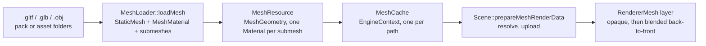

- **Files**: `.gltf`, `.glb` and `.obj` (`MeshLoader::isMeshAsset`; FBX is not read). glTF: every mesh the default scene
  places (every mesh once without a scene), with its node transform chain (matrix or TRS): positions are
  transformed, normals by the cofactor matrix, and a mirrored transform flips the winding; one `MeshSubmesh` per
  primitive per node. Every triangle primitive keeps its positions, normals and `TEXCOORD_0`, and every material with its
  maps (`MeshMaterial`: base colour, metallic-roughness, normal, occlusion and emissive images, embedded or
  external, the factors and the common extensions; an emissive factor of 1 imports as 1000 nits); one
  `MeshSubmesh` per material group for an `.obj`. The colour factors are linear in glTF and are converted to sRGB at import, as the material stores them. UVs follow the engine
  convention (`v = 0` at the bottom of the image): glTF's are flipped at load, images decoded bottom row first.
- **Geometry**: `MeshGeometry::fromStaticMesh` turns the per-triangle corners into `Mesh3DVertex` (identical corners
  share a vertex; a corner without normal takes its face normal), with the object-space bounds; `raycast` intersects a
  ray with it (the editor places dropped meshes on it).
- **Cache**: `app::EngineContext::getMeshCache()` maps an asset path to one shared `MeshResource`, looked up in the
  open pack (the external files of a `.gltf` too), then the asset folders, then as given; an unreadable file is
  remembered as missing. The opaque and the blended GPU meshes are uploaded on first use, in
  `Scene::prepareMeshRenderData` before any layer draws (an upload closes the render pass). A hot-reloaded file is
  invalidated (`MeshCache::invalidate`): its holders are marked stale and fetch it again on their next frame.
- **Layer** `RendererMesh` (`DefaultConfig`: `SunDirection`, `SunIlluminance` in lux (100 000), `Ambient` colour, `AmbientLuminance` in nits (12 000)): draws each submesh of its entities with the
  material of its slot ([Materials](#renderer-materials)), the mesh tint times the base colour, the component texture
  or else the material's, and the entity id; opaque meshes as they come,
  blended ones (`transparent: true`, `Renderer3D::transparentMeshState`) at the end, sorted back-to-front by the
  distance of their bounds centre. In Edit the viewport draws the voxel and mesh layers after its 2D composite.
- **Skinning**: a skinned `MeshResource` (`isSkinned`: a skeleton and `VertexSkin` per vertex) uploads
  `SkinnedMesh3DVertex` meshes (`Renderer3D::createSkinnedMesh`, shader `skinned3d.slang`: four joints per vertex).
  The scene pushes the skin matrices of each `Animator` once per pass (`RendererMesh::pushSkin`) into one storage buffer
  read at binding 5 (`Renderer3D::g_skinBinding`, the instance binding, free in a single draw), `SceneUbo.ids.w` giving
  the first matrix of the draw; skinned draws are not instanced and keep the frustum culling of the mesh index.
  `mesh3d` and `skinned3d` share their surface shading (`common/mesh_surface.slangh`).
- **Levels of detail**: `MeshResource` keeps the reduced levels of a cooked mesh (`LoadedMesh::lods`) or builds them
  from the `.owlmeta` of the file (`data::geometry::buildMeshLods`); `Scene` picks one per entity
  (`MeshResource::selectLod`) from the fraction of the screen height its bounding sphere covers, seen from the camera
  of the last main pass (shadow passes reuse it), and `RendererMesh::drawSubmesh` draws its compact submesh.
  `RendererMesh::Statistics` counts `skinnedDrawCount` and `lodDrawCount`.
- **Instancing and culling**: opaque meshes are queued and, at `endScene`, grouped by mesh, material and texture into
  one instanced draw each; the per-instance data (`renderer::MeshInstance`: model, tint, entity id) sits in a storage
  buffer that `mesh3d.slang` reads. The compute shader `mesh_culling.slang` (`renderer::utils::MeshCullingPass`) culls
  every instance against the frustum, writes the visible list and the instance count of one
  `DrawIndexedIndirectCommand` per group, and `Renderer3D::drawMeshIndirect` draws it (`RenderCommand::drawIndexedIndirectAt`).
  The Null backend culls on the CPU and draws with `drawMeshInstanced`. `RendererMesh::Statistics` reports
  `instancedBatchCount`, `visibleInstanceCount` and `occlusionLevelCount`.
- **Occlusion culling**: with `OcclusionCulling` on, `Scene` records two frame-graph passes before the world: the
  occluder depth (mesh and voxel layers drawn in shadow mode with the render camera) and a farthest-depth Hi-Z pyramid
  built by compute shaders (each texel keeps the smallest depth, the farthest with reversed-Z). `mesh_culling` then drops
  the instances whose projected box lies behind the farthest occluder depth of the texels it covers; boxes crossing the camera plane are kept.
- **Spatial indexes**: `Scene` keeps two `data::geometry::LooseOctree`s (`getMeshSpatialIndex` for `MeshRenderer`
  entities, `getSpriteSpatialIndex` for `SpriteRenderer` and `AnimatedSpriteRenderer`), refiled when the world matrix
  or the mesh changes; the mesh pass and the 2D sprite loop skip entities outside the frustum of the current
  view-projection (`Scene::getCullingStatistics`).

The `RendererMesh` layer reads these keys (editable in the Owl Nest Scene Settings, RendererMesh section):

| Key                | Default | Effect                                                                                                 |
|--------------------|---------|--------------------------------------------------------------------------------------------------------|
| `OcclusionCulling` | `false` | Hi-Z occlusion culling of the opaque instances (Owl Nest: **Occlusion Culling**)                       |
| `OcclusionScale`   | `1`     | Occluder depth resolution, 0.125 to 1, as a share of the view size (Owl Nest: **Occluder Resolution**) |
- **Packs**: `AssetScanner` adds the mesh file of every `MeshRenderer`, the buffers and images a `.gltf` names, the
  texture override and the materials of the slots.

## Materials {#renderer-materials}

A material is a `renderer::Material`: resolved `MaterialParameters` plus one texture per `MaterialMap`. Decisions and
rationale: [3D core](design/3d-core.md#materials).

### Asset format

A `.owlmat` is versioned YAML under a `Material` key. A root material lists the fields it sets (the others keep the
defaults); a material with a `parent` is an instance and lists only the fields it overrides.

```yaml
Material:
  FormatVersion: 1
  baseColor: [0.05, 0.15, 0.6, 1]
  metallic: 0.4
  roughness: 0.5
  clearcoat: 1
  clearcoatRoughness: 0.05
```

```yaml
Material:
  FormatVersion: 1
  parent: materials/car_paint.owlmat
  baseColor: [0.6, 0.05, 0.05, 1]
```

| Field                                                                                     | Default        | Description                                                                                               |
|-------------------------------------------------------------------------------------------|----------------|-----------------------------------------------------------------------------------------------------------|
| `shadingModel`                                                                            | `Standard`     | `Standard`, `Unlit` or `Toon`                                                                             |
| `alphaMode`                                                                               | `Opaque`       | `Opaque`, `Mask` (discard under `alphaCutoff`) or `Blend`                                                 |
| `alphaCutoff`                                                                             | `0.5`          | Alpha below which a `Mask` material discards                                                              |
| `doubleSided`                                                                             | `false`        | Both faces lit, the back face with its normal flipped                                                     |
| `baseColor`                                                                               | `{1, 1, 1, 1}` | sRGB colour and alpha, multiplies the base-colour map                                                     |
| `metallic`, `roughness`                                                                   | `0`, `0.5`     | Multiply the metallic and roughness maps                                                                  |
| `normalScale`, `occlusionStrength`                                                        | `1`, `1`       | Strength of the normal and occlusion maps                                                                 |
| `emissive`, `emissiveLuminance`                                                           | black, `1000`  | sRGB emitted colour and its luminance in nits (screen 200, embers 5 000, candle flame 10 000)             |
| `ior`                                                                                     | `1.5`          | Index of refraction, f0 = ((ior - 1) / (ior + 1))²: water 1.33, glass 1.5, diamond 2.42; metals ignore it |
| `clearcoatIor`                                                                            | `1.5`          | Index of refraction of the clearcoat layer                                                                |
| `normalConvention`                                                                        | `OpenGl`       | `OpenGl` (green up: glTF, Blender, Poly Haven `nor_gl`) or `DirectX` (green down: Unreal, `nor_dx`)       |
| `clearcoat`, `clearcoatRoughness`                                                         | `0`, `0`       | Clearcoat layer, off at zero                                                                              |
| `sheenColor`, `sheenRoughness`                                                            | black, `0`     | Sheen layer, off when black                                                                               |
| `anisotropy`, `anisotropyRotation`                                                        | `0`, `0`       | Anisotropic highlight, -1 to 1, off at zero; rotation in radians                                          |
| `toonBands`, `toonRim`                                                                    | `3`, `0.5`     | Diffuse bands and rim strength of a `Toon` material                                                       |
| `metallicChannel`, `roughnessChannel`, `occlusionChannel`                                 | `B`, `G`, `R`  | Channel (`R`, `G`, `B` or `A`) read in the map of the same name                                           |
| `baseColorMap`, `metallicMap`, `roughnessMap`, `normalMap`, `occlusionMap`, `emissiveMap` | empty          | Texture names, one per map                                                                                |

### Instances and overrides

- **Instance.** `parent` names another `.owlmat` (asset path); the instance takes everything from it and overrides
  the fields it lists. The chain is followed up to `MaterialLibrary::g_maxParentDepth` (16) parents, a longer or
  cyclic chain is refused.
- **Slot override.** Each `MeshRenderer` slot holds a `.owlmat` and a `MaterialOverrides` (the fields of the same
  names, as a YAML map), applied to the resolved material for that entity only. A prefab keeps them as overrides.
- **Fields.** `MaterialField` gives one bit per overridable field (`g_allMaterialFields`).

### Shading models

- **Standard** follows the Filament model: Burley diffuse, GGX distribution, height-correlated Smith visibility,
  Schlick Fresnel and a multi-scattering energy compensation, lit by the scene lights, the cascaded shadows and the
  environment (diffuse spherical harmonics, prefiltered reflections, DFG split sum). The layers add a clearcoat (GGX,
  Kelemen visibility), a sheen (Charlie distribution, Neubelt visibility) and an anisotropic GGX highlight; each is
  skipped at zero.
- **Unlit** returns the base colour plus the emissive colour: no light, no shadow.
- **Toon** bands the diffuse term (`toonBands`) under the same lights and shadows, adds a stepped highlight, a rim
  (`toonRim`) and the spherical-harmonics ambient; it has no reflections.
- The tangent frame is built per pixel from the derivatives of the position and the UV: the vertex layout carries no
  tangent, and its cotangent follows the handedness of the screen derivatives, so a relief is not mirrored on Vulkan.
  The shaders sample texel centres with `SampleLevel`.

### Maps and colour spaces

| Map         | Channels                                 | Space  |
|-------------|------------------------------------------|--------|
| `BaseColor` | RGB colour, A alpha                      | sRGB   |
| `Metallic`  | `metallicChannel` (default B) metallic   | linear |
| `Normal`    | Tangent-space normal                     | linear |
| `Occlusion` | `occlusionChannel` (default R) occlusion | linear |
| `Emissive`  | RGB emitted colour                       | sRGB   |
| `Roughness` | `roughnessChannel` (default G) roughness | linear |

A packed image (ARM, or the glTF metallic-roughness one) is named by several maps: the defaults read AO in R,
roughness in G and metallic in B. Separate grey images are one map each, with the channel to read (often `R`). The
glTF import gives its metallic-roughness image to both the `Metallic` and `Roughness` maps. `MaterialField` has a bit
for each channel (`MetallicChannel`, `RoughnessChannel`, `OcclusionChannel`), overridable like any field, and
`MaterialParameters::differingFields` lists the fields two materials do not share.

```yaml
# One packed ARM image
Material:
  FormatVersion: 1
  metallicMap: textures/metal_arm.png
  roughnessMap: textures/metal_arm.png
  occlusionMap: textures/metal_arm.png
```

```yaml
# Separate grey images, read in R
Material:
  FormatVersion: 1
  metallicMap: textures/metal.png
  metallicChannel: R
  roughnessMap: textures/rough.png
  roughnessChannel: R
```

Textures stay UNORM; the shaders decode the sRGB ones (base colour, emissive) and read the others raw. Colour factors
are stored sRGB as authored and converted to linear on upload; the linear glTF factors are converted at import.

### MaterialLibrary

`EngineContext::getMaterialLibrary()` (`renderer::MaterialLibrary`) loads each `.owlmat` once (open pack first, then the
asset directories) and shares the resolved material with every entity. A changed file (the hot reload, a save from the
Owl Nest material document) is dropped with every instance built on it (`invalidate`) and bumps `getGeneration()`:
each slot compares it with its own and resolves again, so one edit updates every entity using the material. A file or
parent that cannot be read gives a null material (logged once) and the slot falls back to the file's own material.

`AssetScanner` follows the `.owlmat` slots with their parent chain and maps, the maps of the slot overrides, the
`Environment` image and the camera LUT into the pack.

## Image-based lighting {#renderer-ibl}

The `Environment` component ([Scene > Environment](scene.md#environment-component)) lights the 3D layers with an
equirectangular Radiance `.hdr` image (`EnvironmentMap`, `Equirectangular`).

- **Build.** `EnvironmentMap::build` runs on the task system when the scene first sees the image (`loadHdrAsset`: pack,
  asset directories, path as given), spreading rows over the hardware threads. Level 0 is the image resized to at most
  `g_maxEnvironmentWidth` (1024) pixels wide; level i is half the size of level i - 1 and holds the radiance filtered by
  GGX importance sampling for roughness i / (levelCount - 1). Six levels by default, uploaded as `Rgba32F` textures
  in slots 7 to 12.
- **Diffuse.** `SphericalHarmonics` (order 2, 9 RGB coefficients) of the irradiance, convolved with the cosine lobe; the
  shaders evaluate `gLighting.irradiance` for the diffuse ambient.
- **Split sum.** `computeDfgTable` (64 by 64, indexed by N.V and roughness) gives the DFG scale and bias with the
  height-correlated Smith visibility, plus the albedo of the Charlie sheen lobe, computed once at start-up (slot 6);
  the multi-scattering term derives from it.
- **Controls.** `intensity` is the luminance in cd/m² (nits) of a pixel value of 1 of the image, or of a white `ambient`
  without one (`g_defaultSkyLuminance`, 10 000; clear day 10 000, overcast 2 000, dusk 100, night 0.01; 0 leaves only
  the lights and the emissive); `rotation` turns it about the vertical axis; the first
  visible `Environment` of the scene counts.
- **Procedural sky.** A `ProceduralSky` in the scene replaces the image: the same build and levels from a computed
  sky ([Scene > ProceduralSky](scene.md#proceduralsky-component)).
- **Sky.** With `showSky`, an `environment sky` pass draws the image behind the world layers (`Renderer3D::drawSky`).
- **Fallback.** Without an image (empty `hdri`, or while it builds), the `ambient` colour of the `Environment` (sRGB,
  default `[0.63, 0.63, 0.67]`, times `intensity`) lights the surfaces as a constant sky (`SphericalHarmonics::constant`) and the
  reflections fall back to it; without any `Environment` the layer `Ambient` plays that part.
- **Editor ambient.** In Edit mode only, `Renderer3D::setEditorAmbient` adds a grey light to every lit 3D surface
  (`EditorSettings::editorAmbient`), to work in dark places; Play never gets it.

## Particles {#renderer-particles}

`RendererParticles` draws the `ParticleEmitter` and `Trail` entities of a `RendererParticles` layer
([Particles and effects](particles.md)).

- **Simulation.** `ParticleSystem::advance` counts the spawns of the frame on the CPU and records a step;
  `Scene::prepareParticleRenderData` runs it before the frame graph (a dispatch closes the render pass): the compute
  shader `engine_assets/shaders/particles/particle_simulate.slang` (one thread per slot) spawns into a range of the
  ring of slots, ages, moves and records the trails. On Vulkan the particle and trail buffers are never written from the CPU, so they stay persistent
  device buffers; the step goes through the streamed frame ring. On the Null backend `simulateParticle` runs the same
  arithmetic on the CPU (the CPU path of `ParticleSystem`).
- **Sorting.** An alpha-blended emitter writes its sort keys (`particle_sort_keys`, the distance along the view) and
  sorts them with `bitonic_sort`, 1024 items, then draws in that order.
- **Drawing.** Block `particles`: binding 0 the uniform block (view-projection, camera axes, colour and size tables of 16
  samples, flags), 1 the texture, 2 the particles, 3 the sort order, 4 the trail points. One instanced quad per slot
  (`engine_assets/shaders/particles/particle.slang`, dead slots collapse), ribbons of up to 128 points
  (`engine_assets/shaders/particles/particle_trail.slang`), depth tested without depth write, `BlendMode::Additive`
  or `Alpha`.
- **Emissive.** The colour is decoded from sRGB and multiplied by `1 + emissive · exposure` on a linear target only, so
  the display-space path (previews) keeps the authored colour.

## Post-process {#renderer-post-process}

`renderer::PostProcessSettings` sits on `renderer::Camera` (`getPostProcess` / `setPostProcess`), saved by the Camera
component under `camera.postProcess`.

| Field                          | Default     | Description                                                                                                |
|--------------------------------|-------------|------------------------------------------------------------------------------------------------------------|
| `ev100`                        | `15`        | Exposure value at ISO 100: 15 sunny, 12 overcast, 8 bright interior, 5 dim room, 3 candle light            |
| `autoExposure`                 | `false`     | Follow the average brightness of the frame instead of `ev100`                                              |
| `autoExposureMin`              | `-2`        | Lowest EV100 the automatic exposure may pick                                                               |
| `autoExposureMax`              | `16`        | Highest EV100 the automatic exposure may pick                                                              |
| `autoExposureSpeed`            | `2`         | Adaptation speed, in EV per second                                                                         |
| `exposure`                     | `0`         | Compensation in EV on top of `ev100` or the automatic exposure: the brightness is multiplied by 2^exposure |
| `bloom`                        | `false`     | Glow of the bright parts                                                                                   |
| `bloomThreshold`               | `1`         | Displayed brightness (after exposure) above which the colour blooms                                        |
| `bloomKnee`                    | `0.5`       | Softness of the threshold, 0 to 1                                                                          |
| `bloomIntensity`               | `0.1`       | Strength of the bloom added to the scene                                                                   |
| `bloomScatter`                 | `0.7`       | Weight of the upsampled level, 0 tight to 1 wide                                                           |
| `vignette`                     | `false`     | Darkened edges                                                                                             |
| `vignetteIntensity`            | `0.3`       | Strength of the vignette                                                                                   |
| `vignetteSmoothness`           | `0.4`       | Softness of its edge                                                                                       |
| `vignetteColor`                | `{0, 0, 0}` | sRGB colour the edges fade to                                                                              |
| `lut`                          | empty       | Asset path of a `.cube` colour-grading LUT                                                                 |
| `lutContribution`              | `1`         | Weight of the LUT, 0 to 1                                                                                  |
| `chromaticAberration`          | `false`     | Red and blue channels split towards the edges, like a simple lens                                          |
| `chromaticAberrationIntensity` | `0.3`       | Strength of the split: 1 puts the channels 1 % of the frame width apart at the corners                     |
| `filmGrain`                    | `false`     | A grain over the image, a new one each frame, strongest in the mid-tones                                   |
| `filmGrainIntensity`           | `0.15`      | Strength of the grain, 0 to 1                                                                              |
| `filmGrainSize`                | `1.5`       | Size of a grain, in pixels, 1 to 4                                                                         |
| `depthOfField`                 | `false`     | Blur of what is away from `focusDistance`, by the depth of the 3D layers                                   |
| `focusDistance`                | `5`         | Distance from the camera that stays sharp, in world units                                                  |
| `focusRange`                   | `5`         | Distance from the focus over which the blur grows to `bokehRadius`                                         |
| `bokehRadius`                  | `8`         | Largest blur radius, in pixels of a frame 1080 pixels high (at most 32)                                    |
| `motionBlur`                   | `false`     | Blur along the motion of the camera since the previous frame, in Play only                                 |
| `motionBlurIntensity`          | `0.5`       | Fraction of the frame the shutter stays open, 0 to 1                                                       |
| `lensFlare`                    | `false`     | Flares of the lights with a `flare` strength, hidden ones excepted                                         |
| `lensFlareIntensity`           | `1`         | Strength of every flare                                                                                    |
| `lensFlareGhosts`              | `4`         | Ghosts per light, 0 to 8                                                                                   |
| `lensFlareSpacing`             | `0.45`      | Distance between two ghosts, a fraction of the line centre to light                                        |
| `lensFlareHalo`                | `0.6`       | Radius of the halo around the centre, a fraction of the image height                                       |
| `lensFlareSize`                | `0.12`      | Size of the glow at a light, a fraction of the image height                                                |

- **Exposure.** The exposure is `1 / (1.2 · 2^EV100)` (`exposureOf`, default `g_defaultEv100` = 15), applied to every
  physical light value before shading ([Lights and shadows](#renderer-lights)); `exposure` then adds an EV
  compensation in the colour encode.
- **Auto exposure.** `PostProcess::recordExposure` adds the passes that measure the log-average luminance of the scene
  colour on the GPU (a 64×64 target, then halvings down to one texel) and adapt the exposure from the previous
  frame, at `autoExposureSpeed` EV/s within `autoExposureMin` to `autoExposureMax`, in two persistent 1×1 targets
  (`RenderGraph::importFramebuffer`). The colour encode applies the result and the bloom threshold is tested on the
  displayed brightness.
- **Bloom chain.** `PostProcess::recordBloom` adds the passes to the frame graph: a thresholded 13-tap downsample of
  the scene colour (soft knee) into a transient `Linear` target of half the frame, further 13-tap downsamples halving
  each time, then 9-tap tent upsamples that add each level back, ending on the half-size target the encode pass reads.
  `getBloomLevelCount` gives at most `g_maxBloomLevels` (6) levels, stopping when a side would fall under 8 pixels
  (0 for a frame too small, which disables the bloom). The shader is `post_process/bloom.slang`.
- **Depth of field.** `PostProcess::recordDepthOfField` reads the scene colour and a depth of the 3D layers drawn
  for it (**post depth**, which the outline then reuses): the blur radius of a pixel grows with its distance to
  `focusDistance` up to `bokehRadius` at `focusRange`; 32 taps on a disc gather the neighbours whose own radius covers
  the pixel, those behind it only within its radius, so a sharp object keeps its edges over a blurred background.
  The 2D layers have no depth and blur as the far plane.
- **Motion blur.** In Play the scene keeps the projection and view of the previous frame;
  `PostProcess::getReprojection` takes the clip space of this frame to the previous one, both relative to their eye,
  and `recordMotionBlur` averages 12 taps along the motion of each pixel times `motionBlurIntensity`, at most
  `g_maxMotionPixels` (32). Only the camera moves the pixels (no velocity of the objects); a jump of more than 50 m
  in one frame (a teleport, a floating-origin shift) skips the blur, and the editor views never blur.
- **Lens flares.** `LensFlare::recordLensFlares` runs after the depth of field and the motion blur when the camera has
  `lensFlare` and a light has a `flare` strength: the pass copies the colour into a target of its own (the entity ids of
  the scene colour stay untouched), then adds, per source (the 8 brightest), a glow with streaks, a halo and the ghosts,
  in one instanced additive draw (`engine_assets/shaders/lens_flare/lens_flare.slang`). The vertex stage tests 16
  depth taps of the post depth around the source, so a covered light does not flare. See [Particles and effects](particles.md#lens-flares).
- **Encode order.** `color_encode.slang` reads the scene colour (the red and blue channels moved apart along the
  radius by `chromaticAberrationIntensity`), then applies exposure, bloom (times `bloomIntensity`), tone mapping,
  clamp, vignette (towards the linearised `vignetteColor`), film grain (a hash per cell of `filmGrainSize` pixels,
  new each frame, strongest in the mid-tones), then the sRGB encoding and finally the LUT looked up on the encoded
  colour and mixed in by `lutContribution`.
- **LUT.** `ColorLut::parse` reads an Adobe / Resolve `.cube` (`LUT_3D_SIZE`, `DOMAIN_MIN` / `DOMAIN_MAX`);
  `PostProcess::getLut` stores it as a 2D strip texture (`toStrip`) once per asset path.
- **Lifecycle.** `PostProcess::init` / `shutdown` create and release its draw, uniform block and cached LUTs.

## Owl RHI {#renderer-owl-rhi}

The Owl RHI is the render hardware interface every renderer draws through: the interfaces of
`owl::renderer::gpu` (`source/owl/public/renderer/gpu/`) and one implementation per backend under
`source/owl/private/renderer/gpu/{vulkan,opengl,null}`. The backend is chosen at startup by `RenderCommand::create(Type)`.
Design and roadmap: [Owl RHI](design/owl-rhi.md).

| Backend  | API         | Role                                                                  |
|----------|-------------|-----------------------------------------------------------------------|
| `Vulkan` | Vulkan 1.3+ | Reference backend: every feature lands here first                     |
| `OpenGL` | OpenGL 4.5  | Fallback, frozen in features; SPIR-V shaders, GLSL without `gl_spirv` |
| `Null`   | None        | Headless tests and benchmarks; records the state of each draw         |

A draw is fully described by two explicit objects, so no draw inherits state from the one before:

- **Pipeline state.** A `DrawData` gets its shader, vertex layout and `PipelineState` at `init`: topology
  (`Triangles`, `Lines`), culling (`None`, `Back`, `Front`; front faces are counter-clockwise on both backends),
  blending (`Alpha`, `Opaque`), depth test and depth write. Vulkan bakes topology, culling and blending into the
  deduplicated pipeline and sets depth as dynamic state at each bind; OpenGL applies what differs from the previous
  draw. The default is the painter-ordered 2D state (alpha blending, no depth); `Renderer3D::opaqueMeshState` and
  `transparentMeshState` are the 3D ones (the voxel water uses the second).
- **Bindings.** Uniform buffers, storage buffers and textures belong to a renderer block (`RendererDescriptors`,
  below), and each draw uses the bindings of the block active when it is issued. `RenderCommand::bindTextures(span)`
  sets the sampled textures of the block in slot order; `Texture2D::bind(slot)` changes one slot.

| `RenderAPI` method                  | Role                                                                    |
|-------------------------------------|-------------------------------------------------------------------------|
| `init()`                            | Bring the backend up                                                    |
| `setViewport` / `setClearColor`     | Viewport and clear colour                                               |
| `clear()`                           | Clear the bound framebuffer (colour and depth)                          |
| `drawData` / `drawDataInstanced`    | Draw a `DrawData` with its pipeline state and the active block bindings |
| `drawIndexedIndirect`               | GPU-driven draws (Vulkan `drawIndirectCount`, OpenGL 4.6)               |
| `bindTextures(span)`                | Sampled textures of the active block                                    |
| `storageBufferMemoryBarrier()`      | Compute writes visible to the next draws                                |
| `beginFrame()` / `endFrame()`       | Frame lifecycle (Vulkan: frame slot, swap chain image, one submission)  |
| `beginBatch()` / `endBatch()`       | Render pass scope on the bound framebuffer (opened lazily by any draw)  |
| `getRenderCounters`, GPU timestamps | Profiling (`OwlRunner --frame-bench`)                                   |

**Adding a backend** (WebGPU is on the [roadmap](roadmap.md)): implement `RenderAPI`, `GraphContext`, `DrawData`, `Shader`,
`ComputeShader`, `Texture2D`, `Framebuffer`, `UniformBuffer`, `StorageBuffer`, `VertexBuffer` / `IndexBuffer` under
`private/renderer/gpu/<backend>/`, add the `RenderAPI::Type` enumerator, a case to each `create` factory and a
`RendererDescriptors` branch. Renderers only see `DrawData`, `PipelineState`, the blocks and `RenderCommand`; Slang
(`renderer::utils::compileSlangToSpirv`) also targets WGSL and Metal. Backend selection at startup:
[Architecture](architecture.md).

### Vulkan device requirements and OpenGL fallback {#renderer-vulkan-requirements}

The Vulkan backend picks the best physical device that offers everything it uses, and skips the others with a warning
naming the device, its Vulkan version and what it lacks:

- a device of **Vulkan 1.3** or newer (`apiVersion`; the backend calls 1.3 core entry points such as
  `vkCmdSetDepthTestEnable` / `vkCmdSetDepthWriteEnable`), whatever the loader version;
- `VK_KHR_swapchain`, a graphics queue, a queue presenting to the window surface, a surface format and a present mode;
- Vulkan 1.0 features `samplerAnisotropy`, `independentBlend` and `wideLines`;
- Vulkan 1.1 `shaderDrawParameters`, Vulkan 1.2 `shaderSampledImageArrayNonUniformIndexing`, Vulkan 1.3
  `shaderDemoteToHelperInvocation`.

`drawIndirectCount` (Vulkan 1.2) is optional: without it `drawIndexedIndirect` is skipped with a warning. The selected
device is logged once at startup: `Vulkan: Using <device> (<type>), driver <version> (<driver name>), Vulkan <version>.`

When Vulkan cannot start (no device meets the requirements, no driver, instance or device creation failure), the
application falls back to **OpenGL** before any draw: the window is created again for OpenGL, the log says
`The Vulkan renderer could not start, falling back to OpenGL` after a line telling the player what to do (for a
driver without Vulkan 1.3: `Vulkan 1.3 is not available on <GPU> (driver <version>, Vulkan <x.y>): update the graphics
driver. Owl Engine uses OpenGL meanwhile.`, NVIDIA versions shown as its drivers are named, e.g. `456.71`), and Owl
Nest shows that line once in a toast. The editor and
the runner both do it; the frame bench reports the backend that runs. The Null backend never falls back. Set
`renderer: OpenGL` in `config.yml` (or in Owl Nest *Parameters*) to skip the Vulkan attempt on such a machine.

### OpenGL shader path {#renderer-opengl-shaders}

OpenGL needs 4.5 core. When the driver ingests SPIR-V (GL 4.6 or `GL_ARB_gl_spirv`), the Slang SPIR-V goes through
`glShaderBinary` + `glSpecializeShader`, with the Vulkan-only `InstanceIndex` / `VertexIndex` built-ins remapped to
`gl_InstanceID` / `gl_VertexID` (`remapBuiltinsForOpenGl`). Otherwise (llvmpipe, GL 4.5 drivers) the same SPIR-V is
translated to GLSL 4.50 by spirv-cross (`crossCompileToGlsl`) and compiled with `glShaderSource`. Both paths share the
SPIR-V cache, whose key holds the backend, the module, the Slang version, the macros and the profile. The startup log
says which path runs; `OWL_OPENGL_SHADERS=glsl` or `spirv` forces it. The only other 4.6 entry point,
`glMultiDrawElementsIndirectCount` (`drawIndexedIndirect`), is skipped with a warning on a 4.5 driver; no renderer
uses it yet.

### Vulkan descriptors and validation

A renderer's descriptor set is written at draw time, from the UBO, SSBO and textures bound before that draw. Every
binding its layout declares is written: a binding nothing was bound to gets a default resource (1x1 white texture,
zeroed uniform or storage buffer). With the validation layers on (`--validation` in the frame bench, *Use Debugging*
in Owl Nest), the sample scenes run with zero message on NVIDIA, Intel and lavapipe; keep it that way.

### Shader hot reload {#renderer-shader-hot-reload}

`Shader::reload` recompiles a shader from its Slang file (`getSourcePath`) and swaps the binaries only when every stage
compiles (and, on OpenGL, links); otherwise the running ones stay and the Slang diagnostic is logged. A successful
reload bumps `getGeneration`. On OpenGL the program is replaced. On Vulkan every live `DrawData` using the shader
rebuilds its pipeline with its own `PipelineState`, vertex input and binding-block layout; the pipeline name carries
the generation so the deduplication never hands back a pipeline of the old binaries, and the old one is released
through `deferRelease`. The binding layout comes from the renderer block, not from the shader: a reload changes code,
not bindings. `app::HotReload` calls it when a watched `.slang` file changes (see [Editor](editor_assets.md#editor-hot-reload)).

### Vulkan frames in flight

Two frames are in flight. Each owns one primary command buffer that records the whole frame — every framebuffer
pass, the clears, the layout transitions, the uploads and the compute dispatches — submitted once at `endFrame`
(waiting on the swapchain image's acquire semaphore, signalling a render-finished semaphore owned by that image).
The CPU waits only for the frame slot it reuses, two frames back.

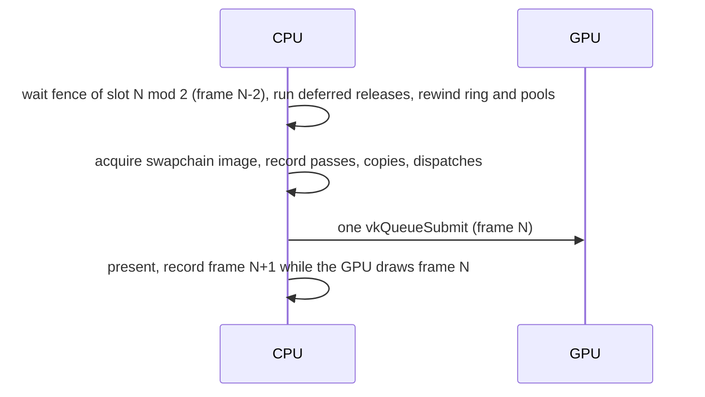

- **Batches share render passes**, not submissions: `beginBatch` opens a pass on the current framebuffer, `endBatch`
  leaves it open for the next batch on the same framebuffer; a framebuffer change, an upload, a compute dispatch, a
  read-back, a batch after the overlay subpass or the end of the frame closes it. The first pass of a frame on a
  framebuffer clears its depth (the swapchain image is cleared to the clear colour); later passes load every
  attachment, so successive layers keep what earlier ones drew on any GPU. `RenderCommand::clear` clears the first
  colour attachment and the depth inside the pass (`vkCmdClearAttachments`), except right after that clearing pass
  began with the same colour and nothing drawn (a second full-screen clear costs 40 µs per frame on Intel).
- **Off-screen colour images** stay in the attachment layout between passes and go to the sampled layout at
  `Framebuffer::unbind`; the transitions are barriers in the frame command buffer.
- **Uniform blocks and streamed storage buffers** (any SSBO the CPU wrote) are copied into a per-frame VMA ring at the
  first draw after each change; a buffer only the GPU writes (compute output) stays in one persistent mapped buffer.
- **Uploads** (vertex, index, texture data) are recorded in the frame with a staging region; outside a frame they go
  through a one-shot submission waited on its own fence. Resources are destroyed through `deferRelease`, once every
  frame recorded so far is complete.
- **Read-backs**: `readPixel` copies the pixel into a per-slot buffer and returns the value read two frames earlier
  (as OpenGL does); `StorageBuffer::getData` and `readColorAttachment` flush the frame so far and wait for it (counted
  as `fence_wait` by the frame bench; no sample scene does it per frame).

## Image tests {#render-image-tests}

`test/unit/render_tests` (`owl_render_tests_unit_test`, CTest label `render`) renders the reference scenes on lavapipe
(Vulkan) and llvmpipe (OpenGL) and compares each capture to a versioned PNG:

| Scene       | Covers                                                                         |
|-------------|--------------------------------------------------------------------------------|
| `sprites`   | Gradient background, plain, rotated, textured, tiled and tinted quads, circles |
| `text`      | World-space MSDF text (multi-line, rotated) and a screen-space UI label        |
| `tilemap`   | Instanced tilemap with several tilesets                                        |
| `raycast`   | GPU raycaster: walls, doors, billboard sprites, floor and ceiling              |
| `voxel`     | Procedural voxel terrain with water, seen by the voxel player                  |
| `mixed`     | Platformer level: tilemap, sprites, animated sprite, HUD text and panel        |
| `stylemix`  | Voxel terrain, perspective sprites, `Space: Screen` HUD, voxel crosshair       |
| `isometric` | Isometric map, depth-tested trees and houses, sorted translucent smoke, HUD    |
| `draworder` | Quads, circles and text at interleaved world z, a quad stored last but lowest  |
| `mesh`      | glTF cube with its texture, tinted, as a ground slab, and blended in front     |

The picking cases (`RenderPick`) run `mesh` and `voxel` with `--pick X,Y` and check the entity the runner logs under each pixel
(`FrameBench: Pick X,Y -> <tag>`, read from the entity-id attachment, one pixel per frame).

Each case runs `OwlRunner --frame-bench <scene> --capture <png>` (320 x 180, 60 warm-up frames, fixed time step,
Vulkan validation on) in its own process and compares RGB per pixel: a pixel differs above 24 / 255 on a channel, the
test fails above 0.25 % of differing pixels (a Mesa update passes, a missing sprite does not). A failure leaves the
capture, a red diff and the runner log in `<build>/render_tests/`. The scenes live in
`test/unit/test_helper/assets/render_tests/scenes/` and use the Engine Demo's assets.

```bash
./docker_run.sh ctest --test-dir output/build/linux-clang-release -L render --output-on-failure
# Regenerate the references (writes test/unit/test_helper/assets/render_tests/references/<backend>/<scene>.png):
./docker_run.sh env OWL_RENDER_TESTS_UPDATE=1 ctest --test-dir output/build/linux-clang-release -L render
```

CTest starts the binary under `xvfb-run` when installed; without a display or lavapipe (`OWL_RENDER_TESTS_VK_ICD`
overrides `/usr/share/vulkan/icd.d/lvp_icd.json`) the cases are skipped. The label takes about 8 s (25 s with a cold
shader cache); llvmpipe is capped at SSE4.1 (`GALLIUM_OVERRIDE_CPU_CAPS`), so the captures do not depend on AVX,
with a Mesa shader cache of its own in `<build>/render_tests/mesa_shader_cache` that only capped runs fill.

## Renderer2D: The Batch Renderer {#renderer2d}

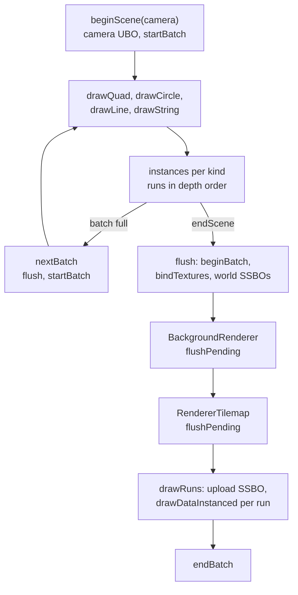

### Lifecycle

| Method               | Description                                       |
|----------------------|---------------------------------------------------|
| `init()`             | Create shaders, allocate draw data, white texture |
| `shutdown()`         | Release GPU resources                             |
| `beginScene(camera)` | Upload camera UBO, start first batch              |
| `endScene()`         | Flush the batch and end the frame                 |
| `flush()`            | Bind textures, draw all primitives, end batch     |
| `nextBatch()`        | Flush current batch and start a new one           |

### Draw Primitives

| Method         | Input Struct   | Description                                |
|----------------|----------------|--------------------------------------------|
| `drawQuad`     | `Quad2DData`   | Textured/coloured quad with UV and tiling  |
| `drawCircle`   | `CircleData`   | SDF circle with thickness and fade         |
| `drawLine`     | `LineData`     | Single line segment                        |
| `drawRect`     | `RectData`     | Wireframe rectangle (4 lines)              |
| `drawPolyLine` | `PolyLineData` | Connected line segments, optionally closed |
| `drawString`   | `StringData`   | MSDF text rendering with font atlas        |

### Quad2DData

| Field           | Type                        | Default                     | Description                    |
|-----------------|-----------------------------|-----------------------------|--------------------------------|
| `transform`     | `math::Transform`           | —                           | Quad transformation            |
| `color`         | `math::vec4`                | `{1, 1, 1, 1}`              | Colour tint                    |
| `texture`       | `shared<Texture>`           | `nullptr`                   | Texture (plain colour if null) |
| `tilingFactor`  | `float`                     | `1.0`                       | Texture repetition factor      |
| `textureCoords` | `std::array<math::vec2, 4>` | `{(0,0),(1,0),(1,1),(0,1)}` | Per-vertex UV coordinates      |
| `entityId`      | `int`                       | `-1`                        | Entity ID for mouse picking    |

The `textureCoords` field defaults to full-texture UVs. Custom UVs are used by the
`AnimatedSpriteRenderer` to display individual frames from a spritesheet.

### CircleData

| Field       | Type              | Default        | Description           |
|-------------|-------------------|----------------|-----------------------|
| `transform` | `math::Transform` | —              | Circle transformation |
| `color`     | `math::vec4`      | `{1, 1, 1, 1}` | Circle colour         |
| `thickness` | `float`           | `1.0`          | Ring thickness (0–1)  |
| `fade`      | `float`           | `0.005`        | Edge fade amount      |
| `entityId`  | `int`             | `-1`           | Entity ID for picking |

### LineData

| Field      | Type         | Default        | Description |
|------------|--------------|----------------|-------------|
| `point1`   | `math::vec3` | —              | Start point |
| `point2`   | `math::vec3` | —              | End point   |
| `color`    | `math::vec4` | `{1, 1, 1, 1}` | Line colour |
| `entityId` | `int`        | `-1`           | Entity ID   |

### StringData

| Field       | Type                      | Default        | Description                         |
|-------------|---------------------------|----------------|-------------------------------------|
| `transform` | `math::Transform`         | —              | Placement of the layout frame       |
| `text`      | `std::string`             | —              | Text content (UTF-8)                |
| `font`      | `shared<Font>`            | `nullptr`      | Font (or default)                   |
| `color`     | `math::vec4`              | `{1, 1, 1, 1}` | Text colour                         |
| `layout`    | `data::fonts::TextLayout` | see below      | Size, alignment, wrap, fit, spacing |
| `entityId`  | `int`                     | `-1`           | Entity ID                           |

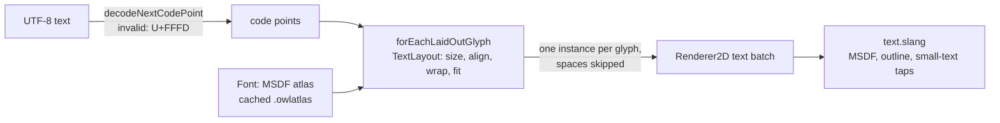

- **Encoding.** `text` is UTF-8, decoded while it is laid out (`core::utils::decodeNextCodePoint`, no conversion
  buffer); an invalid sequence becomes U+FFFD, drawn as `?` like any code point missing from the atlas.
  `Font::forEachGlyph` lays glyphs on raw baselines and `Font::measureText` gives their box.
- **Layout.** `drawString` lays the text out with `data::fonts::forEachLaidOutGlyph` (`data/fonts/TextLayout.h`) in a
  frame centred on the layout box, then applies `transform`. Glyphs keep the font aspect (one scale per em; the box
  only drives wrap, alignment and fit; a non-uniform `transform` scale still stretches). The font unit is the
  ascender-to-descender height (`Font::getAscender()` minus `Font::getDescender()` is 1). Nothing is allocated.

| `TextLayout` field | Default    | Meaning                                                                        |
|--------------------|------------|--------------------------------------------------------------------------------|
| `fontSize`         | `1`        | Ascender-to-descender height, in frame units                                   |
| `boxSize`          | `{0, 0}`   | Layout box centred on the origin; 0 on an axis leaves it unbounded             |
| `horizontal`       | `Center`   | `Left`, `Center`, `Right`: each line on the box edge (the origin without box)  |
| `vertical`         | `Middle`   | `Top`, `Middle`, `Bottom` on the box edge; `Baseline`: first baseline on 0     |
| `wrap`             | `false`    | Break on spaces within the box width; a longer word breaks between code points |
| `fit`              | `Overflow` | `Overflow` draws all, `Clip` cuts glyphs and UVs at the box, `Shrink` resizes  |
| `minFontSize`      | `0`        | Lower bound of `Shrink`                                                        |
| `kerning`          | `0`        | Extra advance between glyphs, in font units                                    |
| `lineSpacing`      | `0`        | Extra space between lines, in font units                                       |

`computeTextLayout` resolves the shrunk size, line count and placement, `measureTextLayout` the box of the lines,
`LineBreaker` the lines (byte ranges). A world-space `Text` takes its em height from the entity's Y scale; a `UiText`
lays out in its `UiRect`, in pixels.

**Charset and atlas.** Every font loads Basic Latin, Latin-1, Latin Extended-A, General Punctuation and `€`
(`FontSettings::defaultRanges()`: `œ`, `Œ`, `’`, `“ ”`, `…` included). More code-point ranges are import settings of
the font, in a `.owlfont` sidecar next to the `.ttf` / `.otf` (packed with it), edited in the font document of Owl
Nest:

```yaml
FontSettings: {}
FormatVersion: 1
extraRanges:
  - [1024, 1279]  # Cyrillic, U+0400 to U+04FF
```

The MSDF atlas is cached in `cache/font/<font>-<key>.owlatlas` under the user directory, keyed by the font file,
the charset and the atlas parameters (a change regenerates it and drops the stale file), and generated on the task
pool's workers (`Scheduler::getWorkerCount`).

**Outline and box.** `StringData::outlineWidth` (frame units) and `outlineColor` outline the glyphs in the same draw:
each glyph quad and its UVs grow by the width (`outlineUv`, 0 = none), and the fragment shader grows the glyph by its
signed distance (an antialiased band, completed by a ring dilation beyond the field's half range), clipped to the glyph
cell so atlas neighbours never bleed in; the fill is composited over it. `backgroundColor` (zero alpha: none) and
`backgroundPadding` add a quad behind the measured text block, at the text depth.

**Small text.** The atlas em is 40 px with a 6 px distance range (`g_pixelRange`, atlas cache version 2), matched by
`kPxRange` in `text.slang` (keep both in step). Under about 40 px on screen the atlas (no mipmaps) is minified, so the
fragment shader averages four rotated-grid taps over the pixel footprint (`SampleGrad`); larger text keeps one sample.
HUD scale modes keep text legible too ([HUD system](design/hud-system.md)).

### Batching Internals

Each primitive appends one instance struct (`QuadInstance`, `CircleInstance`, `LineInstance`, `TextInstance`) to a
CPU vector; `flush()` uploads it to a per-batch `StorageBuffer` and issues one instanced draw (a shared unit quad, or a
unit segment with `PipelineState::topology = Lines` for lines); the vertex shader places the unit shape from the
instance, with no CPU vertex math.

**Instance layouts (std430):**

| Struct           | Size  | Members                                                                                                                                       |
|------------------|-------|-----------------------------------------------------------------------------------------------------------------------------------------------|
| `QuadInstance`   | 128 B | `mat4 transform`, `vec4 color`, `vec2 uv[4]`, `uint texIndex`, `int entityId`, `vec2 tilingFactor`                                            |
| `CircleInstance` | 96 B  | `mat4 transform`, `vec4 color`, `float thickness`, `float fade`, `int entityId`, `uint _pad`                                                  |
| `LineInstance`   | 64 B  | `vec3 point1`, `vec3 point2`, `vec4 color`, `int entityId` (with explicit pads to align fields to 16 B)                                       |
| `TextInstance`   | 96 B  | `int worldIndex`, `vec4 color`, `vec2 uv[4]`, `uint texIndex`, `int entityId`, `vec2 outlineUv`, `vec4 outlineColor`; MSDF screenPxRange path |

The four per-corner UVs (not a `uvRect`) keep the UV trapezoids of the raycaster's floor, ceiling and stripes.

**Capacity limits:**

| Constant                  | Value         | Description                                  |
|---------------------------|---------------|----------------------------------------------|
| `g_maxQuadsPerBatch`      | 20,000        | `nextBatch()` rolls over when reached        |
| `g_maxCirclesPerBatch`    | 20,000        | Same trigger                                 |
| `g_maxLinesPerBatch`      | 20,000        | Same trigger                                 |
| `g_maxTextGlyphsPerBatch` | 20,000        | Counted per glyph, not per `drawString` call |
| `g_MaxTextureSlots`       | GPU-dependent | Queried via `getMaxTextureSlots()`           |

**Texture slots**: slot 0 is the 1×1 white texture, slots 1..N the unique textures; a full table triggers
`nextBatch()` (flush + restart).

**Flush order**, within one render pass:

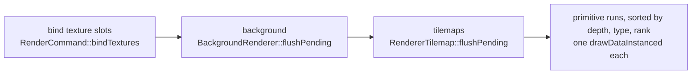

**Draw order** (`DrawRuns`). Every primitive carries a sort key, the `depth` field of its data struct (default 0;
larger is nearer the viewer, the convention of the isometric layer). The rule is *depth first, then type, then
submission order*: primitives draw by increasing depth; at one depth quads (and sprites) come first, then circles,
lines (rects, polylines), then text; within one type the submission order holds. A batch whose primitives
share one depth keeps one counter per type and draws one range per type. When a second depth appears, consecutive
primitives of one type and depth become *runs*, sorted at `flush()` by depth, type and submission rank (`std::sort` on a
vector reserved at `init`, no allocation); runs of one type that touch in their instance buffer merge into a single
draw. A batch holds at most 4 096 runs. The key is per batch: `nextBatch`, a scissor change and the tilemaps (drawn
first) are never reordered across.

Callers give the key as they need it: `Scene` uses the world z of sprites, animated sprites, circles and text (equal z
keeps the order sprites, animated sprites, circles, text); the HUD pass uses the rank of the window of a widget and, in a
window, the layer (shapes, circles, then text) so a window covers the ones under it and a label stays over its panel,
with no batch per window.

**Clipping.** `Renderer2D::setScissor` restricts the draws that follow to a rectangle of the target (`RenderCommand::setScissor`:
`glScissor` on OpenGL, the dynamic scissor of the open render pass on Vulkan); the queued draws are flushed first with
the previous rectangle, `clearScissor`, `beginScene` and `endScene` lift it, and the RHI puts the whole target back at
the end of each flush, so a draw inherits nothing. The HUD pass uses it for windows and `clipChildren` panels.

**Per-batch descriptor layout** declared in `Renderer2D::init`:

| Binding | Type                   | Stage    |
|---------|------------------------|----------|
| 0       | UBO (`Camera`)         | Vertex   |
| 1       | `Sampler2D[32]`        | Fragment |
| 2       | SSBO (`XxxInstance[]`) | Vertex   |

Four `StorageBuffer`s (quad, circle, line, text) take binding 2 in turn: `gpu::StorageBuffer::bind()` before each
instanced draw (`glBindBufferBase` on OpenGL, `internal::RendererDescriptors::bindStorageBuffer` into the draw's
descriptor set on Vulkan).

### Statistics

`Renderer2D::Statistics` tracks per-frame performance:

| Field                   | Description                                                            |
|-------------------------|------------------------------------------------------------------------|
| `drawCalls`             | Number of GPU drawcalls submitted (one per non-empty batch at `flush`) |
| `quadCount`             | Quads drawn (includes circles and per-glyph text instances)            |
| `lineCount`             | Line segments drawn                                                    |
| `getTotalVertexCount()` | `quadCount * 4 + lineCount * 2`                                        |
| `getTotalIndexCount()`  | `quadCount * 6 + lineCount * 2`                                        |

Reset with `Renderer2D::resetStats()` at the start of each frame.

## Background and Skybox Rendering

`BackgroundRenderer` is **deferred**: `drawBackground(data)` stores a pending draw, drawn in `Renderer2D::flush()` inside
the same render pass (needed by Vulkan's `DONT_CARE` load op).

### BackgroundData

| Field                 | Type                | Default              | Description                              |
|-----------------------|---------------------|----------------------|------------------------------------------|
| `mode`                | `int`               | `0`                  | 0=Solid, 1=Gradient, 2=Texture, 3=Skybox |
| `color`               | `math::vec4`        | `{0.2, 0.3, 0.8, 1}` | Main/bottom colour                       |
| `topColor`            | `math::vec4`        | `{0.8, 0.9, 1, 1}`   | Top colour (gradient mode)               |
| `inverseViewRotation` | `math::mat4`        | identity             | Inverse view-rotation (skybox)           |
| `texture`             | `shared<Texture2D>` | `nullptr`            | Background or equirectangular texture    |

## Texture System

### Texture2D

`Texture2D` represents a 2D image on the GPU. Factory methods dispatch to the active backend.

| Factory Method                             | Description                                                              |
|--------------------------------------------|--------------------------------------------------------------------------|
| `create(path)`                             | Load from image file (`.png`, `.jpg`), blocking                          |
| `create(spec)`                             | Create from `Specification` (size, format)                               |
| `createFromSerialized(string)`             | Deserialize from scene YAML string, blocking                             |
| `createFromSerializedAsync(string, sched)` | Same, but decodes on a worker; placeholder visible while state `Pending` |
| `createFromSerializedForDeserialize(str)`  | Wrapper used by scene components: async when an `Application` is alive   |

### Specification

| Field          | Type           | Default  | Description                                                       |
|----------------|----------------|----------|-------------------------------------------------------------------|
| `size`         | `math::vec2ui` | `{0, 0}` | Texture dimensions                                                |
| `format`       | `ImageFormat`  | `Rgba8`  | Pixel format                                                      |
| `generateMips` | `bool`         | `false`  | Generate the full mipmap chain on upload (`Linear` filter only)   |
| `filterMode`   | `FilterMode`   | `Linear` | `Linear` (bilinear, trilinear with mips), `Nearest` or `PixelArt` |
| `atlasCell`    | `math::vec2ui` | `{0, 0}` | Size of one atlas cell in texels, for a `PixelArt` texture        |

Both backends sample the same way: `Linear` magnifies and minifies linearly (Vulkan adds anisotropy), trilinearly when
the texture has mipmaps; `Nearest` snaps to texels and ignores mipmaps. Mipmaps are off by default, so an atlas never
bleeds between cells when minified; ask for them where a texture is drawn smaller than its size (Owl Nest's icon
atlas). `setFilterMode()` switches the sampler at run time (on Vulkan after a device wait: load time and editor actions
only); the mipmap levels stay those allocated at creation.

`PixelArt` is the mode of tile atlases: nearest magnification keeps the texels sharp up close, trilinear minification
over the mipmaps filters them far away. `Texture2D::setPixelArtCells(cell)` builds the mipmaps cell by cell
(`renderer::buildCellMips`, `renderer/AtlasMips.h`): each texel averages the 2x2 texels below it inside one cell, the
colours weighted by their alpha, and the chain stops at the level where a cell side becomes odd
(`cellMipLevelCount`), so no level mixes two tiles. A compressed texture keeps the levels of its cook that hold whole
cells. The voxel, tilemap (`tilemap_instanced`) and raycast (`raycast_stripe`) shaders sample an atlas cell through
`clampToAtlasCell` (`engine_assets/shaders/common/atlas.slangh`): the UV stays half a texel of the coarsest level it
reads inside the cell; a texture with one level is sampled unchanged. A tileset asks for the mode with
`filterMode: PixelArt` ([Tilemaps and Tilesets](editor_tilemaps.md)).

### ImageFormat

| Format    | Channels | Bits/pixel | Typical use            |
|-----------|----------|------------|------------------------|
| `R8`      | 1        | 8          | Masks, heightmaps      |
| `Rgb8`    | 3        | 24         | Non-transparent images |
| `Rgba8`   | 4        | 32         | Standard textures      |
| `Rgba32F` | 4        | 128        | HDR / floating-point   |
| `Bc7`     | 4        | 8          | Compressed, desktop    |
| `Astc4x4` | 4        | 8          | Compressed, ARM/mobile |

`Bc7` and `Astc4x4` hold 4x4 blocks of 16 bytes (`isCompressed(format)`). `RenderAPI::supportsFormat` (also
`RenderCommand::supportsFormat`) tells whether the device samples a format: Vulkan from the `textureCompressionBC`
and `textureCompressionASTC_LDR` device features, OpenGL from BPTC (core in 4.2) and
`KHR_texture_compression_astc_ldr`. `Texture2D::setLevels` uploads a chain of levels, finest first, in a supported
format. A KTX2 texture cooked by the [pipeline](design/content-pipeline.md#content-pipeline-cook) is transcoded at
load by `TextureDecoder` to `Bc7`, else `Astc4x4`, else `Rgba8`.

### Serialization Format

Textures serialize to a prefixed string via `getSerializeString()`:

| Prefix  | Example                   | Description                   |
|---------|---------------------------|-------------------------------|
| `emp:`  | `emp:`                    | Empty texture                 |
| `nam:`  | `nam:player_sprite`       | Named asset (asset directory) |
| `pat:`  | `pat:textures/ground.png` | Path-based                    |
| `spec:` | `spec:64x64_Rgba8_mips`   | Specification-based           |

`createFromSerialized()` reverses this process, resolving `nam:` assets through the
asset directories (or pack file if one is open).

### Async Texture Loading

For `nam:`/`pat:` references, `createFromSerializedAsync()` decodes the image on a worker, so a scene transition
pulling many textures does not hitch:

```mermaid
sequenceDiagram
    participant Caller as Scene component::deserialize
    participant Texture as Texture2D::createFromSerializedAsync
    participant Decoder as TextureDecoder (main thread)
    participant Worker as Scheduler worker
    participant GPU as GPU upload
    Caller->>Texture: createFromSerializedAsync(name, sched)
    Texture->>Decoder: resolve bytes + peek size
    Decoder-->>Texture: (width, height) from PNG/JPG header
    Texture->>GPU: allocate Rgba8 texture, setData(white)
    Texture->>Worker: Scheduler::pushTask(decode + terminate)
    Texture-->>Caller: shared<Texture2D>, state = Pending
    Note over Caller,GPU: Frame continues rendering; texture shows white
    Worker->>Worker: decodeImageBytes(bytes, Rgba8)
    Worker->>GPU: termination callback: setData(decoded pixels)
    Note over GPU: state → Ready (or Failed; placeholder stays visible)
```

- The placeholder has the real size (peeked from the PNG/JPG header), so bindings, UVs and atlas maths are right
  from frame 0; decoding is always `Rgba8` (`desired_channels = 4`), so the final `setData` size matches.
- Decodes run concurrently (`stbi_set_flip_vertically_on_load_thread()` keeps the flip state per thread).
- `emp:`/`siz:`, an unresolvable `nam:`, and callers without an `Application` (unit tests, `PackWriter`) use the
  blocking factory.
- `Texture2D::getLoadState()` tells `Pending` / `Ready` / `Failed`; the runner logs the textures still pending after
  each scene transition.

### Texture Library

`Renderer::getTextureLibrary()` is an `AssetLibrary<Texture2D>` caching loaded textures by name.

## Framebuffer

A `Framebuffer` represents an off-screen render target with one or more typed attachments.

### Attachment Formats

| Format       | Description                    | Typical Use         |
|--------------|--------------------------------|---------------------|
| `Rgba8`      | 8-bit RGBA colour              | Display colour      |
| `Rgba16F`    | 16-bit float RGBA colour       | Linear scene colour |
| `RedFloat`   | Single 32-bit float per pixel  | Shadow maps         |
| `RedInteger` | Single integer per pixel       | Entity ID picking   |
| `Depth32F`   | 32-bit float depth, no stencil | Depth testing       |
| `Surface`    | Swap chain surface (Vulkan)    | Final presentation  |

### FramebufferSpecification

| Field             | Type                              | Default  | Description              |
|-------------------|-----------------------------------|----------|--------------------------|
| `size`            | `math::vec2ui`                    | `{0, 0}` | Render target dimensions |
| `attachments`     | `vector<AttachmentSpecification>` | —        | List of attachments      |
| `samples`         | `uint32_t`                        | `1`      | MSAA sample count        |
| `swapChainTarget` | `bool`                            | `false`  | Vulkan swap chain target |
| `debugName`       | `string`                          | `"main"` | Debug identifier         |

### Key Methods

| Method                       | Description                                |
|------------------------------|--------------------------------------------|
| `bind()` / `unbind()`        | Activate/deactivate the framebuffer        |
| `resize(size)`               | Recreate attachments at new size           |
| `readPixel(index, x, y)`     | Read integer pixel (entity ID picking)     |
| `readColorAttachment(index)` | Read a whole RGBA attachment (captures)    |
| `clearAttachment(index, v)`  | Clear an attachment to a value             |
| `isUpsideDown()`             | Backend-specific Y-flip (Vulkan vs OpenGL) |

The editor viewport renders into `Rgba8` + `RedInteger` + `Depth32F` for entity picking. `readPixel` never
stalls (a fenced pixel pack buffer on OpenGL, a per-frame read-back slot on Vulkan) and returns the value of a frame
or two ago, so the viewport checks that the entity still exists.

## Shader System

Shaders are written in **Slang** and compiled to SPIR-V at runtime (translated to GLSL on OpenGL drivers without
SPIR-V support, see [OpenGL shader path](#renderer-opengl-shaders)).
See [Architecture > Shader Pipeline](architecture.md) for the
compilation, reflection, and caching pipeline.

### Shader API

| Method                          | Description                    |
|---------------------------------|--------------------------------|
| `bind()` / `unbind()`           | Activate/deactivate the shader |
| `setInt(name, val)`             | Set integer uniform            |
| `setFloat(name, val)`           | Set float uniform              |
| `setFloat2/3/4(name, v)`        | Set vector uniform             |
| `setMat4(name, mat)`            | Set 4×4 matrix uniform         |
| `setIntArray(name, arr, count)` | Set integer array uniform      |

### Shader includes {#renderer-shader-includes}

A graphics shader source may `#include "x.slangh"`: the file is looked up next to the including shader, then in
`shaders/common/`. `.slangh` files are headers, never baked or compiled on their own. The SPIR-V cache key hashes the
expanded text (`renderer::utils::readShaderSource`), so editing an included file recompiles every shader using it.
`common/pbr.slangh` is shared by the mesh and voxel shaders.

### Shader Library

`Renderer::getShaderLibrary()` caches compiled shaders by name. Shader names follow
the format `"renderer/name"` (e.g., `"renderer2D/quad"`), composed and decomposed via
`Shader::composeName()` and `Shader::decomposeName()`.

## DrawData and Buffer Layout

`DrawData` binds vertex data, index data, and a shader into a single drawable unit.

### ShaderDataType

| Type     | Size (bytes) | Components |
|----------|--------------|------------|
| `Float`  | 4            | 1          |
| `Float2` | 8            | 2          |
| `Float3` | 12           | 3          |
| `Float4` | 16           | 4          |
| `Mat3`   | 36           | 9          |
| `Mat4`   | 64           | 16         |
| `Int`    | 4            | 1          |
| `Int2`   | 8            | 2          |
| `Int3`   | 12           | 3          |
| `Int4`   | 16           | 4          |
| `Bool`   | 1            | 1          |

A `BufferLayout` is an initializer list of `BufferElement{name, type}` entries; offsets and stride are computed.

## Camera System {#camera-system}

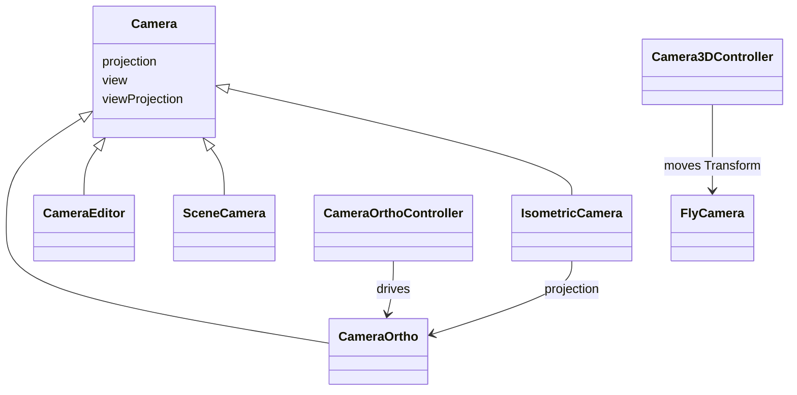

### Camera (base class)

Stores `projection`, `view` and `viewProjection`; the view is the inverse of `setTransform(mat4)`.

#### Depth convention and clip space {#camera-depth}

Depth is **reversed-Z** on both backends: in [0, 1], 1 at the near plane (`g_nearDepth`) and 0 at the far plane
(`g_farDepth`), compared GREATER, cleared to 0, in a `Depth32F` float buffer. OpenGL gets the same range through
`glClipControl(GL_LOWER_LEFT, GL_ZERO_TO_ONE)`. `math::perspectiveReversedZ` (an infinite far gives the infinite far
plane) and `math::orthoReversedZ` build the projections; `math::perspective` and `math::ortho` stay the generic
GL-style maths. `renderer/ClipSpace.h` is the one place a camera goes through:

| Helper                 | Role                                                                                |
|------------------------|-------------------------------------------------------------------------------------|
| `ClipSpace`            | `OpenGl` or `Vulkan`, differing only in NDC Y (`CameraOrtho::ClipSpace` aliases it) |
| `getActiveClipSpace()` | The clip space of the active backend                                                |
| `toClipSpace()`        | Converts a reversed-Z projection to a given clip space                              |
| `toActiveClipSpace()`  | Same for the active backend (Vulkan negates the Y row)                              |
| `cameraRelativeView()` | The view without its translation, for camera-relative rendering                     |

The scene, editor, orthographic and isometric cameras, the shadow cascades and the mesh preview all build their
projection this way. `math::Frustum` and `FrustumCullingPass::extractFrustumPlanes` use the reversed-Z planes (near
`z <= w`, far `z >= 0`); `Frustum::classify` keeps a box lying on a plane, such as a sprite on an orthographic near plane.

### CameraOrtho

Orthographic camera with explicit bounds and a position / rotation, driven by `CameraOrthoController` (WASD, wheel
zoom, optional Q/E rotation).

### CameraEditor

Orbit camera used in the editor viewport. Controls:

| Property     | Type         | Default     | Description        |
|--------------|--------------|-------------|--------------------|
| `focalPoint` | `math::vec3` | `{0, 0, 0}` | Orbit centre       |
| `distance`   | `float`      | `10.0`      | Distance to focal  |
| `pitch`      | `float`      | `0.0`       | Vertical angle     |
| `yaw`        | `float`      | `0.0`       | Horizontal angle   |
| `fov`        | `float`      | `45.0`      | Field of view      |
| `nearClip`   | `float`      | `0.1`       | Near clip distance |
| `farClip`    | `float`      | `1000.0`    | Far clip distance  |

Supports mouse pan (middle button), rotate (alt + left button), and zoom (scroll wheel).

### SceneCamera

Attached to entities via the `Camera` component. Supports switchable projection:

**Orthographic mode:**

| Property           | Default | Description         |
|--------------------|---------|---------------------|
| `orthographicSize` | `10.0`  | Visible half-height |
| `nearClip`         | `-1.0`  | Near clip           |
| `farClip`          | `1.0`   | Far clip            |

**Perspective mode:**

| Property      | Default  | Description            |
|---------------|----------|------------------------|
| `verticalFov` | `45°`    | Vertical field of view |
| `nearClip`    | `0.01`   | Near clip              |
| `farClip`     | `1000.0` | Far clip               |

`setViewportSize(size)` recomputes the projection for the aspect ratio; only the `Camera::primary` entity renders.

## Animated Sprite Rendering {#animated-sprites}

The `AnimatedSpriteRenderer` component draws one frame of a spritesheet, advancing over time.

### Spritesheet Layout

A grid of `columns × rows` cells, frames numbered in **row-major order** from the top left (frame 0).

### Properties

| Field            | Type          | Default | Serialized               | Description                              |
|------------------|---------------|---------|--------------------------|------------------------------------------|
| `color`          | `vec4`        | white   | Yes                      | Tint colour                              |
| `texture`        | `Texture2D`   | null    | Yes                      | Spritesheet texture                      |
| `columns`        | `uint32_t`    | `1`     | Yes                      | Grid columns                             |
| `rows`           | `uint32_t`    | `1`     | Yes                      | Grid rows                                |
| `firstFrame`     | `uint32_t`    | `0`     | Yes                      | Animation start frame (inclusive)        |
| `lastFrame`      | `uint32_t`    | `0`     | Yes                      | Animation end frame (inclusive)          |
| `frameDuration`  | `float`       | `0.1`   | Yes                      | Seconds per frame                        |
| `loop`           | `bool`        | `true`  | Yes                      | Whether to loop                          |
| `speedCurve`     | `math::Curve` | empty   | Yes (omitted when empty) | Speed multiplier vs. normalized progress |
| `m_currentFrame` | `uint32_t`    | `0`     | No                       | Currently displayed frame                |
| `m_elapsedTime`  | `float`       | `0.0`   | No                       | Time accumulator                         |
| `m_playing`      | `bool`        | `true`  | No                       | Playing state                            |

### UV Computation

At render time, the current frame index is converted to UV coordinates:

```
col = frame % columns
row = frame / columns
uMin = col / columns          uMax = (col + 1) / columns
vMin = 1 - (row + 1) / rows   vMax = 1 - row / rows
```

The UV rect goes to `Renderer2D::drawQuad()` as `textureCoords`, independent of the pixel size.

### Runtime Behaviour

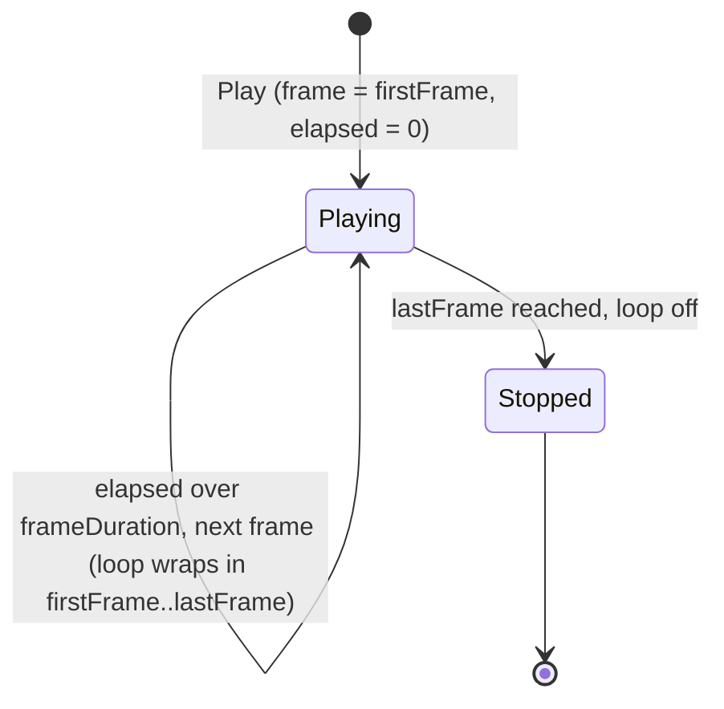

In Edit mode the animation does not advance, like physics and scripts.

## Uniform Buffer

`UniformBuffer::create(size, binding, renderer)` allocates a GPU constant buffer at a binding point and
`setData(ptr, size, offset)` streams it; `Renderer2D` keeps the camera view projection at binding 0 (see
[Batching Internals](#renderer2d)).

## Code Example

Drawing primitives manually (outside the ECS):

```c++
renderer::Renderer2D::resetStats();
renderer::Renderer2D::beginScene(camera);

// Colored quad
renderer::Renderer2D::drawQuad({
    .transform = myTransform,
    .color = {1.0f, 0.0f, 0.0f, 1.0f}
});

// Textured quad with custom UVs (top-left quarter of texture)
renderer::Renderer2D::drawQuad({
    .transform = spriteTransform,
    .texture = myTexture,
    .textureCoords = {
        math::vec2{0.0f, 0.5f}, math::vec2{0.5f, 0.5f},
        math::vec2{0.5f, 1.0f}, math::vec2{0.0f, 1.0f}
    }
});

// Circle with thin outline
renderer::Renderer2D::drawCircle({
    .transform = circleTransform,
    .color = {0.0f, 1.0f, 0.0f, 1.0f},
    .thickness = 0.1f
});

renderer::Renderer2D::endScene();
```
